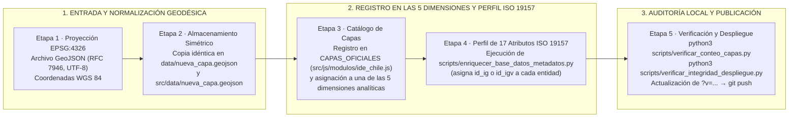
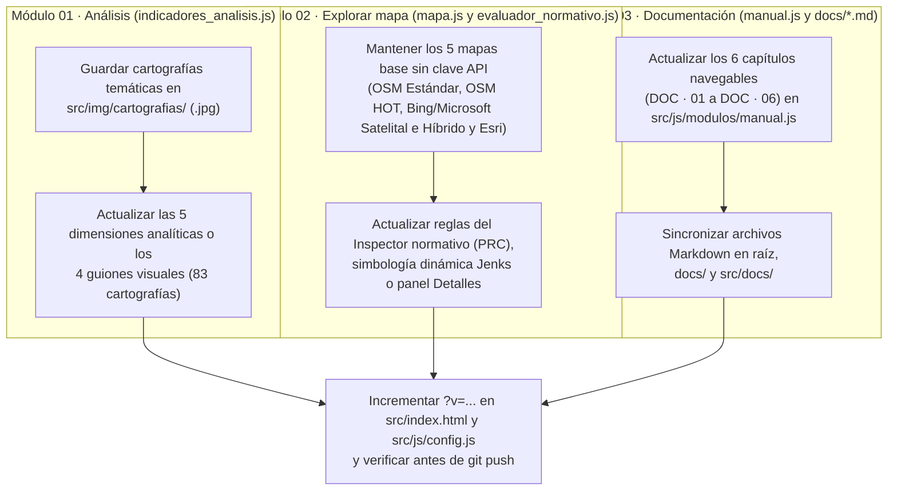

# Guía de contribución y mantención técnica — Atlas para la Gestión Territorial
## Análisis y Exploración | Municipio de Santiago y Barrio Brasil

* **Plataforma Web en Producción:** [https://atlasvgiuah.netlify.app](https://atlasvgiuah.netlify.app)
* **Documentación de Referencia:** [`MANUAL_ACTUALIZACION_ATLAS.md`](MANUAL_ACTUALIZACION_ATLAS.md) · [`docs/ARQUITECTURA.md`](docs/ARQUITECTURA.md) · [`PROTOCOL_INTEGRIDAD_Y_DESPLIEGUE.md`](PROTOCOL_INTEGRIDAD_Y_DESPLIEGUE.md).

---

## 1. Alcance de las contribuciones técnicas

Esta guía establece los procedimientos estandarizados para incorporar nuevas coberturas geográficas —tanto oficiales del Estado de Chile (`id_ig`) como descentralizadas de Información Geográfica Voluntaria (`id_igv`)—, actualizar los 4 guiones visuales y las 83 cartografías del **Módulo 01 (`Análisis`)**, añadir reglas o hitos normativos al **Inspector normativo (PRC)** del **Módulo 02 (`Explorar mapa`)** y mantener los 6 capítulos navegables del **Módulo 03 (`Documentación`)**.

---

## 2. Flujo de trabajo para integrar una nueva cobertura geográfica



### Detalle paso a paso de las 5 etapas:

1. **Etapa 1 — Normalización geodésica a `EPSG:4326`:**
   Verifique que el archivo `.geojson` utilice coordenadas geográficas `EPSG:4326` (longitud `[-71,8°, -69,5°]`, latitud `[-34,5°, -32,8°]`) y codificación `UTF-8`.
2. **Etapa 2 — Copia simétrica en `data/` y `src/data/`:**
   Guarde el archivo simultáneamente en `data/<id_capa>.geojson` y `src/data/<id_capa>.geojson`.
3. **Etapa 3 — Registro en `src/js/modulos/ide_chile.js` y `src/js/modulos/indicadores_analisis.js`:**
   Agregue la definición de la cobertura dentro del catálogo en `src/js/modulos/ide_chile.js` (o en `src/js/modulos/catalogo_vgi_descentralizado.js` si corresponde a una capa colaborativa de IGV) y asóciela a una de las **5 dimensiones analíticas** (*1. Dimensión Sociodemográfica y Habitacional*, *2. Dimensión Socioeconómica y Comercial*, *3. Dimensión Socioambiental y Espacio Público*, *4. Dimensión Sociosanitaria y Salud* o *5. Dimensión Sociourbana, Movilidad y Normativa*):
   ```javascript
   nueva_capa: {
     id: 'nueva_capa',
     nombre: 'Nombre descriptivo de la cobertura',
     institucion: 'Institución pública o comunidad IGV custodia',
     archivoLocal: 'data/nueva_capa.geojson',
     color: '#10b981',
     peso: 2,
     opacidadRelleno: 0.35,
     geometria: 'Polígono', // 'Punto' | 'Línea' | 'Polígono'
     licencia: 'Datos Abiertos (Ley N.° 20.285) / ODbL 1.0',
     descripcion: 'Síntesis técnica de la cobertura y su utilidad territorial.'
   }
   ```
4. **Etapa 4 — Inyección del perfil de 17 atributos ISO 19157 (`id_ig` / `id_igv`):**
   Ejecute `python3 scripts/enriquecer_base_datos_metadatos.py` para incorporar las 17 columnas homologadas de metadatos y calidad espacial que se consultan en el panel inferior de **Detalles** del Módulo 02.
5. **Etapa 5 — Verificación local y empaquetado:**
   Ejecute `python3 scripts/verificar_conteo_capas.py` y `python3 scripts/verificar_integridad_despliegue.py`. Si modifica los libros Excel o el paquete comprimido de datos, ejecute además `python3 scripts/generar_catalogos_excel.py` y `python3 scripts/empaquetar_base_datos_completa.py`.

---

## 3. Flujo de trabajo para actualizar los 3 módulos de la plataforma



---

## 4. Convenciones de organización y estilo documental

1. **JavaScript Modular:**
   * Mantener cada componente funcional separado en su archivo correspondiente dentro de `src/js/modulos/`.
   * Manejar posibles errores de red en peticiones de carga de capas leyendo desde `src/data/`.
2. **Coherencia terminológica en español:**
   * Utilizar el título oficial único **Atlas para la Gestión Territorial** y el subtítulo **Análisis y Exploración | Municipio de Santiago y Barrio Brasil**.
   * Emplear la sigla en español **IGV** (Información Geográfica Voluntaria) para referirse a las 171 coberturas colaborativas descentralizadas (`id_igv`) e **IG** para las 123 coberturas oficiales del Estado (`id_ig`).
3. **Flujo de commits semánticos:**
   * Utilizar prefijos claros: `feat(modulo): ...`, `fix(visor): ...`, `docs(manual): ...`, `data(capas): ...`.
