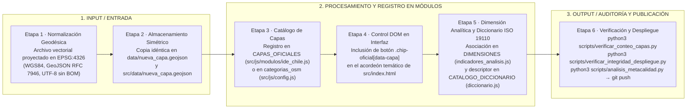
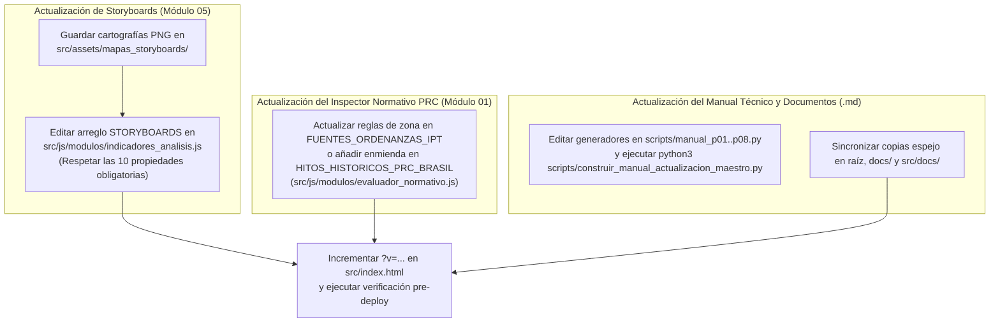

# Guía de Contribución y Mantención Técnica — Atlas de Información Geográfica Voluntaria (VGI)

* **Plataforma Web en Producción:** [https://atlasvgiuah.netlify.app](https://atlasvgiuah.netlify.app)
* **Documentación de Referencia:** [`MANUAL_ACTUALIZACION_ATLAS.md`](MANUAL_ACTUALIZACION_ATLAS.md) · [`docs/ARQUITECTURA.md`](docs/ARQUITECTURA.md) · [`PROTOCOL_INTEGRIDAD_Y_DESPLIEGUE.md`](PROTOCOL_INTEGRIDAD_Y_DESPLIEGUE.md).

---

## 1. Alcance de las Contribuciones Técnicas

Esta guía establece los procedimientos estandarizados para incorporar nuevas coberturas geográficas (oficiales o colaborativas VGI), actualizar storyboards territoriales, añadir hitos normativos al Inspector del Plan Regulador Comunal, documentar descriptores ISO 19110 y mantener el código fuente de la plataforma web.

---

## 2. Pipeline de Integración de una Nueva Cobertura Geográfica (6 Etapas)



### Detalle Paso a Paso de las 6 Etapas:

1. **Etapa 1 — Normalización Geodésica a `EPSG:4326`:**
   Verifique que el archivo `.geojson` utilice coordenadas geográficas `EPSG:4326` (longitud `[-71,8°, -69,5°]`, latitud `[-34,5°, -32,8°]`) y codificación `UTF-8`.
2. **Etapa 2 — Copia Simétrica en `data/` y `src/data/`:**
   Guarde el archivo simultáneamente en `data/<id_capa>.geojson` y `src/data/<id_capa>.geojson`.
3. **Etapa 3 — Registro en `src/js/modulos/ide_chile.js`:**
   Agregue la definición de la cobertura dentro del diccionario `CAPAS_OFICIALES`:
   ```javascript
   bbdd_nueva: {
     id: 'bbdd_nueva',
     nombre: 'Nombre Descriptivo de la Cobertura',
     institucion: 'Institución Pública Custodia',
     archivoLocal: 'data/bbdd_nueva.geojson',
     color: '#10b981',
     peso: 2,
     opacidadRelleno: 0.35,
     geometria: 'Polígono', // 'Punto' | 'Línea' | 'Polígono'
     licencia: 'Datos Abiertos / Ley N° 20.285',
     descripcion: 'Síntesis técnica de la cobertura y su utilidad territorial.'
   }
   ```
4. **Etapa 4 — Control Interactivo en `src/index.html`:**
   Añada el botón correspondiente dentro del acordeón institucional del subpanel `🏛 Capas IDE`:
   ```html
   <button type="button" class="chip-oficial" id="btn-oficial-bbdd_nueva" data-capa="bbdd_nueva" title="Institución Pública Custodia">
     <span class="dot-color" style="background:#10b981;"></span>
     <span class="nombre-chip">Nombre Descriptivo de la Cobertura</span>
     <span class="badge-institucion-chip">INSTITUCIÓN</span>
     <span class="badge-geom-chip">⬠ POL</span>
   </button>
   ```
5. **Etapa 5 — Vinculación en `indicadores_analisis.js` y `diccionario.js`:**
   * En `src/js/modulos/indicadores_analisis.js`, agregue `'bbdd_nueva'` al arreglo `capasIds` de la dimensión correspondiente en `DIMENSIONES` y su título en `NOMBRES_OFICIALES_FALLBACK`.
   * En `src/js/modulos/diccionario.js`, registre los atributos de la capa en `CATALOGO_DICCIONARIO` conforme a la norma ISO 19110:2016.
6. **Etapa 6 — Ejecución de la Suite de Verificación y Empaquetado:**
   Ejecute `python3 scripts/verificar_conteo_capas.py`, `python3 scripts/verificar_integridad_despliegue.py` y `python3 scripts/analisis_metacalidad.py`. Si modifica los libros Excel o la geodatabase descargable, ejecute además `python3 scripts/generar_catalogos_excel.py` y `python3 scripts/empaquetar_base_datos_completa.py`.

---

## 3. Pipeline de Contribución a Storyboards, Inspector Normativo y Documentación



---

## 4. Convenciones de Código y Estilo Documental

1. **JavaScript ES6+ Modular (IIFE):**
   * Mantener el encapsulamiento mediante funciones inmediatamente invocadas (`const ModuloX = (() => { ... return { ... }; })();`) y exponer únicamente los métodos públicos necesarios en `window.ModuloX`.
   * Manejar siempre posibles errores de red en peticiones `fetch()` implementando bloques `try / catch` con conmutación hacia los respaldos locales en `src/data/`.
2. **Estándares de Redacción Técnica en Documentación y UI:**
   * Redactar en tercera persona objetiva y descriptiva.
   * Expresar las formulaciones matemáticas en bloques de texto estructurado con notación Unicode/ASCII clara (evitando comandos o delimitadores matemáticos no soportados por visores Markdown estándar).
   * Asegurar que toda referencia a archivos de salida o entregables indique su ruta exacta en el repositorio (`data/...`, `src/data/...`, `docs/...`, `src/docs/...`).
3. **Flujo de Commits Semánticos:**
   * Utilizar prefijos convencionales: `feat(modulo): ...`, `fix(visor): ...`, `docs(manual): ...`, `data(capas): ...`, `chore(ci): ...`.
