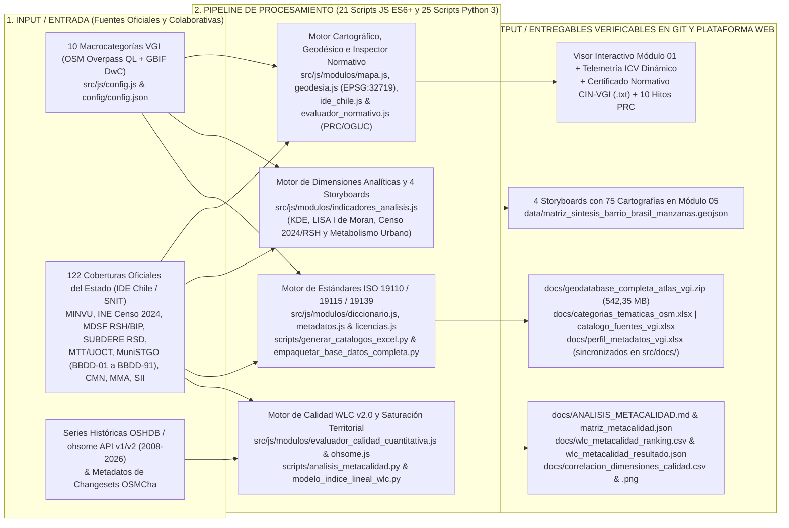
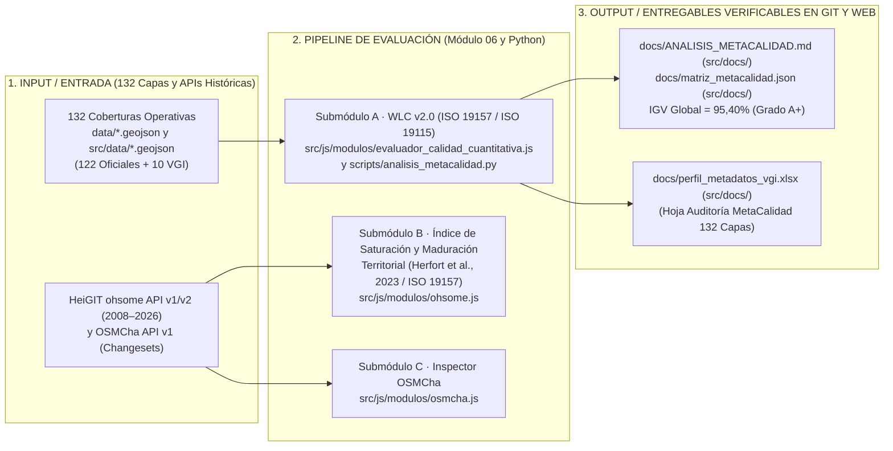

# Atlas de Información Geográfica Voluntaria para la Gestión Territorial
## Informe Técnico y Metodológico del Sistema — Octubre 2026

* **Plataforma Web en Producción (CDN Primario):** [https://atlasvgiuah.netlify.app/](https://atlasvgiuah.netlify.app/)
* **Repositorio Espejo (GitHub Pages):** [https://geojota.github.io/atlas-vgi-barrio-brasil/](https://geojota.github.io/atlas-vgi-barrio-brasil/)
* **Alcance Estructural:** **132 Capas Operativas** (`122` Oficiales del Estado + `10` Macrocategorías VGI `CAT-01` a `CAT-10`) · **140 Descriptores ISO 19110:2016** · **5 Dimensiones Analíticas** · **4 Storyboards Territoriales (75 Cartografías Temáticas)** · **10 Módulos Funcionales (`01` al `10`)**.

---

## 🧭 Índice de Contenidos

1. [Ficha General del Proyecto y Marco Conceptual VGI](#1-ficha-general-del-proyecto-y-marco-conceptual-vgi)
2. [Encuadre Territorial y Sistema Geodésico de Doble Proyección](#2-encuadre-territorial-y-sistema-geodésico-de-doble-proyección)
3. [Pipelines de Arquitectura, Procesamiento y Resiliencia Híbrida](#3-pipelines-de-arquitectura-procesamiento-y-resiliencia-híbrida)
4. [Estructura Funcional de los 10 Módulos de la Plataforma Web (`01` al `10`)](#4-estructura-funcional-de-los-10-módulos-de-la-plataforma-web-01-al-10)
5. [Composición de la Geodatabase Cartográfica (`132 Capas Operativas`)](#5-composición-de-la-geodatabase-cartográfica-132-capas-operativas)
6. [Dimensiones Analíticas y los 4 Storyboards Territoriales (`75 Cartografías`)](#6-dimensiones-analíticas-y-los-4-storyboards-territoriales-75-cartografías)
7. [Evaluación Multicriterio de Calidad Espacial (`ISO 19157 / WLC v2.0 / ohsome API`)](#7-evaluación-multicriterio-de-calidad-espacial-iso-19157--wlc-v20--ohsome-api)
8. [Inspector Normativo PRC/OGUC (`CIN-VGI`) y Evolución Regulatoria (`1990–2024`)](#8-inspector-normativo-prcoguc-cin-vgi-y-evolución-regulatoria-19902024)
9. [Diccionario Territorial ISO 19110 (`140 Descriptores`) y Brechas VGI](#9-diccionario-territorial-iso-19110-140-descriptores-y-brechas-vgi)
10. [Perfiles de Actor Territorial, Gobernanza Abierta y Verificación Automatizada](#10-perfiles-de-actor-territorial-gobernanza-abierta-y-verificación-automatizada)

---

## 1. Ficha General del Proyecto y Marco Conceptual VGI

| Dimensión | Especificación Técnica y Operativa |
| :--- | :--- |
| **Nombre del Sistema** | Atlas de Información Geográfica Voluntaria para la Gestión Territorial — Nodo GeoAbierto |
| **Ámbito Territorial de Estudio** | Barrio Brasil (`223,75 ha`), Entorno Campus Universidad Alberto Hurtado (`136,10 ha`), Comuna de Santiago y Región Metropolitana de Santiago (`CUT 13`) |
| **Plataforma Web en Producción** | [https://atlasvgiuah.netlify.app/](https://atlasvgiuah.netlify.app/) |
| **Base de Datos Espacial** | PostgreSQL 15+ / PostGIS 3.4+ en Supabase Cloud + Repositorio Simétrico `data/*.geojson` ↔ `src/data/*.geojson` |
| **Paquete Consolidado Descargable** | `docs/geodatabase_completa_atlas_vgi.zip` (`542,35 MB` comprimidos / `~3,33 GB` descomprimidos; `257` archivos en `7` subcarpetas) |
| **Régimen de Licenciamiento** | Datos VGI: `ODbL 1.0` (OSM) y `CC BY 4.0` (GBIF) · Datos Oficiales: `Ley N° 20.285` · Cartografía Derivada: `CC BY-SA 4.0` · Software: `GNU AGPLv3` |

### Fundamentación en la Literatura de Ciencia de la Información Geográfica
La producción cartográfica institucional se ha estructurado históricamente en torno a organismos estatales centralizados (ministerios sectoriales, institutos nacionales de estadísticas y direcciones de obras municipales). Aunque dichos registros poseen carácter normativo oficial, presentan ciclos de actualización multianuales y una escala de captura que frecuentemente omite los microelementos del espacio público cotidiano.

A partir de la conceptualización de la **Información Geográfica Voluntaria (*Volunteered Geographic Information*, VGI)** formulada por Goodchild (2007) y los estudios comparativos de calidad espacial desarrollados por Haklay (2010), Senaratne et al. (2017) y Herfort et al. (2023), el **Atlas VGI** articula de manera complementaria las **122 coberturas oficiales del Estado de Chile** con **10 macrocategorías colaborativas VGI (`CAT-01` a `CAT-10`)**. El sistema no sustituye la cartografía pública, sino que densifica los vacíos de escala micro-urbana (rebajes de cordón, baldosas podotáctiles, mobiliario peatonal, ciclovías locales, comercio de proximidad y biodiversidad barrial) bajo estándares verificables de calidad (**ISO 19157:2013**), metadatos (**ISO 19115:2014 / ISO 19139:2007**) y catalogación de objetos (**ISO 19110:2016**).

---

## 2. Encuadre Territorial y Sistema Geodésico de Doble Proyección

| Sector Territorial | Bounding Box WGS84 `[Lon_min, Lat_min, Lon_max, Lat_max]` | Superficie (`EPSG:32719`) | Zoom Base |
| :--- | :--- | :---: | :---: |
| **Barrio Brasil Completo** | `[-70.6720, -33.4505, -70.6580, -33.4350]` | `223,75 ha` (`2,24 km²`) | `15` |
| **Cuadrante Manzana Campus UAH** | `[-70.6675, -33.4505, -70.6565, -33.4385]` | `136,10 ha` (`1,36 km²`) | `16` |
| **Región Metropolitana de Santiago** | `[-71.5000, -34.2000, -70.0000, -33.0000]` | Escala Metropolitana (`52 comunas`) | `10` |

* **CRS de Almacenamiento e Intercambio Web (`EPSG:4326`):** Todas las capas `.geojson` en `data/` y `src/data/` se almacenan en coordenadas geográficas WGS84 conforme al estándar IETF RFC 7946.
* **CRS de Cálculo Métrico y Superficies (`EPSG:32719`):** El módulo [`src/js/modulos/geodesia.js`](src/js/modulos/geodesia.js) reproyecta al vuelo los vértices a **WGS 84 / UTM Huso 19 Sur (`EPSG:32719` / SIRGAS-Chile)** mediante la serie de Redfearn y calcula áreas exactas en `m²`, `ha` y `km²` mediante la fórmula poligonal de Gauss/Shoelace.

---

## 3. Pipelines de Arquitectura, Procesamiento y Resiliencia Híbrida

### 3.1. Pipeline Maestro de Integración de Fuentes, Motores y Entregables



### 3.2. Pipeline de Resiliencia de Triple Contingencia (`PostGIS RPC` → `CDN Estático` → `Caché RAM`)

1. **Nivel 1 (RPC PostGIS en Supabase):** El cliente [`src/js/modulos/db_client.js`](src/js/modulos/db_client.js) consulta las funciones espaciales definidas en [`scripts/db/01_schema_postgis.sql`](scripts/db/01_schema_postgis.sql) (`obtener_entidades_en_bbox`) sobre índices espaciales `GiST`.
2. **Nivel 2 (Repositorio Simétrico en CDN):** Si la instancia remota no se encuentra activa, el sistema carga directamente los archivos preprocesados desde `src/data/*.geojson` (sincronizados 1:1 con `data/*.geojson`).
3. **Nivel 3 (Caché en Memoria del Navegador):** Una vez descargada una cobertura durante la sesión, queda indexada en memoria RAM para conmutación instantánea sin tráfico de red adicional.

---

## 4. Estructura Funcional de los 10 Módulos de la Plataforma Web (`01` al `10`)

| N° Módulo | Nombre en la Interfaz (`src/index.html`) | ID Panel DOM | Módulos JS Asociados (`src/js/`) | Función Técnica y Entregables |
| :---: | :--- | :--- | :--- | :--- |
| **`01`** | **Visor para la gestión territorial** | `#panel-inicio` | `app.js`, `modulos/mapa.js`, `modulos/ide_chile.js`, `modulos/evaluador_normativo.js`, `modulos/geodesia.js` | Lienzo cartográfico 2D (Leaflet 1.9.4), activación de las **132 capas**, dibujo de BBox con superficie en `EPSG:32719`, **ICV Dinámico** e **Inspector Normativo CIN-VGI** (con los 10 hitos históricos del PRC 1990–2024). |
| **`02`** | **Consultas Overpass (OSM)** | `#panel-explorador-osm` | `modulos/osm.js`, `modulos/taginfo.js` | Consultas en vivo mediante Overpass QL (con failover en 3 espejos), reconstrucción topológica de nodos/vías, normalización a 14 atributos y validación semántica en Taginfo API v4. |
| **`03`** | **Biodiversidad GBIF** | `#panel-biodiversidad-gbif` | `modulos/gbif.js` | Búsqueda de ocurrencias biológicas georreferenciadas en GBIF API v1 bajo el estándar **Darwin Core (DwC)** (`data/capa_biodiversidad.geojson`). |
| **`04`** | **Cartografía uMap** | `#panel-proyectos-umap` | `modulos/umap.js`, `modulos/importador_capas.js` | Integración de mapas comunitarios uMap e importador local *Drag & Drop* para archivos `.geojson`, `.kml`, `.kmz`, `.gpx` y `.csv`. |
| **`05`** | **Indicadores & Storyboards** | `#panel-indicadores` | `modulos/indicadores_analisis.js` | Articulación de las **132 capas** en **5 Dimensiones Analíticas** y **4 Storyboards Territoriales** con **75 cartografías temáticas**, gráficos comparativos, diagramas SVG y visor Lightbox. |
| **`06`** | **Calidad & ICV** | `#panel-calidad-ohsome` | `modulos/evaluador_calidad_cuantitativa.js`, `modulos/ohsome.js`, `modulos/calidad_analyst.js` | **Submódulo A:** Evaluador Universal WLC v2.0 (ISO 19157/19115). **Submódulo B:** Series históricas ohsome API v1/v2 con **Índice de Saturación y Maduración Territorial (Herfort et al., 2023 / ISO 19157)**. **Submódulo C:** Auditoría OSMCha. |
| **`07`** | **Manual de Uso** | `#panel-manual` | `modulos/manual.js` | Documentación interactiva en dos partes: **Parte I (Manual de Uso)** con tabla filtrable de las 132 capas y **Parte II (Manual de Actualización Técnica)** con catálogo multi-lenguaje y pipelines. |
| **`08`** | **Metadatos ISO 19115** | `#panel-metadatos-iso` | `modulos/metadatos.js` | Generador de fichas de metadatos con autocompletado para las 132 capas y exportación en **JSON (ISO 19115)** y **XML (ISO 19139 / Perfil Nacional IDE Chile)**. |
| **`09`** | **Diccionario (132 Capas)** | `#panel-diccionario` | `modulos/diccionario.js` | Catálogo de Objetos Geográficos (**ISO 19110:2016**) con **140 descriptores normativos** (`54` con homólogo oficial en IDE Chile y `86` brechas temáticas VGI). |
| **`10`** | **Licencias & Catálogos (.xlsx)** | `#panel-licencias` | `modulos/licencias.js` | Marco jurídico de datos abiertos y descarga directa de `docs/geodatabase_completa_atlas_vgi.zip` y de los 3 libros Excel maestros (`.xlsx`). |

---

## 5. Composición de la Geodatabase Cartográfica (`132 Capas Operativas`)

### 5.1. Las 10 Macrocategorías Colaborativas VGI (`CAT-01` a `CAT-10`)
1. **`CAT-01` Educación, Universidades e Investigación (`data/capa_educacion.geojson`):** Pabellones y casonas del Campus UAH, establecimientos escolares, jardines infantiles y bibliotecas (`247` entidades en Barrio Brasil / `7.503` en la RM).
2. **`CAT-02` Servicios Urbanos, Salud y Comercio Barrial (`data/capa_servicios.geojson`):** Comercio de proximidad, almacenes, farmacias, CESFAM Ignacio Domeyko, gastronomía y servicios bancarios (`365` entidades locales / `54.442` en la RM).
3. **`CAT-03` Movilidad, Transporte Público y Paraderos (`data/capa_transporte.geojson`):** Paraderos del sistema Red Movilidad y accesos a estaciones de Metro L1, L2 y L5 (`191` entidades locales / `326.545` en la RM).
4. **`CAT-04` Movilidad Activa, Ciclovías y Peatonalidad (`data/capa_ciclovias.geojson`):** Ciclovías segregadas (ejes Rosas, Compañía, Brasil) y estacionamientos de bicicletas (`11` trazados locales / `128.891` en la RM).
5. **`CAT-05` Áreas Verdes, Espacio Público y Recreación (`data/capa_areas_verdes.geojson`):** Plaza Brasil, Plaza Manuel Rodríguez, bandejones arbolados, juegos infantiles, multicanchas y mobiliario de descanso (`144` entidades locales / `41.433` en la RM).
6. **`CAT-06` Patrimonio Histórico, Memoria y Cultura (`data/capa_patrimonio.geojson`):** Cités patrimoniales, Basílica del Salvador, Inmuebles de Conservación Histórica, centros culturales y sitios de memoria (`71` entidades locales / `2.576` en la RM).
7. **`CAT-07` Accesibilidad Universal y Discapacidad (`data/capa_accesibilidad.geojson`):** Rebajes de cordón (`kerb=*`), pasos peatonales accesibles, baldosas podotáctiles (`tactile_paving=*`) y condiciones para sillas de ruedas (`185` entidades locales / `94.461` en la RM).
8. **`CAT-08` Biodiversidad Urbana y Arbolado (`data/capa_biodiversidad.geojson`):** Arbolado viario de alineación en OSM integrado con ocurrencias biológicas de flora y avifauna en GBIF bajo Darwin Core (`390` registros locales / `121.134` en la RM).
9. **`CAT-09` Edificaciones y Huella Urbana (`data/capa_edificaciones.geojson`):** Polígonos cerrados de huella construida con superficie calculada en `EPSG:32719` (`1.673` polígonos locales / `695.412` en la RM).
10. **`CAT-10` Coberturas y Usos de Suelo (`data/capa_cobertura_suelo.geojson`):** Macrozonificación funcional del suelo urbano y materialidad de pavimentos (`400` polígonos locales / `79.747` en la RM).

### 5.2. Las 122 Capas Oficiales del Estado de Chile (`CAPAS_OFICIALES` en `src/js/modulos/ide_chile.js`)
Incluyen las series comunales y ministeriales de **MINVU** (Plan Regulador Comunal de Santiago, PRMS, Zonas e Inmuebles de Conservación Histórica, Áreas de Riesgo, Campamentos, Parques y Humedales), **INE Censo 2024** (5 niveles escalares: regional, límite urbano, localidades, distritos/zonas y las `1.711` manzanas censales de la Comuna de Santiago en `data/ide_censo2024_manzanas.geojson` con `216` variables), **MDSF** (Registro Social de Hogares 2026 por unidad vecinal y Banco Integrado de Proyectos `BIP`), **SUBDERE** (las `13` capas del Catastro Nacional de Residuos Sólidos Domiciliarios 2024 en `data/subdere_rsd_*.geojson`), **MTT / UOCT / Metro / EFE** (red de semáforos UOCT 2026, estaciones de Metro y red vial), **Ilustre Municipalidad de Santiago** (series `BBDD-01` a `BBDD-91`, zonas de aseo, contenedores y papeleros), **CMN**, **MMA** (ruido ambiental y calidad del aire), **SII** (catastro predial) y **Carabineros / Bomberos / SENAPRED**.

---

## 6. Dimensiones Analíticas y los 4 Storyboards Territoriales (`75 Cartografías`)

En el **Módulo 05** (`src/js/modulos/indicadores_analisis.js`), las 132 capas se estructuran en **5 Dimensiones Analíticas** y se sintetizan en **4 Storyboards Territoriales** que reúnen **75 cartografías temáticas** (`src/assets/mapas_storyboards/`):

| Storyboard Territorial | N° de Mapas | Metodología Espacial y Coberturas Cruzadas |
| :--- | :---: | :--- |
| **Storyboard 01 · Densidad de Kernel (KDE)** | **11 mapas** | Estimación de densidad de Kernel sobre equipamientos educativos (`CAT-01`), salud/comercio (`CAT-02`), patrimonio (`CAT-06`) y accesibilidad peatonal (`CAT-07`). |
| **Storyboard 02 · Autocorrelación Espacial Local (LISA)** | **11 mapas** | Estadístico **I de Moran Local Bivariado** (Anselin, 1995) identificando clusters significativos (`HH`, `LL`, `HL`, `LH`) entre la densidad VGI y la dotación oficial por manzana (`data/matriz_sintesis_barrio_brasil_manzanas.geojson`). |
| **Storyboard 03 · Censo 2024, Habitabilidad, RSH e Inversión BIP** | **29 mapas** | Análisis multivariado a nivel de manzana censal (`data/ide_censo2024_manzanas.geojson`) y unidad vecinal (`data/RSH_*_UV_2026_*.geojson`) junto con la cartera de inversión pública (`data/bip_inversiones_santiago.csv`). |
| **Storyboard 04 · Socioambiente, Movilidad y Gestión de Residuos** | **24 mapas** | Cruce del Catastro SUBDERE RSD 2024 (`data/subdere_rsd_*.geojson`), rutas y contenedores de aseo municipal, ruido ambiental MMA (`data/mma_ruido_ambiental_santiago.geojson`) y red de semáforos UOCT (`data/semaforos_rm_uoct_2026.geojson`). |

---

## 7. Evaluación Multicriterio de Calidad Espacial (`ISO 19157 / WLC v2.0 / ohsome API`)



El **Módulo 06** y el script `scripts/analisis_metacalidad.py` evalúan las **132 coberturas operativas** mediante el modelo dual **WLC v2.0**:

```text
IGV_j = 0.50 * S_cuantitativo(j) + 0.50 * S_cualitativo(j)

Donde:
  S_cuantitativo = 0.30 * S_topo + 0.25 * S_comp + 0.20 * S_pos + 0.15 * S_estruc + 0.10 * S_gran
  S_cualitativo  = 0.30 * MC     + 0.20 * CC     + 0.25 * LL    + 0.15 * RG       + 0.10 * AI
```

* **Resultados Globales de la Auditoría sobre las 132 Capas (`docs/ANALISIS_METACALIDAD.md`):**
  * **Índice Global de Calidad Geográfica (`IGV`):** **`95,38%` (`Grado A+ Excelente`)**.
  * **Pilar Cuantitativo Espacial (`50%`):** **`96,67%`** (Consistencia Topológica OGC: `99,89%`, Completitud Tabular: `97,02%`, Integridad Posicional: `99,79%`).
  * **Pilar Cualitativo de Metadatos (`50%`):** **`94,10%`** (Metadatos Núcleo ISO 19115: `96,33%`, Linaje Jurídico: `98,16%`, Accesibilidad: `97,31%`).
  * **Distribución por Grado ISO 19157:** **`91` capas en Grado A+ (`68,9%`)** y **`41` capas en Grado A (`31,1%`)**, con **`0` capas en Grado B o C (`0,0%`)**.
* **Índice de Saturación y Maduración Territorial (`Submódulo B` en `src/js/modulos/ohsome.js`):** Evalúa la evolución histórica (`2008–2026`) en **HeiGIT ohsome API v1/v2**, ponderando la **Asíntota de Completitud Geométrica (`60%`)** y la **Diversidad de Contribuyentes Activos (`40%`)** conforme a **Herfort et al. (2023)** e **ISO 19157**.

---

## 8. Inspector Normativo PRC/OGUC (`CIN-VGI`) y Evolución Regulatoria (`1990–2024`)

El **Módulo 01** incorpora el **Inspector Normativo Territorial** (`src/js/modulos/evaluador_normativo.js`), el cual ejecuta intersecciones espaciales *Point-in-Polygon* (*Ray-Casting*) sobre las coberturas de planificación urbana para cualquier coordenada seleccionada en el mapa:

1. **Zonificación PRC Santiago y Principio de Exclusión Negativa (`Art. 2.1.24 OGUC`):** Determina la zona vigente del Plan Regulador Comunal, reportando usos permitidos (`UPERM`) y prohibidos (`UPROH`).
2. **Áreas de Riesgo (`Art. 2.1.17 OGUC`) y Protección Patrimonial (`Art. 60 LGUC` y `Ley N° 17.288`):** Verifica la superposición con Zonas de Conservación Histórica (`ZCH`), Inmuebles de Conservación Histórica (`ICH`) y Zonas Típicas.
3. **Expediente Histórico de 10 Modificaciones al PRC en Barrio Brasil (`1990–2024`):** Documenta la trayectoria normativa desde la Resolución N° 26/1990 y el Seccional Brasil hasta las enmiendas de altura y protección de cités, enlazando directamente a los expedientes oficiales de Asesoría Urbana de la Municipalidad de Santiago.
4. **Alcance Referencial (`Art. 116 LGUC`):** El **Certificado de Informaciones Normativas VGI (`CIN-VGI`)** incluye la declaración expresa de que constituye un reporte técnico referencial y no sustituye al Certificado de Informaciones Previas (`CIP`) emitido por la Dirección de Obras Municipales (`DOM`).
5. **Dinámica Edificatoria, Permisos DOM y Recepciones Finales (CRF) INE:** Incorpora la tarjeta y apartado **🏗️ DINÁMICA EDIFICATORIA, PERMISOS DOM Y RECEPCIONES FINALES (CRF) INE:** con la advertencia metodológica expresa: *Los resultados arrojados no representan el universo total del punto muestreado sino que están basados en los datos (recepción final [2011–2025] y permisos de edificación [2010–2025]) disponibles públicamente*.

---

## 9. Diccionario Territorial ISO 19110 (`140 Descriptores`) y Brechas VGI

El **Módulo 09** (`src/js/modulos/diccionario.js`) y el libro [`docs/categorias_tematicas_osm.xlsx`](docs/categorias_tematicas_osm.xlsx) sistematizan **140 descriptores normativos** bajo la norma **ISO 19110:2016**:

* **`54` Descriptores con Contraparte Oficial en IDE Chile / SNIT:** Permiten contrastar e integrar la cartografía colaborativa con los registros ministeriales y municipales.
* **`86` Descriptores de Brechas Temáticas VGI:** Corresponden a atributos micro-urbanos (rebajes de solera, pavimento podotáctil, condición de accesibilidad en silla de ruedas, estacionamientos de bicicletas, mobiliario peatonal, comercio barrial y arbolado viario detallado) que carecen de homólogo en los catastros estatales y son aportados por el mapeo ciudadano.

---

## 10. Perfiles de Actor Territorial, Gobernanza Abierta y Verificación Automatizada

El sistema articula flujos específicos para cuatro perfiles de usuarios territoriales (**Instituciones Públicas / Municipios**, **Organizaciones Comunitarias y Vecinales**, **Voluntariado de Mapeo OSM / Ciencia Ciudadana** e **Investigadores / ONGs**) y respalda cada actualización en producción mediante la suite de auditoría en Python 3:

```bash
# 1. Verificación de paridad exacta de 132 capas (122 oficiales + 10 VGI) y 140 descriptores ISO 19110:
python3 scripts/verificar_conteo_capas.py

# 2. Verificación de integridad GeoJSON (RFC 7946), ausencia de punteros LFS y paridad data/ <-> src/data/:
python3 scripts/verificar_integridad_despliegue.py

# 3. Auditoría universal de MetaCalidad WLC v2.0 (ISO 19115 / ISO 19157):
python3 scripts/analisis_metacalidad.py
```
