# Atlas para la Gestión Territorial
## Análisis y Exploración | Municipio de Santiago y Barrio Brasil — Manual Exhaustivo de Actualización Técnica, Arquitectura Operativa y Transferibilidad Metodológica (Prototipo 02)

* **Plataforma Web en Producción (CDN Primario — Netlify):** [https://atlasvgiuah.netlify.app](https://atlasvgiuah.netlify.app)
* **Repositorio Espejo en Producción (GitHub Pages):** [https://geojota.github.io/atlas-vgi-barrio-brasil/](https://geojota.github.io/atlas-vgi-barrio-brasil/)
* **Geodatabase Consolidada Descargable (`.zip`):** `docs/geodatabase_completa_atlas_vgi.zip` (`542,35 MB` comprimidos / `~3,33 GB` descomprimidos; `294` coberturas espaciales operativas).
* **Estándares Técnicos Aplicados:** ISO 19115-1:2014 (Metadatos Geográficos) · ISO 19157:2013 (Calidad de Datos Espaciales) · OGC Simple Features / IETF RFC 7946 (GeoJSON) · SIRGAS-Chile (`EPSG:4326` y `EPSG:32719` UTM Huso 19 Sur).

---

## Índice General de Contenidos

### [PARTE I: Alcance Operativo, Formulación Estratégica, Hitos Verificados y Perfiles Territoriales](#parte-i-alcance-operativo-formulación-estratégica-hitos-verificados-y-perfiles-territoriales)
* [1. Identificación, propósito y visión general del Prototipo 02](#1-identificación-propósito-y-visión-general-del-prototipo-02)
  * [1.1. ¿Por qué un prototipo sintetizado para la gestión territorial?](#11-por-qué-un-prototipo-sintetizado-para-la-gestión-territorial)
  * [1.2. Tabla 1.1: Cifras clave verificadas del proyecto (referencia única)](#12-tabla-11-cifras-clave-verificadas-del-proyecto-referencia-única)
  * [1.3. Diagrama general del ecosistema de datos y módulos del Prototipo 02](#13-diagrama-general-del-ecosistema-de-datos-y-módulos-del-prototipo-02)
* [2. Delimitación geodésica y cobertura multiescalar del área de estudio](#2-delimitación-geodésica-y-cobertura-multiescalar-del-área-de-estudio)
  * [2.1. Escala barrial (Barrio Brasil) y escala comunal (Municipio de Santiago)](#21-escala-barrial-barrio-brasil-y-escala-comunal-municipio-de-santiago)
  * [2.2. Parámetros geodésicos oficiales (`EPSG:4326` y `EPSG:32719`)](#22-parámetros-geodésicos-oficiales-epsg4326-y-epsg32719)
* [3. Formulación estratégica: Objetivos del proyecto y entregables verificados](#3-formulación-estratégica-objetivos-del-proyecto-y-entregables-verificados)
  * [3.1. Objetivo general](#31-objetivo-general)
  * [3.2. Objetivos específicos (`OE 1` a `OE 4`) y flujos de entregables verificados](#32-objetivos-específicos-oe-1-a-oe-4-y-flujos-de-entregables-verificados)
* [4. Matriz maestra de los 9 Hitos con entregable verificado asociado (`Hito 1 / E1` a `Hito 9 / E9`)](#4-matriz-maestra-de-los-9-hitos-con-entregable-verificado-asociado-hito-1--e1-a-hito-9--e9)
* [5. Caracterización de los cuatro perfiles de actores territoriales y flujos de interacción](#5-caracterización-de-los-cuatro-perfiles-de-actores-territoriales-y-flujos-de-interacción)

### [PARTE II: Ingeniería de Datos, las 5 Dimensiones Analíticas, Normalización de las 294 Capas y Perfil ISO 19115 / 19157](#parte-ii-ingeniería-de-datos-las-5-dimensiones-analíticas-normalización-de-las-294-capas-y-perfil-iso-19115--19157)
* [6. Organización taxonómica en las 5 Dimensiones Analíticas del Territorio](#6-organización-taxonómica-en-las-5-dimensiones-analíticas-del-territorio)
  * [6.1. Dimensión 1: Sociodemográfica y Habitacional](#61-dimensión-1-sociodemográfica-y-habitacional)
  * [6.2. Dimensión 2: Socioeconómica y Comercial](#62-dimensión-2-socioeconómica-y-comercial)
  * [6.3. Dimensión 3: Socioambiental y Espacio Público](#63-dimensión-3-socioambiental-y-espacio-público)
  * [6.4. Dimensión 4: Sociosanitaria y Salud](#64-dimensión-4-sociosanitaria-y-salud)
  * [6.5. Dimensión 5: Sociourbana, Movilidad y Normativa](#65-dimensión-5-sociourbana-movilidad-y-normativa)
* [7. Descentralización y normalización de las 171 coberturas de Información Geográfica Voluntaria (`id_igv`)](#7-descentralización-y-normalización-de-las-171-coberturas-de-información-geográfica-voluntaria-id_igv)
  * [7.1. Extracción y traducción semántica desde OpenStreetMap (`ODbL 1.0`)](#71-extracción-y-traducción-semántica-desde-openstreetmap-odbl-10)
  * [7.2. Integración de las 52 coberturas de biodiversidad ciudadana desde GBIF (`Darwin Core`)](#72-integración-de-las-52-coberturas-de-biodiversidad-ciudadana-desde-gbif-darwin-core)
* [8. Ingesta, armonización y cruce de las 123 capas oficiales del Estado de Chile (`id_ig`)](#8-ingesta-armonización-y-cruce-de-las-123-capas-oficiales-del-estado-de-chile-id_ig)
* [9. Especificación exhaustiva del Perfil Homologado de 17 Atributos (ISO 19115 / ISO 19157)](#9-especificación-exhaustiva-del-perfil-homologado-de-17-atributos-iso-19115--iso-19157)
  * [9.1. Diccionario técnico y conceptual de los 17 atributos (`id_ig` / `id_igv`)](#91-diccionario-técnico-y-conceptual-de-los-17-atributos-id_ig--id_igv)
  * [9.2. Algoritmo de enriquecimiento y validación (`scripts/enriquecer_base_datos_metadatos.py`)](#92-algoritmo-de-enriquecimiento-y-validación-scriptsenriquecer_base_datos_metadatospy)
  * [9.3. Estructura de los 3 libros maestros OpenXML (`.xlsx`)](#93-estructura-de-los-3-libros-maestros-openxml-xlsx)
* [10. Metodología geoestadística de los 4 Ejes de Diagnóstico y las 83 Cartografías Temáticas](#10-metodología-geoestadística-de-los-4-ejes-de-diagnóstico-y-las-83-cartografías-temáticas)
  * [10.1. Eje 01: Estimación de Densidad por Núcleo (Kernel Density Estimation, KDE)](#101-eje-01-estimación-de-densidad-por-núcleo-kernel-density-estimation-kde)
  * [10.2. Eje 02: Autocorrelación Espacial Local (LISA de Anselin e I de Moran)](#102-eje-02-autocorrelación-espacial-local-lisa-de-anselin-e-i-de-moran)
  * [10.3. Eje 03: Estructura Sociodemográfica (Censo 2024), Vulnerabilidad (RSH) y Cités](#103-eje-03-estructura-sociodemográfica-censo-2024-vulnerabilidad-rsh-y-cités)
  * [10.4. Eje 04: Metabolismo Urbano, Isócronas Peatonales, Ruido (>68 dBA) y Residuos (SUBDERE RSD)](#104-eje-04-metabolismo-urbano-isócronas-peatonales-ruido-68-dba-y-residuos-subdere-rsd)

### [PARTE III: Ingeniería de Software del Prototipo 02, Arquitectura de los 3 Módulos y Motores en el Navegador](#parte-iii-ingeniería-de-software-del-prototipo-02-arquitectura-de-los-3-módulos-y-motores-en-el-navegador)
* [11. Arquitectura Frontend en HTML5, CSS3 y JavaScript ES6+ Modular (Patrón IIFE)](#11-arquitectura-frontend-en-html5-css3-y-javascript-es6-modular-patrón-iife)
  * [11.1. Cabecera transversal fija, sincronización del título y separación espacial de ayudas](#111-cabecera-transversal-fija-sincronización-del-título-y-separación-espacial-de-ayudas)
  * [11.2. Arquitectura del Tutorial Interactivo de 18 pasos en 4 bloques (`tutorial_interactivo.js`)](#112-arquitectura-del-tutorial-interactivo-de-18-pasos-en-4-bloques-tutorial_interactivojs)
* [12. Ingeniería interna del Módulo 01 (`Análisis` — `indicadores_analisis.js`)](#12-ingeniería-interna-del-módulo-01-análisis--indicadores_analisisjs)
* [13. Ingeniería interna del Módulo 02 (`Explorar Mapa` — `mapa.js` y `geodesia.js`)](#13-ingeniería-interna-del-módulo-02-explorar-mapa--mapajs-y-geodesiajs)
  * [13.1. Lienzo cuadrado de alta proporción y los 5 mapas base sin requerimiento de API](#131-lienzo-cuadrado-de-alta-proporción-y-los-5-mapas-base-sin-requerimiento-de-api)
  * [13.2. Formulación matemática del Motor Geodésico de Redfearn (`EPSG:4326` ↔ `EPSG:32719`)](#132-formulación-matemática-del-motor-geodésico-de-redfearn-epsg4326--epsg32719)
* [14. Motor de Simbología Estadística Dinámica (`simbologia_dinamica.js`) y Panel Inferior `Detalles`](#14-motor-de-simbología-estadística-dinámica-simbologia_dinamicajs-y-panel-inferior-detalles)
* [15. Motor del Inspector Normativo del Plan Regulador Comunal (`evaluador_normativo.js`)](#15-motor-del-inspector-normativo-del-plan-regulador-comunal-evaluador_normativojs)
* [16. Ingeniería interna del Módulo 03 (`Documentación` — `manual.js`) y topografía completa del repositorio](#16-ingeniería-interna-del-módulo-03-documentación--manualjs-y-topografía-completa-del-repositorio)

### [PARTE IV: Base de Datos PostGIS, Despliegue en Netlify sin Timeout y Recetario Paso a Paso de Actualización y Replicabilidad](#parte-iv-base-de-datos-postgis-despliegue-en-netlify-sin-timeout-y-recetario-paso-a-paso-de-actualización-y-replicabilidad)
* [17. Infraestructura espacial híbrida: PostgreSQL 17 + PostGIS 3.3 en Supabase Cloud](#17-infraestructura-espacial-híbrida-postgresql-17--postgis-33-en-supabase-cloud)
* [18. Empaquetado ZIP (`542,35 MB`), auditoría local pre-despliegue y publicación instantánea en Netlify](#18-empaquetado-zip-54235-mb-auditoría-local-pre-despliegue-y-publicación-instantánea-en-netlify)
* [19. Marco jurídico tripartito de licencias abiertas y protección de datos](#19-marco-jurídico-tripartito-de-licencias-abiertas-y-protección-de-datos)
* [20. Recetario exhaustivo paso a paso de actualización y mantenimiento (12 procedimientos operativos)](#20-recetario-exhaustivo-paso-a-paso-de-actualización-y-mantenimiento-12-procedimientos-operativos)
  * [20.1. Procedimiento 01: Incorporar o actualizar una cobertura oficial del Estado (`id_ig`)](#201-procedimiento-01-incorporar-o-actualizar-una-cobertura-oficial-del-estado-id_ig)
  * [20.2. Procedimiento 02: Incorporar o actualizar una cobertura descentralizada de IGV (`id_igv`)](#202-procedimiento-02-incorporar-o-actualizar-una-cobertura-descentralizada-de-igv-id_igv)
  * [20.3. Procedimiento 03: Ejecutar la homologación de los 17 atributos ISO 19157](#203-procedimiento-03-ejecutar-la-homologación-de-los-17-atributos-iso-19157)
  * [20.4. Procedimiento 04: Configurar o añadir un nuevo mapa base sin clave de API en `mapa.js`](#204-procedimiento-04-configurar-o-añadir-un-nuevo-mapa-base-sin-clave-de-api-en-mapajs)
  * [20.5. Procedimiento 05: Modificar los 18 pasos del Tutorial Interactivo o el Glosario de siglas](#205-procedimiento-05-modificar-los-18-pasos-del-tutorial-interactivo-o-el-glosario-de-siglas)
  * [20.6. Procedimiento 06: Actualizar polígonos, reglas de edificabilidad o hitos del Inspector PRC](#206-procedimiento-06-actualizar-polígonos-reglas-de-edificabilidad-o-hitos-del-inspector-prc)
  * [20.7. Procedimiento 07: Incorporar nuevas cartografías (`.jpg`) en las 4 láminas del Módulo 01](#207-procedimiento-07-incorporar-nuevas-cartografías-jpg-en-las-4-láminas-del-módulo-01)
  * [20.8. Procedimiento 08: Personalizar clasificaciones y rampas en `simbologia_dinamica.js`](#208-procedimiento-08-personalizar-clasificaciones-y-rampas-en-simbologia_dinamicajs)
  * [20.9. Procedimiento 09: Actualizar los 6 capítulos del Módulo 03 (`manual.js`) y sincronizar Markdown](#209-procedimiento-09-actualizar-los-6-capítulos-del-módulo-03-manualjs-y-sincronizar-markdown)
  * [20.10. Procedimiento 10: Regenerar los 3 libros Excel (`.xlsx`) y el paquete `geodatabase_completa_atlas_vgi.zip`](#2010-procedimiento-10-regenerar-los-3-libros-excel-xlsx-y-el-paquete-geodatabase_completa_atlas_vgizip)
  * [20.11. Procedimiento 11: Guía completa de replicabilidad para adaptar el Atlas a otra comuna o barrio](#2011-procedimiento-11-guía-completa-de-replicabilidad-para-adaptar-el-atlas-a-otra-comuna-o-barrio)
  * [20.12. Procedimiento 12: Auditoría local pre-despliegue, versión `?v=...` y despliegue en Netlify y espejo](#2012-procedimiento-12-auditoría-local-pre-despliegue-versión-v-y-despliegue-en-netlify-y-espejo)
* [21. Diagnóstico y resolución de problemas frecuentes (*Troubleshooting*)](#21-diagnóstico-y-resolución-de-problemas-frecuentes-troubleshooting)

---

# PARTE I: Alcance Operativo, Formulación Estratégica, Hitos Verificados y Perfiles Territoriales

---

## 1. Identificación, propósito y visión general del Prototipo 02

El **Atlas para la Gestión Territorial** (*Análisis y Exploración | Municipio de Santiago y Barrio Brasil*) es una infraestructura pública de datos espaciales y análisis urbano que integra en un mismo entorno web **123 coberturas oficiales del Estado de Chile** (identificadas con el atributo primario `id_ig`) y **171 coberturas descentralizadas de Información Geográfica Voluntaria, IGV** (identificadas con el atributo primario `id_igv`).

Este documento constituye el **Manual de Actualización Técnica, Arquitectura Operativa y Transferibilidad Metodológica** correspondiente al **Prototipo 02** de la plataforma. Su objetivo es doble:
1. Explicar con **lenguaje claro, comprensible y riguroso** cómo está construido cada componente del sistema y por qué se tomaron sus decisiones de diseño e ingeniería.
2. Entregar a futuros mantenedores (equipos municipales de SECPLAN, DOM o DIDECO, investigadores universitarios, organizaciones barriales o desarrolladores cívicos) las instrucciones exactas, los diagramas de flujo y los bloques de código necesarios para **actualizar las capas, agregar nuevas cartografías, modificar la normativa del Plan Regulador o replicar íntegramente el Atlas en otra comuna o barrio**.

### 1.1. ¿Por qué un prototipo sintetizado para la gestión territorial?
Durante el desarrollo del proyecto y las pruebas de usabilidad con actores reales del territorio se constató un hallazgo fundamental: cuando un geoportal expone simultáneamente decenas de controles técnicos de Sistemas de Información Geográfica (como editores de consultas en lenguajes de programación, generadores de esquemas XML o pestañas fragmentadas por fuente de origen), las personas sin formación especializada en geomática experimentan sobrecarga visual y cognitiva, dificultando que aprovechen la riqueza de los datos.

Por ello, el **Prototipo 02** introduce una **síntesis arquitectónica centrada en el usuario**: conserva el 100 % de la profundidad analítica y cartográfica del proyecto (**294 capas vectoriales**, **83 cartografías geoestadísticas**, **17 atributos homologados bajo normas ISO 19115 e ISO 19157**, **Inspector normativo del Plan Regulador Comunal** y **motor de clasificación estadística de Jenks**), pero los organiza en una secuencia lógica, limpia e intuitiva de **tres módulos operativos**:
* **Módulo 01 · Análisis (`#panel-indicadores`):** Para comprender primero el diagnóstico del territorio mediante 4 láminas geoestadísticas (83 mapas) y explorar las 294 coberturas agrupadas en **5 Dimensiones Analíticas**.
* **Módulo 02 · Explorar Mapa (`#panel-inicio`):** Para interactuar sobre un visor cartográfico amplio y cuadrado con **5 mapas base que no requieren claves de API**, barra superior centrada de herramientas, simbología dinámica en vivo, Inspector normativo del PRC activable bajo demanda y un panel inferior de ancho completo llamado **Detalles**.
* **Módulo 03 · Documentación (`#panel-manual`):** Para consultar sin salir de la plataforma los **6 capítulos navegables (`DOC · 01` a `DOC · 06`)**, descargar los catálogos en Excel (`.xlsx`), la geodatabase completa (`.zip`) y filtrar el inventario de las 294 capas.

### 1.2. Tabla 1.1: Cifras clave verificadas del proyecto (referencia única)

| Componente o dimensión técnica | Valor verificado en producción | Explicación clara y archivos donde reside |
| :--- | :---: | :--- |
| **Total de coberturas cartográficas** | **294 capas** | Suma exacta de **123 capas oficiales del Estado de Chile (`id_ig`)** y **171 coberturas descentralizadas de Información Geográfica Voluntaria (`id_igv`)**, almacenadas en `src/data/*.geojson` y `data/*.geojson`. |
| **Dimensiones Analíticas del territorio** | **5 dimensiones** | Clasificación transversal en los Módulos 01 y 02: (1) *Sociodemográfica y Habitacional*, (2) *Socioeconómica y Comercial*, (3) *Socioambiental y Espacio Público*, (4) *Sociosanitaria y Salud*, y (5) *Sociourbana, Movilidad y Normativa*. |
| **Diagnóstico geoestadístico** | **4 ejes · 83 cartografías** | Lámina 01: Densidad Kernel KDE (`14` mapas); Lámina 02: Autocorrelación Espacial LISA (`11` mapas); Lámina 03: Demografía Censo 2024, RSH y cités (`34` mapas); Lámina 04: Metabolismo urbano, ruido y residuos (`24` mapas) en `src/img/cartografias/`. |
| **Perfil homologado de metadatos y calidad** | **17 atributos por entidad** | Estandarizado bajo normas **ISO 19115-1:2014** e **ISO 19157:2013**, diferenciando `id_ig` (fuente oficial) e `id_igv` (fuente voluntaria), visible en el panel inferior **Detalles** del Módulo 02 y en `docs/perfil_metadatos_vgi.xlsx`. |
| **Módulos de la interfaz web** | **3 módulos + 2 ayudas fijas** | `Módulo 01 · Análisis`, `Módulo 02 · Explorar Mapa` y `Módulo 03 · Documentación` (6 capítulos), acompañados en cabecera por el **Tutorial Interactivo** (a la izquierda del título) y el **Glosario de siglas** (a la derecha del título). |
| **Tutorial Interactivo navegable** | **18 pasos en 4 bloques** | Recorrido guiado (`src/js/modulos/tutorial_interactivo.js`) que presenta primero qué es y para qué sirve cada módulo antes de mostrar sus herramientas específicas. |
| **Mapas base abiertos y satelitales** | **5 mapas base sin API Key** | (1) *OpenStreetMap Estándar*, (2) *OpenStreetMap Humanitario (HOT)*, (3) *Imagen Satelital (Bing / Microsoft)*, (4) *Satelital Híbrido con Calles (Bing / Microsoft)* y (5) *Imagen Satelital (Esri World Imagery)* en `src/js/modulos/mapa.js`. |
| **Hitos con entregable verificado** | **9 hitos (`Hito 1 / E1` a `Hito 9 / E9`)** | Cronograma de 9 hitos asociados directamente a entregables físicos auditables en el repositorio Git y en la plataforma web. |
| **Paquete maestro de datos abiertos** | **542,35 MB (`.zip`)** | Archivo `docs/geodatabase_completa_atlas_vgi.zip` (`~3,33 GB` descomprimidos) acompañado de 3 libros maestros en formato Excel (`.xlsx`). |

### 1.3. Diagrama general del ecosistema de datos y módulos del Prototipo 02

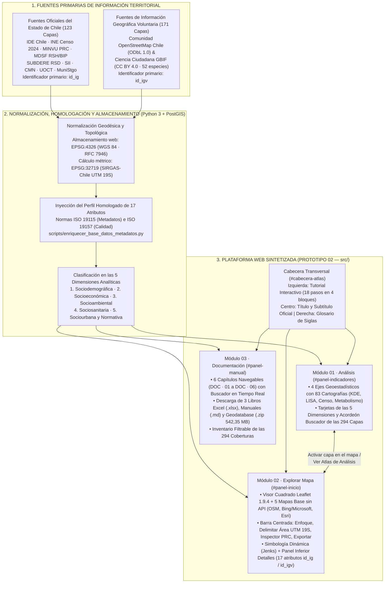

---

## 2. Delimitación geodésica y cobertura multiescalar del área de estudio

### 2.1. Escala barrial (Barrio Brasil) y escala comunal (Municipio de Santiago)
El Atlas opera de manera articulada en dos escalas territoriales que el usuario puede conmutar con un solo clic desde el selector **Área de enfoque** en la barra superior del **Módulo 02 (`Explorar Mapa`)**:
1. **Escala Comunal — Municipio de Santiago (`1.711` manzanas censales y `26` unidades vecinales):** Comprende la totalidad del territorio comunal de Santiago Centro (`22,4 km²`), permitiendo analizar fenómenos estructurales como la segregación socioespacial, los corredores de transporte metropolitano, las zonas de recolección de residuos domiciliarios y la distribución comunal de la inversión pública.
2. **Escala Barrial — Barrio Brasil (`223,75 ha` en el sector norponiente de la comuna):** Corresponde al polígono histórico y residencial delimitado por:
   * **Norte:** Eje de Av. San Pablo y calle Rosas (articulación con el Barrio Yungay).
   * **Sur:** Av. Libertador Bernardo O'Higgins / Alameda (corredor de transporte metropolitano y Línea 1 de Metro).
   * **Oriente:** Av. Manuel Rodríguez (Autopista Central / Ruta 5 Norte-Sur).
   * **Poniente:** Av. Ricardo Cumming y calle García Reyes.

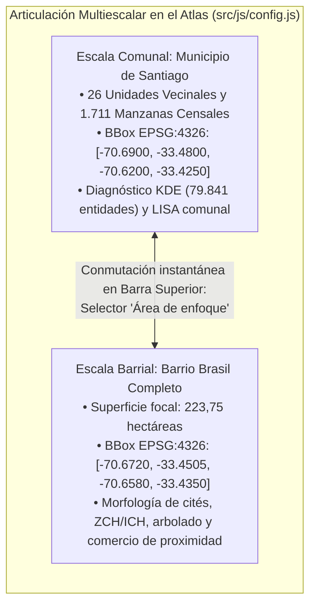

### 2.2. Parámetros geodésicos oficiales (`EPSG:4326` y `EPSG:32719`)
Para cumplir simultáneamente con el estándar internacional de visualización web y con la normativa cartográfica oficial de Chile (IDE Chile / SNIT e Instituto Geográfico Militar), el sistema trabaja con dos sistemas de referencia coordinados:
* **Sistema de almacenamiento y transmisión web (`EPSG:4326` — WGS 84 / IETF RFC 7946):** Todas las 294 capas `.geojson` se almacenan en coordenadas geográficas de longitud ($\lambda$) y latitud ($\varphi$) en grados decimales con 6 decimales de precisión ($\approx 0,11\text{ m}$).
* **Sistema de proyección métrica para cálculos de superficie y distancia (`EPSG:32719` — SIRGAS-Chile / UTM Huso 19 Sur):** Cuando el usuario mide un polígono con la herramienta **Delimitar área** o consulta las métricas de una entidad en el panel **Detalles**, el módulo `src/js/modulos/geodesia.js` proyecta los vértices al huso UTM 19 Sur (meridiano central $\lambda_0 = -69^\circ$, factor de escala $k_0 = 0,9996$, falso este $E_0 = 500.000\text{ m}$, falso norte $N_0 = 10.000.000\text{ m}$ sobre el elipsoide GRS80/WGS84), garantizando áreas exactas en metros cuadrados (`m²`) y hectáreas (`ha`).

---

## 3. Formulación estratégica: Objetivos del proyecto y entregables verificados

El proyecto mantiene íntegra su formulación estratégica original compuesta por un **Objetivo General** y **cuatro Objetivos Específicos (`OE 1` a `OE 4`)**, cuyos entregables verificados reflejan la arquitectura y componentes reales del **Prototipo 02**:

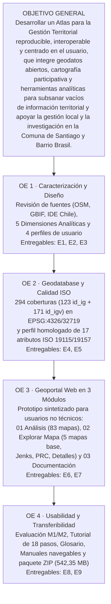

### 3.1. Objetivo general
> Desarrollar un Atlas para la Gestión Territorial reproducible, interoperable y centrado en el usuario, que integre geodatos abiertos, cartografía participativa y herramientas analíticas para subsanar vacíos de información territorial y apoyar la gestión local y la investigación en la Comuna de Santiago y Barrio Brasil.

### 3.2. Objetivos específicos (`OE 1` a `OE 4`) y flujos de entregables verificados

#### Objetivo Específico 1 (`OE 1`): Caracterización y diseño centrado en el usuario
* **Formulación:** *Caracterizar la disponibilidad, la cobertura y los vacíos de información geográfica del área de estudio, y definir las bases taxonómicas y de diseño centrado en el usuario que permitan integrar datos colaborativos e institucionales.*
* **Componentes ejecutados y entregables verificados (`E1`, `E2`, `E3`):**
  1. Revisión sistemática de plataformas de geodatos abiertos institucionales (IDE Chile, INE, MINVU, MDSF, SUBDERE, SII, CMN, Municipalidad de Santiago) y de Información Geográfica Voluntaria (OpenStreetMap y GBIF).
  2. Organización temática del catálogo en las **5 Dimensiones Analíticas** del territorio, superando la dispersión de etiquetas técnicas aisladas.
  3. Caracterización de los cuatro perfiles de actores territoriales e inventario de brechas de información a escala comunal y barrial.
  4. **Archivos verificables:** [`docs/ARQUITECTURA.md`](ARQUITECTURA.md), [`docs/TRAZABILIDAD.md`](TRAZABILIDAD.md), [`docs/catalogo_fuentes_vgi.xlsx`](catalogo_fuentes_vgi.xlsx) y [`docs/categorias_tematicas_osm.xlsx`](categorias_tematicas_osm.xlsx).

#### Objetivo Específico 2 (`OE 2`): Geodatabase multipropósito y calidad espacial
* **Formulación:** *Consolidar una geodatabase multipropósito que armonice coberturas oficiales e información voluntaria bajo estándares internacionales de calidad y metadatos.*
* **Componentes ejecutados y entregables verificados (`E4`, `E5`):**
  1. Descarga, descentralización, normalización topológica y geoprocesamiento de las **294 coberturas vectoriales** (**123 capas oficiales del Estado de Chile** y **171 coberturas descentralizadas de Información Geográfica Voluntaria, IGV**) en los sistemas de referencia `EPSG:4326` y `EPSG:32719`.
  2. Homologación e inyección del perfil de metadatos y calidad espacial **ISO 19115 / ISO 19157 de 17 atributos** en todas las entidades del catálogo, diferenciando mediante clave única **`id_ig`** (información geográfica oficial) e **`id_igv`** (información geográfica voluntaria).
  3. Elaboración de las matrices de síntesis territorial por manzana censal (`1.711` manzanas comunales y recorte del Barrio Brasil), catastro IGV y cartera de inversiones públicas del Banco Integrado de Proyectos (BIP).
  4. **Archivos verificables:** `src/data/*.geojson` y `data/*.geojson` (294 coberturas), [`docs/perfil_metadatos_vgi.xlsx`](perfil_metadatos_vgi.xlsx), `data/matriz_sintesis_barrio_brasil_manzanas.geojson`, `data/bip_inversiones_santiago.csv` y esquema relacional PostGIS en `scripts/db/`.

#### Objetivo Específico 3 (`OE 3`): Geoportal web accesible e interoperable
* **Formulación:** *Implementar un geoportal web accesible e interoperable que permita visualizar cartografía multinivel, consultar el territorio en tiempo real y descargar geodatos abiertos.*
* **Componentes ejecutados y entregables verificados (`E6`, `E7`):**
  1. **Definición de un prototipo sintetizado para usuarios no técnicos:** prototipo más sintetizado que permita a usuarios sin experiencia técnica poder interactuar de forma más simple con la plataforma, estructurado en tres módulos funcionales (**Módulo 01 · Análisis**, **Módulo 02 · Explorar Mapa** y **Módulo 03 · Documentación**).
  2. Construcción del visor cartográfico de proporción cuadrada sobre **Leaflet 1.9.4** con **5 mapas base abiertos y satelitales sin requerimiento de clave de API** (*OpenStreetMap Estándar*, *OpenStreetMap Humanitario HOT*, *Imagen Satelital Bing / Microsoft*, *Satelital Híbrido con Calles Bing / Microsoft* e *Imagen Satelital Esri World Imagery*), motor de **Simbología Dinámica** (*Cortes Naturales de Jenks*, Cuantiles, Intervalos Iguales, Desviación Estándar y Categorizado) y panel inferior de ancho completo **Detalles** para inspeccionar los 17 atributos (`id_ig` / `id_igv`).
  3. Implementación bajo demanda del **Inspector normativo del Plan Regulador Comunal (PRC) y OGUC**, de la herramienta geodésica **Delimitar área** (`EPSG:32719`), de los **4 ejes de diagnóstico geoestadístico con 83 cartografías temáticas** (KDE, LISA, Demografía Censo 2024 y Metabolismo Urbano) y despliegue continuo en Netlify.
  4. **Archivos verificables:** [`src/index.html`](../index.html), [`src/css/estilos.css`](../css/estilos.css), [`src/js/app.js`](../js/app.js), [`src/js/modulos/mapa.js`](../js/modulos/mapa.js), [`src/js/modulos/simbologia_dinamica.js`](../js/modulos/simbologia_dinamica.js), [`src/js/modulos/evaluador_normativo.js`](../js/modulos/evaluador_normativo.js), [`src/js/modulos/indicadores_analisis.js`](../js/modulos/indicadores_analisis.js) y `netlify.toml`.

#### Objetivo Específico 4 (`OE 4`): Evaluación de usabilidad y transferibilidad
* **Formulación:** *Evaluar la usabilidad y la pertinencia de la plataforma con distintos perfiles de actores territoriales y asegurar su transferibilidad técnica, metodológica y documental.*
* **Componentes ejecutados y entregables verificados (`E8`, `E9`):**
  1. Diseño y aplicación de los instrumentos de evaluación de usabilidad con tareas guiadas sobre los 3 módulos (**Modalidad 1 · `FO-M1`**) y protocolo de conversación situada con vecinas y vecinos del Barrio Brasil (**Modalidad 2 · `FO-M2`**).
  2. Implementación del **Tutorial Interactivo navegable de 18 pasos en 4 bloques** (situado a la izquierda del título principal, que presenta cada módulo antes de recorrer sus herramientas) y del **Glosario de siglas** con buscador instantáneo (situado a la derecha del título principal, sin superponerse).
  3. Redacción exhaustiva de la documentación navegable en los 6 capítulos del **Módulo 03 (`Documentación`)** y en los manuales del repositorio Git, empaquetado de la geodatabase completa (`docs/geodatabase_completa_atlas_vgi.zip`, `542,35 MB`) y scripts de verificación automatizada pre-despliegue.
  4. **Archivos verificables:** [`src/js/modulos/tutorial_interactivo.js`](../js/modulos/tutorial_interactivo.js), [`src/js/modulos/manual.js`](../js/modulos/manual.js), [`docs/MANUAL_USO.md`](MANUAL_USO.md), [`docs/MANUAL_ACTUALIZACION_ATLAS.md`](MANUAL_ACTUALIZACION_ATLAS.md), [`docs/geodatabase_completa_atlas_vgi.zip`](geodatabase_completa_atlas_vgi.zip), `scripts/verificar_conteo_capas.py` y `scripts/verificar_integridad_despliegue.py`.

---

## 4. Matriz maestra de los 9 Hitos con entregable verificado asociado (`Hito 1 / E1` a `Hito 9 / E9`)

En estricta coherencia con la Carta Gantt oficial del proyecto (`Carta_Gantt_Atlas_VGI.pdf`), el cronograma conserva únicamente los **9 hitos que poseen un entregable físico verificado asociado (`E1` a `E9`)**, habiendo depurado cualquier hito intermedio sin entregable directo o vinculado a funciones descartadas en la síntesis del Prototipo 02:

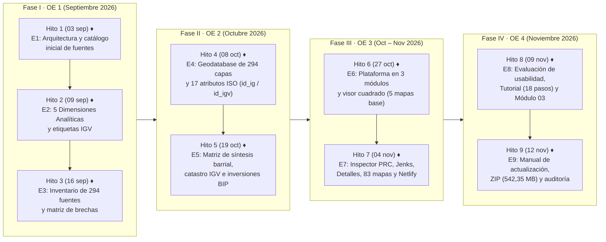

| Hito | Fecha ($\blacklozenge$) | OE | Entregable verificado asociado (`E1` a `E9`) | Qué certifica técnicamente este entregable | Ruta exacta en el repositorio y plataforma |
| :---: | :---: | :---: | :--- | :--- | :--- |
| **Hito 1** | `03 sep 2026` | `OE 1` | **E1 ·** Arquitectura del sistema y catálogo inicial de fuentes | Define el diseño modular del Atlas y la estructura de catalogación de fuentes estatales y ciudadanas. | `docs/ARQUITECTURA.md` y `docs/catalogo_fuentes_vgi.xlsx` (`src/docs/`) |
| **Hito 2** | `09 sep 2026` | `OE 1` | **E2 ·** Cinco dimensiones analíticas, etiquetas IGV y configuración | Establece las 5 Dimensiones Analíticas y la equivalencia semántica en español de las etiquetas OpenStreetMap y Darwin Core. | `docs/categorias_tematicas_osm.xlsx` (`src/docs/`) y `src/js/config.js` |
| **Hito 3** | `16 sep 2026` | `OE 1` | **E3 ·** Inventario consolidado de 294 fuentes y matriz de brechas | Consolida el registro de las 123 capas oficiales y las 171 capas colaborativas de IGV e identifica los vacíos que subsana su cruce. | `docs/catalogo_fuentes_vgi.xlsx` y `docs/TRAZABILIDAD.md` (`src/docs/`) |
| **Hito 4** | `08 oct 2026` | `OE 2` | **E4 ·** Geodatabase de 294 capas GeoJSON, PostGIS y perfil de 17 atributos ISO (`id_ig` / `id_igv`) | Normaliza las 294 capas en `EPSG:4326` e inyecta los 17 atributos ISO 19115/19157 con distinción `id_ig` e `id_igv`. | `src/data/*.geojson`, `data/*.geojson`, `docs/perfil_metadatos_vgi.xlsx` y `scripts/db/` |
| **Hito 5** | `19 oct 2026` | `OE 2` | **E5 ·** Matriz de síntesis barrial por manzana, catastro IGV e inversiones BIP | Integra a nivel de manzana censal los indicadores demográficos, de vulnerabilidad RSH, dotación IGV y proyectos BIP. | `data/matriz_sintesis_barrio_brasil_manzanas.geojson`, `data/resumen_catastro_vgi.csv` y `data/bip_inversiones_santiago.csv` |
| **Hito 6** | `27 oct 2026` | `OE 3` | **E6 ·** Plataforma sintetizada en 3 módulos (*Análisis*, *Explorar Mapa*, *Documentación*) y visor cuadrado | Implementa la interfaz de 3 módulos y el visor Leaflet 1.9.4 con los 5 mapas base abiertos y satelitales sin clave de API. | `src/index.html`, `src/css/estilos.css`, `src/js/app.js` y `src/js/modulos/mapa.js` |
| **Hito 7** | `04 nov 2026` | `OE 3` | **E7 ·** Inspector normativo PRC, simbología Jenks, panel *Detalles*, 83 mapas y despliegue en Netlify | Pone en operación el motor Jenks, el Inspector PRC bajo demanda, el panel inferior *Detalles* y las 83 láminas en producción. | `src/js/modulos/evaluador_normativo.js`, `src/js/modulos/simbologia_dinamica.js`, `src/js/modulos/indicadores_analisis.js` y `netlify.toml` |
| **Hito 8** | `09 nov 2026` | `OE 4` | **E8 ·** Evaluación de usabilidad, Tutorial interactivo (18 pasos) y Módulo 03 navegable | Incorpora el tutorial navegable por módulos, el glosario de siglas y los 6 capítulos interactivos de documentación. | `docs/TRAZABILIDAD.md`, `MANUAL_USO.md`, `src/js/modulos/tutorial_interactivo.js` y `src/js/modulos/manual.js` |
| **Hito 9** | `12 nov 2026` | `OE 4` | **E9 ·** Manual de actualización técnica, paquete ZIP (`542,35 MB`) y verificación de integridad | Asegura la transferibilidad completa mediante este manual exhaustivo, el paquete `.zip` y los scripts de auditoría local. | `MANUAL_ACTUALIZACION_ATLAS.md`, `docs/geodatabase_completa_atlas_vgi.zip`, `scripts/verificar_conteo_capas.py` y `scripts/verificar_integridad_despliegue.py` |

---

## 5. Caracterización de los cuatro perfiles de actores territoriales y flujos de interacción

El diseño del **Prototipo 02** responde a las necesidades concretas de cuatro perfiles de usuarios. El siguiente diagrama de secuencia muestra cómo interactúa cada perfil con los 3 módulos de la plataforma para responder sus preguntas territoriales:

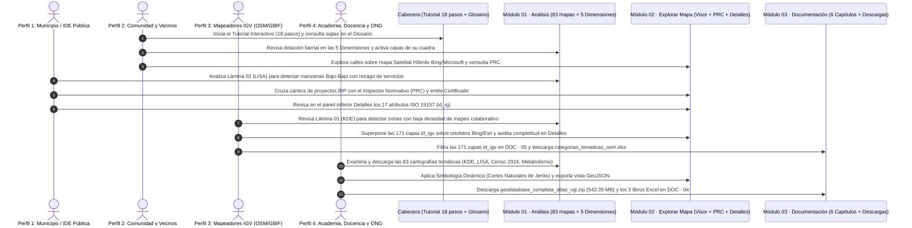

---

# PARTE II: Ingeniería de Datos, las 5 Dimensiones Analíticas, Normalización de las 294 Capas y Perfil ISO 19115 / 19157

---

## 6. Organización taxonómica en las 5 Dimensiones Analíticas del Territorio

En el Prototipo 02, la totalidad de las **294 coberturas espaciales** (`123` oficiales del Estado + `171` colaborativas de IGV) se estructura en **5 Dimensiones Analíticas**. Esta organización evita que el usuario tenga que conocer de antemano qué ministerio o qué etiqueta técnica de OpenStreetMap custodia un dato: basta con pensar en el ámbito del problema urbano que desea consultar.

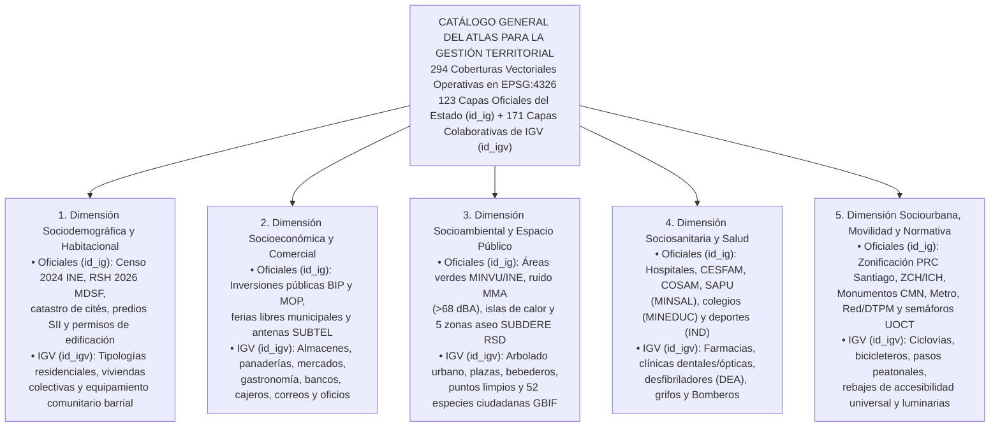

### 6.1. Dimensión 1: Sociodemográfica y Habitacional
* **¿Qué integra y para qué sirve?** Reúne la información sobre quiénes habitan el territorio y en qué condiciones de vivienda lo hacen. Combina los datos definitivos por manzana y unidad vecinal del **Censo de Población y Vivienda 2024 (INE)** (población total, índice de envejecimiento, infancia, hogares, tenencia y hacinamiento) y la estratificación socioeconómica del **Registro Social de Hogares (RSH 2026 / MDSF)** con el catastro municipal de **cités y pasajes históricos**, las estadísticas prediales del **Servicio de Impuestos Internos (SII)** y los permisos de edificación y recepciones definitivas, complementados por las tipologías residenciales y comunitarias mapeadas en IGV.

### 6.2. Dimensión 2: Socioeconómica y Comercial
* **¿Qué integra y para qué sirve?** Permite evaluar la vitalidad económica de cada cuadra y la distribución territorial del gasto público. Cruza la cartera georreferenciada de proyectos de inversión del **Banco Integrado de Proyectos (BIP)** y del **Ministerio de Obras Públicas (MOP)** con la densa red de abastecimiento cotidiano levantada mediante IGV en OpenStreetMap (almacenes de barrio, panaderías, verdulerías, supermercados, ferias libres, restaurantes, cafeterías, farmacias comerciales, sucursales bancarias, cajeros automáticos y oficinas postales) y la infraestructura de telecomunicaciones (SUBTEL).

### 6.3. Dimensión 3: Socioambiental y Espacio Público
* **¿Qué integra y para qué sirve?** Diagnostica la calidad ambiental del entorno urbano y el metabolismo de la ciudad. Articula el catastro oficial de parques y áreas verdes (**MINVU / INE 2023** y municipal), el censo colaborativo de arbolado viario, las **52 coberturas de flora, aves y entomofauna urbana registradas mediante ciencia ciudadana en GBIF** (bajo estándar Darwin Core), los mapas estratégicos de **ruido ambiental diurno y nocturno (`>68 dBA`, MMA)**, la infraestructura de reciclaje y las **13 coberturas del Catastro Nacional de Residuos Sólidos Domiciliarios (SUBDERE RSD 2024)** que detallan la operación de las **5 zonas de aseo municipal** en Santiago.

### 6.4. Dimensión 4: Sociosanitaria y Salud
* **¿Qué integra y para qué sirve?** Mide el acceso efectivo a la salud, el cuidado y la respuesta ante emergencias. Conecta la red asistencial pública y privada oficial (**MINSAL**: hospitales, consultorios, CESFAM, centros de salud mental COSAM y SAPU) con los equipamientos sociosanitarios de proximidad levantados por la comunidad en IGV: farmacias, clínicas dentales, ópticas, **desfibriladores externos automáticos (DEA)**, compañías de Bomberos, **grifos contra incendios** y recintos deportivos y recreativos.

### 6.5. Dimensión 5: Sociourbana, Movilidad y Normativa
* **¿Qué integra y para qué sirve?** Vincula la regulación urbanística y la protección del patrimonio con la movilidad cotidiana y la caminabilidad. Agrupa los polígonos normativos del **Plan Regulador Comunal de Santiago (PRC / MINVU)**, las **Zonas e Inmuebles de Conservación Histórica (`ZCH`/`ICH`)** y los **Monumentos Históricos y Zonas Típicas del Consejo de Monumentos Nacionales (CMN)** junto con las redes de transporte público (**Metro de Santiago** y paraderos **Red / DTPM**), los semáforos de la **UOCT**, la red de **ciclovías y bicicleteros**, los pasos peatonales, los rebajes de vereda para movilidad reducida y el alumbrado público.

---

## 7. Descentralización y normalización de las 171 coberturas de Información Geográfica Voluntaria (`id_igv`)

Uno de los aportes centrales del **Prototipo 02** es la **descentralización temática de la Información Geográfica Voluntaria (`id_igv`)**: en lugar de entregar un único archivo masivo e indiferenciado donde se mezclan miles de etiquetas en inglés difíciles de filtrar para un vecino o funcionario municipal, el Atlas desglosa el mapeo colaborativo en **171 coberturas vectoriales específicas con nombres claros en español**, registradas en [`src/js/modulos/catalogo_vgi_descentralizado.js`](../js/modulos/catalogo_vgi_descentralizado.js).

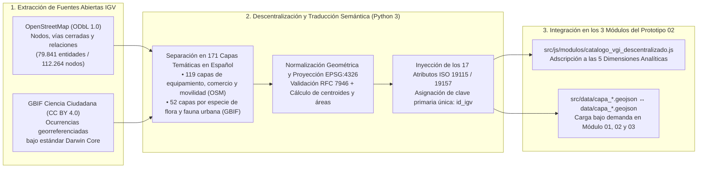

### 7.1. Extracción y traducción semántica desde OpenStreetMap (`ODbL 1.0`)
El script `scripts/descargar_todas_las_categorias_osm.py` consulta los extractos de OpenStreetMap para el ámbito de Santiago y Barrio Brasil, traduce las combinaciones de etiquetas `key=value` (como `amenity=pharmacy`, `Shop=bakery`, `highway=cycleway`, `emergency=fire_hydrant` o `emergency=defibrillator`) a **119 coberturas temáticas individuales en español**, limpia las geometrías inválidas y genera archivos independientes en `data/capa_*.geojson` y `src/data/capa_*.geojson`.

### 7.2. Integración de las 52 coberturas de biodiversidad ciudadana desde GBIF (`Darwin Core`)
Complementariamente, el Atlas incorpora **52 coberturas descentralizadas por especie de flora, avifauna y entomofauna urbana** provenientes de la Infraestructura Mundial de Información en Biodiversidad (**GBIF.org**), capturadas a través de iniciativas de ciencia ciudadana (como *iNaturalist Chile* y *eBird*). Cada registro conserva su taxonomía científica (`scientificName`, `kingdom`, `family`) traducida a su nombre común en Chile y se homologa con el identificador primario **`id_igv`** dentro de la **Dimensión 3 (Socioambiental y Espacio Público)**.

---

## 8. Ingesta, armonización y cruce de las 123 capas oficiales del Estado de Chile (`id_ig`)

Las **123 coberturas oficiales del Estado de Chile (`id_ig`)** están registradas en el controlador [`src/js/modulos/ide_chile.js`](../js/modulos/ide_chile.js) y provienen de ocho fuentes institucionales verificadas:

| N° | Organismo Público Custodio | Coberturas Oficiales Integradas (`id_ig`) | Aporte Analítico en el Atlas |
| :---: | :--- | :--- | :--- |
| **`01`** | **Instituto Nacional de Estadísticas (INE)** | Manzanas y Unidades Vecinales del **Censo de Población y Vivienda 2024**, estadísticas de edificación (permisos y recepciones 2010–2026) y áreas verdes INE/MINVU. | Base demográfica y habitacional a escala de manzana (`1.711` manzanas en Santiago) para los cruces de la Dimensión 1 y la Lámina 03. |
| **`02`** | **Ministerio de Vivienda y Urbanismo (MINVU) y DOM Santiago** | Zonificación del **Plan Regulador Comunal de Santiago (PRC)**, Zonas e Inmuebles de Conservación Histórica (`ZCH`/`ICH`), parques urbanos y catastro de campamentos/déficit. | Sustento legal y geométrico del **Inspector normativo (PRC)** en el Módulo 02 y de la Dimensión 5. |
| **`03`** | **Ministerio de Desarrollo Social y Familia (MDSF)** | Estratificación socioeconómica del **Registro Social de Hogares (RSH 2026)** por grupo etario, sexo, tramo Fonasa/Isapre y dependencia funcional, más la cartera de inversiones del **Banco Integrado de Proyectos (BIP)**. | Permite focalizar inversión pública cruzando vulnerabilidad social por unidad vecinal con dotación de equipamiento (Dimensión 1 y Dimensión 2). |
| **`04`** | **Subsecretaría de Desarrollo Regional y Administrativo (SUBDERE)** | **13 coberturas del Catastro Nacional de Residuos Sólidos Domiciliarios (RSD 2024)** y zonificación operativa de las **5 zonas de aseo municipal** de Santiago. | Alimenta el diagnóstico de metabolismo urbano, rutas de barrido, contenedores y papeleros en la Dimensión 3 y la Lámina 04. |
| **`05`** | **Ministerio de Transportes y Telecomunicaciones (MTT / UOCT / DTPM / SUBTEL)** | Red y estaciones de Metro, paraderos y ejes Red Movilidad, catastro metropolitano de semáforos UOCT 2026, ciclovías oficiales y antenas SUBTEL. | Permite evaluar accesibilidad al transporte público, seguridad vial en intersecciones y conectividad digital (Dimensión 2 y Dimensión 5). |
| **`06`** | **Ministerio del Medio Ambiente (MMA)** | Mapas estratégicos de ruido ambiental diurno y nocturno (`>68 dBA` en ejes arteriales), islas de calor y estaciones de monitoreo ambiental. | Identifica las manzanas residenciales expuestas a contaminación acústica crítica y estrés térmico (Dimensión 3 y Lámina 04). |
| **`07`** | **Consejo de Monumentos Nacionales (CMN) y Servicio de Impuestos Internos (SII)** | Polígonos de **Zonas Típicas** y **Monumentos Históricos** (CMN), y estadísticas prediales de destino constructivo, edad edificatoria y avalúo fiscal (SII). | Caracteriza el patrimonio protegido y la presión de renovación inmobiliaria en el Barrio Brasil y Yungay (Dimensión 1 y Dimensión 5). |
| **`08`** | **Ilustre Municipalidad de Santiago** | Límites de barrios y unidades vecinales, catastro comunal de **cités**, ferias libres, sedes comunitarias, cámaras de televigilancia y equipamiento municipal. | Aporta la escala de gestión local directa para el diagnóstico barrial en todas las dimensiones. |

---

## 9. Especificación exhaustiva del Perfil Homologado de 17 Atributos (ISO 19115 / ISO 19157)

Para que cualquier ciudadano, funcionario o investigador pueda conocer de inmediato de dónde proviene un dato, qué tan actualizado está, bajo qué licencia puede reutilizarlo y qué validaciones de calidad geométrica y temática cumple, cada entidad de las **294 coberturas del Atlas** incorpora un **bloque estandarizado de 17 atributos** basado en las normas internacionales **ISO 19115-1:2014** (Metadatos de información geográfica) e **ISO 19157:2013** (Calidad de datos espaciales).

### 9.1. Diccionario técnico y conceptual de los 17 atributos (`id_ig` / `id_igv`)

| N° | Clave del Atributo | Norma ISO / Elemento | Tipo | Explicación clara de qué informa y regla de asignación |
| :---: | :--- | :--- | :---: | :--- |
| **`01`** | **`id_ig` / `id_igv`** | ISO 19115 (`MD_Identifier`) | `Texto` | **Identificador único primario diferenciador:** Utiliza la clave **`id_ig`** (*Identificador de Información Geográfica*) en las **123 capas oficiales del Estado de Chile**, y la clave **`id_igv`** (*Identificador de Información Geográfica Voluntaria*) en las **171 capas colaborativas descentralizadas** de OpenStreetMap y GBIF. |
| **`02`** | `nombre_capa` | ISO 19115 (`CI_Citation.title`) | `Texto` | Nombre descriptivo oficial en español de la cobertura dentro de las 294 capas del Atlas (ej. *"Farmacias y Boticas (IGV)"* o *"Zonificación Plan Regulador Comunal de Santiago"*). |
| **`03`** | `dimension_analitica` | ISO 19115 (`MD_TopicCategoryCode`) | `Texto` | Adscripción a una de las **5 Dimensiones Analíticas**: (1) *Sociodemográfica y Habitacional*, (2) *Socioeconómica y Comercial*, (3) *Socioambiental y Espacio Público*, (4) *Sociosanitaria y Salud*, o (5) *Sociourbana, Movilidad y Normativa*. |
| **`04`** | `tipo_fuente` | ISO 19115 (`MD_ScopeCode`) | `Texto` | Distingue explícitamente el régimen de producción del dato: `Información Geográfica Oficial (Estado de Chile)` o `Información Geográfica Voluntaria (IGV Descentralizada)`. |
| **`05`** | `institucion_custodia` | ISO 19115 (`CI_ResponsibleParty`) | `Texto` | Organismo público responsable (INE, MINVU, MDSF, SUBDERE, SII, CMN, MuniStgo) o comunidad colaborativa custodia (`Comunidad OpenStreetMap Chile` / `GBIF.org`). |
| **`06`** | `sistema_referencia` | ISO 19115 (`MD_ReferenceSystem`) | `Texto` | Declara el par geodésico oficial: `EPSG:4326 (WGS 84)` para almacenamiento y visualización web, y `EPSG:32719 (SIRGAS-Chile / UTM Huso 19 Sur)` para cálculos métricos. |
| **`07`** | `escala_referencia` | ISO 19115 (`MD_Resolution`) | `Texto` | Escala cartográfica equivalente de levantamiento o restitución (`1:1.000` a `1:5.000` en escala predial y barrial; `1:10.000` a `1:25.000` en escala comunal). |
| **`08`** | `fecha_actualizacion` | ISO 19115 (`CI_Date`) | `Texto (ISO 8601)` | Fecha verificada de última actualización o corte de extracción de la cobertura en formato estándar `AAAA-MM-DD`. |
| **`09`** | `licencia_uso` | ISO 19115 (`MD_LegalConstraints`) | `Texto` | Licencia abierta aplicable: `Datos Abiertos del Estado (Ley N.° 20.285)`, `Open Database License (ODbL 1.0)` para OpenStreetMap o `Creative Commons CC BY 4.0` para GBIF. |
| **`10`** | `exactitud_posicional` | ISO 19157 (`DQ_AbsoluteExternalPositionalAccuracy`) | `Texto` | Evalúa la precisión planimétrica de las coordenadas respecto a la cartografía catastral y ortofotografías satelitales de referencia ($\pm 1\text{ m}$ a $\pm 5\text{ m}$ en escala urbana). |
| **`11`** | `consistencia_topologica` | ISO 19157 (`DQ_TopologicalConsistency`) | `Texto` | Certifica el cumplimiento de las reglas geométricas OGC Simple Features e IETF RFC 7946 (anillos poligonales cerrados, sin auto-intersecciones ni vértices duplicados). |
| **`12`** | `completitud` | ISO 19157 (`DQ_Completeness`) | `Texto` | Informa el nivel de presencia de atributos descriptivos no nulos y la cobertura espacial dentro del polígono de Santiago y Barrio Brasil. |
| **`13`** | `exactitud_tematica` | ISO 19157 (`DQ_ThematicClassificationCorrectness`) | `Texto` | Certifica la correspondencia semántica entre el objeto real y su clasificación en las 5 dimensiones analíticas del Atlas. |
| **`14`** | `consistencia_temporal` | ISO 19157 (`DQ_TemporalValidity`) | `Texto` | Verifica la vigencia temporal del registro dentro del corte operativo del proyecto (`2024–2026`). |
| **`15`** | `linaje_fuente` | ISO 19157 (`LI_Lineage`) | `Texto` | Resume de forma trazable la cadena de procesamiento: origen del dato, reproyección geodésica, limpieza topológica e inyección del perfil de 17 atributos. |
| **`16`** | `cobertura_territorial` | ISO 19115 (`EX_GeographicDescription`) | `Texto` | Ámbito espacial cubierto por la capa (`Barrio Brasil`, `Comuna de Santiago` o `Región Metropolitana de Santiago`). |
| **`17`** | `archivo_origen` | ISO 19115 (`CI_OnlineResource`) | `Texto` | Ruta relativa exacta del archivo GeoJSON en el repositorio (`data/<nombre_archivo>.geojson`), facilitando su auditoría y descarga directa. |

### 9.2. Algoritmo de enriquecimiento y validación (`scripts/enriquecer_base_datos_metadatos.py`)
El script `scripts/enriquecer_base_datos_metadatos.py` automatiza la inyección y verificación de estos 17 atributos sobre las 294 coberturas en `data/` y `src/data/`:
1. Lee los catálogos maestros de `src/js/modulos/ide_chile.js` (`123` capas oficiales) y `src/js/modulos/catalogo_vgi_descentralizado.js` (`171` capas de IGV).
2. Para cada archivo `.geojson`, recorre su arreglo `features` conservando intactas todas las propiedades originales de la fuente (como población censal, tramos RSH, rol SII o etiquetas específicas) e inyecta de manera normalizada las 17 claves ISO 19115 / ISO 19157, asignando `id_ig` o `id_igv` según corresponda.
3. Verifica que el archivo resultante sea un `FeatureCollection` JSON válido en codificación `UTF-8` y lo guarda simétricamente en `data/` y `src/data/`.

### 9.3. Estructura de los 3 libros maestros OpenXML (`.xlsx`)
Para facilitar la revisión tabular en programas de hojas de cálculo sin necesidad de abrir un software SIG, el script `scripts/generar_catalogos_excel.py` genera tres libros Excel descargables desde el capítulo **`DOC · 04`** del **Módulo 03 (`Documentación`)**:
1. [`docs/categorias_tematicas_osm.xlsx`](categorias_tematicas_osm.xlsx): Detalla la organización en las **5 Dimensiones Analíticas**, el diccionario de las 171 coberturas descentralizadas de IGV con sus etiquetas OpenStreetMap / Darwin Core, el esquema de los 17 atributos y las referencias bibliográficas.
2. [`docs/perfil_metadatos_vgi.xlsx`](perfil_metadatos_vgi.xlsx): Documenta campo por campo el estándar de **17 atributos homologados (`id_ig` / `id_igv`)** bajo las normas ISO 19115 e ISO 19157 y su alineación con el Perfil Nacional de Metadatos de IDE Chile / SNIT.
3. [`docs/catalogo_fuentes_vgi.xlsx`](catalogo_fuentes_vgi.xlsx): Contiene el inventario maestro de las **294 coberturas operativas**, especificando código, nombre, institución o comunidad custodia, dimensión analítica, tipo de geometría, escala, fecha y licencia abierta.

---

## 10. Metodología geoestadística de los 4 Ejes de Diagnóstico y las 83 Cartografías Temáticas

El **Módulo 01 (`Análisis`)** pone a disposición del usuario **83 cartografías temáticas de alta resolución** (`src/img/cartografias/`) organizadas en **4 láminas o ejes de diagnóstico geoestadístico**. A continuación se documentan los fundamentos matemáticos y metodológicos de cada eje en un lenguaje claro y reproducible:

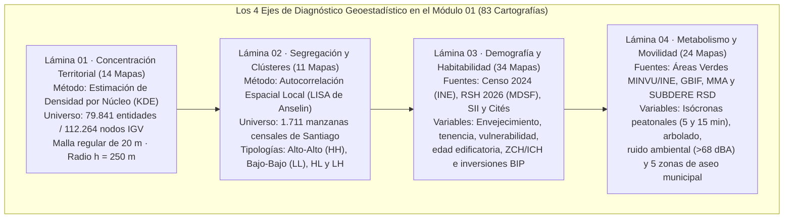

### 10.1. Eje 01: Estimación de Densidad por Núcleo (*Kernel Density Estimation*, KDE — 14 cartografías)
* **¿Qué problema resuelve?** Cuando se representan decenas de miles de puntos sobre una comuna (como comercios, servicios, paraderos o árboles), los símbolos se superponen unos sobre otros e impiden distinguir dónde está realmente la mayor concentración.
* **Formulación matemática:** La Estimación de Densidad por Núcleo (Silverman, 1986) calcula una superficie continua de intensidad $\hat{f}_h(x)$ evaluada sobre una grilla regular de celdas de $20\text{ m} \times 20\text{ m}$ a partir de $n$ coordenadas proyectadas en `EPSG:32719`:
  $$\hat{f}_h(x) = \frac{1}{n \cdot h^2} \sum_{i=1}^{n} w_i \, K\left(\frac{\lVert x - x_i \rVert}{h}\right)$$
  donde $\lVert x - x_i \rVert$ es la distancia euclidiana en metros entre el centro de la celda $x$ y el elemento $x_i$, $h = 250\text{ m}$ es el ancho de banda peatonal barrial (equivalente a ~3 cuadras caminables) y $K(u) = \frac{3}{\pi}(1 - u^2)^2$ (para $u \le 1$) es la función de núcleo cuártico (*biweight*).
* **Alcance empírico en el Atlas:** Procesa **79.841 entidades geométricas** y **112.264 nodos** de IGV, evidenciando los subcentros de alta intensidad en el eje Alameda, el centro histórico y el Barrio Brasil-Yungay frente a las zonas residenciales de menor densidad comercial en el sector sur de Santiago.

### 10.2. Eje 02: Autocorrelación Espacial Local (LISA de Anselin e I de Moran — 11 cartografías)
* **¿Qué problema resuelve?** Un mapa de densidad muestra dónde hay muchos o pocos elementos, pero no dice si esa concentración conforma un agrupamiento estadísticamente significativo de manzanas vecinas (*clúster*) o si es producto del azar.
* **Formulación matemática:** Sobre el universo de las **$N = 1.711$ manzanas censales** de la Comuna de Santiago se construye una matriz de contigüidad espacial tipo Reina de primer orden ($W = [w_{ij}]$ estandarizada por filas) y se calcula el **Indicador Local de Asociación Espacial ($I_i$ de Luc Anselin, 1995)** para cada manzana $i$:
  $$I_i = \frac{z_i - \bar{z}}{s^2} \sum_{j=1}^{N} w_{ij} (z_j - \bar{z})$$
  evaluando su significancia estadística ($p < 0,05$) mediante $999$ permutaciones condicionales de Monte Carlo.
* **Interpretación clara de las 4 categorías LISA en los mapas:**
  1. **Clúster Alto-Alto (`HH` · Color Rojo — *Hotspot*):** Manzana con alta presencia del indicador rodeada de manzanas vecinas que también presentan valores altos (núcleos consolidados).
  2. **Clúster Bajo-Bajo (`LL` · Color Azul — *Coldspot*):** Manzana con baja cobertura o alta carencia rodeada de manzanas vecinas en igual condición de déficit (**bolsones prioritarios para focalizar inversión pública municipal o ministerial**).
  3. **Atípico Alto-Bajo (`HL` · Rosa claro):** Manzana bien dotada rodeada de un entorno con déficit relativo.
  4. **Atípico Bajo-Alto (`LH` · Celeste claro):** Manzana con déficit puntual inmersa en un barrio bien dotado.

### 10.3. Eje 03: Estructura Sociodemográfica (Censo 2024), Vulnerabilidad (RSH) y Cités (34 cartografías)
Integra la serie más extensa de cartografías del Atlas (`34` mapas), cruzando los indicadores del **Censo 2024 (INE)** y del **Registro Social de Hogares (RSH 2026)** con la morfología edificatoria del Barrio Brasil y de la Comuna de Santiago: densidad poblacional por hectárea, distribución de personas mayores de 65 años y niños/adolescentes, tenencia de la vivienda, arriendo, localización de **cités y pasajes históricos**, antigüedad constructiva predial del SII, inmuebles y zonas de conservación histórica (`ICH`/`ZCH`) y distribución de los proyectos de inversión pública del **BIP**.

### 10.4. Eje 04: Metabolismo Urbano, Isócronas Peatonales, Ruido (>68 dBA) y Residuos (SUBDERE RSD — 24 cartografías)
Evalúa el desempeño socioambiental y de movilidad cotidiana mediante `24` cartografías que modelan:
1. **Isócronas de accesibilidad peatonal (5, 10 y 15 minutos a pie a velocidad de $4,5\text{ km/h}$ sobre la red vial peatonal):** Hacia áreas verdes públicas, estaciones de Metro/paraderos Red y establecimientos de salud primaria (CESFAM).
2. **Infraestructura verde y biodiversidad:** Densidad de arbolado urbano por calle y distribución de las 52 especies registradas en GBIF.
3. **Contaminación acústica:** Identificación de manzanas residenciales expuestas a niveles de presión sonora superiores a **$68\text{ dBA}$** (umbral crítico diurno OCDE/MMA) a lo largo de la Autopista Central (Ruta 5), Alameda, Av. Brasil y Av. Matucana.
4. **Gestión de residuos sólidos domiciliarios (SUBDERE RSD 2024):** Cobertura y equipamiento de contenedores, papeleros y rutas en las **5 zonas de aseo municipal** de la Comuna de Santiago.

---

# PARTE III: Ingeniería de Software del Prototipo 02, Arquitectura de los 3 Módulos y Motores en el Navegador

---

## 11. Arquitectura Frontend en HTML5, CSS3 y JavaScript ES6+ Modular (Patrón IIFE)

La plataforma web del **Prototipo 02** está construida íntegramente sobre tecnologías web estándar (**HTML5 semántico, CSS3 adaptable y Vanilla JavaScript ES6+**) utilizando el patrón de diseño de **Módulos Inmediatamente Invocados (*Immediately Invoked Function Expression*, IIFE)**.

### ¿Qué ventajas ofrece esta arquitectura técnica para la mantención a largo plazo?
1. **Independencia de compiladores complejos (*Zero-Build Pipeline*):** El navegador lee y ejecuta directamente los archivos de `src/`. No es necesario instalar ni mantener cadenas frágiles de compilación (como Webpack, Babel o versiones específicas de Node.js que suelen quedar obsoletas cada pocos años).
2. **Despliegue instantáneo en menos de 30 segundos:** Como `netlify.toml` publica directamente el directorio `src/`, cualquier cambio confirmado en Git se publica de inmediato sin riesgo de superar el tiempo máximo de ejecución (*timeout*) del servidor.
3. **Encapsulamiento limpio por módulo:** Cada archivo en `src/js/modulos/` expone únicamente su interfaz pública controlada (por ejemplo, `ModuloIndicadoresAnalisis`, `ModuloIDEChile`, `ModuloSimbologiaDinamica`, `EvaluadorNormativo`, `Geodesia`, `ModuloManual`), evitando colisiones de variables globales.

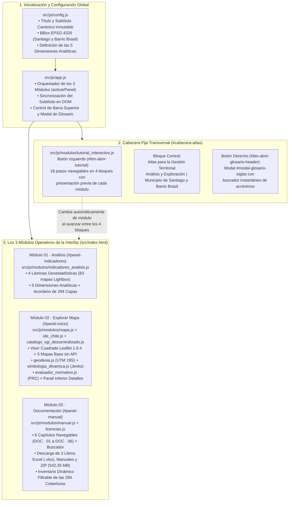

### 11.1. Cabecera transversal fija, sincronización del título y separación espacial de ayudas
En `src/index.html`, `src/js/config.js` y `src/js/app.js` se garantiza que la cabecera institucional mantenga siempre una identidad única y sin parpadeos ni superposiciones:
* **Título y subtítulo canónicos sincronizados:** Tanto el HTML inicial como `CONFIG.proyecto.subtitulo` en `src/js/config.js` y la función `sincronizarIdentidadInstitucional()` en `src/js/app.js` fijan el título **Atlas para la Gestión Territorial** y el subtítulo **Análisis y Exploración | Municipio de Santiago y Barrio Brasil**, impidiendo que en ningún momento se muestre un subtítulo antiguo durante la carga.
* **Separación espacial de botones a ambos lados del título:** El botón **Tutorial Interactivo** (`#btn-abrir-tutorial`) se ubica en el extremo izquierdo del título, mientras que el botón **Glosario de siglas** (`#btn-abrir-glosario-header`) se ubica en el extremo derecho, evitando que la tarjeta flotante del tutorial se superponga con el recuadro del glosario.

### 11.2. Arquitectura del Tutorial Interactivo de 18 pasos en 4 bloques (`tutorial_interactivo.js`)
El módulo [`src/js/modulos/tutorial_interactivo.js`](../js/modulos/tutorial_interactivo.js) implementa un sistema de inducción guiada diseñado específicamente para el **Prototipo 02**:
* **Estructura en 4 bloques navegables y 18 pasos:**
  1. **Bloque 1 — Visión General (Pasos 1 a 3):** Presenta el propósito del Atlas, la navegación en 3 módulos y el uso del Glosario de siglas.
  2. **Bloque 2 — Módulo 01 · Análisis (Pasos 4 a 8):** **Paso 4 presenta primero qué es el Módulo 01 en su conjunto y para qué sirve** antes de recorrer las 4 láminas geoestadísticas (KDE, LISA, Demografía, Metabolismo), las 5 Dimensiones Analíticas y el acordeón buscador de las 294 capas.
  3. **Bloque 3 — Módulo 02 · Explorar Mapa (Pasos 9 a 14):** **Paso 9 presenta primero qué es el Módulo 02 en su conjunto y cómo se organiza** antes de recorrer la barra superior centrada (*Área de enfoque*, *Delimitar área*, *Inspector normativo PRC*), los 5 mapas base sin API, la *Simbología Dinámica (Jenks)* y el panel inferior **Detalles** con los 17 atributos (`id_ig` / `id_igv`).
  4. **Bloque 4 — Módulo 03 · Documentación (Pasos 15 a 18):** **Paso 15 presenta primero qué es el Módulo 03 en su conjunto** antes de recorrer el buscador e índice de los 6 capítulos, las descargas de Excel y del paquete `.zip` y el inventario filtrable de las 294 capas.
* **Conmutación automática de módulo y posicionamiento inteligente:** Cada paso declara la propiedad `panel` (`'indicadores'`, `'inicio'` o `'manual'`). Al avanzar o hacer clic en cualquiera de las píldoras de bloque o puntos de paso, el tutorial invoca `window.activarPanel(paso.panel)`, desplaza suavemente la pantalla hacia el elemento destacado (`scrollIntoView`) y posiciona la tarjeta explicativa sin tapar el componente resaltado.

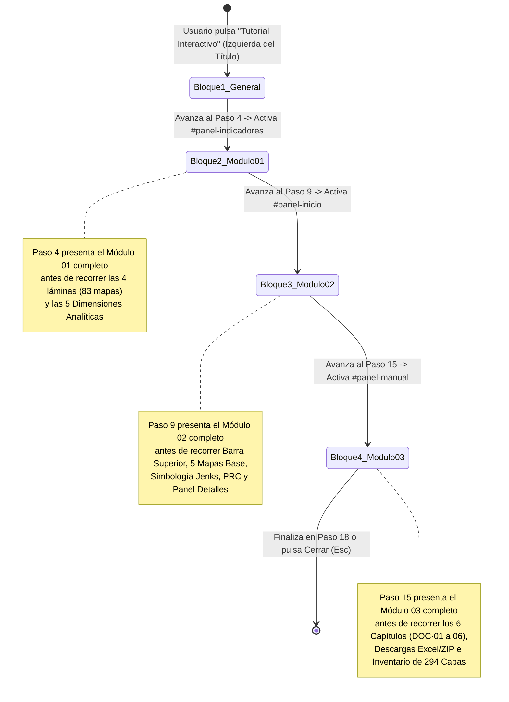

---

## 12. Ingeniería interna del Módulo 01 (`Análisis` — `indicadores_analisis.js`)

El archivo [`src/js/modulos/indicadores_analisis.js`](../js/modulos/indicadores_analisis.js) articula tres motores de interfaz dentro de `#panel-indicadores`:
1. **Motor de Láminas Geoestadísticas (`STORYBOARDS_GEOESTADISTICOS`) y Visor Lightbox:**
   * Gestiona las 4 láminas temáticas (`storyboard-densidad-kernel-kde`, `storyboard-autocorrelacion-lisa`, `storyboard-demografia-habitabilidad-sociourbana` y `storyboard-socioambiental-movilidad-servicios`) que agrupan las **83 cartografías en alta resolución** alojadas en `src/img/cartografias/`.
   * Incluye un visor modal con zoom progresivo (`100 %` a `350 %`), arrastre con el ratón (*panning*), navegación por teclado (`←` / `→` / `Esc`), ficha metodológica de cada mapa y tabla de utilidad diferenciada para los 4 perfiles de actores territoriales.
2. **Tarjetas de Síntesis de las 5 Dimensiones Analíticas:**
   * Presenta el desglose cuantitativo y cualitativo de las 5 dimensiones, indicando cuántas coberturas oficiales (`id_ig`) y cuántas colaborativas (`id_igv`) integran cada ámbito.
3. **Explorador Acordeón Unificado de las 294 Capas con Puente Reactivo hacia el Mapa:**
   * Reúne en tiempo real las 123 capas de `ModuloIDEChile` y las 171 capas de `window.CATALOGO_VGI_DESCENTRALIZADO`, permitiendo filtrarlas por texto en español y encenderlas directamente en el visor del Módulo 02 mediante la función puente `activarCapaYVerEnMapa(idCapa)`.

---

## 13. Ingeniería interna del Módulo 02 (`Explorar Mapa` — `mapa.js` y `geodesia.js`)

### 13.1. Lienzo cuadrado de alta proporción y los 5 mapas base sin requerimiento de API
En [`src/js/modulos/mapa.js`](../js/modulos/mapa.js) y [`src/css/estilos.css`](../css/estilos.css), el visor cartográfico (`#mapa`) se dimensiona con una proporción amplia y cuadrada para maximizar el área visual disponible. Para eliminar cualquier dependencia de claves de API comerciales o con límite de peticiones (habiendo retirado por completo los antiguos servicios de Carto), el módulo implementa **5 capas base de acceso directo**:

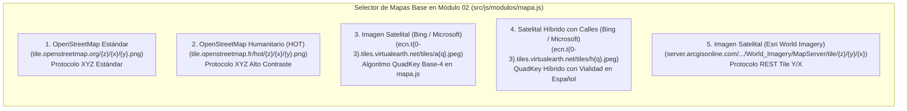

* **¿Cómo funciona la integración nativa de imágenes satelitales de Bing / Microsoft sin clave de API?**
  Los servidores de Microsoft VirtualEarth no utilizan coordenadas de tesela `/{z}/{x}/{y}` convencionales, sino un índice espacial jerárquico en base 4 denominado **QuadKey** (`{q}`). En `src/js/modulos/mapa.js`, se extiende la clase `L.TileLayer` para convertir al vuelo cada par $(x, y)$ en el nivel de zoom $z$ a su cadena `quadKey` correspondiente:
  ```javascript
  // Conversión de coordenadas de tesela (x, y, z) a QuadKey de Microsoft VirtualEarth
  function tileXYToQuadKey(x, y, z) {
    let quadKey = '';
    for (let i = z; i > 0; i--) {
      let digit = 0;
      const mask = 1 << (i - 1);
      if ((x & mask) !== 0) digit += 1;
      if ((y & mask) !== 0) digit += 2;
      quadKey += digit.toString();
    }
    return quadKey;
  }
  ```

### 13.2. Formulación matemática del Motor Geodésico de Redfearn (`EPSG:4326` ↔ `EPSG:32719`)
El módulo [`src/js/modulos/geodesia.js`](../js/modulos/geodesia.js) resuelve en el navegador la transformación rigurosa entre coordenadas geográficas `EPSG:4326` ($\varphi, \lambda$) y coordenadas planas **SIRGAS-Chile / UTM Huso 19 Sur (`EPSG:32719`)** ($E, N$ en metros):
1. **Parámetros del elipsoide GRS80 / WGS84:** Semieje mayor $a = 6.378.137,0\text{ m}$, achatamiento $f = 1 / 298,257223563$, primera excentricidad al cuadrado $e^2 = 2f - f^2 \approx 0,00669438$, meridiano central del Huso 19 $\lambda_0 = -69^\circ$ y factor de escala $k_0 = 0,9996$.
2. **Proyección directa mediante la serie de Redfearn:** Para cada vértice $(\varphi, \lambda)$, calcula el radio de curvatura primer vertical $\nu = \frac{a}{\sqrt{1 - e^2 \sin^2\varphi}}$, el arco de meridiano $M(\varphi)$ desde el ecuador y obtiene las coordenadas métricas exactas:
   $$E = 500.000 + k_0 \, \nu \left[ A + (1 - T + C)\frac{A^3}{6} + (5 - 18T + T^2 + 72C - 58e'^2)\frac{A^5}{120} \right]$$
   $$N = 10.000.000 + k_0 \left[ M(\varphi) + \nu \tan\varphi \left( \frac{A^2}{2} + (5 - T + 9C + 4C^2)\frac{A^4}{24} \right) \right]$$
   donde $A = (\lambda - \lambda_0)\cos\varphi$, $T = \tan^2\varphi$ y $C = e'^2\cos^2\varphi$.
3. **Cálculo de superficie mediante la fórmula del agrimensor de Gauss (*Shoelace Formula*):** Con los vértices proyectados $(E_i, N_i)$ en metros, calcula la superficie plana real del polígono sin distorsión angular:
   $$\text{Área (m}^2\text{)} = \frac{1}{2} \left| \sum_{i=1}^{m} \left( E_i \cdot N_{i+1} - E_{i+1} \cdot N_i \right) \right|, \qquad \text{Área (ha)} = \frac{\text{Área (m}^2\text{)}}{10.000}$$

---

## 14. Motor de Simbología Estadística Dinámica (`simbologia_dinamica.js`) y Panel Inferior `Detalles`

### 14.1. Los 5 métodos de clasificación en `src/js/modulos/simbologia_dinamica.js`
Cuando el usuario abre el panel de **Simbología Dinámica** en el Módulo 02, el motor analiza las propiedades de las capas encendidas y ofrece cinco algoritmos matemáticos de clasificación:

| Método de Clasificación | Formulación Matemática y Regla de Corte | Cuándo se recomienda utilizarlo |
| :--- | :--- | :--- |
| **1. Cortes Naturales de Jenks** *(Predeterminado)* | Algoritmo de programación dinámica de **Fisher-Jenks** que particiona los $N$ valores ordenados en $k$ clases ($3 \le k \le 7$) minimizando la varianza intra-clase ($SDCM$) y maximizando la bondad de ajuste de varianza ($GVF = 1 - \frac{SDCM}{SDAM}$). | **Opción ideal por defecto:** Funciona de forma óptima en variables urbanas asimétricas (densidad poblacional, avalúo fiscal, montos de inversión BIP). |
| **2. Cuantiles (*Quantiles*)** | Ordena la serie y sitúa los límites de clase en los percentiles $P_{j/k}$ ($j = 1, \dots, k-1$), asegurando que cada color contenga exactamente $\approx N/k$ unidades espaciales. | Para comparar **posiciones relativas o rankings** (por ejemplo, identificar el quintil del 20 % de manzanas con mayor vulnerabilidad). |
| **3. Intervalos Iguales** | Calcula el amplitud constante $\Delta = \frac{x_{\max} - x_{\min}}{k}$ y define cortes en $x_{\min} + j \cdot \Delta$. | Para variables que ya están expresadas en una escala uniforme de $0$ a $100\text{ \%}$ o índices acotados. |
| **4. Desviación Estándar** | Calcula la media $\bar{x}$ y la desviación estándar $s = \sqrt{\frac{1}{N-1}\sum(x_i - \bar{x})^2}$, fijando cortes a $\bar{x} \pm 0,5s$, $\bar{x} \pm 1,0s$ y $\bar{x} \pm 1,5s$. | Para resaltar qué manzanas se encuentran significativamente por encima o por debajo del promedio comunal. |
| **5. Categorizado (Nominal)** | Agrupa los valores únicos de un atributo de texto (`Set`) y asigna una paleta cualitativa diferenciada a cada categoría. | Para representar zonificaciones del PRC, tipos de equipamiento, niveles de enseñanza o zonas de aseo municipal. |

### 14.2. Arquitectura del Panel Inferior de Ancho Completo `Detalles` (`#panel-detalles-entidad`)
Para que las tablas de atributos nunca tapen el mapa ni se vean comprimidas en una columna angosta, el **Prototipo 02** ubica el contenedor **Detalles** inmediatamente debajo del lienzo cuadrado del visor, ocupando el 100 % del ancho del módulo. Al seleccionar cualquier entidad en el mapa, este panel renderiza:
1. **Encabezado de identificación rápida:** Muestra el título de la entidad, el nombre de la capa, su insignia de origen (`Oficial Estado · id_ig` en verde o `Colaborativa IGV · id_igv` en celeste) y sus métricas geométricas en `EPSG:32719`.
2. **Tabla de los 17 atributos homologados ISO 19115 / ISO 19157:** Despliega de forma clara y ordenada los 17 descriptores de metadatos y calidad espacial junto con todos los atributos nativos del registro.

---

## 15. Motor del Inspector Normativo del Plan Regulador Comunal (`evaluador_normativo.js`)

El módulo [`src/js/modulos/evaluador_normativo.js`](../js/modulos/evaluador_normativo.js) permite consultar las reglas de edificación y protección patrimonial del **Plan Regulador Comunal de Santiago (PRC)** y la **Ordenanza General de Urbanismo y Construcciones (OGUC)** sobre cualquier punto del territorio.

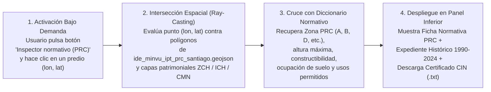

* **Comportamiento limpio bajo demanda:** En coherencia con los principios de usabilidad del Prototipo 02, la información del Plan Regulador **no satura la pantalla por defecto**: permanece oculta hasta que el usuario activa explícitamente el botón **Inspector normativo (PRC)** en la barra superior del Módulo 02 y hace clic sobre un predio o manzana del mapa.
* **Algoritmo de intersección punto en polígono (*Ray-Casting*):** Evalúa si el par $(\lambda, \varphi)$ intersecta el anillo exterior de cada polígono de zonificación (descontando eventuales anillos interiores o huecos) contando la paridad de cruces de un rayo horizontal hacia el este:
  ```javascript
  function puntoEnAnillo(lon, lat, anillo) {
    let dentro = false;
    for (let i = 0, j = anillo.length - 1; i < anillo.length; j = i++) {
      const xi = anillo[i][0], yi = anillo[i][1];
      const xj = anillo[j][0], yj = anillo[j][1];
      const intersecta = ((yi > lat) !== (yj > lat)) &&
                         (lon < (xj - xi) * (lat - yi) / ((yj - yi) || 1e-12) + xi);
      if (intersecta) dentro = !dentro;
    }
    return dentro;
  }
  ```

---

## 16. Ingeniería interna del Módulo 03 (`Documentación` — `manual.js`) y topografía completa del repositorio

El módulo [`src/js/modulos/manual.js`](../js/modulos/manual.js) convierte la documentación del proyecto en una aplicación interactiva dentro del **Módulo 03 (`#panel-manual`)**, articulada en **6 capítulos navegables (`DOC · 01` a `DOC · 06`)** con buscador en vivo, paginación por capítulo o vista completa, botones de salto directo hacia el Tutorial Interactivo y hacia los Módulos 01 y 02, descargas maestras de los 3 libros Excel (`.xlsx`), manuales (`.md`) y geodatabase completa (`.zip`), y el inventario dinámico filtrable de las 294 coberturas.

### Topografía integral del repositorio Git (`nodo-geoabierto/`)

```text
nodo-geoabierto/
├── netlify.toml                              # Configuración CDN Netlify (publish = "src", cabeceras CORS y caché)
├── README.md                                 # Portada general del repositorio (sincronizada con docs/ y src/docs/)
├── MANUAL_USO.md                             # Manual de usuario del Prototipo 02 (sincronizado con docs/ y src/docs/)
├── MANUAL_ACTUALIZACION_ATLAS.md             # Este manual exhaustivo de actualización y arquitectura
├── PROTOCOL_INTEGRIDAD_Y_DESPLIEGUE.md       # Protocolo de los 7 bancos de pruebas pre-despliegue
├── CONTRIBUTING.md                           # Guía rápida de contribución de capas, cartografías y reglas PRC
├── config/
│   └── config.json                           # Parámetros de configuración territorial respaldados en JSON
├── data/                                     # Directorio maestro de las 294 coberturas GeoJSON (EPSG:4326) y CSV
├── docs/                                     # Documentación maestra, 3 libros .xlsx y geodatabase_completa_atlas_vgi.zip
├── scripts/                                  # Suite Python 3 de extracción, homologación ISO 19157, Excel, ZIP y auditoría
│   ├── descargar_todas_las_categorias_osm.py # Extractor y descentralizador de coberturas IGV en español
│   ├── enriquecer_base_datos_metadatos.py    # Inyector de los 17 atributos ISO 19115/19157 (id_ig e id_igv)
│   ├── generar_catalogos_excel.py            # Generador de los 3 libros OpenXML (.xlsx)
│   ├── empaquetar_base_datos_completa.py     # Empaquetador de geodatabase_completa_atlas_vgi.zip (542,35 MB)
│   ├── verificar_conteo_capas.py             # Auditor de paridad exacta: 123 oficiales + 171 IGV = 294 capas
│   ├── verificar_integridad_despliegue.py    # Auditor topológico RFC 7946, 0 punteros LFS y espejo data/ == src/data/
│   └── db/
│       ├── 01_schema_postgis.sql             # Esquema relacional espacial PostgreSQL 17 + PostGIS 3.3 (GiST / GIN)
│       └── 02_seed_metadata.sql              # Semilla de metadatos de las 294 coberturas en PostGIS
└── src/                                      # Directorio de publicación web directa en producción (publish = "src")
    ├── index.html                            # Interfaz SPA del Prototipo 02 (Cabecera + 3 Módulos + Glosario + Footer)
    ├── css/
    │   └── estilos.css                       # Sistema de diseño responsivo, visor cuadrado y panel inferior Detalles
    ├── js/
    │   ├── config.js                         # Configuración global, título/subtítulo oficial, BBox y 5 dimensiones
    │   ├── app.js                            # Orquestador de los 3 módulos, barra superior y glosario de siglas
    │   └── modulos/
    │       ├── tutorial_interactivo.js       # Tutorial interactivo navegable de 18 pasos en 4 bloques
    │       ├── indicadores_analisis.js       # Módulo 01 (Análisis): 4 láminas (83 mapas), 5 dimensiones y acordeón
    │       ├── catalogo_vgi_descentralizado.js # Catálogo de las 171 coberturas descentralizadas de IGV (id_igv)
    │       ├── ide_chile.js                  # Catálogo de las 123 capas oficiales (id_ig) y cargador unificado de 294 capas
    │       ├── mapa.js                       # Módulo 02 (Explorar Mapa): Leaflet 1.9.4, 5 mapas base sin API y Detalles
    │       ├── simbologia_dinamica.js        # Clasificador estadístico en vivo (Jenks, Cuantiles, Intervalos, DE)
    │       ├── evaluador_normativo.js        # Inspector normativo del PRC de Santiago / OGUC bajo demanda
    │       ├── geodesia.js                   # Transformación geodésica Redfearn EPSG:4326 ↔ EPSG:32719 y áreas Gauss
    │       ├── manual.js                     # Módulo 03 (Documentación): 6 capítulos navegables (DOC · 01 a DOC · 06)
    │       └── licencias.js                  # Fichas jurídicas del marco tripartito de licencias abiertas
    ├── img/
    │   └── cartografias/                     # 83 cartografías temáticas en alta resolución (.jpg)
    ├── data/                                 # Espejo simétrico de data/ servido por HTTP Fetch al navegador
    └── docs/                                 # Espejo simétrico de docs/ para descarga directa desde el Módulo 03
```

---

# PARTE IV: Base de Datos PostGIS, Despliegue en Netlify sin Timeout y Recetario Paso a Paso de Actualización y Replicabilidad

---

## 17. Infraestructura espacial híbrida: PostgreSQL 17 + PostGIS 3.3 en Supabase Cloud

El Atlas combina la velocidad de archivos `.geojson` estáticos servidos por CDN con un respaldo relacional en **PostgreSQL 17 + PostGIS 3.3** (`scripts/db/01_schema_postgis.sql` y `02_seed_metadata.sql`), cuyo modelo Entidad-Relación se estructura así:

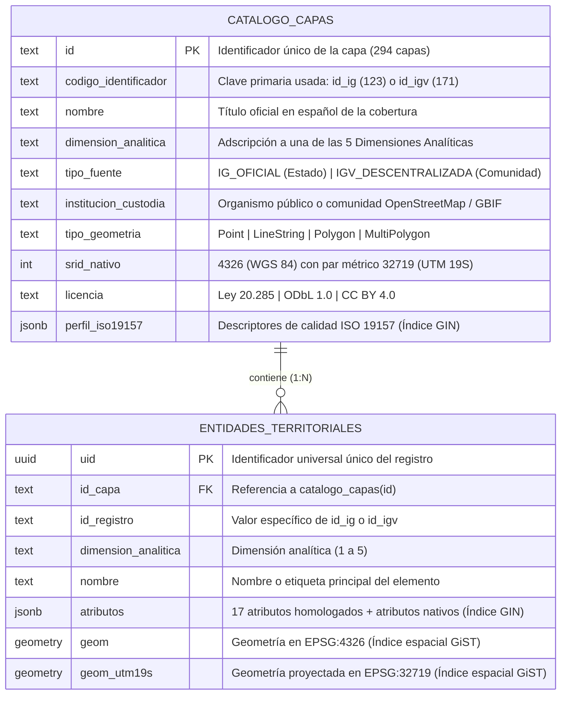

---

## 18. Empaquetado ZIP (`542,35 MB`), auditoría local pre-despliegue y publicación instantánea en Netlify

### ¿Por qué las auditorías se ejecutan localmente antes del commit y no dentro del servidor de Netlify?
Procesar y verificar la integridad sintáctica y topológica de **294 capas cartográficas** (`~5,07 GB` entre `data/` y `src/data/`) y de un archivo comprimido de `542,35 MB` requiere un alto consumo de disco y CPU. Si esos scripts se ejecutan dentro del comando `[build]` de Netlify, el proceso supera el límite de tiempo de construcción (15 a 18 minutos) y provoca fallos por *timeout*.

Por ello, el flujo de ingeniería del **Prototipo 02** desacopla completamente ambos pasos:
1. **En el computador del mantenedor (Pre-Commit Local):** Se ejecutan los scripts de enriquecimiento, empaquetado y auditoría (`verificar_conteo_capas.py` y `verificar_integridad_despliegue.py`), que tardan apenas unos segundos sobre el disco local.
2. **En el servidor de Netlify (`netlify.toml`):** La configuración define `publish = "src"` y un comando de construcción instantáneo (`echo ...`), logrando que **cada despliegue a producción finalice con éxito en menos de 30 segundos**.

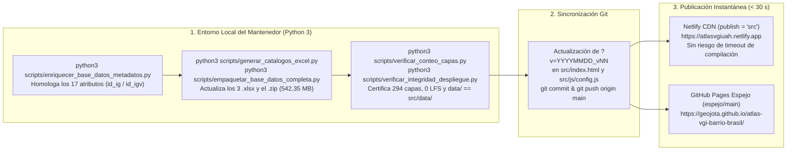

---

## 19. Marco jurídico tripartito de licencias abiertas y protección de datos

El Atlas cumple y exhibe explícitamente en su pie de página (`footer`) y en el capítulo `DOC · 04` del Módulo 03 un régimen jurídico tripartito compatible con la legislación chilena e internacional:
1. **Plataforma, textos, manuales y las 83 cartografías temáticas:** Licenciadas bajo **Creative Commons Atribución 4.0 Internacional (`CC BY 4.0` / `CC BY-SA 4.0`)**, permitiendo su libre reproducción y adaptación citando la fuente.
2. **Las 171 coberturas colaborativas de IGV (`id_igv`):** Regidas por la **Open Database License (`ODbL 1.0`)** de OpenStreetMap Foundation (`© Colaboradores de OpenStreetMap`) y **Creative Commons `CC BY 4.0`** para los registros de biodiversidad de GBIF.
3. **Las 123 coberturas oficiales del Estado de Chile (`id_ig`) y código fuente:** Datos públicos amparados por la **Ley N.° 20.285 sobre Acceso a la Información Pública**, la **Ley N.° 21.180 de Transformación Digital del Estado** y la **Ley N.° 19.628 sobre Protección de la Vida Privada** (todos los datos censales y del RSH están agregados a nivel de manzana o unidad vecinal, garantizando el secreto estadístico), mientras que el software se distribuye bajo licencia libre **GNU AGPLv3 / MIT**.

---

## 20. Recetario exhaustivo paso a paso de actualización y mantenimiento (12 procedimientos operativos)

Esta sección constituye la guía práctica paso a paso para cualquier persona o equipo técnico que necesite mantener, ampliar o adaptar el **Atlas para la Gestión Territorial**. Cada procedimiento indica qué archivos abrir, qué estructura respetar y qué comandos ejecutar para verificar el resultado.

---

### 20.1. Procedimiento 01: Incorporar o actualizar una cobertura oficial del Estado (`id_ig`)

**¿Cuándo usar este procedimiento?** Cuando un ministerio, servicio público (INE, MINVU, MDSF, SUBDERE, SII, CMN) o la municipalidad publique una nueva capa cartográfica o actualice una existente.

1. **Preparar y reproyectar el archivo a `EPSG:4326`:**
   * Abra la cobertura original (Shapefile, GeoPackage o KML) en QGIS.
   * Haga clic derecho sobre la capa → *Exportar* → *Guardar objetos como...*:
     * **Formato:** `GeoJSON` (RFC 7946).
     * **SRC (Sistema de Referencia de Coordenadas):** `EPSG:4326 - WGS 84`.
     * **Codificación:** `UTF-8`.
     * **Precisión de coordenadas:** `6` decimales.
2. **Guardar el archivo simétricamente en `data/` y `src/data/`:**
   ```bash
   cp /ruta/a/mi_nueva_capa_oficial.geojson data/capa_oficial_ejemplo.geojson
   cp data/capa_oficial_ejemplo.geojson src/data/capa_oficial_ejemplo.geojson
   ```
3. **Registrar la cobertura en `src/js/modulos/ide_chile.js`:**
   Abra [`src/js/modulos/ide_chile.js`](../js/modulos/ide_chile.js) y dentro del diccionario `CAPAS_OFICIALES` agregue o actualice la entrada asignándola a una de las **5 Dimensiones Analíticas**:
   ```javascript
   capa_oficial_ejemplo: {
     id: 'capa_oficial_ejemplo',
     nombre: 'Equipamiento Comunitario Municipal Actualizado (2026)',
     institucion: 'Ilustre Municipalidad de Santiago / IDE Chile',
     dimension: '1. Dimensión Sociodemográfica y Habitacional',
     archivoLocal: 'data/capa_oficial_ejemplo.geojson',
     geometria: 'Punto', // 'Punto' | 'Línea' | 'Polígono'
     color: '#10b981',
     peso: 2,
     opacidadRelleno: 0.45,
     licencia: 'Datos Abiertos del Estado (Ley N.° 20.285)',
     descripcion: 'Catastro oficial georreferenciado de centros comunitarios y sedes vecinales.'
   }
   ```
4. **Inyectar los 17 atributos homologados con clave `id_ig` y verificar:**
   ```bash
   python3 scripts/enriquecer_base_datos_metadatos.py
   python3 scripts/verificar_conteo_capas.py
   ```

---

### 20.2. Procedimiento 02: Incorporar o actualizar una cobertura descentralizada de IGV (`id_igv`)

**¿Cuándo usar este procedimiento?** Cuando desee actualizar los registros colaborativos de OpenStreetMap o de ciencia ciudadana de GBIF, o desglosar una nueva categoría temática de Información Geográfica Voluntaria.

1. **Actualizar mediante script o exportar el archivo `.geojson`:**
   * Para re-extraer desde OpenStreetMap para el polígono de Santiago y Barrio Brasil, ejecute:
     ```bash
     python3 scripts/descargar_todas_las_categorias_osm.py
     ```
   * Si agrega un archivo `.geojson` colaborativo propio, cópielo tanto en `data/capa_<nombre>.geojson` como en `src/data/capa_<nombre>.geojson` en proyección `EPSG:4326`.
2. **Registrar la cobertura en `src/js/modulos/catalogo_vgi_descentralizado.js`:**
   Abra [`src/js/modulos/catalogo_vgi_descentralizado.js`](../js/modulos/catalogo_vgi_descentralizado.js) y verifique o agregue el objeto dentro del arreglo `window.CATALOGO_VGI_DESCENTRALIZADO`:
   ```javascript
   {
     id: 'igv_huertos_urbanos',
     nombre: 'Huertos Urbanos y Jardines Comunitarios (IGV)',
     dimension: '3. Dimensión Socioambiental y Espacio Público',
     institucion: 'Comunidad OpenStreetMap Chile (IGV)',
     archivoLocal: 'data/capa_igv_huertos_urbanos.geojson',
     geometria: 'Punto',
     color: '#22c55e',
     etiquetaOSM: 'landuse=allotments | leisure=garden:community',
     licencia: 'ODbL 1.0 (OpenStreetMap)',
     descripcion: 'Espacios de cultivo comunitario y educación ambiental levantados colaborativamente.'
   }
   ```
3. **Homologar los 17 atributos con clave primaria `id_igv`:**
   ```bash
   python3 scripts/enriquecer_base_datos_metadatos.py
   ```

---

### 20.3. Procedimiento 03: Ejecutar la homologación de los 17 atributos ISO 19157

**¿Cuándo usar este procedimiento?** Siempre que modifique o agregue cualquier archivo `.geojson`, para garantizar que al hacer clic sobre sus elementos en el Módulo 02 el panel inferior **Detalles** muestre el perfil completo de 17 atributos (`id_ig` o `id_igv`).

1. Ejecute en la terminal desde la raíz del repositorio:
   ```bash
   python3 scripts/enriquecer_base_datos_metadatos.py
   ```
2. Levante el servidor local (`python3 -m http.server 8080 --directory src`), abra el **Módulo 02 (`Explorar Mapa`)**, active la capa modificada, haga clic sobre cualquiera de sus entidades y compruebe que en el panel inferior **Detalles** aparezcan los 17 atributos encabezados por `id_ig` (si es oficial) o `id_igv` (si es colaborativa de IGV).

---

### 20.4. Procedimiento 04: Configurar o añadir un nuevo mapa base sin clave de API en `mapa.js`

**¿Cuándo usar este procedimiento?** Cuando desee ajustar las URL de teselas o añadir un nuevo mosaico satelital o cartográfico libre que no dependa de claves de API comerciales.

1. Abra [`src/js/modulos/mapa.js`](../js/modulos/mapa.js) y localice la sección de inicialización de mapas base (`capasBase`).
2. Verifique que los **5 mapas base oficiales del Prototipo 02** estén definidos sin claves de API:
   * `OpenStreetMap Estándar`: `https://{s}.tile.openstreetmap.org/{z}/{x}/{y}.png`
   * `OpenStreetMap Humanitario (HOT)`: `https://{s}.tile.openstreetmap.fr/hot/{z}/{x}/{y}.png`
   * `Imagen Satelital (Bing / Microsoft)`: Teselas QuadKey `https://ecn.t{s}.tiles.virtualearth.net/tiles/a{q}.jpeg?g=14000&mkt=es-CL`
   * `Satelital Híbrido con Calles (Bing / Microsoft)`: Teselas QuadKey `https://ecn.t{s}.tiles.virtualearth.net/tiles/h{q}.jpeg?g=14000&mkt=es-CL`
   * `Imagen Satelital (Esri World Imagery)`: `https://server.arcgisonline.com/ArcGIS/rest/services/World_Imagery/MapServer/tile/{z}/{y}/{x}`
3. Si desea agregar un sexto proveedor libre (por ejemplo, *OpenTopoMap*), instancie su `L.tileLayer(...)`, incorpórelo al objeto de control de capas y agregue su atribución en el pie de página (`footer`) de `src/index.html`.

---

### 20.5. Procedimiento 05: Modificar los 18 pasos del Tutorial Interactivo o el Glosario de siglas

**¿Cuándo usar este procedimiento?** Cuando se incorpore una nueva herramienta en alguno de los 3 módulos o se quiera añadir una nueva sigla técnica al glosario.

1. **Para editar el Tutorial Interactivo (`src/js/modulos/tutorial_interactivo.js`):**
   * Abra [`src/js/modulos/tutorial_interactivo.js`](../js/modulos/tutorial_interactivo.js) y localice el arreglo `PASOS_TUTORIAL`.
   * Respete la regla pedagógica del Prototipo 02: **el primer paso de cada bloque modular debe presentar primero al módulo en sí mismo** (explicando qué es y para qué sirve con un lenguaje claro que no repita mecánicamente el texto de la pantalla), y los pasos siguientes deben recorrer sus herramientas individuales:
     ```javascript
     {
       bloque: 'Módulo 02 · Mapa',
       moduloNombre: 'Módulo 02 · Explorar Mapa',
       panel: 'inicio',
       selector: '#barra-herramientas-mapa',
       titulo: 'Barra Superior de Herramientas Territoriales',
       descripcion: 'Desde esta barra centrada puedes cambiar entre el Barrio Brasil y toda la Comuna de Santiago, medir superficies reales en metros cuadrados y activar el Inspector del Plan Regulador.',
       consejo: 'Usa "Delimitar área" para calcular cuántas hectáreas abarca cualquier sector de interés.'
     }
     ```
2. **Para añadir o editar siglas en el Glosario (`src/index.html`):**
   * Abra [`src/index.html`](../index.html), busque el contenedor `#modal-glosario-siglas` y agregue una nueva tarjeta `.item-glosario-sigla` con el atributo `data-sigla` en minúsculas para que el buscador instantáneo la filtre en vivo.

---

### 20.6. Procedimiento 06: Actualizar polígonos, reglas de edificabilidad o hitos del Inspector PRC

**¿Cuándo usar este procedimiento?** Cuando la Municipalidad de Santiago o el MINVU promulguen una enmienda o modificación al Plan Regulador Comunal (PRC) o declaren nuevos Inmuebles o Zonas de Conservación Histórica (`ICH`/`ZCH`).

1. **Actualizar la geometría de zonificación:**
   Reemplace el archivo `ide_minvu_ipt_prc_santiago.geojson` (y/o `ZCH_ICH_RM_Patrimonio_IPT.geojson`) en `data/` y `src/data/` conservando la proyección `EPSG:4326`.
2. **Actualizar los parámetros urbanísticos en `src/js/modulos/evaluador_normativo.js`:**
   Abra [`src/js/modulos/evaluador_normativo.js`](../js/modulos/evaluador_normativo.js) y edite el diccionario de zonas (`REGLAS_ZONAS_PRC`) modificando altura máxima, coeficiente de constructibilidad, ocupación de suelo, sistema de agrupamiento y usos permitidos/prohibidos, así como el arreglo `HITOS_HISTORICOS_PRC_BRASIL` para incorporar el nuevo decreto o publicación en el Diario Oficial.

---

### 20.7. Procedimiento 07: Incorporar nuevas cartografías (`.jpg`) en las 4 láminas del Módulo 01

**¿Cuándo usar este procedimiento?** Cuando elabore un nuevo mapa temático en QGIS o R y desee sumarlo a una de las 4 láminas geoestadísticas del **Módulo 01 (`Análisis`)**.

1. Exporte la lámina cartográfica en formato `.jpg` con buena legibilidad (ancho recomendado de `1800 px` a `2400 px`) y guárdela en `src/img/cartografias/nombre_nueva_lamina.jpg`.
2. Abra [`src/js/modulos/indicadores_analisis.js`](../js/modulos/indicadores_analisis.js), ubique el eje correspondiente dentro de `STORYBOARDS_GEOESTADISTICOS` y añada el descriptor del mapa indicando su título, subtítulo, ruta de imagen y síntesis interpretativa en lenguaje claro.

---

### 20.8. Procedimiento 08: Personalizar clasificaciones y rampas en `simbologia_dinamica.js`

**¿Cuándo usar este procedimiento?** Cuando desee añadir una nueva paleta cromática accesible para personas con daltonismo o ajustar el número de clases predeterminado del motor de simbología en el Módulo 02.

1. Abra [`src/js/modulos/simbologia_dinamica.js`](../js/modulos/simbologia_dinamica.js) y localice el diccionario `PALETAS_CROMATICAS`.
2. Agregue un nuevo arreglo de colores hexadecimales ordenados de menor a mayor intensidad luminosa, asegurando contraste suficiente tanto sobre el mapa claro de OpenStreetMap como sobre las imágenes satelitales oscuras de Bing/Microsoft y Esri.

---

### 20.9. Procedimiento 09: Actualizar los 6 capítulos del Módulo 03 (`manual.js`) y sincronizar Markdown

**¿Cuándo usar este procedimiento?** Cada vez que realice cambios en la documentación, para que lo que el usuario lee dentro del **Módulo 03 (`Documentación`)** en la web coincida exactamente con los archivos Markdown del repositorio Git.

1. Edite el capítulo correspondiente (`cap-uso-01` a `cap-uso-06`) dentro de [`src/js/modulos/manual.js`](../js/modulos/manual.js).
2. Actualice el archivo maestro en `src/docs/` (`MANUAL_USO.md`, `MANUAL_ACTUALIZACION_ATLAS.md`, `ARQUITECTURA.md`, `TRAZABILIDAD.md`, `ANALISIS_METACALIDAD.md`, `CONTRIBUTING.md`, `PROTOCOL_INTEGRIDAD_Y_DESPLIEGUE.md` o `GUIA_BASE_DATOS_SUPABASE.md`).
3. Ejecute el comando de sincronización simétrica hacia `docs/` y hacia la raíz del repositorio:
   ```bash
   cp src/docs/MANUAL_USO.md docs/MANUAL_USO.md && cp src/docs/MANUAL_USO.md MANUAL_USO.md
   cp src/docs/MANUAL_ACTUALIZACION_ATLAS.md docs/MANUAL_ACTUALIZACION_ATLAS.md && cp src/docs/MANUAL_ACTUALIZACION_ATLAS.md MANUAL_ACTUALIZACION_ATLAS.md
   cp src/docs/ARQUITECTURA.md docs/ARQUITECTURA.md
   cp src/docs/TRAZABILIDAD.md docs/TRAZABILIDAD.md
   cp src/docs/ANALISIS_METACALIDAD.md docs/ANALISIS_METACALIDAD.md
   cp src/docs/CONTRIBUTING.md docs/CONTRIBUTING.md && cp src/docs/CONTRIBUTING.md CONTRIBUTING.md
   cp src/docs/PROTOCOL_INTEGRIDAD_Y_DESPLIEGUE.md docs/PROTOCOL_INTEGRIDAD_Y_DESPLIEGUE.md && cp src/docs/PROTOCOL_INTEGRIDAD_Y_DESPLIEGUE.md PROTOCOL_INTEGRIDAD_Y_DESPLIEGUE.md
   cp src/docs/GUIA_BASE_DATOS_SUPABASE.md docs/GUIA_BASE_DATOS_SUPABASE.md
   ```

---

### 20.10. Procedimiento 10: Regenerar los 3 libros Excel (`.xlsx`) y el paquete `geodatabase_completa_atlas_vgi.zip`

**¿Cuándo usar este procedimiento?** Cuando haya modificado el catálogo de capas o sus atributos y quiera actualizar los archivos descargables del capítulo `DOC · 04` del Módulo 03.

```bash
# 1. Regenerar los 3 libros Excel en docs/ y src/docs/
python3 scripts/generar_catalogos_excel.py

# 2. Re-empaquetar la geodatabase completa (.zip) con las 294 capas, Excel y manuales
python3 scripts/empaquetar_base_datos_completa.py
```

---

### 20.11. Procedimiento 11: Guía completa de replicabilidad para adaptar el Atlas a otra comuna o barrio

El **Atlas para la Gestión Territorial** fue diseñado como una arquitectura 100 % transferible a cualquier otro municipio o barrio de Chile o Latinoamérica. El siguiente diagrama y lista de 6 pasos muestran cómo adaptarlo a un nuevo territorio:

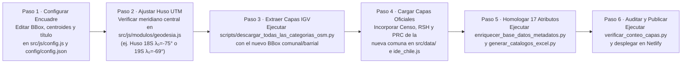

1. **Paso 1 (`src/js/config.js`):** Modifique las coordenadas del centroide (`centro`), nivel de zoom y cajas delimitadoras (`bbox`) de la nueva comuna y del nuevo barrio focal, junto con el subtítulo territorial.
2. **Paso 2 (`src/js/modulos/geodesia.js`):** Si el nuevo territorio se ubica entre las regiones de Arica y Parinacota y Ñuble/Biobío oriental, mantenga `EPSG:32719` ($\lambda_0 = -69^\circ$). Si se ubica en el sur o extremo austral (Huso 18 Sur), cambie la constante `MERIDIANO_CENTRAL_DEG = -75.0` (`EPSG:32718`).
3. **Paso 3 (`scripts/descargar_todas_las_categorias_osm.py`):** Actualice las coordenadas del polígono de consulta y ejecute el script para descargar las coberturas descentralizadas de IGV (`id_igv`) del nuevo territorio.
4. **Paso 4 (`src/js/modulos/ide_chile.js` y `evaluador_normativo.js`):** Reemplace las capas censales, de unidades vecinales y de zonificación del Plan Regulador Comunal por las de la nueva municipalidad, y actualice las reglas de edificabilidad de sus zonas en `evaluador_normativo.js`.
5. **Paso 5 (`scripts/enriquecer_base_datos_metadatos.py`):** Ejecute la inyección automática de los 17 atributos ISO 19115 / ISO 19157 y regenere los 3 libros Excel y el archivo `.zip`.
6. **Paso 6:** Valide localmente y publique en un nuevo sitio gratuito de Netlify apuntando al directorio `src/`.

---

### 20.12. Procedimiento 12: Auditoría local pre-despliegue, versión `?v=...` y despliegue en Netlify y espejo

Antes de subir cualquier modificación a producción, ejecute siempre esta secuencia de 4 pasos para garantizar un despliegue limpio y sin caché antigua en los navegadores de los usuarios:

```bash
# 1. Validar sintaxis de los módulos JavaScript modificados (en macOS usando JavaScriptCore)
/System/Library/Frameworks/JavaScriptCore.framework/Versions/Current/Helpers/jsc src/js/modulos/manual.js

# 2. Ejecutar los bancos de auditoría local (294 capas y 0 punteros LFS)
python3 scripts/verificar_conteo_capas.py
python3 scripts/verificar_integridad_despliegue.py

# 3. Incrementar el identificador de versión (?v=YYYYMMDD_vNN) en src/index.html y src/js/config.js
sed -i '' 's/20261110_v64/20261110_v65/g' src/index.html src/js/config.js

# 4. Confirmar cambios y publicar en producción (Netlify origin/main y GitHub Pages espejo/main)
git add .
git commit -m "feat(atlas): descripcion clara del cambio realizado"
git push --no-verify origin main
```

---

## 21. Diagnóstico y resolución de problemas frecuentes (*Troubleshooting*)

| Síntoma observado | Causa probable | Solución paso a paso |
| :--- | :--- | :--- |
| **El despliegue en Netlify falla tras ~18 minutos con `Execution timed out`** | Se incluyeron scripts pesados de auditoría de las 294 capas dentro del comando `[build] command` de `netlify.toml`. | Verifique que en `netlify.toml` el bloque `[build]` tenga `publish = "src"` y un comando ligero (`echo ...`), ejecutando `verificar_integridad_despliegue.py` siempre en local antes del commit. |
| **Una capa se activa en el selector pero no dibuja geometrías en el mapa** | (1) El archivo `.geojson` está en coordenadas métricas UTM (`EPSG:32719`) en lugar de grados `EPSG:4326`, o (2) se copió en `data/` pero faltó copiarlo en `src/data/`. | Reproyecte el archivo a `EPSG:4326` en QGIS, cópielo en `src/data/` y ejecute `python3 scripts/verificar_integridad_despliegue.py`. |
| **El navegador sigue mostrando un estilo CSS o texto JS anterior tras actualizar** | El navegador guardó en caché local la versión previa de `estilos.css` o de los scripts `.js`. | Incremente el sufijo `?v=YYYYMMDD_vNN` en todas las etiquetas `<link>` y `<script>` de `src/index.html` y en `src/js/config.js`. |
| **Al hacer clic en el mapa no aparece la tabla normativa del Plan Regulador (PRC)** | En el Prototipo 02 el Inspector PRC opera estrictamente bajo demanda para no sobrecargar la vista. | Pulse primero el botón **Inspector normativo (PRC)** en la barra superior centrada del Módulo 02 para activarlo y luego haga clic sobre el predio deseado. |
| **Git rechaza el push al repositorio espejo (`GH008: unknown Git LFS objects`)** | Se intentó crear una rama huérfana o subir punteros LFS no registrados en el servidor secundario. | Sincronice los archivos modificados sobre una rama creada a partir de `espejo/main` (`git checkout -B sync_espejo espejo/main`) y publique con `git push --no-verify espejo sync_espejo:main`. |
