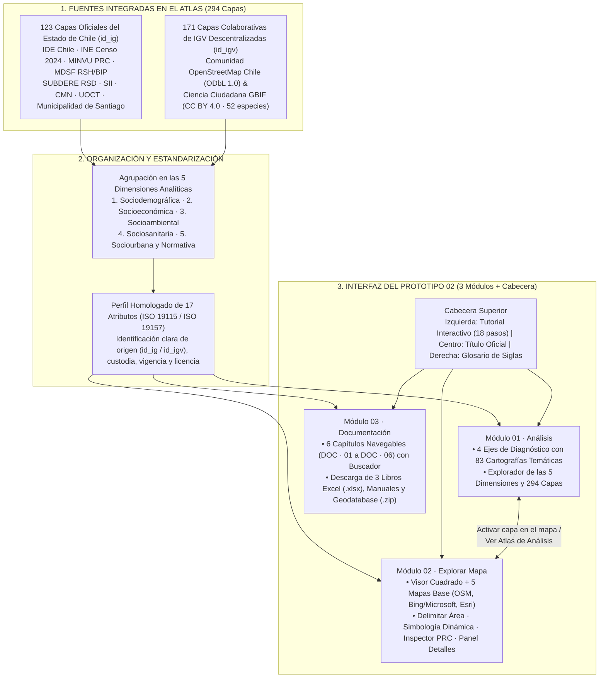
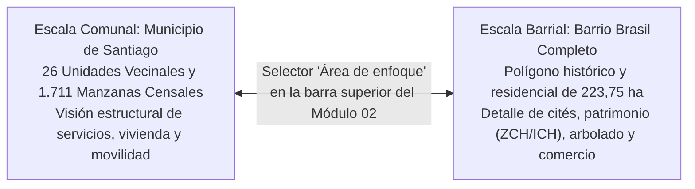
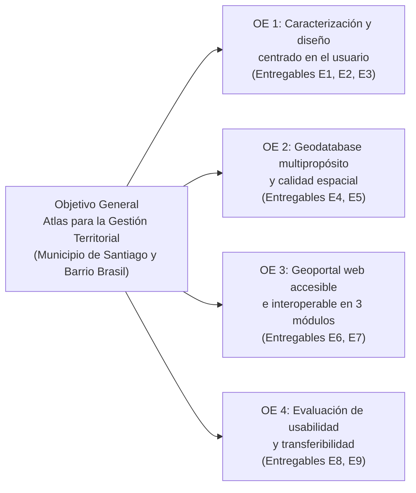
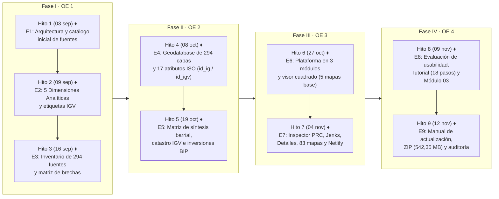
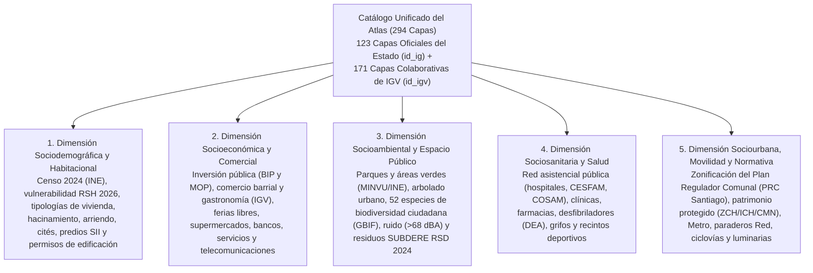
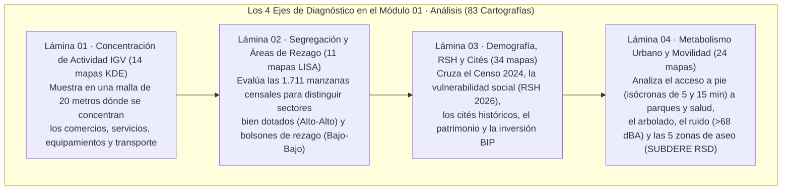
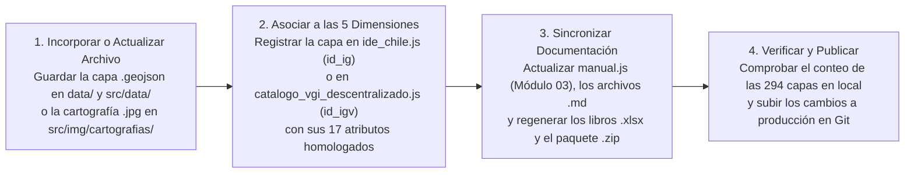

# Atlas para la Gestión Territorial
## Análisis y Exploración | Municipio de Santiago y Barrio Brasil — Manual de Actualización, Estructura de Datos y Funcionamiento de la Plataforma (Prototipo 02)

* **Plataforma Web en Producción:** [https://atlasvgiuah.netlify.app](https://atlasvgiuah.netlify.app)
* **Repositorio Espejo (GitHub Pages):** [https://geojota.github.io/atlas-vgi-barrio-brasil/](https://geojota.github.io/atlas-vgi-barrio-brasil/)
* **Geodatabase Consolidada Descargable (`.zip`):** `docs/geodatabase_completa_atlas_vgi.zip` (`542,35 MB` comprimidos / `~3,33 GB` descomprimidos; `294` coberturas espaciales operativas).

---

## Índice General de Contenidos

### [PARTE I: Alcance Operativo, Formulación Estratégica, Hitos Verificados y Perfiles Territoriales](#parte-i-alcance-operativo-formulación-estratégica-hitos-verificados-y-perfiles-territoriales)
* [1. Identificación, propósito y visión general del Prototipo 02](#1-identificación-propósito-y-visión-general-del-prototipo-02)
  * [1.1. Un prototipo sintetizado para facilitar la gestión y lectura del territorio](#11-un-prototipo-sintetizado-para-facilitar-la-gestión-y-lectura-del-territorio)
  * [1.2. Tabla 1.1: Cifras clave verificadas del proyecto (referencia única)](#12-tabla-11-cifras-clave-verificadas-del-proyecto-referencia-única)
  * [1.3. Diagrama general de la plataforma y sus 3 módulos operativos](#13-diagrama-general-de-la-plataforma-y-sus-3-módulos-operativos)
* [2. Cobertura territorial y escalas de trabajo del Atlas](#2-cobertura-territorial-y-escalas-de-trabajo-del-atlas)
  * [2.1. Articulación entre la escala comunal (Municipio de Santiago) y la escala barrial (Barrio Brasil)](#21-articulación-entre-la-escala-comunal-municipio-de-santiago-y-la-escala-barrial-barrio-brasil)
* [3. Formulación estratégica: Objetivos del proyecto y entregables verificados](#3-formulación-estratégica-objetivos-del-proyecto-y-entregables-verificados)
  * [3.1. Objetivo general](#31-objetivo-general)
  * [3.2. Objetivos específicos (`OE 1` a `OE 4`) y entregables verificados](#32-objetivos-específicos-oe-1-a-oe-4-y-entregables-verificados)
* [4. Matriz de los 9 Hitos con entregable verificado asociado (`Hito 1 / E1` a `Hito 9 / E9`)](#4-matriz-de-los-9-hitos-con-entregable-verificado-asociado-hito-1--e1-a-hito-9--e9)
* [5. Perfiles de actores territoriales destinatarios](#5-perfiles-de-actores-territoriales-destinatarios)

### [PARTE II: Organización de las 5 Dimensiones Analíticas, Catálogo de 294 Capas, Diagnóstico Territorial y Actualización](#parte-ii-organización-de-las-5-dimensiones-analíticas-catálogo-de-294-capas-diagnóstico-territorial-y-actualización)
* [6. Organización temática en las 5 Dimensiones Analíticas del Territorio](#6-organización-temática-en-las-5-dimensiones-analíticas-del-territorio)
  * [6.1. Dimensión 1: Sociodemográfica y Habitacional](#61-dimensión-1-sociodemográfica-y-habitacional)
  * [6.2. Dimensión 2: Socioeconómica y Comercial](#62-dimensión-2-socioeconómica-y-comercial)
  * [6.3. Dimensión 3: Socioambiental y Espacio Público](#63-dimensión-3-socioambiental-y-espacio-público)
  * [6.4. Dimensión 4: Sociosanitaria y Salud](#64-dimensión-4-sociosanitaria-y-salud)
  * [6.5. Dimensión 5: Sociourbana, Movilidad y Normativa](#65-dimensión-5-sociourbana-movilidad-y-normativa)
* [7. Descentralización de las 171 coberturas de Información Geográfica Voluntaria (`id_igv`)](#7-descentralización-de-las-171-coberturas-de-información-geográfica-voluntaria-id_igv)
* [8. Integración de las 123 capas oficiales del Estado de Chile (`id_ig`)](#8-integración-de-las-123-capas-oficiales-del-estado-de-chile-id_ig)
* [9. Perfil homologado de 17 atributos de metadatos y calidad (ISO 19115 / ISO 19157)](#9-perfil-homologado-de-17-atributos-de-metadatos-y-calidad-iso-19115--iso-19157)
  * [9.1. Diccionario de los 17 atributos homologados (`id_ig` / `id_igv`)](#91-diccionario-de-los-17-atributos-homologados-id_ig--id_igv)
  * [9.2. Libros maestros descargables en formato Excel (`.xlsx`)](#92-libros-maestros-descargables-en-formato-excel-xlsx)
* [10. Guía comprensible de los 4 Ejes de Diagnóstico Geoestadístico (83 cartografías)](#10-guía-comprensible-de-los-4-ejes-de-diagnóstico-geoestadístico-83-cartografías)
  * [10.1. Eje 01: Concentración Territorial de Actividad IGV en Santiago (14 mapas KDE)](#101-eje-01-concentración-territorial-de-actividad-igv-en-santiago-14-mapas-kde)
  * [10.2. Eje 02: Segregación Espacial, Hotspots y Áreas de Rezago (11 mapas LISA)](#102-eje-02-segregación-espacial-hotspots-y-áreas-de-rezago-11-mapas-lisa)
  * [10.3. Eje 03: Estructura Sociodemográfica, Habitabilidad y Morfología Urbana (34 mapas)](#103-eje-03-estructura-sociodemográfica-habitabilidad-y-morfología-urbana-34-mapas)
  * [10.4. Eje 04: Metabolismo Urbano, Movilidad y Espacio Público (24 mapas)](#104-eje-04-metabolismo-urbano-movilidad-y-espacio-público-24-mapas)
* [11. Criterios generales para la actualización y mantención del Atlas](#11-criterios-generales-para-la-actualización-y-mantención-del-atlas)

---

# PARTE I: Alcance Operativo, Formulación Estratégica, Hitos Verificados y Perfiles Territoriales

---

## 1. Identificación, propósito y visión general del Prototipo 02

El **Atlas para la Gestión Territorial** (*Análisis y Exploración | Municipio de Santiago y Barrio Brasil*) es una plataforma web pública y abierta que integra en un mismo entorno **123 coberturas oficiales del Estado de Chile** (identificadas con el atributo primario `id_ig`) y **171 coberturas descentralizadas de Información Geográfica Voluntaria, IGV** (identificadas con el atributo primario `id_igv`).

Su objetivo principal es acercar la información territorial tanto a quienes toman decisiones en instituciones públicas como a las comunidades barriales, mapeadores voluntarios e investigadores, combinando la validez estadística y normativa de los registros del Estado con el nivel de detalle cotidiano que aporta la cartografía colaborativa.

### 1.1. Un prototipo sintetizado para facilitar la gestión y lectura del territorio
A partir de la evaluación de usabilidad desarrollada en el proyecto, el **Prototipo 02** organiza todas las capacidades del Atlas en una estructura limpia, directa y fácil de recorrer compuesta por **tres módulos principales** y **dos herramientas de apoyo permanente en la cabecera**:
* **Cabecera Superior Permanente (`#cabecera-atlas`):** Ubica el **Tutorial Interactivo** (de 18 pasos organizados en 4 bloques navegables) a la izquierda del título principal, y el **Glosario de siglas** a la derecha del título, evitando que ambos recuadros se superpongan.
* **Módulo 01 · Análisis (`#panel-indicadores`):** Presenta el diagnóstico del territorio a través de **4 láminas geoestadísticas (83 cartografías temáticas)** y agrupa las **294 coberturas** en **5 Dimensiones Analíticas** con un buscador en español que permite activarlas directamente en el mapa.
* **Módulo 02 · Explorar Mapa (`#panel-inicio`):** Dispone un visor cartográfico amplio y de proporción cuadrada con **5 mapas base abiertos y satelitales sin requerimiento de clave de API** (OpenStreetMap Estándar, OpenStreetMap Humanitario HOT, Imagen Satelital Bing/Microsoft, Satelital Híbrido con Calles Bing/Microsoft e Imagen Satelital Esri World Imagery), barra superior centrada de herramientas, motor de **Simbología Dinámica**, **Inspector normativo del Plan Regulador Comunal (PRC)** bajo demanda y el panel inferior **Detalles** para consultar los **17 atributos homologados (`id_ig` / `id_igv`)**.
* **Módulo 03 · Documentación (`#panel-manual`):** Reúne dentro de la plataforma **6 capítulos navegables (`DOC · 01` a `DOC · 06`)** con buscador en tiempo real, descargas de los 3 libros en formato Excel (`.xlsx`), manuales, el paquete comprimido de la geodatabase completa (`.zip` de `542,35 MB`) y el inventario filtrable de las 294 capas.

### 1.2. Tabla 1.1: Cifras clave verificadas del proyecto (referencia única)

| Componente del sistema | Valor verificado | Descripción clara y alcance |
| :--- | :---: | :--- |
| **Total de coberturas cartográficas** | **294 capas** | Suma de **123 capas oficiales del Estado de Chile (`id_ig`)** y **171 coberturas descentralizadas de Información Geográfica Voluntaria (`id_igv`)**. |
| **Dimensiones Analíticas del territorio** | **5 dimensiones** | (1) *Sociodemográfica y Habitacional*, (2) *Socioeconómica y Comercial*, (3) *Socioambiental y Espacio Público*, (4) *Sociosanitaria y Salud*, y (5) *Sociourbana, Movilidad y Normativa*. |
| **Diagnóstico geoestadístico** | **4 ejes · 83 cartografías** | Lámina 01: Concentración KDE (`14` mapas); Lámina 02: Autocorrelación LISA (`11` mapas); Lámina 03: Demografía Censo 2024, RSH y cités (`34` mapas); Lámina 04: Metabolismo urbano, ruido y residuos (`24` mapas). |
| **Perfil homologado de metadatos y calidad** | **17 atributos por entidad** | Estandarizado bajo normas **ISO 19115** e **ISO 19157**, diferenciando `id_ig` (fuente oficial) e `id_igv` (fuente voluntaria), visible en el panel inferior **Detalles** del Módulo 02. |
| **Estructura de navegación** | **3 módulos + 2 ayudas** | `Módulo 01 · Análisis`, `Módulo 02 · Explorar Mapa` y `Módulo 03 · Documentación` (6 capítulos), más el **Tutorial Interactivo** (18 pasos) y el **Glosario de siglas**. |
| **Mapas base disponibles** | **5 mapas base sin API** | *OpenStreetMap Estándar*, *OpenStreetMap Humanitario (HOT)*, *Imagen Satelital (Bing / Microsoft)*, *Satelital Híbrido con Calles (Bing / Microsoft)* e *Imagen Satelital (Esri World Imagery)*. |
| **Hitos con entregable verificado** | **9 hitos (`E1` a `E9`)** | Cronograma de 9 hitos vinculados directamente con entregables verificados en el repositorio y en la plataforma web. |
| **Paquete maestro descargable** | **542,35 MB (`.zip`)** | Archivo `docs/geodatabase_completa_atlas_vgi.zip` acompañado de 3 libros maestros en formato Excel (`.xlsx`). |

### 1.3. Diagrama general de la plataforma y sus 3 módulos operativos

---

## 2. Cobertura territorial y escalas de trabajo del Atlas

### 2.1. Articulación entre la escala comunal (Municipio de Santiago) y la escala barrial (Barrio Brasil)
El Atlas permite trabajar de forma fluida en dos escalas complementarias, conmutables desde el selector **Área de enfoque** en la barra superior del **Módulo 02 (`Explorar Mapa`)**:
1. **Escala Comunal — Municipio de Santiago (`1.711` manzanas censales y `26` unidades vecinales):** Abarca toda la comuna de Santiago, permitiendo observar patrones generales de población, distribución de equipamientos, redes de movilidad y zonas de gestión ambiental.
2. **Escala Barrial — Barrio Brasil (`223,75 ha` en el sector norponiente):** Comprende el polígono delimitado por Av. San Pablo/Rosas al norte, la Alameda al sur, Av. Manuel Rodríguez (Ruta 5) al oriente y Av. Ricardo Cumming/García Reyes al poniente, facilitando el análisis detallado a nivel de cuadra, pasaje, cité y predio patrimonial.

---

## 3. Formulación estratégica: Objetivos del proyecto y entregables verificados

El proyecto se estructura en torno a un **Objetivo General** y **cuatro Objetivos Específicos (`OE 1` a `OE 4`)**, cuyos entregables verificados se encuentran íntegramente disponibles en el repositorio y en la plataforma web:

### 3.1. Objetivo general
> Desarrollar un Atlas para la Gestión Territorial reproducible, interoperable y centrado en el usuario, que integre geodatos abiertos, cartografía participativa y herramientas analíticas para subsanar vacíos de información territorial y apoyar la gestión local y la investigación en la Comuna de Santiago y Barrio Brasil.

### 3.2. Objetivos específicos (`OE 1` a `OE 4`) y entregables verificados

* **OE 1.** Caracterizar la disponibilidad, la cobertura y los vacíos de información geográfica del área de estudio, y definir las bases taxonómicas y de diseño centrado en el usuario que permitan integrar datos colaborativos e institucionales.
  * *Componentes ejecutados y entregables verificados (`E1`, `E2`, `E3`):* Revisión de plataformas de geodatos abiertos (OpenStreetMap, GBIF e IDE Chile); organización temática del catálogo en las **5 Dimensiones Analíticas** del territorio; caracterización de los cuatro perfiles de actores territoriales e inventario de brechas de información (`docs/ARQUITECTURA.md`, `docs/TRAZABILIDAD.md`, `docs/catalogo_fuentes_vgi.xlsx` y `docs/categorias_tematicas_osm.xlsx`).
* **OE 2.** Consolidar una geodatabase multipropósito que armonice coberturas oficiales e información voluntaria bajo estándares internacionales de calidad y metadatos.
  * *Componentes ejecutados y entregables verificados (`E4`, `E5`):* Descarga, descentralización y normalización de las **294 coberturas vectoriales** (**123 capas oficiales del Estado de Chile** y **171 coberturas descentralizadas de Información Geográfica Voluntaria, IGV**); homologación del perfil de metadatos y calidad ISO 19157 de **17 atributos** diferenciando `id_ig` (información geográfica oficial) e `id_igv` (información geográfica voluntaria); y elaboración de las matrices de síntesis comunal y barrial (`src/data/*.geojson`, `docs/perfil_metadatos_vgi.xlsx`, `data/matriz_sintesis_barrio_brasil_manzanas.geojson` y `data/bip_inversiones_santiago.csv`).
* **OE 3.** Implementar un geoportal web accesible e interoperable que permita visualizar cartografía multinivel, consultar el territorio en tiempo real y descargar geodatos abiertos.
  * *Componentes ejecutados y entregables verificados (`E6`, `E7`):* **Definición de un prototipo sintetizado para usuarios no técnicos:** prototipo más sintetizado que permita a usuarios sin experiencia técnica poder interactuar de forma más simple con la plataforma, articulado en 3 módulos (*Módulo 01 Análisis*, *Módulo 02 Explorar Mapa* y *Módulo 03 Documentación*); visor cartográfico cuadrado con **5 mapas base abiertos y satelitales sin clave de API** (OpenStreetMap Estándar y HOT, Bing/Microsoft Satelital e Híbrido, y Esri World Imagery), simbología dinámica (*Cortes Naturales de Jenks*), Inspector normativo del Plan Regulador Comunal (PRC) bajo demanda, panel inferior **Detalles** y 4 ejes de diagnóstico geoestadístico con 83 cartografías temáticas (`src/index.html`, `src/css/estilos.css`, `src/js/modulos/mapa.js`, `evaluador_normativo.js`, `indicadores_analisis.js` y `netlify.toml`).
* **OE 4.** Evaluar la usabilidad y la pertinencia de la plataforma con distintos perfiles de actores territoriales y asegurar su transferibilidad técnica, metodológica y documental.
  * *Componentes ejecutados y entregables verificados (`E8`, `E9`):* Aplicación de instrumentos de evaluación de usabilidad con tareas guiadas (Modalidad 1) y conversaciones con vecinos (Modalidad 2); implementación del **Tutorial Interactivo navegable de 18 pasos en 4 bloques** y del **Glosario de siglas**; documentación navegable en el Módulo 03 y en el repositorio Git; y empaquetado de la geodatabase completa (`docs/MANUAL_USO.md`, `docs/MANUAL_ACTUALIZACION_ATLAS.md`, `src/js/modulos/tutorial_interactivo.js`, `src/js/modulos/manual.js` y `docs/geodatabase_completa_atlas_vgi.zip`).

---

## 4. Matriz de los 9 Hitos con entregable verificado asociado (`Hito 1 / E1` a `Hito 9 / E9`)

En total correspondencia con la Carta Gantt del proyecto (`Carta_Gantt_Atlas_VGI.pdf`), se mantienen exclusivamente los **9 hitos que cuentan con un entregable verificado asociado (`E1` a `E9`)**:

| Hito | Fecha ($\blacklozenge$) | OE | Entregable verificado asociado (`E1` a `E9`) | Localización verificable en el repositorio y plataforma |
| :---: | :---: | :---: | :--- | :--- |
| **Hito 1** | `03 sep 2026` | `OE 1` | **E1 ·** Arquitectura del sistema y catálogo inicial de fuentes | `docs/ARQUITECTURA.md` y `docs/catalogo_fuentes_vgi.xlsx` (`src/docs/`) |
| **Hito 2** | `09 sep 2026` | `OE 1` | **E2 ·** Cinco dimensiones analíticas, etiquetas IGV y configuración | `docs/categorias_tematicas_osm.xlsx` (`src/docs/`) y `src/js/config.js` |
| **Hito 3** | `16 sep 2026` | `OE 1` | **E3 ·** Inventario consolidado de 294 fuentes y matriz de brechas | `docs/catalogo_fuentes_vgi.xlsx` y `docs/TRAZABILIDAD.md` (`src/docs/`) |
| **Hito 4** | `08 oct 2026` | `OE 2` | **E4 ·** Geodatabase de 294 capas GeoJSON y perfil de 17 atributos ISO (`id_ig` / `id_igv`) | `src/data/*.geojson`, `data/*.geojson` y `docs/perfil_metadatos_vgi.xlsx` |
| **Hito 5** | `19 oct 2026` | `OE 2` | **E5 ·** Matriz de síntesis barrial por manzana, catastro IGV e inversiones BIP | `data/matriz_sintesis_barrio_brasil_manzanas.geojson`, `data/resumen_catastro_vgi.csv` y `data/bip_inversiones_santiago.csv` |
| **Hito 6** | `27 oct 2026` | `OE 3` | **E6 ·** Plataforma sintetizada en 3 módulos (*Análisis*, *Explorar Mapa*, *Documentación*) y visor cuadrado | `src/index.html`, `src/css/estilos.css`, `src/js/app.js` y `src/js/modulos/mapa.js` |
| **Hito 7** | `04 nov 2026` | `OE 3` | **E7 ·** Inspector normativo PRC, simbología Jenks, panel *Detalles*, 83 mapas y despliegue en Netlify | `src/js/modulos/evaluador_normativo.js`, `src/js/modulos/simbologia_dinamica.js`, `src/js/modulos/indicadores_analisis.js` y `netlify.toml` |
| **Hito 8** | `09 nov 2026` | `OE 4` | **E8 ·** Evaluación de usabilidad, Tutorial interactivo (18 pasos) y Módulo 03 navegable | `docs/TRAZABILIDAD.md`, `MANUAL_USO.md`, `src/js/modulos/tutorial_interactivo.js` y `src/js/modulos/manual.js` |
| **Hito 9** | `12 nov 2026` | `OE 4` | **E9 ·** Manual de actualización, paquete ZIP (`542,35 MB`) y verificación de integridad | `MANUAL_ACTUALIZACION_ATLAS.md`, `docs/geodatabase_completa_atlas_vgi.zip` y `scripts/verificar_conteo_capas.py` |

---

## 5. Perfiles de actores territoriales destinatarios

La plataforma está diseñada para responder de forma clara a cuatro perfiles de actores territoriales:
1. **Perfil 1 — Instituciones públicas (Municipio / IDE):** Equipos municipales (SECPLAN, DOM, DIDECO, DIMAO) y servicios ministeriales que requieren cruzar vulnerabilidad social (RSH) y demografía (Censo 2024) con dotación de equipamiento, cartera de proyectos BIP y normativa vigente del Plan Regulador Comunal (PRC).
2. **Perfil 2 — Comunidad, vecinas y vecinos:** Juntas de vecinos, organizaciones barriales y residentes del Barrio Brasil y de Santiago que buscan conocer y visibilizar el estado de su entorno (áreas verdes, salud, luminarias, cités, patrimonio y reglas de edificación en su cuadra) mediante una interfaz guiada por el Tutorial Interactivo y el Glosario de siglas.
3. **Perfil 3 — Mapeadores voluntarios y ciencia ciudadana (OpenStreetMap / GBIF):** Contribuyentes de datos abiertos que utilizan el Atlas para identificar sectores de la comuna con vacíos de mapeo colaborativo y revisar los atributos de completitud y calidad de las 171 coberturas `id_igv`.
4. **Perfil 4 — ONG, docencia e investigación:** Equipos académicos, estudiantes y organizaciones sociales que consultan las 83 cartografías temáticas del Módulo 01 y descargan la geodatabase completa (`.zip`) y los catálogos en Excel (`.xlsx`) desde el Módulo 03 para sus propios estudios.

---

# PARTE II: Organización de las 5 Dimensiones Analíticas, Catálogo de 294 Capas, Diagnóstico Territorial y Actualización

---

## 6. Organización temática en las 5 Dimensiones Analíticas del Territorio

Para facilitar la búsqueda y comprensión de las **294 coberturas espaciales** (`123` oficiales del Estado + `171` colaborativas de IGV), el Prototipo 02 las agrupa en **5 Dimensiones Analíticas** presentes tanto en el **Módulo 01 (`Análisis`)** como en el selector de capas del **Módulo 02 (`Explorar Mapa`)**:

### 6.1. Dimensión 1: Sociodemográfica y Habitacional
Reúne los datos de población, hogares y vivienda del **Censo 2024 (INE)** y los tramos socioeconómicos del **Registro Social de Hogares (RSH 2026)** junto con el catastro de **cités y pasajes históricos**, la información predial del **Servicio de Impuestos Internos (SII)** y los permisos y recepciones de edificación.

### 6.2. Dimensión 2: Socioeconómica y Comercial
Combina la cartera de inversiones públicas del **Banco Integrado de Proyectos (BIP)** y del **MOP** con la red de comercio cotidiano y abastecimiento levantada en OpenStreetMap (almacenes, panaderías, supermercados, ferias libres, mercados, restaurantes, bancos y servicios) y redes de telecomunicaciones (SUBTEL).

### 6.3. Dimensión 3: Socioambiental y Espacio Público
Integra el catastro de parques, plazas y áreas verdes (**MINVU / INE** y municipal), el arbolado urbano, las **52 coberturas de flora y fauna ciudadana de GBIF**, los mapas de exposición a **ruido ambiental (`>68 dBA`, MMA)**, los puntos limpios de reciclaje y las **13 coberturas del Catastro de Residuos Sólidos Domiciliarios (SUBDERE RSD 2024)** correspondientes a las **5 zonas de aseo municipal**.

### 6.4. Dimensión 4: Sociosanitaria y Salud
Agrupa la red asistencial pública y privada (hospitales, CESFAM, centros de salud mental, clínicas), las farmacias, los **desfibriladores externos automáticos (DEA)**, los grifos contra incendios, los cuarteles de Bomberos y el equipamiento deportivo y comunitario.

### 6.5. Dimensión 5: Sociourbana, Movilidad y Normativa
Articula la zonificación del **Plan Regulador Comunal de Santiago (PRC)**, las **Zonas e Inmuebles de Conservación Histórica (`ZCH`/`ICH`)** y los **Monumentos Nacionales (CMN)** con las redes de transporte público (**Metro** y paraderos **Red**), semáforos UOCT, ciclovías, bicicleteros, cruces peatonales, accesibilidad universal y luminarias.

---

## 7. Descentralización de las 171 coberturas de Información Geográfica Voluntaria (`id_igv`)

En lugar de concentrar el mapeo colaborativo en archivos genéricos difíciles de consultar, el Atlas descentraliza la Información Geográfica Voluntaria en **171 capas temáticas independientes con nombres claros en español** (`src/js/modulos/catalogo_vgi_descentralizado.js`):
* **119 coberturas de equipamiento, comercio, movilidad e infraestructura barrial** provenientes de **OpenStreetMap** bajo licencia abierta `ODbL 1.0`.
* **52 coberturas por especie de flora y fauna urbana** provenientes de registros de ciencia ciudadana en **GBIF** bajo licencia `CC BY 4.0` y estándar Darwin Core.

---

## 8. Integración de las 123 capas oficiales del Estado de Chile (`id_ig`)

Las **123 coberturas oficiales (`id_ig`)** (`src/js/modulos/ide_chile.js`) provienen de los organismos públicos custodios del Estado de Chile: **INE** (Censo 2024 y edificación), **MINVU** (Plan Regulador Comunal, patrimonio `ZCH`/`ICH` y áreas verdes), **MDSF** (Registro Social de Hogares 2026 e inversiones BIP), **SUBDERE** (Catastro RSD 2024 y zonas de aseo), **MTT / UOCT / DTPM / SUBTEL** (Metro, Red, semáforos y telecomunicaciones), **MMA** (ruido ambiental e islas de calor), **CMN** (Monumentos Históricos y Zonas Típicas), **SII** (catastro predial) y la **Ilustre Municipalidad de Santiago** (barrios, unidades vecinales, cités y equipamiento comunal).

---

## 9. Perfil homologado de 17 atributos de metadatos y calidad (ISO 19115 / ISO 19157)

Cada elemento de las **294 capas** cuenta con una ficha estandarizada de **17 atributos** basada en las normas internacionales **ISO 19115** (metadatos) e **ISO 19157** (calidad de datos espaciales), que se despliega en el panel inferior **Detalles** del **Módulo 02 (`Explorar Mapa`)** al hacer clic sobre cualquier punto, línea o polígono.

### 9.1. Diccionario de los 17 atributos homologados (`id_ig` / `id_igv`)

| N° | Atributo | Norma ISO | Descripción clara de su contenido |
| :---: | :--- | :---: | :--- |
| **`01`** | **`id_ig` / `id_igv`** | ISO 19115 | **Identificador único primario:** utiliza **`id_ig`** en las 123 capas oficiales del Estado de Chile e **`id_igv`** en las 171 capas colaborativas de Información Geográfica Voluntaria. |
| **`02`** | `nombre_capa` | ISO 19115 | Nombre descriptivo en español de la cobertura dentro del catálogo de 294 capas. |
| **`03`** | `dimension_analitica` | ISO 19115 | Indica a cuál de las 5 Dimensiones Analíticas del Atlas pertenece la capa. |
| **`04`** | `tipo_fuente` | ISO 19115 | Señala si corresponde a `Información Geográfica Oficial (Estado de Chile)` o a `Información Geográfica Voluntaria (IGV Descentralizada)`. |
| **`05`** | `institucion_custodia` | ISO 19115 | Organismo público responsable o comunidad colaborativa custodia (`OpenStreetMap Chile` / `GBIF`). |
| **`06`** | `sistema_referencia` | ISO 19115 | Sistema de coordenadas geográficas (`EPSG:4326`) y de medición en metros (`EPSG:32719` UTM 19S). |
| **`07`** | `escala_referencia` | ISO 19115 | Escala cartográfica de referencia del levantamiento (`1:1.000` a `1:25.000`). |
| **`08`** | `fecha_actualizacion` | ISO 19115 | Fecha verificada de última actualización o corte de extracción de los datos (`AAAA-MM-DD`). |
| **`09`** | `licencia_uso` | ISO 19115 | Condición legal de uso abierto: `Ley N.° 20.285 (Datos Abiertos)`, `ODbL 1.0 (OpenStreetMap)` o `CC BY 4.0 (GBIF)`. |
| **`10`** | `exactitud_posicional` | ISO 19157 | Nivel de precisión de la ubicación del elemento respecto de la cartografía base y ortofotos. |
| **`11`** | `consistencia_topologica` | ISO 19157 | Verifica que las geometrías estén correctamente cerradas y sin errores de dibujo. |
| **`12`** | `completitud` | ISO 19157 | Informa qué tan completos están los datos descriptivos del registro dentro del área de estudio. |
| **`13`** | `exactitud_tematica` | ISO 19157 | Confirma que la clasificación temática asignada al lugar o equipamiento sea correcta. |
| **`14`** | `consistencia_temporal` | ISO 19157 | Indica la vigencia temporal del dato dentro del periodo operativo del Atlas (`2024–2026`). |
| **`15`** | `linaje_fuente` | ISO 19157 | Resume de dónde provino el dato y cómo fue normalizado para integrarse en la plataforma. |
| **`16`** | `cobertura_territorial` | ISO 19115 | Alcance espacial de la capa (`Barrio Brasil`, `Comuna de Santiago` o `Región Metropolitana`). |
| **`17`** | `archivo_origen` | ISO 19115 | Ruta del archivo `.geojson` en el repositorio (`data/<archivo>.geojson`) para su trazabilidad directa. |

### 9.2. Libros maestros descargables en formato Excel (`.xlsx`)
Desde el capítulo **`DOC · 04`** del **Módulo 03 (`Documentación`)** se pueden descargar tres libros Excel que respaldan toda la estructura del catálogo:
1. **`categorias_tematicas_osm.xlsx`:** Organización de las 5 Dimensiones Analíticas, listado de las 171 capas de IGV y diccionario de atributos.
2. **`perfil_metadatos_vgi.xlsx`:** Detalle de los 17 atributos homologados (`id_ig` / `id_igv`) bajo las normas ISO 19115 e ISO 19157.
3. **`catalogo_fuentes_vgi.xlsx`:** Inventario completo de las 294 coberturas con su institución custodia, escala y licencia.

---

## 10. Guía comprensible de los 4 Ejes de Diagnóstico Geoestadístico (83 cartografías)

El **Módulo 01 (`Análisis`)** reúne **83 cartografías temáticas** organizadas en **4 ejes o láminas de diagnóstico**. A continuación se explica de manera clara y accesible qué muestra cada eje y cómo ayuda a comprender el territorio:

### 10.1. Eje 01: Concentración Territorial de Actividad IGV en Santiago (14 mapas KDE)
* **¿Qué muestra y cómo se lee?** A través del método de **Estimación de Densidad por Núcleo (KDE)** calculado sobre una malla de 20 metros (a partir de 79.841 entidades y 112.264 nodos colaborativos), estos 14 mapas transforman miles de puntos individuales en superficies continuas de intensidad. Los colores más intensos permiten identificar de un vistazo dónde se agrupan con mayor fuerza el comercio cotidiano, los servicios, la oferta cultural y el transporte público (especialmente en el eje Alameda, el centro histórico y el Barrio Brasil-Yungay), mientras que los tonos suaves muestran los sectores residenciales con menor densidad de equipamiento mapeado.

### 10.2. Eje 02: Segregación Espacial, Hotspots y Áreas de Rezago (11 mapas LISA)
* **¿Qué muestra y cómo se lee?** Utiliza los **Indicadores Locales de Asociación Espacial (LISA de Anselin)** sobre las **1.711 manzanas censales** de la Comuna de Santiago para comparar cada manzana con sus manzanas vecinas inmediatas. Así, el mapa clasifica las manzanas en cuatro situaciones fáciles de interpretar para la toma de decisiones:
  * **Alto-Alto (Rojo — *Hotspot*):** Manzanas con alta cobertura de servicios rodeadas de vecinas igualmente bien dotadas.
  * **Bajo-Bajo (Azul — *Coldspot*):** Conjuntos de manzanas vecinas que comparten simultáneamente baja dotación de equipamiento o mayor vulnerabilidad, señalando las **áreas prioritarias de rezago donde focalizar proyectos e inversión**.
  * **Alto-Bajo y Bajo-Alto:** Manzanas que presentan una condición distinta a la de su entorno inmediato.

### 10.3. Eje 03: Estructura Sociodemográfica, Habitabilidad y Morfología Urbana (34 mapas)
* **¿Qué muestra y cómo se lee?** Es la serie más amplia de mapas del diagnóstico (`34` cartografías) y cruza tres fuentes clave: el **Censo de Población y Vivienda 2024 (INE)**, la calificación socioeconómica del **Registro Social de Hogares (RSH 2026)** y el catastro de **cités, viviendas colectivas y patrimonio histórico (`ZCH`/`ICH`)**. Permite observar en qué manzanas viven más personas mayores o población infantil, dónde predomina el arriendo o el hacinamiento, cómo se distribuyen los cités en el Barrio Brasil y dónde se localizan las iniciativas de inversión pública del **BIP**.

### 10.4. Eje 04: Metabolismo Urbano, Movilidad y Espacio Público (24 mapas)
* **¿Qué muestra y cómo se lee?** Evalúa la calidad ambiental cotidiana y la cercanía a pie dentro de la ciudad a través de `24` cartografías que integran:
  * **Isócronas de caminata peatonal (5, 10 y 15 minutos a pie):** Muestran qué manzanas cuentan con una plaza, parque, estación de transporte o centro de salud a distancia caminable y cuáles presentan déficit de proximidad.
  * **Arbolado y biodiversidad ciudadana:** Distribución del arbolado urbano y de las 52 especies registradas colaborativamente en GBIF.
  * **Ruido ambiental (`>68 dBA`):** Identifica las calles y frentes de manzana expuestos a niveles altos de ruido vehicular diurno y nocturno en corredores como la Ruta 5, Alameda, Av. Brasil y Av. Matucana.
  * **Gestión de residuos domiciliarios (`SUBDERE RSD 2024`):** Muestra la cobertura operativa de recolección, contenedores y papeleros en las **5 zonas de aseo municipal** de Santiago.

---

## 11. Criterios generales para la actualización y mantención del Atlas

Para mantener actualizado el **Atlas para la Gestión Territorial** o incorporar nuevas capas y documentos conservando la coherencia del **Prototipo 02**, el flujo de mantención sigue cuatro pasos simples y verificables:

1. **Paridad de archivos entre el repositorio y la web:** Todo archivo de datos (`.geojson` o `.csv`) debe guardarse de manera idéntica tanto en la carpeta `data/` como en `src/data/`, y todo documento o catálogo descargable (`.md`, `.xlsx` o `.zip`) debe actualizarse tanto en `docs/` como en `src/docs/`.
2. **Adscripción a las 5 Dimensiones Analíticas y clave de origen (`id_ig` / `id_igv`):** Toda cobertura oficial del Estado debe registrarse con su identificador `id_ig` en `src/js/modulos/ide_chile.js`, y toda cobertura colaborativa de Información Geográfica Voluntaria debe registrarse con su identificador `id_igv` y nombre en español en `src/js/modulos/catalogo_vgi_descentralizado.js`, asignándola siempre a una de las 5 Dimensiones Analíticas y manteniendo sus 17 atributos homologados (`scripts/enriquecer_base_datos_metadatos.py`).
3. **Coherencia con la interfaz de 3 módulos:** Cualquier actualización visual o documental debe preservar la organización sintetizada en el **Módulo 01 (`Análisis`)**, el **Módulo 02 (`Explorar Mapa`**, con sus 5 mapas base sin clave de API y el panel inferior **Detalles**) y el **Módulo 03 (`Documentación`**, con sus 6 capítulos navegables `DOC · 01` a `DOC · 06`), así como la disposición en cabecera del **Tutorial Interactivo** (a la izquierda del título) y el **Glosario de siglas** (a la derecha del título).
4. **Verificación local previa a la publicación:** Antes de subir cambios a producción, se comprueba localmente la integridad de las capas (`scripts/verificar_conteo_capas.py` y `scripts/verificar_integridad_despliegue.py`) para que la publicación web en Netlify se realice de manera directa, rápida y sin interrupciones.
