# Atlas para la Gestión Territorial
## Análisis y Exploración | Municipio de Santiago y Barrio Brasil — Manual de actualización técnica, transferibilidad metodológica y arquitectura operativa

---

## Índice general de contenidos

### [PARTE I: Alcance operativo, formulación estratégica y perfiles territoriales](#parte-i-alcance-operativo-formulación-estratégica-y-perfiles-territoriales)
* [1. Identificación y alcance operativo del proyecto](#1-identificación-y-alcance-operativo-del-proyecto)
  * [1.1. Propósito y misión operativa](#11-propósito-y-misión-operativa)
* [2. Delimitación geodésica y cobertura territorial del área de estudio](#2-delimitación-geodésica-y-cobertura-territorial-del-área-de-estudio)
* [3. Formulación estratégica: Objetivos del proyecto y entregables verificados](#3-formulación-estratégica-objetivos-del-proyecto-y-entregables-verificados)
  * [3.1. Objetivo general](#31-objetivo-general)
  * [3.2. Objetivos específicos y entregables verificados](#32-objetivos-específicos-y-entregables-verificados)
* [4. Flujo de trabajo integral de los entregables verificados del proyecto](#4-flujo-de-trabajo-integral-de-los-entregables-verificados-del-proyecto)
* [5. Perfiles de actores territoriales destinatarios](#5-perfiles-de-actores-territoriales-destinatarios)
  * [5.1. Perfil 1: Instituciones públicas (municipio / IDE)](#51-perfil-1-instituciones-públicas-municipio--ide)
  * [5.2. Perfil 2: Comunidad y vecinos](#52-perfil-2-comunidad-y-vecinos)
  * [5.3. Perfil 3: Mapeadores voluntarios (OSM)](#53-perfil-3-mapeadores-voluntarios-osm)
  * [5.4. Perfil 4: ONG, docencia e investigación](#54-perfil-4-ong-docencia-e-investigación)

### [PARTE II: Ingeniería de datos, dimensiones analíticas y normalización cartográfica](#parte-ii-ingeniería-de-datos-dimensiones-analíticas-y-normalización-cartográfica)
* [6. Organización taxonómica en 5 dimensiones analíticas territoriales](#6-organización-taxonómica-en-5-dimensiones-analíticas-territoriales)
  * [6.1. Dimensión 01: Educación, Cultura y Patrimonio](#61-dimensión-01-educación-cultura-y-patrimonio)
  * [6.2. Dimensión 02: Servicios, Comercio y Habitabilidad](#62-dimensión-02-servicios-comercio-y-habitabilidad)
  * [6.3. Dimensión 03: Movilidad, Transporte y Accesibilidad](#63-dimensión-03-movilidad-transporte-y-accesibilidad)
  * [6.4. Dimensión 04: Áreas Verdes, Ambiente y Biodiversidad](#64-dimensión-04-áreas-verdes-ambiente-y-biodiversidad)
  * [6.5. Dimensión 05: Normativa, Suelo y Morfología Urbana](#65-dimensión-05-normativa-suelo-y-morfología-urbana)
* [7. Ingesta y normalización de las 171 coberturas descentralizadas de IGV (OpenStreetMap y GBIF)](#7-ingesta-y-normalización-de-las-171-coberturas-descentralizadas-de-igv-openstreetmap-y-gbif)
  * [7.1. Coberturas granulares de OpenStreetMap por equipamiento y servicio](#71-coberturas-granulares-de-openstreetmap-por-equipamiento-y-servicio)
  * [7.2. Ocurrencias de ciencia ciudadana y biodiversidad urbana (GBIF / Darwin Core)](#72-ocurrencias-de-ciencia-ciudadana-y-biodiversidad-urbana-gbif--darwin-core)
* [8. Ingesta, normalización y homologación de las 123 capas oficiales del Estado de Chile](#8-ingesta-normalización-y-homologación-de-las-123-capas-oficiales-del-estado-de-chile)
  * [8.1. Instituto Nacional de Estadísticas (INE) — Censo 2024](#81-instituto-nacional-de-estadísticas-ine--censo-2024)
  * [8.2. Ministerio de Vivienda y Urbanismo (MINVU) y Municipalidad de Santiago (PRC)](#82-ministerio-de-vivienda-y-urbanismo-minvu-y-municipalidad-de-santiago-prc)
  * [8.3. Subsecretaría de Desarrollo Regional y Administrativo (SUBDERE) — Catastro RSD 2024](#83-subsecretaría-de-desarrollo-regional-y-administrativo-subdere--catastro-rsd-2024)
  * [8.4. Unidad Operativa de Control de Tránsito (UOCT / MTT) y SUBTEL](#84-unidad-operativa-de-control-de-tránsito-uoct--mtt-y-subtel)
  * [8.5. Ministerio de Desarrollo Social y Familia (MDSF / RSH y BIP)](#85-ministerio-de-desarrollo-social-y-familia-mdsf--rsh-y-bip)
  * [8.6. Consejo de Monumentos Nacionales (CMN) y Servicio de Impuestos Internos (SII)](#86-consejo-de-monumentos-nacionales-cmn-y-servicio-de-impuestos-internos-sii)
* [9. Perfil homologado de 17 atributos de metadatos y calidad espacial (ISO 19115 / ISO 19157)](#9-perfil-homologado-de-17-atributos-de-metadatos-y-calidad-espacial-iso-19115--iso-19157)
  * [9.1. Diccionario de los 17 atributos homologados (`id_ig` / `id_igv`)](#91-diccionario-de-los-17-atributos-homologados-id_ig--id_igv)
  * [9.2. Inyección automatizada en la geodatabase (`scripts/enriquecer_base_datos_metadatos.py`)](#92-inyección-automatizada-en-la-geodatabase-scriptsenriquecer_base_datos_metadatospy)
  * [9.3. Catálogos maestros en formato OpenXML (`.xlsx`)](#93-catálogos-maestros-en-formato-openxml-xlsx)

### [PARTE III: Ingeniería de software, interfaz de 3 módulos y visualización interactiva](#parte-iii-ingeniería-de-software-interfaz-de-3-módulos-y-visualización-interactiva)
* [10. Arquitectura frontend sin compilación previa: Vanilla JavaScript ES6+ y patrón IIFE](#10-arquitectura-frontend-sin-compilación-previa-vanilla-javascript-es6-y-patrón-iife)
  * [10.1.Estructura modular de los 3 módulos principales y la cabecera global](#101-estructura-modular-de-los-3-módulos-principales-y-la-cabecera-global)
  * [10.2. Tutorial interactivo de 14 pasos y Glosario de siglas en cabecera](#102-tutorial-interactivo-de-14-pasos-y-glosario-de-siglas-en-cabecera)
* [11. Motor cartográfico en el Módulo 02 (`Explorar mapa`): Leaflet 1.9.4 y mapas base sin clave API](#11-motor-cartográfico-en-el-módulo-02-explorar-mapa-leaflet-194-y-mapas-base-sin-clave-api)
  * [11.1. Lienzo cartográfico de proporción cuadrada y proyección EPSG:4326 / EPSG:32719](#111-lienzo-cartográfico-de-proporción-cuadrada-y-proyección-epsg4326--epsg32719)
  * [11.2. Los 4 mapas base operativos (OpenStreetMap, HOT, Bing/Microsoft y Esri)](#112-los-4-mapas-base-operativos-openstreetmap-hot-bingmicrosoft-y-esri)
  * [11.3. Motor de Simbología dinámica (cortes naturales de Jenks y 6 paletas cromáticas)](#113-motor-de-simbología-dinámica-cortes-naturales-de-jenks-y-6-paletas-cromáticas)
  * [11.4. Panel inferior de `Detalles` y exportación dinámica (GeoJSON / CSV)](#114-panel-inferior-de-detalles-y-exportación-dinámica-geojson--csv)
* [12. Inspector normativo del Plan Regulador Comunal de Santiago (PRC / OGUC)](#12-inspector-normativo-del-plan-regulador-comunal-de-santiago-prc--oguc)
  * [12.1. Algoritmo de intersección punto en polígono (*ray-casting*) en el navegador](#121-algoritmo-de-intersección-punto-en-polígono-ray-casting-en-el-navegador)
  * [12.2. Emisión del Certificado de Informaciones Normativas (CIN) y expediente histórico](#122-emisión-del-certificado-de-informaciones-normativas-cin-y-expediente-histórico)
* [13. Módulo 01 (`Análisis`): Las 5 dimensiones analíticas, los 4 guiones visuales y las 83 cartografías](#13-módulo-01-análisis-las-5-dimensiones-analíticas-los-4-guiones-visuales-y-las-83-cartografías)
* [14. Módulo 03 (`Documentación`): Los 6 capítulos navegables en la plataforma](#14-módulo-03-documentación-los-6-capítulos-navegables-en-la-plataforma)
* [15. Topografía integral del repositorio y anatomía de archivos](#15-topografía-integral-del-repositorio-y-anatomía-de-archivos)

### [PARTE IV: Base de datos PostGIS, empaquetado, despliegue en Netlify y tutoriales de mantenimiento](#parte-iv-base-de-datos-postgis-empaquetado-despliegue-en-netlify-y-tutoriales-de-mantenimiento)
* [16. Infraestructura espacial: PostgreSQL 17 + PostGIS 3.3 en Supabase Cloud](#16-infraestructura-espacial-postgresql-17--postgis-33-en-supabase-cloud)
* [17. Empaquetado de la geodatabase (`empaquetar_base_datos_completa.py`) y verificación pre-despliegue](#17-empaquetado-de-la-geodatabase-empaquetar_base_datos_completapy-y-verificación-pre-despliegue)
* [18. Configuración de despliegue continuo en Netlify (`netlify.toml`) y GitHub Pages](#18-configuración-de-despliegue-continuo-en-netlify-netlifytoml-y-github-pages)
* [19. Marco jurídico, licencias de datos y atribuciones cartográficas en el pie de plataforma](#19-marco-jurídico-licencias-de-datos-y-atribuciones-cartográficas-en-el-pie-de-plataforma)
* [20. Guía paso a paso de actualización y mantenimiento (10 procedimientos operativos)](#20-guía-paso-a-paso-de-actualización-y-mantenimiento-10-procedimientos-operativos)
  * [20.1. Procedimiento 01: Incorporar una nueva capa oficial (`id_ig`) o de IGV (`id_igv`)](#201-procedimiento-01-incorporar-una-nueva-capa-oficial-id_ig-o-de-igv-id_igv)
  * [20.2. Procedimiento 02: Actualizar o añadir un mapa base en `mapa.js`](#202-procedimiento-02-actualizar-o-añadir-un-mapa-base-en-mapajs)
  * [20.3. Procedimiento 03: Modificar los pasos del Tutorial interactivo o el Glosario de siglas](#203-procedimiento-03-modificar-los-pasos-del-tutorial-interactivo-o-el-glosario-de-siglas)
  * [20.4. Procedimiento 04: Actualizar la zonificación o hitos del Inspector normativo (PRC)](#204-procedimiento-04-actualizar-la-zonificación-o-hitos-del-inspector-normativo-prc)
  * [20.5. Procedimiento 05: Incorporar nuevas cartografías o fichas en el Módulo 01 (`Análisis`)](#205-procedimiento-05-incorporar-nuevas-cartografías-o-fichas-en-el-módulo-01-análisis)
  * [20.6. Procedimiento 06: Actualizar los capítulos navegables del Módulo 03 (`Documentación`)](#206-procedimiento-06-actualizar-los-capítulos-navegables-del-módulo-03-documentación)
  * [20.7. Procedimiento 07: Inyectar el perfil homologado de 17 atributos ISO 19157](#207-procedimiento-07-inyectar-el-perfil-homologado-de-17-atributos-iso-19157)
  * [20.8. Procedimiento 08: Regenerar los 3 catálogos Excel (`.xlsx`) y el paquete ZIP](#208-procedimiento-08-regenerar-los-3-catálogos-excel-xlsx-y-el-paquete-zip)
  * [20.9. Procedimiento 09: Modificar variables de diseño `:root` y proporciones del visor](#209-procedimiento-09-modificar-variables-de-diseño-root-y-proporciones-del-visor)
  * [20.10. Procedimiento 10: Auditoría local, control de caché (`?v=...`) y despliegue en Netlify](#2010-procedimiento-10-auditoría-local-control-de-caché-v-y-despliegue-en-netlify)

---

# PARTE I: Alcance operativo, formulación estratégica y perfiles territoriales

---

## 1. Identificación y alcance operativo del proyecto

El **Atlas para la Gestión Territorial** (*Análisis y Exploración | Municipio de Santiago y Barrio Brasil*) es una plataforma web abierta diseñada bajo una arquitectura sintetizada de tres módulos (`01 Análisis`, `02 Explorar mapa` y `03 Documentación`) que reúne cartografía pública oficial e Información Geográfica Voluntaria (IGV) descentralizada para el diagnóstico urbano, la consulta normativa y la descarga libre de datos espaciales en la comuna de Santiago y el Barrio Brasil.

El sistema articula estándares del Open Geospatial Consortium (OGC) y de la Organización Internacional de Normalización (ISO 19115 para metadatos e ISO 19157 para calidad de datos espaciales). La Tabla 1.1 sintetiza las cifras clave verificadas de la plataforma y del repositorio.

### Tabla 1.1. Cifras clave del proyecto (referencia general)

| Indicador o componente | Valor verificado | Definición operativa y alcance |
| :--- | :---: | :--- |
| **Coberturas cartográficas totales** | **294 capas** | **123 capas oficiales del Estado de Chile (`id_ig`) + 171 coberturas descentralizadas de Información Geográfica Voluntaria (`id_igv`)** de OpenStreetMap y GBIF. |
| **Dimensiones analíticas territoriales** | **5 dimensiones** | Agrupación transversal temática en los Módulos 01 y 02: Educación, Cultura y Patrimonio; Servicios, Comercio y Habitabilidad; Movilidad, Transporte y Accesibilidad; Áreas Verdes, Ambiente y Biodiversidad; y Normativa, Suelo y Morfología Urbana. |
| **Cartografías temáticas e indicadores** | **83 cartografías** | Distribuidas en 4 guiones visuales territoriales (densidad de Kernel KDE, autocorrelación espacial LISA, Censo 2024/RSH y metabolismo urbano) y 5 dimensiones de análisis urbano en el Módulo 01 (`Análisis`). |
| **Perfil homologado de metadatos y calidad** | **17 atributos ISO 19157** | Esquema estandarizado embebido en cada entidad geográfica (`id_ig` para fuentes estatales e `id_igv` para fuentes de IGV), consultable en el panel inferior de **Detalles** del Módulo 02. |
| **Arquitectura de navegación** | **3 módulos + 2 apoyos en cabecera** | Módulos `01 Análisis`, `02 Explorar mapa` y `03 Documentación` (con 6 capítulos navegables `DOC · 01` a `DOC · 06`), acompañados por el **Tutorial interactivo** (14 pasos) y el **Glosario de siglas**. |
| **Mapas base operativos** | **4 mosaicos sin API key** | OpenStreetMap Estándar, OpenStreetMap Humanitario (HOT), Imágenes Satelitales Bing / Microsoft e Imágenes Satelitales Esri World Imagery. |
| **Volumen y paquete de datos abiertos** | **542,35 MB en ZIP** | Geodatabase completa descargable en `docs/geodatabase_completa_atlas_vgi.zip` y 3 catálogos maestros en formato OpenXML (`.xlsx`). |

### 1.1. Propósito y misión operativa
El proyecto responde a la necesidad de cubrir los vacíos de información territorial a escala de manzana censal y unidad vecinal que presentan los catastros estatales tradicionales. Mientras las fuentes públicas suelen registrar rezagos de actualización o agregaciones comunales que ocultan el detalle de la infraestructura peatonal, el comercio barrial o la red de cités, la Información Geográfica Voluntaria (IGV) aporta datos granulares y actualizados a escala vecinal.

Para resolver esta brecha, el Atlas integra en un mismo entorno de consulta las **171 coberturas descentralizadas de IGV** provenientes de OpenStreetMap (OSM) y de la Infraestructura Mundial de Información en Biodiversidad (GBIF) con las **123 coberturas oficiales del Estado de Chile** provenientes de IDE Chile, el Ministerio de Vivienda y Urbanismo (MINVU), el Instituto Nacional de Estadísticas (INE), el Ministerio de Transportes y Telecomunicaciones (MTT/UOCT), el Ministerio de Desarrollo Social y Familia (MDSF), la Subsecretaría de Desarrollo Regional y Administrativo (SUBDERE), la Municipalidad de Santiago y el Servicio de Impuestos Internos (SII).

---

## 2. Delimitación geodésica y cobertura territorial del área de estudio

El área de estudio focal comprende un polígono continuo de 223,75 ha situado en el sector norponiente de la comuna de Santiago (Barrio Brasil), articulado con coberturas a escala comunal (Municipio de Santiago) y metropolitana. Su caja delimitadora se define en coordenadas geográficas WGS84 (`EPSG:4326`) y en la proyección métrica oficial SIRGAS-Chile / UTM Huso 19 Sur (`EPSG:32719`):

```text
BBox_Barrio_Brasil (EPSG:4326) = [-70.6720, -33.4505, -70.6580, -33.4350]
  Longitud (oeste a este): -70,6720° a -70,6580°
  Latitud  (sur a norte) : -33,4505° a -33,4350°
```

* **Límite norte:** Eje vial de avenida San Pablo y calle Rosas (transición hacia el barrio Yungay).
* **Límite sur:** Eje de avenida Libertador Bernardo O'Higgins / Alameda (corredor de transporte metropolitano, Línea 1 de Metro con estaciones Los Héroes y República).
* **Límite oriente:** Eje vial de avenida Manuel Rodríguez (Autopista Central - Ruta 5 Norte-Sur).
* **Límite poniente:** Eje vial de avenida Ricardo Cumming y calle García Reyes.

---

## 3. Formulación estratégica: Objetivos del proyecto y entregables verificados

El proyecto se organiza en un objetivo general y cuatro objetivos específicos (`OE 1` a `OE 4`) con entregables verificables en el repositorio y en la plataforma web:

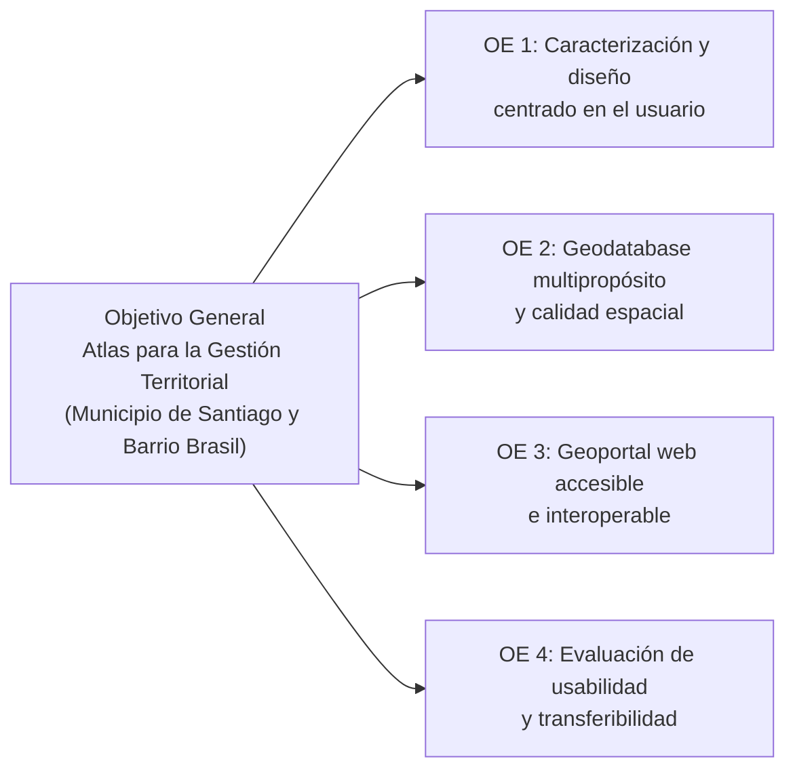

### 3.1. Objetivo general
> Desarrollar un Atlas para la Gestión Territorial reproducible, interoperable y centrado en el usuario, que integre geodatos abiertos, cartografía participativa y herramientas analíticas para subsanar vacíos de información territorial y apoyar la gestión local y la investigación en la comuna de Santiago y Barrio Brasil.

---

### 3.2. Objetivos específicos y entregables verificados

* **OE 1.** Caracterizar la disponibilidad, la cobertura y los vacíos de información geográfica del área de estudio, y definir las bases taxonómicas y de diseño centrado en el usuario que permitan integrar datos colaborativos e institucionales.
* **OE 2.** Consolidar una geodatabase multipropósito que armonice coberturas oficiales e información voluntaria bajo estándares internacionales de calidad y metadatos.
* **OE 3.** Implementar un geoportal web accesible e interoperable que permita visualizar cartografía multinivel, consultar el territorio en tiempo real y descargar geodatos abiertos.
* **OE 4.** Evaluar la usabilidad y la pertinencia de la plataforma con distintos perfiles de actores territoriales y asegurar su transferibilidad técnica, metodológica y documental.

---

#### Objetivo específico 1 (OE 1): Caracterización y diseño centrado en el usuario
* **Estado operativo:** 100 % completado.
* **Definición formal:**
  > Caracterizar la disponibilidad, la cobertura y los vacíos de información geográfica del área de estudio, y definir las bases taxonómicas y de diseño centrado en el usuario que permitan integrar datos colaborativos e institucionales.
* **Componentes ejecutados:**
  - Revisión de fuentes de geodatos abiertos institucionales (IDE Chile, INE, MINVU, SUBDERE, SII, Municipalidad de Santiago) y de Información Geográfica Voluntaria (IGV) en OpenStreetMap y GBIF.
  - Organización taxonómica de las coberturas territoriales en las **5 dimensiones analíticas** del Atlas: (1) *Educación, Cultura y Patrimonio*, (2) *Servicios, Comercio y Habitabilidad*, (3) *Movilidad, Transporte y Accesibilidad*, (4) *Áreas Verdes, Ambiente y Biodiversidad*, y (5) *Normativa, Suelo y Morfología Urbana*.
  - Caracterización de los perfiles de actores territoriales (instituciones públicas, comunidad y vecinos, mapeadores voluntarios y ONG/academia) mediante criterios de diseño centrado en el usuario.

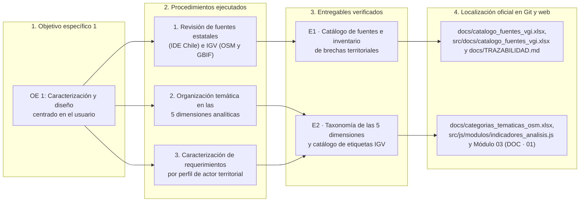

* **Entregables verificados y localización oficial:**

| N° | Entregable verificado | Tipo de producto | Fuente y localización oficial en el proyecto |
|:---:|:---|:---:|:---|
| **E-01** | Documento metodológico de arquitectura, organización en 5 dimensiones analíticas y perfiles de usuario. | Metodológico | `docs/ARQUITECTURA.md`, `docs/TRAZABILIDAD.md` y `src/js/modulos/manual.js` (`DOC · 01`) |
| **E-02** | Catálogo de fuentes geoespaciales, matriz de brechas barriales y correspondencia taxonómica IGV. | Catálogo de datos | `docs/catalogo_fuentes_vgi.xlsx` y `docs/categorias_tematicas_osm.xlsx` (`src/docs/`) |

---

#### Objetivo específico 2 (OE 2): Geodatabase multipropósito y calidad espacial
* **Estado operativo:** 100 % completado.
* **Definición formal:**
  > Consolidar una geodatabase multipropósito que armonice coberturas oficiales e información voluntaria bajo estándares internacionales de calidad y metadatos.
* **Componentes ejecutados:**
  - Descarga, normalización y geoprocesamiento de las **294 coberturas vectoriales del catálogo (compuestas por 123 capas oficiales del Estado de Chile y 171 coberturas descentralizadas de IGV)** en los sistemas de referencia `EPSG:4326` y `EPSG:32719`.
  - Estructuración de la base de datos espacial en clúster relacional PostgreSQL 17 + PostGIS 3.3 (Supabase Cloud) con indexación espacial GiST y atributos JSONB indexados mediante GIN.
  - Estandarización e inyección del **perfil homologado de metadatos y calidad espacial ISO 19157 de 17 atributos** en la totalidad de las entidades vectoriales, diferenciando mediante clave única los registros oficiales (`id_ig`) y los registros de Información Geográfica Voluntaria (`id_igv`) para su inspección directa en el panel **Detalles** y su descarga transparente.

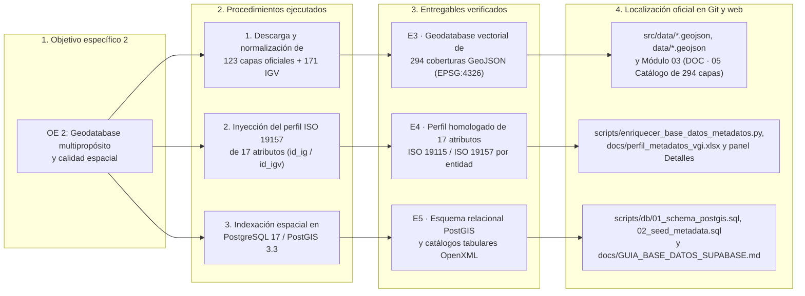

* **Entregables verificados y localización oficial:**

| N° | Entregable verificado | Tipo de producto | Fuente y localización oficial en el proyecto |
|:---:|:---|:---:|:---|
| **E-03** | Geodatabase espacial de **294 coberturas vectoriales GeoJSON** (`123` oficiales con `id_ig` + `171` descentralizadas de IGV con `id_igv`). | Geodatabase vectorial | `src/data/*.geojson`, `data/*.geojson` y `src/js/modulos/manual.js` (`DOC · 05`) |
| **E-04** | Base de datos espacial PostgreSQL 17 + PostGIS 3.3 desplegada en la nube con funciones de consulta espacial. | Base relacional espacial | `scripts/db/01_schema_postgis.sql`, `scripts/db/02_seed_metadata.sql` y `docs/GUIA_BASE_DATOS_SUPABASE.md` (`src/docs/`) |
| **E-05** | Perfil homologado de 17 atributos de metadatos y calidad espacial ISO 19157 embebido en cada entidad y documentado en libro OpenXML (`.xlsx`). | Perfil de calidad y metadatos | `docs/perfil_metadatos_vgi.xlsx`, `src/docs/perfil_metadatos_vgi.xlsx` y panel **Detalles** del Módulo 02 |

---

#### Objetivo específico 3 (OE 3): Geoportal web accesible e interoperable
* **Estado operativo:** 100 % completado.
* **Definición formal:**
  > Implementar un geoportal web accesible e interoperable que permita visualizar cartografía multinivel, consultar el territorio en tiempo real y descargar geodatos abiertos.
* **Componentes ejecutados:**
  - **Definición de un prototipo sintetizado para usuarios no técnicos:** prototipo más sintetizado que permita a usuarios sin experiencia técnica poder interactuar de forma más simple con la plataforma, articulado en tres módulos principales (`Módulo 01 Análisis`, `Módulo 02 Explorar mapa` y `Módulo 03 Documentación`) y complementado en la cabecera por el **Tutorial interactivo** (a la izquierda del título) y el **Glosario de siglas** (a la derecha del título).
  - Configuración del visor cartográfico de proporción cuadrada en el **Módulo 02 (`Explorar mapa`)** sobre Leaflet 1.9.4, con selector de 4 mapas base sin requerimiento de clave API (**OpenStreetMap Estándar**, **OpenStreetMap Humanitario (HOT)**, **Imágenes Satelitales Bing / Microsoft** e **Imágenes Satelitales Esri World Imagery**), catálogo de las 294 capas agrupadas en las 5 dimensiones analíticas, buscador instantáneo, motor de **Simbología dinámica** (cortes naturales de Jenks) y panel inferior de **Detalles** con exportación directa en GeoJSON y CSV.
  - Implementación del **Inspector normativo (PRC)** del Plan Regulador Comunal de Santiago y de la Ordenanza General de Urbanismo y Construcciones (OGUC) en el panel lateral del Módulo 02, que ejecuta intersección punto en polígono en el navegador y emite el Certificado de Informaciones Normativas descargable.
  - Integración en el **Módulo 01 (`Análisis`)** de las 5 dimensiones analíticas territoriales y los 4 guiones visuales con 83 cartografías temáticas e indicadores espaciales (KDE, LISA, Censo 2024 y metabolismo urbano), con publicación continua en Netlify (`https://atlasvgiuah.netlify.app/`).

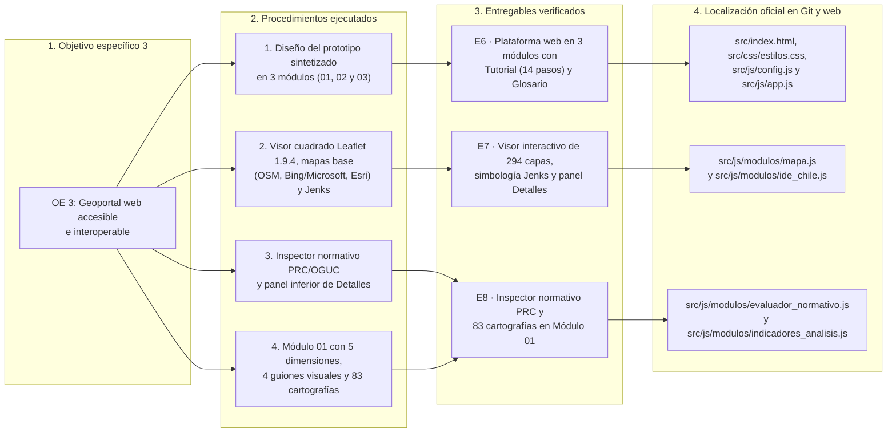

* **Entregables verificados y localización oficial:**

| N° | Entregable verificado | Tipo de producto | Fuente y localización oficial en el proyecto |
|:---:|:---|:---:|:---|
| **E-06** | Plataforma web sintetizada en tres módulos (`01 Análisis`, `02 Explorar mapa` y `03 Documentación`) con Tutorial interactivo de 14 pasos y Glosario de siglas. | Plataforma web | `src/index.html`, `src/js/app.js` y `https://atlasvgiuah.netlify.app/` |
| **E-07** | Visor cartográfico de gran formato con 4 mapas base (OSM, HOT, Bing/Microsoft y Esri), 294 capas por dimensión, simbología dinámica Jenks y panel **Detalles**. | Motor cartográfico | `src/js/modulos/mapa.js`, `src/js/modulos/ide_chile.js` y `src/css/estilos.css` |
| **E-08** | Inspector normativo territorial del PRC de Santiago y 4 guiones visuales con 83 cartografías temáticas en el Módulo 01. | Módulos analíticos | `src/js/modulos/evaluador_normativo.js`, `src/js/modulos/indicadores_analisis.js` y `src/img/cartografias/` |

---

#### Objetivo específico 4 (OE 4): Evaluación de usabilidad y transferibilidad
* **Estado operativo:** 100 % completado.
* **Definición formal:**
  > Evaluar la usabilidad y la pertinencia de la plataforma con distintos perfiles de actores territoriales y asegurar su transferibilidad técnica, metodológica y documental.
* **Componentes ejecutados:**
  - Evaluación de usabilidad y pertinencia técnica mediante protocolo de 8 tareas operativas (`T1` a `T8`) con usuarios expertos y entrevista comunitaria con actores barriales, sistematizando la transición hacia la interfaz sintetizada de tres módulos.
  - Reescritura de la documentación técnica y de usuario para que sea directamente navegable dentro de la plataforma en el **Módulo 03 (`Documentación`)** a través de 6 capítulos interactivos (`DOC · 01` a `DOC · 06`), en total sincronía con los archivos maestros del repositorio (`MANUAL_USO.md`, `MANUAL_ACTUALIZACION_ATLAS.md`, `ARQUITECTURA.md` y `TRAZABILIDAD.md`).
  - Empaquetado de la geodatabase completa en el archivo comprimido `docs/geodatabase_completa_atlas_vgi.zip` (542,35 MB) y verificación automatizada de integridad pre-despliegue (`scripts/verificar_integridad_despliegue.py` y `scripts/verificar_conteo_capas.py`) desacoplada del proceso de compilación de Netlify para despliegues instantáneos.

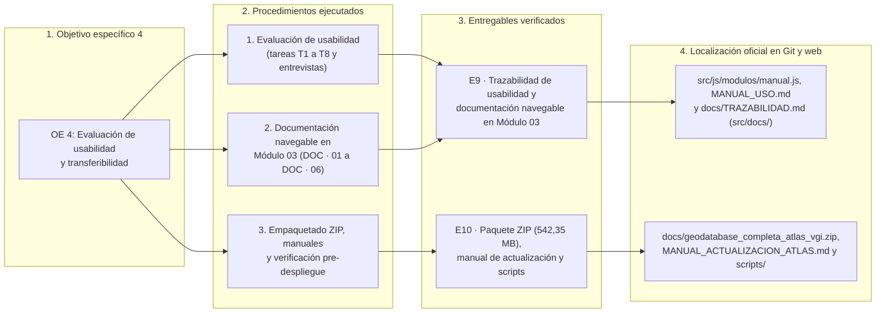

* **Entregables verificados y localización oficial:**

| N° | Entregable verificado | Tipo de producto | Fuente y localización oficial en el proyecto |
|:---:|:---|:---:|:---|
| **E-09** | Documentación navegable en el Módulo 03 (`DOC · 01` a `DOC · 06`), Manual de uso y matriz de trazabilidad de usabilidad (`T1` a `T8`). | Documentación y evaluación | `src/js/modulos/manual.js`, `MANUAL_USO.md`, `docs/MANUAL_USO.md` y `docs/TRAZABILIDAD.md` (`src/docs/`) |
| **E-10** | Manual de actualización técnica, protocolos de verificación y paquete comprimido de la geodatabase completa (`542,35 MB`). | Transferibilidad y datos | `MANUAL_ACTUALIZACION_ATLAS.md`, `docs/geodatabase_completa_atlas_vgi.zip` y `scripts/verificar_integridad_despliegue.py` |

---

## 4. Matriz de cumplimiento de los 9 Hitos con entregables verificados asociados

En coherencia con la Carta Gantt del proyecto (`Carta_Gantt_Atlas_VGI.pdf`), únicamente se mantienen los **9 hitos que cuentan con un entregable verificado asociado (`E1` a `E9`)**, habiendo eliminado los hitos que correspondían a componentes descartados (como el índice de calidad WLC o el generador de metadatos ISO 19139) o metas sin entregable directo:

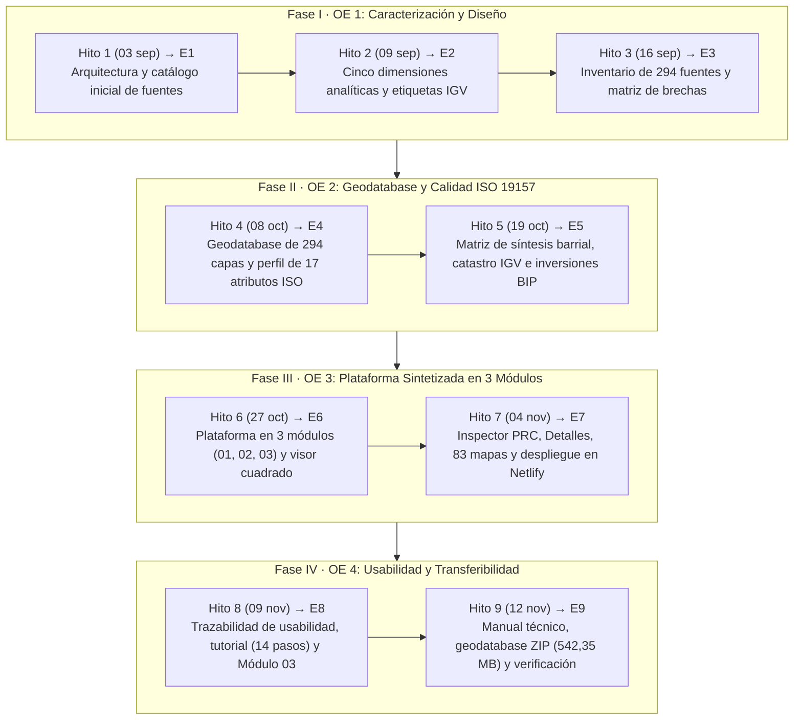

| Hito | Fecha de hito ($\blacklozenge$) | OE asociado | Entregable verificado asociado (`E1` a `E9`) | Estado | Ruta verificable en el repositorio y plataforma |
|:---:|:---:|:---:|:---|:---:|:---|
| **Hito 1** | `03 sep 2026` | `OE 1` | **E1 ·** Documento de arquitectura y catálogo inicial de fuentes | 100 % cerrado | `docs/ARQUITECTURA.md` y `docs/catalogo_fuentes_vgi.xlsx` (`src/docs/`) |
| **Hito 2** | `09 sep 2026` | `OE 1` | **E2 ·** Organización en 5 dimensiones analíticas, etiquetas IGV y configuración | 100 % cerrado | `docs/categorias_tematicas_osm.xlsx` (`src/docs/`) y `src/js/config.js` |
| **Hito 3** | `16 sep 2026` | `OE 1` | **E3 ·** Inventario consolidado de 294 fuentes (123 oficiales + 171 IGV) y matriz de brechas | 100 % cerrado | `docs/catalogo_fuentes_vgi.xlsx` y `docs/TRAZABILIDAD.md` (`src/docs/`) |
| **Hito 4** | `08 oct 2026` | `OE 2` | **E4 ·** Geodatabase de 294 capas GeoJSON, base PostGIS y perfil de 17 atributos ISO (`id_ig` / `id_igv`) | 100 % cerrado | `src/data/*.geojson`, `data/*.geojson`, `docs/perfil_metadatos_vgi.xlsx` y `scripts/db/` |
| **Hito 5** | `19 oct 2026` | `OE 2` | **E5 ·** Matriz de síntesis barrial por manzana, catastro IGV e inversiones BIP | 100 % cerrado | `data/matriz_sintesis_barrio_brasil_manzanas.geojson`, `data/resumen_catastro_vgi.csv` y `data/bip_inversiones_santiago.csv` |
| **Hito 6** | `27 oct 2026` | `OE 3` | **E6 ·** Plataforma web sintetizada en 3 módulos (*Análisis*, *Explorar mapa*, *Documentación*) y visor cuadrado | 100 % cerrado | `src/index.html`, `src/css/estilos.css`, `src/js/app.js` y `src/js/modulos/mapa.js` |
| **Hito 7** | `04 nov 2026` | `OE 3` | **E7 ·** Inspector normativo PRC, simbología Jenks, panel *Detalles*, 83 cartografías y despliegue | 100 % cerrado | `src/js/modulos/evaluador_normativo.js`, `src/js/modulos/indicadores_analisis.js` y `netlify.toml` |
| **Hito 8** | `09 nov 2026` | `OE 4` | **E8 ·** Evaluación de usabilidad, matriz de trazabilidad y Módulo 03 navegable | 100 % cerrado | `docs/TRAZABILIDAD.md`, `MANUAL_USO.md` (`src/docs/`) y `src/js/modulos/manual.js` |
| **Hito 9** | `12 nov 2026` | `OE 4` | **E9 ·** Manual de actualización técnica, paquete ZIP (542,35 MB) y verificación de integridad | 100 % cerrado | `MANUAL_ACTUALIZACION_ATLAS.md`, `docs/geodatabase_completa_atlas_vgi.zip` y `scripts/verificar_integridad_despliegue.py` |

---

## 5. Perfiles de actores territoriales destinatarios

La estructura sintetizada en tres módulos (`01 Análisis`, `02 Explorar mapa` y `03 Documentación`) permite que cuatro perfiles de actores territoriales resuelvan sus necesidades de información sobre la misma interfaz unificada sin sobrecarga cognitiva:

### 5.1. Perfil 1: Instituciones públicas (municipio / IDE)
* **Usuarios destinatarios:** Equipos técnicos de SECPLA, Dirección de Obras Municipales (DOM) y DIMAO de la Municipalidad de Santiago; analistas de ministerios (MINVU, MOP, MDSF/RSH, MTT/UOCT, SUBDERE) y de IDE Chile / SNIT.
* **Recorrido principal en la plataforma:**
  1. En el **Módulo 01 (`Análisis`)**, consultar las métricas de inversión pública (BIP), habitabilidad (Censo 2024) y vulnerabilidad (RSH) por dimensión territorial.
  2. En el **Módulo 02 (`Explorar mapa`)**, utilizar el **Inspector normativo (PRC)** haciendo clic sobre cualquier predio para verificar zonificación, alturas máximas, usos permitidos y emitir el Certificado de Informaciones Normativas.
  3. En el panel inferior de **Detalles**, activar la vista **Metadatos y calidad ISO 19157** para auditar el linaje institucional (`id_ig`), la fecha de vigencia y la exactitud posicional de las 123 capas estatales.

### 5.2. Perfil 2: Comunidad y vecinos
* **Usuarios destinatarios:** Juntas de vecinos del Barrio Brasil y de la comuna de Santiago, comités de vivienda y patrimonio, comerciantes locales y residentes.
* **Recorrido principal en la plataforma:**
  1. Iniciar con el **Tutorial interactivo** de 14 pasos ubicado a la izquierda del título principal y consultar el **Glosario de siglas** a la derecha del título cuando aparezcan abreviaturas técnicas.
  2. En el **Módulo 02 (`Explorar mapa`)**, activar capas cotidianas dentro de las 5 dimensiones (centros de salud, farmacias, comercio barrial, puntos de reciclaje, áreas verdes, cruces peatonales y cités) sobre los mapas base de OpenStreetMap o las imágenes satelitales de Bing/Microsoft y Esri.
  3. Consultar los atributos de cualquier equipamiento en el panel **Detalles** con un solo clic en el mapa.

### 5.3. Perfil 3: Mapeadores voluntarios (OSM)
* **Usuarios destinatarios:** Contribuyentes de OpenStreetMap Chile, comunidades de cartografía participativa y editores de datos abiertos.
* **Recorrido principal en la plataforma:**
  1. En el **Módulo 02 (`Explorar mapa`)**, superponer las **171 coberturas descentralizadas de IGV (`id_igv`)** con las **123 capas oficiales (`id_ig`)** para identificar vacíos espaciales y discrepancias geométricas.
  2. Inspeccionar en el panel **Detalles** los atributos de calidad ISO 19157 (`completitud`, `consistencia_topologica`, `exactitud_tematica`, `linaje_fuente`) de cada entidad colaborativa.
  3. En el **Módulo 03 (`Documentación`)**, descargar el catálogo de correspondencia de etiquetas (`categorias_tematicas_osm.xlsx`) desde el capítulo `DOC · 04` y filtrar el inventario completo en `DOC · 05`.

### 5.4. Perfil 4: ONG, docencia e investigación
* **Usuarios destinatarios:** Centros de estudios urbanos, organizaciones no gubernamentales, docentes y estudiantes universitarios.
* **Recorrido principal en la plataforma:**
  1. En el **Módulo 01 (`Análisis`)**, examinar los 4 guiones visuales y las 83 cartografías temáticas de concentración espacial (KDE), autocorrelación local bivariada (LISA / I de Moran), estructura sociodemográfica y metabolismo urbano.
  2. En el **Módulo 02 (`Explorar mapa`)**, aplicar clasificaciones coropléticas mediante el motor de **Simbología dinámica** (cortes naturales de Jenks) y exportar las capas activas en formato GeoJSON o CSV.
  3. En el **Módulo 03 (`Documentación`)**, descargar la geodatabase completa (`geodatabase_completa_atlas_vgi.zip`) y los tres libros maestros `.xlsx` para análisis avanzado en software SIG de escritorio (QGIS / PostGIS).

---

# PARTE II: Ingeniería de datos, dimensiones analíticas y normalización cartográfica

---

## 6. Organización taxonómica en 5 dimensiones analíticas territoriales

En lugar de separar rígidamente las fuentes estatales de las comunitarias en pestañas aisladas, el **Atlas para la Gestión Territorial** organiza la totalidad de sus **294 coberturas cartográficas** (`123` oficiales + `171` de IGV) bajo **5 dimensiones analíticas transversales**, utilizadas de manera idéntica tanto en el **Módulo 01 (`Análisis`)** como en el árbol de capas del **Módulo 02 (`Explorar mapa`)**:

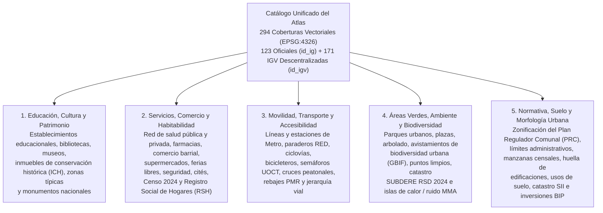

### 6.1. Dimensión 01: Educación, Cultura y Patrimonio
Integra la infraestructura educativa (jardines infantiles JUNJI/Integra, establecimientos escolares MINEDUC, educación superior) con el equipamiento cultural (bibliotecas, museos, centros culturales, teatros, cines, galerías de arte) y los polígonos y monumentos de protección patrimonial del Consejo de Monumentos Nacionales (CMN) y del Plan Regulador Comunal (Zonas Típicas, Monumentos Históricos, Zonas e Inmuebles de Conservación Histórica).

### 6.2. Dimensión 02: Servicios, Comercio y Habitabilidad
Reúne los equipamientos de salud (hospitales, CESFAM, clínicas, centros médicos, farmacias), abastecimiento y comercio cotidiano (supermercados, almacenes de barrio, panaderías, ferias libres, bancos, correos), seguridad y emergencias (Carabineros, PDI, compañías de Bomberos, grifos), junto con las variables demográficas y habitacionales del Censo 2024 (INE), el Registro Social de Hogares (MDSF) y el catastro barrial de cités y pasajes.

### 6.3. Dimensión 03: Movilidad, Transporte y Accesibilidad
Articula las redes de transporte público metropolitano (trazados y estaciones del Metro de Santiago, paraderos y recorridos del sistema RED), la infraestructura de movilidad activa (ciclovías existentes y proyectadas, estacionamientos de bicicletas, talleres), la gestión de tránsito (semáforos UOCT, reductores de velocidad) y la micro-infraestructura de accesibilidad universal levantada mediante IGV (cruces peatonales cebrados, semáforos sonoros, pavimento podotáctil y rebajes de vereda para personas con movilidad reducida).

### 6.4. Dimensión 04: Áreas Verdes, Ambiente y Biodiversidad
Consolida el sistema de espacios públicos vegetados (parques urbanos, plazas, bandejones, jardines comunitarios y arbolado viario), los registros de ciencia ciudadana de flora, fauna y funga urbana provenientes de **GBIF** bajo estándar Darwin Core, las 13 coberturas del Catastro Nacional de Residuos Sólidos Domiciliarios (**SUBDERE RSD 2024**), los puntos de reciclaje y contenedores barriales, y las mediciones ambientales de ruido (MMA).

### 6.5. Dimensión 05: Normativa, Suelo y Morfología Urbana
Agrupa los instrumentos de planificación territorial vigentes —zonificación comunal y seccional del **Plan Regulador Comunal (PRC) de Santiago** e hitos de modificación normativa—, la división político-administrativa y censal (comuna, distritos, unidades vecinales y manzanas), la huella de edificaciones y alturas constructivas, el catastro predial y de avalúos del **Servicio de Impuestos Internos (SII)** y la cartera georreferenciada del **Banco Integrado de Proyectos (BIP)**.

---

## 7. Ingesta y normalización de las 171 coberturas descentralizadas de IGV (OpenStreetMap y GBIF)

A diferencia de los enfoques que agrupan todo el mapeo colaborativo en unas pocas capas genéricas, el **Atlas para la Gestión Territorial** descentraliza la Información Geográfica Voluntaria en **171 coberturas vectoriales específicas (`id_igv`)**, permitiendo al usuario activar únicamente el fenómeno territorial de su interés (por ejemplo, encender exclusivamente *Farmacias*, *Almacenes de barrio*, *Cruces peatonales* o *Avistamientos de aves en GBIF*).

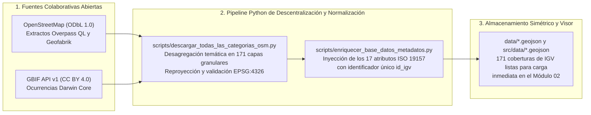

### 7.1. Coberturas granulares de OpenStreetMap por equipamiento y servicio
Cada cobertura descentralizada de OpenStreetMap se extrae mediante reglas de filtrado semántico (`amenity=*`, `shop=*`, `highway=*`, `leisure=*`, `tourism=*`, `historic=*`, `building=*`, `landuse=*`, `recycling_type=*`, `wheelchair=*`) acotadas al ámbito territorial de la comuna de Santiago y del Barrio Brasil. Durante el procesamiento:
1. Se valida la topología según el estándar OGC Simple Features (cierre de anillos poligonales, orientación de coordenadas según RFC 7946 y eliminación de geometrías degeneradas).
2. Para equipamientos representados indistintamente como nodos o recintos edificados en OSM, se preserva la geometría original o se genera el centroide representativo según el tipo de capa (`Punto`, `Línea` o `Polígono`).
3. Se asigna el identificador único correlativo **`id_igv`** (formato `IGV_<CAPA>_<NNNNN>`) junto con las 16 columnas restantes del perfil de metadatos y calidad ISO 19157.

### 7.2. Ocurrencias de ciencia ciudadana y biodiversidad urbana (GBIF / Darwin Core)
Los registros biológicos georreferenciados en la comuna de Santiago y el Barrio Brasil se integran desde la Infraestructura Mundial de Información en Biodiversidad (**GBIF**), preservando los descriptores del estándar **Darwin Core** (`scientificName`, `vernacularName`, `kingdom`, `family`, `eventDate`, `basisOfRecord`, `institutionCode`, `license`) y homologándolos al esquema maestro de 17 atributos con clave **`id_igv`**.

---

## 8. Ingesta, normalización y homologación de las 123 capas oficiales del Estado de Chile

Las **123 coberturas oficiales (`id_ig`)** provienen de los servicios WFS/WMS y repositorios de datos abiertos de las instituciones públicas que integran la Infraestructura de Datos Geoespaciales de Chile (**IDE Chile / SNIT**). Todas las capas han sido reproyectadas a `EPSG:4326` (con métricas geométricas precalculadas en `EPSG:32719` UTM Huso 19 Sur) y enriquecidas con el identificador único **`id_ig`**.

### 8.1. Instituto Nacional de Estadísticas (INE) — Censo 2024
Incluye la cartografía censal y los indicadores demográficos, habitacionales y sociales del **Censo de Población y Vivienda 2024** a escala de manzana censal (`ide_censo2024_manzanas.geojson`), zona censal, distrito censal y límite comunal, permitiendo analizar densidad poblacional, índice de envejecimiento, hacinamiento, materialidad de la vivienda y tipologías residenciales.

### 8.2. Ministerio de Vivienda y Urbanismo (MINVU) y Municipalidad de Santiago (PRC)
Comprende los polígonos de zonificación del **Plan Regulador Comunal (PRC) de Santiago** (`ide_minvu_ipt_prc_santiago.geojson` y `capa_ipt_prc_comunal.geojson`), las Zonas e Inmuebles de Conservación Histórica (`ZCH` e `ICH`), el catastro de parques urbanos y áreas verdes MINVU, y la serie de 91 capas sectoriales comunales de la Municipalidad de Santiago (`bbdd_01_santiago.geojson` a `bbdd_91_santiago.geojson`).

### 8.3. Subsecretaría de Desarrollo Regional y Administrativo (SUBDERE) — Catastro RSD 2024
Incorpora las 13 coberturas del **Catastro Nacional de Residuos Sólidos Domiciliarios (RSD 2024)** (`subdere_rsd_*.geojson`), que documentan rutas de recolección, frecuencias de barrido, puntos verdes, instalaciones de valorización y cobertura del servicio de aseo comunal.

### 8.4. Unidad Operativa de Control de Tránsito (UOCT / MTT) y SUBTEL
Integra la red de intersecciones semaforizadas actualizadas a 2026 (`semaforos_rm_uoct_2026.geojson`), los corredores de transporte público, la red de ciclovías y las estaciones base de telecomunicaciones y antenas de la Subsecretaría de Telecomunicaciones (`subtel_antenas_rm_2026.geojson`).

### 8.5. Ministerio de Desarrollo Social y Familia (MDSF / RSH y BIP)
Reúne las coberturas de estratificación socioeconómica del **Registro Social de Hogares (RSH)** por unidad vecinal (`RSH_*_UV_2026_*.geojson`) y la cartera georreferenciada de proyectos de inversión pública del **Banco Integrado de Proyectos (BIP)** en la comuna de Santiago (`bip_inversiones_santiago.csv` y su representación vectorial).

### 8.6. Consejo de Monumentos Nacionales (CMN) y Servicio de Impuestos Internos (SII)
Incluye las declaratorias oficiales de **Monumentos Históricos** y **Zonas Típicas o Pintorescas** del CMN, así como las coberturas prediales agregadas y estadísticas de destino constructivo, edad edificatoria y avalúo fiscal del **Servicio de Impuestos Internos (SII)**.

---

## 9. Perfil homologado de 17 atributos de metadatos y calidad espacial (ISO 19115 / ISO 19157)

Para garantizar la trazabilidad documental y la evaluación transparente de calidad entre fuentes estatales y comunitarias, cada una de las entidades de las **294 capas cartográficas** incorpora un bloque homologado de **17 atributos** fundamentado en las normas **ISO 19115-1:2014** (metadatos geográficos) e **ISO 19157:2013** (calidad de datos espaciales).

En la interfaz del **Módulo 02 (`Explorar mapa`)**, al hacer clic sobre cualquier punto, línea o polígono, el panel inferior de **Detalles** permite conmutar entre los **Atributos propios de la capa** y la vista **Metadatos y calidad ISO 19157 (17 atributos)**.

### 9.1. Diccionario de los 17 atributos homologados (`id_ig` / `id_igv`)

| N° | Clave del atributo | Norma de referencia | Tipo de dato | Descripción técnica y regla de asignación |
|:---:|:---|:---:|:---:|:---|
| **01** | `id_ig` / `id_igv` | ISO 19115 (`MD_Identifier`) | `String` | Identificador único primario del registro: utiliza **`id_ig`** en las 123 capas oficiales del Estado de Chile e **`id_igv`** en las 171 coberturas descentralizadas de Información Geográfica Voluntaria. |
| **02** | `nombre_capa` | ISO 19115 (`CI_Citation.title`) | `String` | Título descriptivo normalizado de la cobertura cartográfica en el catálogo del Atlas. |
| **03** | `dimension_analitica` | ISO 19115 (`MD_TopicCategoryCode`) | `String` | Adscripción a una de las 5 dimensiones analíticas territoriales del Atlas. |
| **04** | `tipo_fuente` | ISO 19115 (`MD_ScopeCode`) | `String` | Naturaleza de la fuente: `Información Geográfica Oficial (Estado de Chile)` o `Información Geográfica Voluntaria (IGV Descentralizada)`. |
| **05** | `institucion_custodia` | ISO 19115 (`CI_ResponsibleParty`) | `String` | Organismo público responsable (MINVU, INE, SUBDERE, SII, Municipalidad de Santiago, etc.) o comunidad colaborativa custodia (`Comunidad OpenStreetMap Chile` / `GBIF`). |
| **06** | `sistema_referencia` | ISO 19115 (`MD_ReferenceSystem`) | `String` | Sistema de referencia geodésico de almacenamiento (`EPSG:4326 · WGS 84`) y proyección métrica de cálculo (`EPSG:32719 · SIRGAS-Chile UTM 19S`). |
| **07** | `escala_referencia` | ISO 19115 (`MD_Resolution`) | `String` | Escala cartográfica equivalente de captura o restitución (`1:1.000` a `1:5.000` en escala barrial; `1:10.000` a `1:25.000` en escala comunal). |
| **08** | `fecha_actualizacion` | ISO 19115 (`CI_Date`) | `String (ISO 8601)` | Fecha de última actualización o corte de extracción verificado de la cobertura (`AAAA-MM-DD`). |
| **09** | `licencia_uso` | ISO 19115 (`MD_LegalConstraints`) | `String` | Condición jurídica de reutilización: `Datos Abiertos del Estado (Ley N.° 20.285)`, `ODbL 1.0 (OpenStreetMap)` o `CC BY 4.0 (GBIF)`. |
| **10** | `exactitud_posicional` | ISO 19157 (`DQ_AbsoluteExternalPositionalAccuracy`) | `String` | Evaluación de la precisión planimétrica respecto de la cartografía base y ortofotos de referencia. |
| **11** | `consistencia_topologica` | ISO 19157 (`DQ_TopologicalConsistency`) | `String` | Verificación de validez geométrica OGC Simple Features (cierre de anillos, ausencia de auto-intersecciones y orientación RFC 7946). |
| **12** | `completitud` | ISO 19157 (`DQ_CompletenessCommission` / `Omission`) | `String` | Nivel de cobertura de objetos y atributos no nulos dentro del ámbito territorial de Santiago y Barrio Brasil. |
| **13** | `exactitud_tematica` | ISO 19157 (`DQ_ThematicClassificationCorrectness`) | `String` | Conformidad de la clasificación semántica (etiquetas `key=value` en IGV o codificación ministerial en capas estatales). |
| **14** | `consistencia_temporal` | ISO 19157 (`DQ_TemporalValidity`) | `String` | Vigencia temporal de los registros respecto del corte operativo del Atlas (2024–2026). |
| **15** | `linaje_fuente` | ISO 19115 / 19157 (`LI_Lineage`) | `String` | Descripción del proceso de captura, extracción, normalización geodésica y homologación de atributos. |
| **16** | `cobertura_territorial` | ISO 19115 (`EX_GeographicDescription`) | `String` | Alcance espacial de la capa (`Barrio Brasil`, `Comuna de Santiago` o `Región Metropolitana`). |
| **17** | `archivo_origen` | ISO 19115 (`CI_OnlineResource`) | `String` | Ruta relativa verificada del archivo vectorial en el repositorio (`data/<nombre>.geojson`). |

### 9.2. Inyección automatizada en la geodatabase (`scripts/enriquecer_base_datos_metadatos.py`)
El script `scripts/enriquecer_base_datos_metadatos.py` recorre las 294 coberturas vectoriales en `data/` y `src/data/`, detecta si la capa pertenece al catálogo oficial (`123` capas → inyecta `id_ig`) o al catálogo descentralizado de IGV (`171` capas → inyecta `id_igv`), y asegura que cada `Feature` disponga de los 17 atributos documentados sin alterar sus columnas nativas originales.

### 9.3. Catálogos maestros en formato OpenXML (`.xlsx`)
En los directorios `docs/` y `src/docs/` se disponen tres libros de cálculo generados mediante `scripts/generar_catalogos_excel.py` y descargables directamente desde el capítulo `DOC · 04` del **Módulo 03 (`Documentación`)**:
1. **`catalogo_fuentes_vgi.xlsx`**: Inventario general de las 294 coberturas del Atlas, indicando institución o comunidad custodia, dimensión analítica, tipo de geometría, escala y licencia.
2. **`categorias_tematicas_osm.xlsx`**: Diccionario de correspondencia entre las coberturas descentralizadas de IGV (`id_igv`), sus etiquetas en OpenStreetMap (`key=value`) o términos Darwin Core (GBIF), y su adscripción a las 5 dimensiones analíticas.
3. **`perfil_metadatos_vgi.xlsx`**: Especificación técnica de los 17 atributos homologados bajo las normas ISO 19115 e ISO 19157 (`id_ig` / `id_igv`).

---

# PARTE III: Ingeniería de software, interfaz de 3 módulos y visualización interactiva

---

## 10. Arquitectura frontend sin compilación previa: Vanilla JavaScript ES6+ y patrón IIFE

La plataforma web está construida en **HTML5 semántico, CSS3 nativo y Vanilla JavaScript (ES6+)** mediante el patrón de módulos inmediatamente invocados (*Immediately Invoked Function Expression*, IIFE), sin requerir empaquetadores complejos (*bundlers*) durante el despliegue en producción. Esto garantiza una mantenibilidad transparente y tiempos de publicación inferiores a 1 minuto en Netlify.

### 10.1. Estructura modular de los 3 módulos principales y la cabecera global

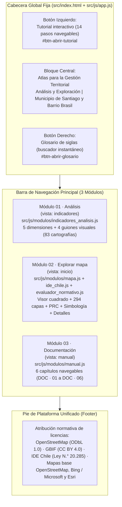

### 10.2. Tutorial interactivo de 14 pasos y Glosario de siglas en cabecera
Para evitar cualquier superposición visual en pantallas de escritorio o portátiles, los dos recursos de apoyo transversal se ubican en extremos opuestos del bloque del título principal:
* **A la izquierda del título (`#btn-abrir-tutorial`):** Abre el **Tutorial interactivo de 14 pasos**, que recorre de forma guiada y auto-navegable cada uno de los tres módulos de la plataforma (cambiando automáticamente de módulo cuando el usuario avanza entre las etapas del Módulo 01, Módulo 02 y Módulo 03) y explica con lenguaje claro para qué sirve cada herramienta y cómo aprovecharla en la toma de decisiones territoriales.
* **A la derecha del título (`#btn-abrir-glosario`):** Despliega el recuadro del **Glosario de siglas** con buscador instantáneo para consultar el significado de acrónimos institucionales, urbanísticos y geomáticos (`IGV`, `IDE`, `PRC`, `OGUC`, `ZCH`, `ICH`, `KDE`, `LISA`, `RSH`, `BIP`, `SUBDERE`, `SII`, `ODbL`, etc.).

---

## 11. Motor cartográfico en el Módulo 02 (`Explorar mapa`): Leaflet 1.9.4 y mapas base sin clave API

### 11.1. Lienzo cartográfico de proporción cuadrada y proyección EPSG:4326 / EPSG:32719
El contenedor `#mapa-principal` en el Módulo 02 se dimensiona con una proporción amplia y equilibrada de formato cuadrado (`min-height: 760px` y relación de aspecto controlada en `src/css/estilos.css`), facilitando la lectura simultánea de la estructura urbana norte-sur y oriente-poniente del Barrio Brasil y de la comuna de Santiago.

### 11.2. Los 4 mapas base operativos (OpenStreetMap, HOT, Bing/Microsoft y Esri)
En `src/js/modulos/mapa.js` y `src/index.html`, el selector `#sel-mapa-base` ofrece exclusivamente **4 mosaicos globales abiertos que no requieren clave API de terceros** (habiendo eliminado los antiguos mosaicos de Carto):

| Clave en `mapa.js` | Nombre en el selector | Proveedor de teselas | Uso recomendado |
|:---:|:---|:---|:---|
| `osm` | **OpenStreetMap Estándar** | OpenStreetMap Foundation (`tile.openstreetmap.org`) | Lectura detallada de vialidad, numeración postal, topónimos y equipamiento barrial. |
| `hot` | **OpenStreetMap Humanitario (HOT)** | Humanitarian OpenStreetMap Team (`tile.openstreetmap.fr/hot`) | Contraste suave para destacar capas vectoriales superpuestas y servicios públicos. |
| `bing_sat` | **Satélite Bing / Microsoft** | Microsoft Corporation VirtualEarth (`ecn.t{0-3}.tiles.virtualearth.net` con *quadkeys*) | Fotointerpretación de techumbres, patios interiores, cités y cobertura arbórea de alta resolución. |
| `esri_sat` | **Satélite Esri World Imagery** | Esri / Maxar / Earthstar Geographics (`server.arcgisonline.com`) | Comparación multitemporal de ortofotografías satelitales y morfología de manzanas. |

### 11.3. Motor de Simbología dinámica (cortes naturales de Jenks y 6 paletas cromáticas)
Ubicado en el panel lateral izquierdo del Módulo 02, el bloque de **Simbología dinámica** inspecciona automáticamente las propiedades de las capas activas en el visor y permite:
1. Seleccionar cualquier atributo numérico o categórico de la capa activa.
2. Elegir entre **4 modos de representación**: *Graduado (Cortes naturales de Jenks)*, *Categorizado (Valores únicos)*, *Proporcional (Radio graduado)* o * Símbolo único*.
3. Ajustar el número de clases (`3` a `7`) y aplicar una de las **6 paletas cromáticas** de alto contraste (*Viridis*, *YlOrRd*, *Blues*, *Greens*, *Purples* o *Spectral*), actualizando en tiempo real tanto el mapa como la leyenda flotante.

### 11.4. Panel inferior de `Detalles` y exportación dinámica (GeoJSON / CSV)
Bajo el lienzo del mapa se ubica el panel **Detalles** (`#panel-detalles-elemento`), que al seleccionar cualquier entidad en el visor presenta:
* Una pestaña de **Atributos de la capa** con todos los valores originales del elemento y su geometría.
* Una pestaña de **Metadatos y calidad ISO 19157 (17 atributos)** donde se muestra el identificador oficial (`id_ig`) o de IGV (`id_igv`), la institución o comunidad custodia, la licencia y los indicadores de calidad espacial.
* Botones de acción rápida para **Descargar GeoJSON** y **Descargar CSV** de las coberturas activas.

---

## 12. Inspector normativo del Plan Regulador Comunal de Santiago (PRC / OGUC)

El **Inspector normativo (PRC)** se integra directamente en el panel lateral izquierdo del **Módulo 02 (`Explorar mapa`)** (`src/js/modulos/evaluador_normativo.js`).

### 12.1. Algoritmo de intersección punto en polígono (*ray-casting*) en el navegador
Cuando el usuario activa el modo de inspección normativa y hace clic sobre cualquier punto del mapa (o ingresa coordenadas específicas), el módulo ejecuta en memoria un algoritmo geométrico de trazado de rayos (*ray-casting*) contra los polígonos de zonificación del **Plan Regulador Comunal de Santiago** (`ide_minvu_ipt_prc_santiago.geojson` y `capa_ipt_prc_comunal.geojson`) y las capas de protección patrimonial (`ZCH`, `ICH` y Monumentos Nacionales).

### 12.2. Emisión del Certificado de Informaciones Normativas (CIN) y expediente histórico
Como resultado de la intersección espacial, el panel muestra de forma inmediata:
* La **Zona del PRC** (por ejemplo, `Zona A`, `Zona B`, `Zona D - Conservación Histórica`, `Sector Especial`), la altura máxima de edificación permitida, el coeficiente de constructibilidad, la ocupación máxima de suelo y el sistema de agrupamiento (continuo, pareado o aislado).
* Los **usos de suelo permitidos y restringidos** conforme a la ordenanza local y a la Ordenanza General de Urbanismo y Construcciones (OGUC).
* El acceso al **Expediente histórico de modificaciones al PRC en el Barrio Brasil (1990–2024)** y el botón para descargar el **Certificado de Informaciones Normativas** en formato de texto estructurado (`.txt`).

---

## 13. Módulo 01 (`Análisis`): Las 5 dimensiones analíticas, los 4 guiones visuales y las 83 cartografías

El **Módulo 01 (`Análisis`)** (`src/js/modulos/indicadores_analisis.js`) constituye la vista de entrada de la plataforma y estructura el diagnóstico territorial en dos niveles complementarios:

1. **Síntesis interactiva por las 5 dimensiones analíticas:** Tarjetas y gráficos comparativos que contrastan la dotación de equipamientos oficiales (`id_ig`) frente a la cobertura levantada mediante Información Geográfica Voluntaria (`id_igv`) en cada una de las 5 dimensiones, con botones de conexión directa (*Ver en el mapa*) que activan las capas correspondientes en el Módulo 02.
2. **Los 4 guiones visuales territoriales con 83 cartografías temáticas (`src/img/cartografias/`):**
   * **Guion visual 01 — Concentración territorial y núcleos de actividad IGV (`KDE` · 14 cartografías):** Mapas de estimación de densidad por núcleo (*Kernel Density Estimation*) con ancho de banda de 250 m para identificar subcentros de servicios, comercio, cultura y movilidad.
   * **Guion visual 02 — Segregación espacial, *hotspots* y áreas de rezago (`LISA` · 11 cartografías):** Mapas de autocorrelación espacial local bivariada (*I de Moran local*) que cruzan vulnerabilidad habitacional con acceso a equipamiento a escala de manzana.
   * **Guion visual 03 — Estructura sociodemográfica, habitabilidad y morfología urbana (`Censo 2024` y `RSH` · 34 cartografías):** Cartografías de densidad poblacional, envejecimiento, tipologías de vivienda, cités e inversión pública del Banco Integrado de Proyectos (BIP).
   * **Guion visual 04 — Socioambiente, proximidad peatonal, movilidad y metabolismo urbano (24 cartografías):** Mapas de isócronas peatonales de 5 y 15 minutos, cobertura arbórea, gestión de residuos sólidos domiciliarios (SUBDERE RSD 2024) y ruido ambiental.

Cada cartografía se abre en un **visor Lightbox de alta resolución** con zoom interactivo, ficha metodológica y botón de descarga directa.

---

## 14. Módulo 03 (`Documentación`): Los 6 capítulos navegables en la plataforma

Para que tanto usuarios ciudadanos como investigadores y administradores técnicos puedan consultar toda la documentación sin abandonar la plataforma, el **Módulo 03 (`Documentación`)** (`src/js/modulos/manual.js`) ofrece un sistema de navegación por pestañas dividido en **6 capítulos interactivos**:

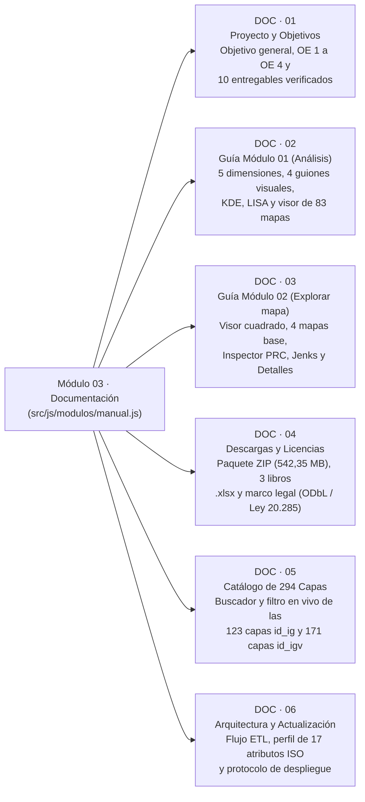

---

## 15. Topografía integral del repositorio y anatomía de archivos

```text
nodo-geoabierto/
├── netlify.toml                          # Configuración CDN Netlify (publish = "src", cabeceras CORS y caché)
├── README.md                             # Portada técnica del repositorio, arquitectura y entregables verificados
├── MANUAL_USO.md                         # Manual de usuario navegable (sincronizado con docs/ y src/docs/)
├── MANUAL_ACTUALIZACION_ATLAS.md         # Manual de actualización técnica (sincronizado con docs/ y src/docs/)
├── PROTOCOL_INTEGRIDAD_Y_DESPLIEGUE.md   # Protocolo de verificación pre-despliegue y sincronización espejo
├── CONTRIBUTING.md                       # Guía de contribución de nuevas capas, cartografías y reglas PRC
├── data/                                 # Directorio maestro de las 294 coberturas GeoJSON (EPSG:4326) y tablas CSV
├── docs/                                 # Documentación maestra, 3 catálogos .xlsx y geodatabase_completa_atlas_vgi.zip
├── scripts/                              # Suite Python 3 de extracción, normalización ISO 19157, empaquetado y auditoría
│   ├── descargar_todas_las_categorias_osm.py
│   ├── enriquecer_base_datos_metadatos.py
│   ├── generar_catalogos_excel.py
│   ├── empaquetar_base_datos_completa.py
│   ├── verificar_conteo_capas.py
│   ├── verificar_integridad_despliegue.py
│   └── db/
│       ├── 01_schema_postgis.sql
│       └── 02_seed_metadata.sql
└── src/                                  # Directorio de publicación web en producción (Netlify publish = "src")
    ├── index.html                        # Punto de entrada SPA (Cabecera + 3 Módulos + Modales + Footer de licencias)
    ├── css/
    │   └── estilos.css                   # Sistema de diseño visual, grilla del visor cuadrado y componentes
    ├── js/
    │   ├── config.js                     # Configuración global, coordenadas BBox y parámetros de versión
    │   ├── app.js                        # Orquestador de los 3 módulos, Tutorial de 14 pasos y Glosario de siglas
    │   └── modulos/
    │       ├── indicadores_analisis.js   # Módulo 01 (Análisis): 5 dimensiones y 4 guiones visuales (83 mapas)
    │       ├── mapa.js                   # Módulo 02 (Explorar mapa): Leaflet 1.9.4, 4 mapas base, Jenks y Detalles
    │       ├── ide_chile.js              # Catálogo unificado y carga bajo demanda de las 294 coberturas
    │       ├── evaluador_normativo.js    # Inspector normativo del PRC de Santiago y emisor del certificado CIN
    │       └── manual.js                 # Módulo 03 (Documentación): 6 capítulos navegables (DOC · 01 a DOC · 06)
    ├── img/
    │   └── cartografias/                 # 83 cartografías temáticas en alta resolución (.jpg)
    ├── data/                             # Espejo exacto de data/ servido por HTTP Fetch al navegador
    └── docs/                             # Espejo exacto de docs/ para descarga directa desde el Módulo 03
```

---

# PARTE IV: Base de datos PostGIS, empaquetado, despliegue en Netlify y tutoriales de mantenimiento

---

## 16. Infraestructura espacial: PostgreSQL 17 + PostGIS 3.3 en Supabase Cloud

Además del almacenamiento vectorial en archivos GeoJSON estáticos servidos por CDN para respuesta inmediata en el navegador, el proyecto mantiene un respaldo relacional en **PostgreSQL 17 + PostGIS 3.3** (`scripts/db/01_schema_postgis.sql` y `02_seed_metadata.sql`, documentado en `docs/GUIA_BASE_DATOS_SUPABASE.md`):
* Tabla maestra `catalogo_capas`: Registra los metadatos descriptivos y de calidad ISO 19157 de las 294 coberturas.
* Tabla espacial `entidades_territoriales`: Almacena las geometrías normalizadas en `EPSG:4326` con índice espacial `GiST` y el diccionario de atributos nativos y homologados (`id_ig` / `id_igv`) en columna `JSONB` con índice `GIN`.
* Flujo automático `.github/workflows/supabase_keepalive.yml`: Ejecuta una consulta periódica cada 72 horas para mantener activa la instancia en la nube.

---

## 17. Empaquetado de la geodatabase (`empaquetar_base_datos_completa.py`) y verificación pre-despliegue

El flujo de validación e integridad se ejecuta **localmente antes de confirmar cambios en Git**, evitando sobrecargar el tiempo de construcción en Netlify:

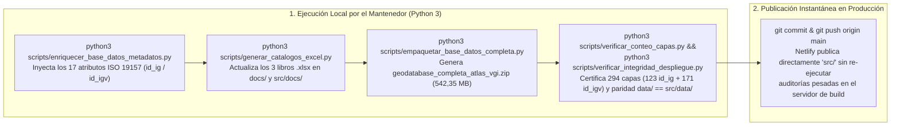

---

## 18. Configuración de despliegue continuo en Netlify (`netlify.toml`) y GitHub Pages

El archivo `netlify.toml` está optimizado para publicar de manera directa el directorio `src/` sin ejecutar scripts pesados durante la fase de *build* del servidor, previniendo cualquier error de tiempo límite (*timeout*):

```toml
[build]
  publish = "src"
  command = "echo 'Build estático listo: las auditorías de las 294 capas se ejecutan en pre-commit local'"
```

Adicionalmente, `netlify.toml` configura:
* Cabeceras `Access-Control-Allow-Origin: *` y tipos MIME `application/geo+json; charset=utf-8` para `/data/*.geojson`.
* Control de caché instantáneo (`max-age=0, must-revalidate`) en `/index.html` y caché de alto rendimiento para las 294 capas vectoriales en `/data/*`.

---

## 19. Marco jurídico, licencias de datos y atribuciones cartográficas en el pie de plataforma

En total coherencia con el pie de página (`footer`) del **Atlas para la Gestión Territorial**, la plataforma cumple y exhibe explícitamente cuatro regímenes complementarios de licenciamiento abierto:
1. **Código fuente y documentación propia del Atlas:** Licenciados bajo **Creative Commons Atribución 4.0 Internacional (CC BY 4.0)** y licencia **MIT**.
2. **Coberturas de Información Geográfica Voluntaria de OpenStreetMap (`id_igv`):** Licenciadas bajo **Open Database License (ODbL 1.0)** (`© Contribuidores de OpenStreetMap`).
3. **Registros de biodiversidad urbana de GBIF (`id_igv`):** Licenciados bajo **Creative Commons Atribución 4.0 Internacional (CC BY 4.0)** conforme al estándar Darwin Core.
4. **Coberturas oficiales del Estado de Chile (`id_ig`) y mosaicos de mapas base:** Datos públicos regidos por la **Ley N.° 20.285 sobre Acceso a la Información Pública** y lineamientos de **IDE Chile / SNIT**, y teselas base provistas por **OpenStreetMap**, **Bing / Microsoft Corporation** y **Esri World Imagery**.

---

## 20. Guía paso a paso de actualización y mantenimiento (10 procedimientos operativos)

### 20.1. Procedimiento 01: Incorporar una nueva capa oficial (`id_ig`) o de IGV (`id_igv`)
1. Verifique que el archivo `.geojson` esté proyectado en coordenadas geográficas `EPSG:4326` (WGS84) y codificado en `UTF-8`.
2. Copie el archivo simétricamente en `data/<id_capa>.geojson` y `src/data/<id_capa>.geojson`.
3. Registre la capa en el diccionario `CAPAS_OFICIALES` dentro de `src/js/modulos/ide_chile.js`, indicando `id`, `nombre`, `institucion`, `archivoLocal`, `color`, `geometria`, `licencia` y la dimensión analítica correspondiente (`dimension`).
4. Agregue el identificador de la capa al arreglo de su dimensión en `src/js/modulos/indicadores_analisis.js`.
5. Ejecute `python3 scripts/enriquecer_base_datos_metadatos.py` para inyectar los 17 atributos ISO 19157 (`id_ig` o `id_igv`) y valide con `python3 scripts/verificar_conteo_capas.py`.

### 20.2. Procedimiento 02: Actualizar o añadir un mapa base en `mapa.js`
1. Abra `src/js/modulos/mapa.js` y localice el diccionario de capas base (`MAPAS_BASE`).
2. Asegúrese de utilizar únicamente servicios de teselas que no requieran claves API restringidas (como `osm`, `hot`, `bing_sat` y `esri_sat`).
3. Si añade un nuevo proveedor de teselas, agregue su `<option value="clave">` en el selector `#sel-mapa-base` dentro de `src/index.html` y actualice la atribución en el pie de página (`footer`).

### 20.3. Procedimiento 03: Modificar los pasos del Tutorial interactivo o el Glosario de siglas
1. Abra `src/js/app.js` y localice el arreglo `PASOS_TUTORIAL` (compuesto por los 14 pasos navegables que recorren la plataforma, el Módulo 01, el Módulo 02 y el Módulo 03).
2. Cada paso define las propiedades `modulo` (`'indicadores'`, `'inicio'` o `'manual'`), `selector` (elemento CSS a destacar), `titulo` y `texto` (explicación funcional de para qué sirve el componente).
3. Para añadir o editar términos en el **Glosario de siglas**, modifique los ítems dentro del modal `#modal-glosario` en `src/index.html`.

### 20.4. Procedimiento 04: Actualizar la zonificación o hitos del Inspector normativo (PRC)
1. Si se aprueba una nueva modificación al Plan Regulador Comunal de Santiago, actualice los polígonos en `data/ide_minvu_ipt_prc_santiago.geojson` y `src/data/ide_minvu_ipt_prc_santiago.geojson`.
2. Abra `src/js/modulos/evaluador_normativo.js` y actualice las reglas urbanísticas de edificabilidad y usos de suelo en `REGLAS_ZONAS_PRC`, así como la cronología en `HITOS_HISTORICOS_PRC_BRASIL`.

### 20.5. Procedimiento 05: Incorporar nuevas cartografías o fichas en el Módulo 01 (`Análisis`)
1. Exporte la nueva cartografía temática en formato `.jpg` (resolución recomendada de 2000 px de ancho) y guárdela en `src/img/cartografias/`.
2. Abra `src/js/modulos/indicadores_analisis.js` y agregue la entrada correspondiente dentro del guion visual respectivo (`GUIONES_VISUALES`), incluyendo su título, dimensión analítica, síntesis interpretativa y ruta de imagen.

### 20.6. Procedimiento 06: Actualizar los capítulos navegables del Módulo 03 (`Documentación`)
1. Abra `src/js/modulos/manual.js`, donde se estructuran los 6 capítulos interactivos (`DOC · 01` a `DOC · 06`).
2. Edite el contenido HTML del capítulo requerido y mantenga sincronizados los archivos Markdown del repositorio (`README.md`, `MANUAL_USO.md`, `MANUAL_ACTUALIZACION_ATLAS.md`, `ARQUITECTURA.md` y `TRAZABILIDAD.md` tanto en raíz como en `docs/` y `src/docs/`).

### 20.7. Procedimiento 07: Inyectar el perfil homologado de 17 atributos ISO 19157
1. Ejecute `python3 scripts/enriquecer_base_datos_metadatos.py`.
2. Verifique en el panel inferior de **Detalles** del Módulo 02 que al seleccionar una entidad se listen correctamente los 17 atributos encabezados por `id_ig` (en capas oficiales) o `id_igv` (en capas de IGV).

### 20.8. Procedimiento 08: Regenerar los 3 catálogos Excel (`.xlsx`) y el paquete ZIP
1. Ejecute `python3 scripts/generar_catalogos_excel.py` para regenerar `catalogo_fuentes_vgi.xlsx`, `categorias_tematicas_osm.xlsx` y `perfil_metadatos_vgi.xlsx` en `docs/` y `src/docs/`.
2. Si se modificaron coberturas GeoJSON, ejecute `python3 scripts/empaquetar_base_datos_completa.py` para actualizar `docs/geodatabase_completa_atlas_vgi.zip` y su copia en `src/docs/`.

### 20.9. Procedimiento 09: Modificar variables de diseño `:root` y proporciones del visor
1. Abra `src/css/estilos.css` y edite los tokens semánticos en `:root` (colores institucionales, tipografía, bordes y sombras).
2. Para ajustar el tamaño o la proporción cuadrada del visor cartográfico en el Módulo 02, modifique las reglas de `#mapa-principal` y `.contenedor-visor-principal` en `src/css/estilos.css`.

### 20.10. Procedimiento 10: Auditoría local, control de caché (`?v=...`) y despliegue en Netlify
1. Actualice el parámetro de versión `?v=YYYYMMDD_vNN` en las referencias CSS/JS de `src/index.html` y en `src/js/config.js`.
2. Ejecute localmente `python3 scripts/verificar_conteo_capas.py` y `python3 scripts/verificar_integridad_despliegue.py`.
3. Confirme los cambios con `git add`, `git commit` y publique en producción mediante `git push origin main`.
