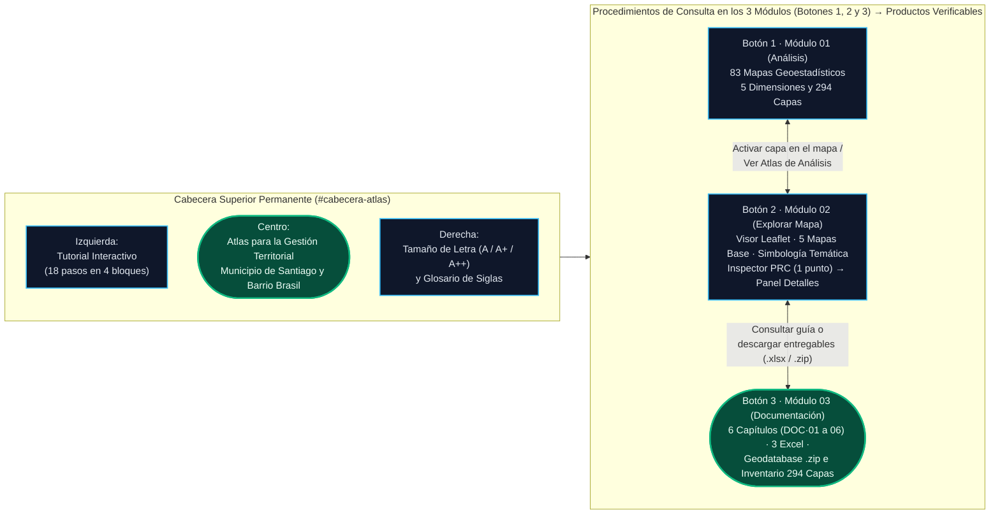
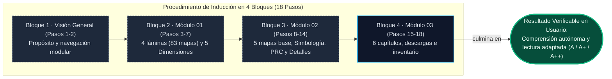
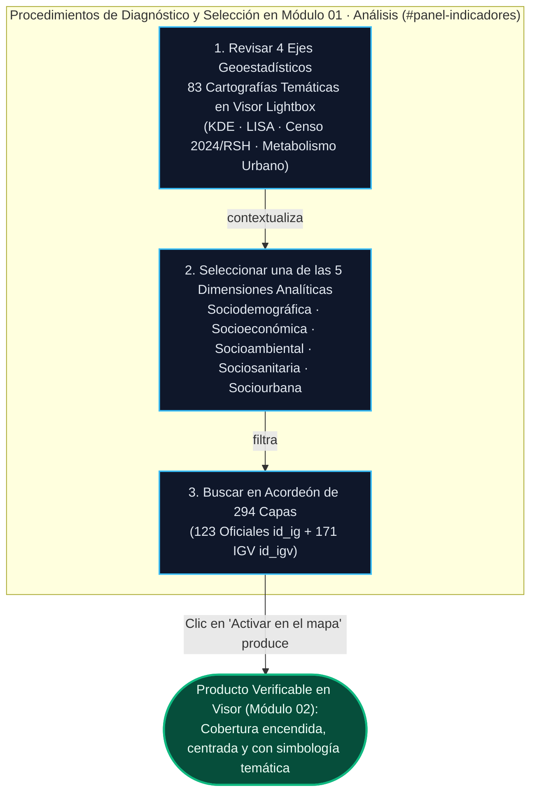
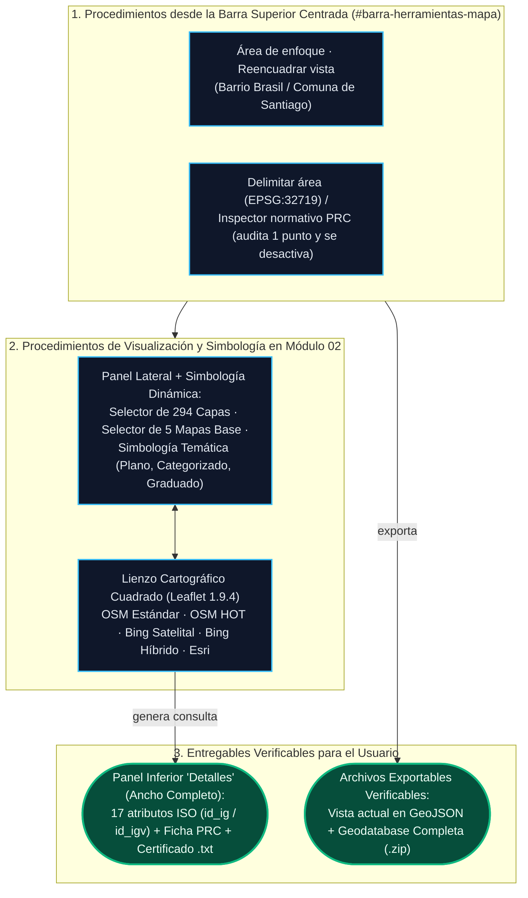
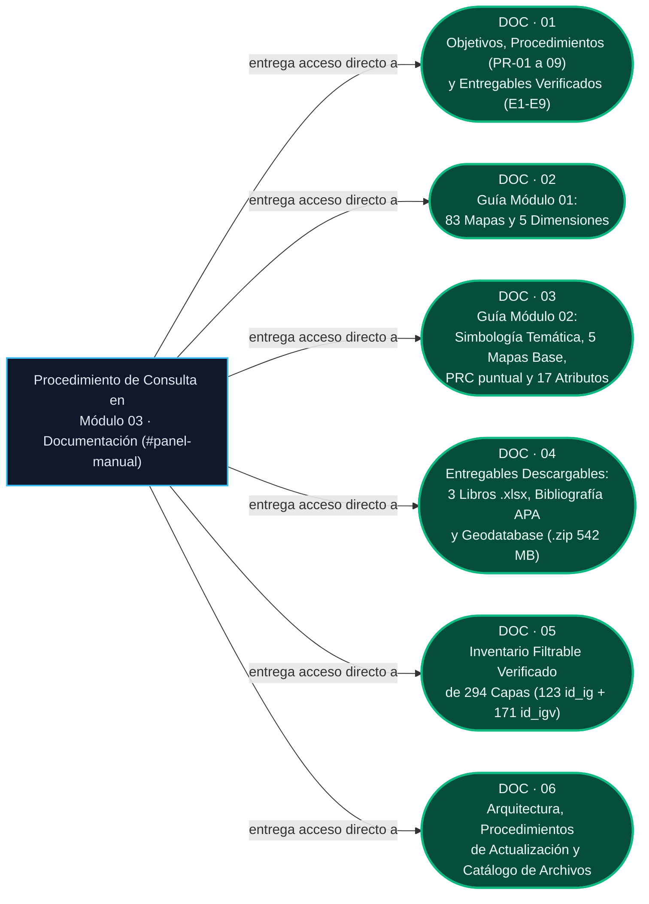

# Manual de Uso — Atlas para la Gestión Territorial
## Análisis y Exploración | Municipio de Santiago y Barrio Brasil

* **Plataforma Web en Producción:** [https://atlasvgiuah.netlify.app](https://atlasvgiuah.netlify.app)
* **Repositorio Espejo (GitHub Pages):** [https://geojota.github.io/atlas-vgi-barrio-brasil/](https://geojota.github.io/atlas-vgi-barrio-brasil/)
* **Geodatabase consolidada descargable (`.zip`):** `docs/geodatabase_completa_atlas_vgi.zip` (`542,35 MB` comprimidos; `294` capas cartográficas operativas).

---

## 1. Propósito del Atlas y a quién está dirigido este manual

El **Atlas para la Gestión Territorial (Análisis y Exploración | Municipio de Santiago y Barrio Brasil)** es una herramienta pública, abierta y gratuita que reúne en un mismo lugar dos grandes fuentes de conocimiento sobre la ciudad:
1. **La información oficial del Estado de Chile (`123` coberturas identificadas con la clave `id_ig`):** proveniente del Censo de Población y Vivienda 2024 (INE), el Registro Social de Hogares (RSH), el Plan Regulador Comunal de Santiago (PRC / MINVU), el Consejo de Monumentos Nacionales (CMN), la SUBDERE, el Servicio de Impuestos Internos (SII) y la Ilustre Municipalidad de Santiago.
2. **La Información Geográfica Voluntaria (`171` coberturas descentralizadas identificadas con la clave `id_igv`):** levantada de forma colaborativa por comunidades ciudadanas y científicas en **OpenStreetMap (OSM)** y en la red mundial de biodiversidad **GBIF**, que registra el equipamiento cotidiano a escala de calle y cuadra (comercios de barrio, ciclovías, paraderos, grifos, farmacias, desfibriladores, luminarias y especies de arbolado y aves urbanas).

Para que cualquier persona —tanto si es vecina o dirigente barrial sin experiencia previa en mapas digitales, como si forma parte de un equipo técnico municipal, una organización social o un grupo de investigación universitaria— pueda recorrer la plataforma con comodidad, el **Prototipo 02** organiza todas sus funciones en **tres módulos claros** acompañados por una **cabecera de ayuda permanente**:

---

## 2. Cómo empezar: La Cabecera Superior, Tamaño de Letra, Tutorial Interactivo y Glosario

En la franja superior de la pantalla encontrará siempre visibles el título oficial de la plataforma, los controles de accesibilidad y los botones de apoyo ubicados en extremos opuestos para que nunca se superpongan entre sí:

### 2.1. El Tutorial Interactivo (a la izquierda del título)
Si es la primera vez que ingresa al Atlas, le recomendamos pulsar el botón **Tutorial Interactivo** situado a la izquierda del título principal.
* **¿Cómo funciona?** Se abrirá una guía paso a paso compuesta por **18 etapas organizadas en 4 bloques navegables** (*Visión General*, *Módulo 01 · Análisis*, *Módulo 02 · Mapa* y *Módulo 03 · Documentación*).
* **Presentación de cada módulo antes de sus herramientas:** Antes de mostrar botones específicos, el tutorial explica primero qué es cada módulo y para qué sirve en la gestión territorial, cambiando automáticamente de pestaña a medida que usted avanza.
* **Navegación libre:** Usted puede usar los botones *Anterior* y *Siguiente*, saltar directamente a cualquiera de los 4 bloques desde la barra superior de la tarjeta del tutorial, o cerrarlo en cualquier momento con `Cerrar (Esc)`.

### 2.2. Control dinámico de tamaño de letra (`A` / `A+` / `A++`) y Glosario de Siglas (a la derecha del título)
Para facilitar la lectura en cualquier pantalla o necesidad visual, junto al **Glosario de siglas** se incluye un control interactivo de escala tipográfica:
* **Ajuste dinámico de tamaño de letra (`A`, `A+`, `A++`):** Además de adaptar proporcionalmente el tamaño de texto según el ancho de pantalla, puede pulsar `A` (estándar), `A+` (lectura ampliada) o `A++` (lectura máxima) para aumentar dinámicamente las letras en todos los módulos y paneles. Su preferencia queda guardada en el navegador.
* **Glosario de Siglas:** Al pulsar **Glosario de siglas**, se despliega un recuadro con buscador instantáneo donde siglas técnicas como `IGV`, `IDE`, `PRC`, `OGUC`, `ZCH`, `ICH`, `KDE`, `LISA`, `RSH`, `BIP`, `SUBDERE`, `CESFAM` u `ODbL` están explicadas en lenguaje claro sin abandonar su vista actual.

---

## 3. Guía paso a paso del Módulo 01: `Análisis`

El **Módulo 01 · Análisis** (`#panel-indicadores`) permite comprender qué ocurre en la Comuna de Santiago y en el Barrio Brasil a través de diagnósticos visuales ya procesados y listos para interpretar. Se divide en dos secciones principales:

### 3.1. Los 4 Ejes de Diagnóstico Geoestadístico (83 Cartografías Temáticas)
En la parte superior del Módulo 01 encontrará cuatro tarjetas correspondientes a las **4 láminas o guiones visuales de diagnóstico**. Al hacer clic en cualquiera de ellas se abre su galería interactiva con visor de alta resolución (zoom con rueda del ratón, pantalla completa y descarga de cada lámina en formato `.jpg`), acompañada de una explicación detallada y de una matriz que resume su utilidad para instituciones públicas, comunidad barrial, mapeadores voluntarios e investigadores:

| Lámina / Eje Geoestadístico | N° de Mapas | ¿Qué método utiliza y qué significa en lenguaje claro? | ¿Qué permite descubrir en Santiago y Barrio Brasil? |
| :--- | :---: | :--- | :--- |
| **Lámina 01 · Concentración Territorial de Actividad IGV en Santiago (KDE)** | `14` | Utiliza la **Estimación de Densidad por Núcleo (Kernel Density Estimation, KDE)** sobre **79.841 entidades** y **112.264 nodos** en una grilla de 20 metros. En lugar de mostrar miles de puntos encimados que no se pueden leer, calcula dónde se concentra con mayor intensidad la oferta de servicios, comercios, cultura y transporte. | Muestra el fuerte contraste entre el corredor central (Alameda, Casco Histórico y Barrio Brasil-Yungay), que concentra la mayor densidad de equipamiento cotidiano, y los sectores residenciales del sur de la comuna, donde la oferta mapeada disminuye. |
| **Lámina 02 · Segregación Espacial, Hotspots y Áreas de Rezago (LISA)** | `11` | Aplica el método de **Indicadores Locales de Asociación Espacial (LISA de Luc Anselin)** sobre las **1.711 manzanas censales** de Santiago. Compara cada manzana con sus manzanas vecinas inmediatas para identificar agrupamientos estadísticamente significativos. | Permite distinguir cuatro situaciones claras: • **Alto-Alto (Rojo / Hotspot):** Manzanas con alta dotación rodeadas de vecinas también bien dotadas. • **Bajo-Bajo (Azul / Coldspot):** Bolsones de rezago donde varias manzanas vecinas carecen simultáneamente de cobertura. • **Alto-Bajo y Bajo-Alto:** Transiciones bruscas o islas dentro del tejido urbano. |
| **Lámina 03 · Estructura Sociodemográfica, Habitabilidad y Morfología Urbana** | `34` | Cruza los datos oficiales del **Censo de Población y Vivienda 2024 (INE)** con los tramos de vulnerabilidad del **Registro Social de Hogares (RSH 2026)**, el catastro de **cités y pasajes patrimoniales**, la edad constructiva del SII y la cartera de inversiones públicas del **BIP**. | Revela dónde residen más personas mayores o población infantil, qué unidades vecinales presentan mayor vulnerabilidad socioeconómica, dónde se localizan los cités históricos del Barrio Brasil y cómo contrasta la edificación patrimonial de baja altura con los bordes de renovación inmobiliaria en altura. |
| **Lámina 04 · Metabolismo Urbano, Movilidad y Espacio Público** | `24` | Evalúa el funcionamiento ambiental y la **accesibilidad caminable** (isócronas peatonales de 5 y 15 minutos) hacia parques, transporte y salud, junto con los mapas acústicos del Ministerio del Medio Ambiente y las zonas de recolección de residuos (**SUBDERE RSD 2024**). | Identifica qué manzanas están a más de 10 o 15 minutos a pie de un área verde o centro de salud, qué corredores viales superan el umbral crítico de ruido diurno/nocturno (**> 68 dBA**, como Ruta 5, Alameda y Av. Brasil) y cómo operan las 5 zonas municipales de aseo. |

### 3.2. Las 5 Dimensiones Analíticas y el Explorador Acordeón de las 294 Capas
Debajo de las cuatro láminas geoestadísticas, el Módulo 01 organiza la totalidad de las **294 coberturas cartográficas del Atlas** (`123` oficiales del Estado + `171` colaborativas de IGV) en **5 Dimensiones Analíticas**:

1. **Dimensión Sociodemográfica y Habitacional:** Población y vivienda del Censo 2024, vulnerabilidad social del RSH, hacinamiento, arriendo, cités, permisos de edificación y recepciones definitivas.
2. **Dimensión Socioeconómica y Comercial:** Proyectos de inversión pública (BIP y MOP), comercio local y gastronomía barrial, ferias libres, mercados, bancos, servicios y telecomunicaciones.
3. **Dimensión Socioambiental y Espacio Público:** Parques y plazas públicas, arbolado urbano, 52 coberturas de flora y fauna ciudadana (GBIF), islas de calor, ruido ambiental (`>68 dBA`), puntos limpios y zonas de aseo municipal (SUBDERE RSD).
4. **Dimensión Sociosanitaria y Salud:** Hospitales, consultorios y CESFAM, clínicas, farmacias, desfibriladores externos automáticos (DEA), grifos contra incendios y recintos deportivos.
5. **Dimensión Sociourbana, Movilidad y Normativa:** Zonificación del Plan Regulador Comunal (PRC Santiago), Zonas e Inmuebles de Conservación Histórica (`ZCH`/`ICH`), Monumentos Nacionales (CMN), estaciones de Metro, paraderos Red, ciclovías y luminarias.

**¿Cómo activar cualquier capa desde el Módulo 01?**
* Puede abrir cualquiera de los 5 acordeones temáticos o escribir una palabra clave en el buscador en español (por ejemplo, *"farmacias"*, *"cités"*, *"arbolado"*, *"censo"* o *"prc"*).
* Al pulsar el botón **"Activar en el mapa"** junto al nombre de una capa, el Atlas cambia automáticamente al **Módulo 02 (Explorar Mapa)**, enciende esa cobertura sobre el territorio y despliega su simbología.

---

## 4. Guía paso a paso del Módulo 02: `Explorar Mapa`

El **Módulo 02 · Explorar Mapa** (`#panel-inicio`) es el entorno interactivo para recorrer las calles, manzanas y predios del Barrio Brasil y de la Comuna de Santiago, superponer capas, medir superficies, consultar el Plan Regulador e inspeccionar los datos detallados de cada lugar.

### 4.1. Cómo usar los controles de la Barra Superior Centrada
Encima del visor encontrará una barra de herramientas centrada y adaptable a cualquier pantalla:
1. **Selector `Área de enfoque` (*Barrio Brasil Completo* / *Comuna de Santiago*):** Permite alternar con un clic entre el encuadre cercano de las manzanas del Barrio Brasil y la vista general de las 26 unidades vecinales de la Comuna de Santiago.
2. **Botón `Delimitar área` (Medición geodésica en `EPSG:32719`):** Al activarlo y arrastrar el cursor sobre el mapa, usted dibuja un polígono de análisis. La plataforma transforma automáticamente las coordenadas geográficas (`EPSG:4326`) al sistema métrico oficial de Chile (**SIRGAS-Chile / UTM Huso 19 Sur, `EPSG:32719`**) y calcula con precisión su superficie en metros cuadrados (`m²`) y hectáreas (`ha`), filtrando los elementos que caen dentro del recuadro.
3. **Botón `Reencuadrar`:** Si hizo mucho zoom o desplazó el mapa lejos del área de estudio, pulse este botón para volver de inmediato al encuadre óptimo.
4. **Botón `Inspector normativo (PRC)`:** Activa el modo de consulta urbanística puntual sobre el Plan Regulador Comunal de Santiago; **tras auditar un punto**, se desactiva automáticamente manteniendo visibles el pin y la ficha para evitar auditorías accidentales (véase la sección 4.4 más abajo).
5. **Botón `Ver Atlas de Análisis`:** Regresa al Módulo 01 conservando las capas que usted dejó encendidas en el mapa.
6. **Botón `Exportar vista (GeoJSON)`:** Descarga en su equipo un archivo `.geojson` con las capas activas en ese momento, incluyendo sus colores y estilos para abrirlo directamente en QGIS o ArcGIS.
7. **Botón `Descargar base de datos (.zip)`:** Descarga el paquete completo de `542,35 MB` con las 294 coberturas, catálogos Excel y documentación.

### 4.2. Cómo elegir entre los 5 Mapas Base Abiertos y Satelitales (Sin clave de API)
Puede elegir en cualquier momento el fondo cartográfico desde dos lugares sincronizados: el **selector integrado dentro del panel `Simbología Dinámica`** (pensado para un acceso más rápido e intuitivo) o el control de capas en la esquina superior derecha del visor. En el Prototipo 02 se utilizan exclusivamente **5 mapas base estables que no requieren claves de API comerciales** (habiendo eliminado los antiguos fondos de Carto):

| N° | Nombre del Mapa Base | Proveedor | ¿Para qué tipo de lectura o tarea se recomienda? |
| :---: | :--- | :--- | :--- |
| `01` | **OpenStreetMap Estándar** *(Predeterminado)* | OpenStreetMap Foundation | Lectura detallada de nombres de calles, sentido de circulación vehicular, numeración predial, pasajes, plazas y comercio de barrio. |
| `02` | **OpenStreetMap Humanitario (HOT)** | Humanitarian OpenStreetMap Team | Ofrece un fondo claro y de tonos suaves que hace resaltar con gran nitidez los colores de las capas temáticas superpuestas y los servicios de emergencia o salud. |
| `03` | **Imagen Satelital (Bing / Microsoft)** | Microsoft VirtualEarth | Fotografía aérea y satelital de alta resolución para observar techumbres, patios interiores de cités, estacionamientos, sitios eriazos y copas reales de árboles. |
| `04` | **Satelital Híbrido con Calles (Bing / Microsoft)** | Microsoft VirtualEarth | Combina la imagen satelital de alta resolución de Bing/Microsoft con los nombres de las calles y avenidas superpuestos en español para no perder la orientación. |
| `05` | **Imagen Satelital (Esri World Imagery)** | Esri / Maxar / Earthstar Geographics | Mosaico satelital alternativo de alta definición, muy útil para comparar el estado de las edificaciones y áreas verdes entre distintas tomas satelitales. |

### 4.3. Cómo personalizar el mapa base y los colores con la `Simbología Dinámica`
En el panel lateral del Módulo 02 se encuentra la herramienta **Simbología Dinámica**, la cual ofrece un control unificado tanto sobre el fondo cartográfico como sobre la representación temática de cada capa activa:
* **Mapa base del visor:** Selector rápido desplegable dentro de *Simbología Dinámica* para cambiar al instante entre los 5 mapas base abiertos y satelitales sin tener que buscar el icono en la esquina del mapa.
* **Elección de variable (atributo):** Seleccione el campo numérico o de texto de la capa que desea representar (por ejemplo, total de población, porcentaje de hogares vulnerables, avalúo o tipo de zona).
* **Métodos de clasificación estadística y simbología temática disponibles (asignación predeterminada acorde con la estructura estadística y geométrica de los datos):**
  * **Color Único (*Plano*):** Asigna un color semántico uniforme a toda la capa (predeterminado para las 171 capas colaborativas IGV puntuales o lineales y coberturas sin variable de clasificación).
  * **Categorizado (*Valores únicos*):** Asigna un color diferente a cada categoría nominal hasta las 9 clases principales más «Otras categorías» (predeterminado para zonas del PRC, zonas de aseo, líneas de Metro o tipos de áreas verdes).
  * **Cuantiles (*Quantiles*):** Divide las manzanas o entidades en grupos con igual cantidad de elementos (predeterminado para porcentajes y quintiles comparativos del RSH).
  * **Cortes Naturales de Jenks (*Natural Breaks*):** Agrupa valores continuos muy desiguales separando saltos naturales de la distribución (predeterminado para totales censales por manzana, avalúos y catastro predial).
  * **Intervalos Iguales y *Pretty Breaks*:** Dividen el rango entre el mínimo y el máximo en tramos idénticos o límites redondeados legibles (predeterminado para densidades lineales, conteos de eventos o potencia instalada).
  * **Desviación Estándar:** Destaca qué unidades se alejan por encima o por debajo del promedio comunal.
* **Número de clases y paletas de colores:** Permite elegir entre `3` y `7` clases y aplicar rampas cromáticas accesibles (*Viridis*, *Amarillo-Naranja-Rojo*, *Azules*, *Verdes*, *Púrpuras* o *Espectral*), actualizando al instante el mapa y su leyenda.

### 4.4. Cómo consultar qué se puede construir o proteger con el `Inspector Normativo (PRC)`
El **Inspector normativo (PRC)** traduce la normativa urbanística del **Plan Regulador Comunal de Santiago** y la **Ordenanza General de Urbanismo y Construcciones (OGUC)** a una ficha clara y fácil de leer:
1. Pulse el botón **Inspector normativo (PRC)** en la barra superior del Módulo 02 para activar el modo de captura (aparecerá un indicador superior informando que puede hacer clic sobre el punto de interés).
2. Haga clic sobre el predio, manzana o plaza específica que desea auditar.
3. **Desactivación automática tras auditar un punto:** Inmediatamente después de calcular el punto elegido, el inspector **coloca el pin identificador, abre el resumen flotante, despliega la ficha normativa en el panel inferior y desactiva automáticamente la captura** para evitar que otros clics accidentales al recorrer el mapa reemplacen su consulta. Si desea evaluar un segundo punto distinto, solo debe volver a pulsar el botón **Inspector normativo (PRC)**; y para limpiar la ficha o cerrar el resumen, pulse *Cerrar* en el banner.
4. Mientras no se realice una consulta normativa, esta ficha permanece oculta para mantener despejada la vista. Cuando se despliega, informa como **entregables consultables**:
   * **Zona del Plan Regulador Comunal** (por ejemplo, `Zona A`, `Zona B`, `Zona D - Zona de Conservación Histórica`, `Sector Especial`).
   * **Normas de edificación:** Altura máxima permitida en metros y pisos aproximados, coeficiente de constructibilidad, porcentaje máximo de ocupación de suelo y sistema de agrupamiento (continuo, pareado o aislado).
   * **Usos de suelo permitidos y prohibidos:** Residencial, equipamiento (salud, educación, cultura, comercio), actividades productivas o área verde.
   * **Protección patrimonial:** Indica si el predio corresponde a un **Inmueble de Conservación Histórica (`ICH`)**, se ubica dentro de una **Zona de Conservación Histórica (`ZCH`)** o es **Monumento Histórico / Zona Típica (CMN)**, además de permitir descargar un **Certificado de Informaciones Normativas (`.txt`)** verificable y consultar el expediente histórico de modificaciones del PRC en el Barrio Brasil (1990–2024).

### 4.5. Cómo leer el panel inferior de `Detalles` y los 17 atributos homologados (`id_ig` / `id_igv`)
Debajo del lienzo cuadrado del mapa se ubica el panel de ancho completo llamado **Detalles**. Cada vez que usted hace clic sobre un punto, una línea o un polígono en el visor, este panel muestra tanto los **atributos propios de la capa** como su **ficha estandarizada de 17 atributos de metadatos y calidad espacial (normas ISO 19115 e ISO 19157)**:

* **¿Cuál es la diferencia entre `id_ig` e `id_igv`?**
  * Si el primer atributo del elemento es **`id_ig`**, usted está consultando un registro perteneciente a una de las **123 capas oficiales del Estado de Chile** (Información Geográfica oficial).
  * Si el primer atributo del elemento es **`id_igv`**, usted está consultando un registro perteneciente a una de las **171 capas descentralizadas de Información Geográfica Voluntaria** (levantado por la comunidad en OpenStreetMap o GBIF).
* **¿Qué informan los otros 16 atributos?** Indican en español claro el nombre del elemento, su dimensión analítica, subtipo, institución o comunidad custodia, licencia abierta aplicable, escala de captura, sistema de referencia (`EPSG:4326` / `EPSG:32719`), superficie o longitud métrica, fecha de actualización y las métricas de calidad ISO 19157 (exactitud posicional, consistencia topológica, completitud de datos, exactitud temática y linaje de procesamiento):

| N° | Atributo en el Panel `Detalles` | Estándar ISO | ¿Qué informa en lenguaje claro? |
| :---: | :--- | :---: | :--- |
| `01` | **`id_ig` / `id_igv`** | ISO 19115 | Código único del registro: **`id_ig`** si pertenece a una de las 123 capas oficiales del Estado o **`id_igv`** si pertenece a una de las 171 capas colaborativas de IGV. |
| `02` | `nombre_capa` | ISO 19115 | Nombre oficial en español de la cobertura cartográfica dentro de las 294 capas del Atlas. |
| `03` | `dimension_analitica` | ISO 19115 | A cuál de las 5 Dimensiones Analíticas del territorio pertenece la capa. |
| `04` | `tipo_fuente` | ISO 19115 | Distingue entre `Información Geográfica Oficial (Estado de Chile)` e `Información Geográfica Voluntaria (IGV Descentralizada)`. |
| `05` | `institucion_custodia` | ISO 19115 | Organismo público responsable (INE, MINVU, MDSF, SUBDERE, SII, CMN, MuniStgo) o comunidad colaborativa (`OpenStreetMap Chile` / `GBIF`). |
| `06` | `sistema_referencia` | ISO 19115 | Coordenadas geográficas `EPSG:4326 (WGS 84)` para el visor web y proyección métrica `EPSG:32719 (SIRGAS-Chile UTM 19S)` para mediciones en metros. |
| `07` | `escala_referencia` | ISO 19115 | Nivel de detalle cartográfico de levantamiento (`1:1.000` a `1:5.000` barrial; `1:10.000` a `1:25.000` comunal). |
| `08` | `fecha_actualizacion` | ISO 19115 | Fecha verificada de última actualización o corte de extracción de los datos (`AAAA-MM-DD`). |
| `09` | `licencia_uso` | ISO 19115 | Régimen jurídico abierto: `Datos Abiertos del Estado (Ley N.° 20.285)`, `ODbL 1.0 (OpenStreetMap)` o `CC BY 4.0 (GBIF)`. |
| `10` | `exactitud_posicional` | ISO 19157 | Precisión de la ubicación geométrica respecto de la cartografía catastral y ortofotografías satelitales. |
| `11` | `consistencia_topologica` | ISO 19157 | Validez geométrica OGC Simple Features / RFC 7946 (polígonos cerrados y sin auto-intersecciones). |
| `12` | `completitud` | ISO 19157 | Nivel de presencia de atributos descriptivos completos dentro del área de estudio. |
| `13` | `exactitud_tematica` | ISO 19157 | Verificación de que la clasificación o categoría temática asignada al objeto es correcta. |
| `14` | `consistencia_temporal` | ISO 19157 | Vigencia temporal del registro dentro del periodo operativo del Atlas (`2024–2026`). |
| `15` | `linaje_fuente` | ISO 19157 | Trazabilidad del proceso de captura, reproyección, limpieza topológica y homologación de atributos. |
| `16` | `cobertura_territorial` | ISO 19115 | Alcance espacial de la capa (`Barrio Brasil`, `Comuna de Santiago` o `Región Metropolitana`). |
| `17` | `archivo_origen` | ISO 19115 | Ruta exacta del archivo `.geojson` en el repositorio (`data/<archivo>.geojson`). |

---

## 5. Guía paso a paso del Módulo 03: `Documentación`

El **Módulo 03 · Documentación** (`#panel-manual`) integra dentro de la misma plataforma toda la documentación de uso, licencias, catálogos y arquitectura técnica para que pueda consultarse sin necesidad de abrir archivos externos. Cuenta con un **buscador en tiempo real** y un índice lateral dividido en **6 capítulos navegables (`DOC · 01` a `DOC · 06`)**:

| Capítulo en la Plataforma | Título del Capítulo | ¿Qué puede consultar o descargar en él? |
| :---: | :--- | :--- |
| **`DOC · 01`** | **Fundamentación, Objetivos, Procedimientos (`PR`) y Entregables Verificados (`E1`–`E9`)** | Explica qué problema resuelve el Atlas, distingue claramente entre procedimientos ejecutados y entregables verificados para cada Objetivo Específico (`OE 1` a `OE 4`), detalla la tabla de los **9 Hitos (`Hito 1 / E1` a `Hito 9 / E9`)** y orienta a cada uno de los 4 perfiles de usuarios. |
| **`DOC · 02`** | **Guía en Profundidad del Módulo 01 (Análisis)** | Explica de manera pedagógica cómo leer los mapas de densidad **KDE**, cómo interpretar los clústeres **LISA** (`Alto-Alto`, `Bajo-Bajo`, `Alto-Bajo`, `Bajo-Alto`), qué muestran los mapas del Censo 2024, RSH y metabolismo urbano, y cómo usar las 5 Dimensiones Analíticas. |
| **`DOC · 03`** | **Guía en Profundidad del Módulo 02 (Explorar Mapa)** | Detalla los controles de lectura adaptativa (`A` / `A+` / `A++`), los botones de la barra superior, el **Inspector normativo (PRC)** de consulta puntual con pausa automática, el **cambio de los 5 mapas base sin API dentro de `Simbología Dinámica`**, la **simbología temática** y el diccionario de los **17 atributos homologados (`id_ig` / `id_igv`)** del panel **Detalles**. |
| **`DOC · 04`** | **Licencias Abiertas, Descarga de Geodatabase (.zip) y Catálogos en Excel** | Permite descargar con un clic el paquete completo `geodatabase_completa_atlas_vgi.zip` (`542,35 MB`), los 3 libros maestros en formato Excel (`categorias_tematicas_osm.xlsx`, `perfil_metadatos_vgi.xlsx` y `catalogo_fuentes_vgi.xlsx`), la bibliografía APA 7ª ed., y explica qué permite hacer cada licencia abierta (`CC BY 4.0`, `ODbL 1.0`, `Ley N.° 20.285` y `GNU AGPLv3`). |
| **`DOC · 05`** | **Inventario General Filtrable de las 294 Coberturas** | Tabla interactiva con filtro en vivo donde se listan las **123 capas oficiales (`id_ig`)** y las **171 capas colaborativas de IGV (`id_igv`)**, indicando su código, archivo `.geojson`, organismo o comunidad custodia y descripción temática. |
| **`DOC · 06`** | **Arquitectura del Sistema, Procedimientos de Actualización y Catálogo del Repositorio** | Explica los componentes de la plataforma, la relación estricta **Procedimiento / Subprocedimiento → Entregable Verificado** para actualizar el Atlas sin archivos huérfanos y el catálogo completo de archivos del repositorio. |

