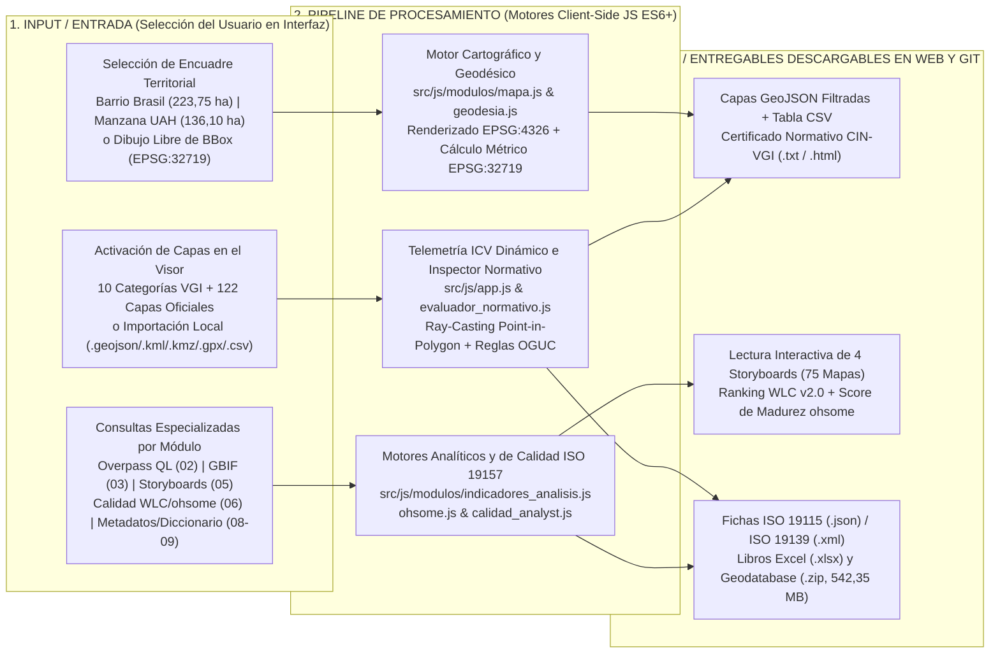
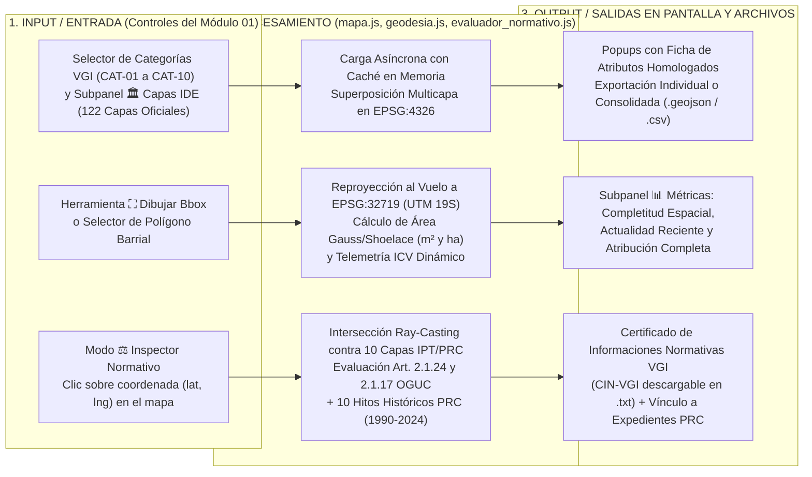
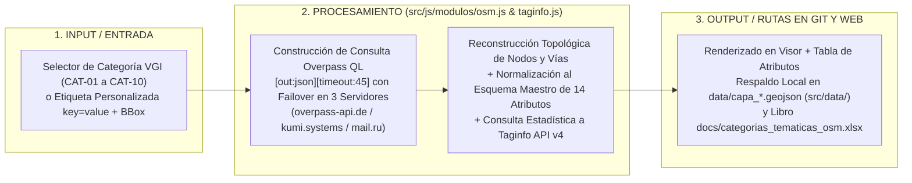
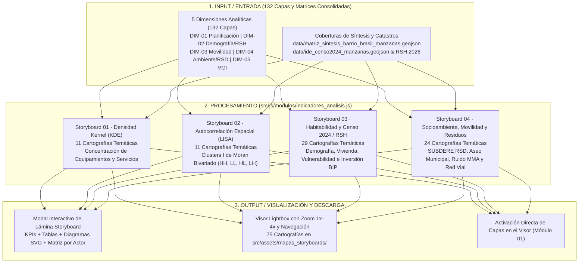
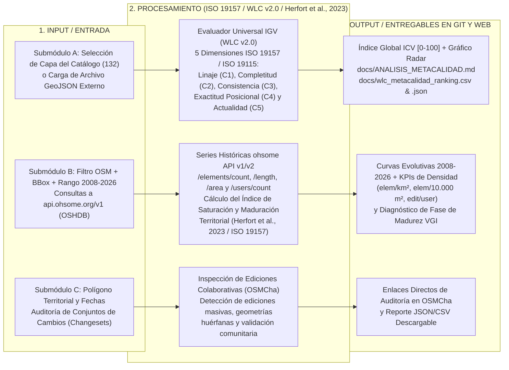

# Manual de Uso de la Plataforma Web — Atlas de Información Geográfica Voluntaria para la Gestión Territorial

* **Plataforma Web Interactiva:** [https://atlasvgiuah.netlify.app](https://atlasvgiuah.netlify.app)
* **Repositorio Espejo (GitHub Pages):** [https://geojota.github.io/atlas-vgi-barrio-brasil/](https://geojota.github.io/atlas-vgi-barrio-brasil/)
* **Cobertura Espacial y Normativa:** **132 Capas Operativas** (`122` Oficiales del Estado + `10` Macrocategorías VGI `CAT-01` a `CAT-10`) · **140 Descriptores ISO 19110:2016** · **5 Dimensiones Analíticas** · **4 Storyboards Territoriales (75 Cartografías Temáticas)** · **10 Módulos Funcionales (`01` al `10`)**.

---

## 1. Propósito General y Estructura Operativa

El **Atlas de Información Geográfica Voluntaria (VGI)** constituye una plataforma web de información territorial diseñada para integrar, visualizar, auditar y descargar coberturas geográficas provenientes de dos regímenes de producción complementarios:

1. **Cartografía Oficial del Estado de Chile (`122 capas`):** Coberturas normativas, censales, socioeconómicas y sectoriales emitidas por IDE Chile / SNIT, MINVU (Instrumentos de Planificación Territorial PRC/PRMS y Patrimonio), INE (Censo de Población y Vivienda 2024), MDSF (Registro Social de Hogares 2026 y Banco Integrado de Proyectos BIP), SUBDERE (Catastro Nacional de Residuos Sólidos Domiciliarios 2024), MTT / UOCT / DTPM (Red de Semáforos, Metro y Transporte Público), Ilustre Municipalidad de Santiago (Series comunales `BBDD-01` a `BBDD-91`), CMN, MMA y SII.
2. **Información Geográfica Voluntaria y Ciencia Ciudadana (`10 macrocategorías VGI`, `CAT-01` a `CAT-10`):** Coberturas colaborativas extraídas de **OpenStreetMap (OSM)** mediante consultas **Overpass QL** y registros biológicos georreferenciados de **GBIF** bajo el estándar **Darwin Core (DwC)**.

### 1.1. Pipeline General de Navegación y Operación del Usuario

---

## 2. Arquitectura de la Interfaz de Usuario (`src/index.html`)

La interfaz se organiza en tres áreas funcionales permanentes:

1. **Cabecera de Estado y Telemetría Global:** Indica el nodo territorial activo, el estado de conexión con los servicios geoespaciales (`PostGIS RPC` / `CDN Local`) y los accesos rápidos al **Importador de Capas Locales** y a la descarga de la **Base de Datos Completa (`docs/geodatabase_completa_atlas_vgi.zip`)**.
2. **Barra de Navegación de los 10 Módulos (`01` al `10`):** Permite conmutar de manera instantánea entre las diez secciones operativas sin recargar la página ni perder el estado de las capas encendidas en el visor.
3. **Área de Trabajo Contextual:** Despliega el lienzo cartográfico interactivo en el **Módulo 01** (junto con su panel lateral de 4 subpestañas) o los paneles analíticos, tabulares y documentales en los **Módulos 02 al 10**.

---

## 3. Guía Operativa de los 10 Módulos de la Plataforma

---

### MÓDULO 01 · Visor para la Gestión Territorial (`#panel-inicio`)

El **Módulo 01** es el núcleo cartográfico de la plataforma. Integra el lienzo interactivo Leaflet (`src/js/modulos/mapa.js`), el catálogo de las **122 capas oficiales** (`src/js/modulos/ide_chile.js`), los selectores de las **10 macrocategorías VGI** (`src/js/config.js`), el calculador en tiempo real del **Índice de Calidad VGI (ICV)** (`src/js/app.js`) y el **Inspector Normativo PRC/OGUC** (`src/js/modulos/evaluador_normativo.js`).

#### Funciones Clave del Módulo 01:
* **Encuadre Territorial y Medición Geodésica (`EPSG:32719`):** Los botones superiores permiten centrar la vista en el **Barrio Brasil Completo (`223,75 ha`)**, el cuadrante **Manzana UAH (`136,10 ha`)** o trazar un rectángulo personalizado mediante **⛶ Dibujar Bbox**. El módulo `src/js/modulos/geodesia.js` transforma los vértices de `EPSG:4326` a `EPSG:32719` (UTM Huso 19 Sur) aplicando las ecuaciones de Redfearn y calcula la superficie exacta en metros cuadrados (`m²`) y hectáreas (`ha`).
* **Subpanel `🏛 Capas IDE` (`122 Coberturas Oficiales`):** Organiza las 122 coberturas estatales en acordeones temáticos con buscador en tiempo real. Para mantener una adecuada legibilidad visual, se recomienda superponer simultáneamente entre **2 y 4 coberturas** (por ejemplo, una capa de zonificación poligonal, una red lineal de movilidad y una capa puntual de equipamientos).
* **Subpanel `📊 Métricas` (ICV Dinámico en Tiempo Real):** Cada vez que se activa o desactiva una cobertura, la función `actualizarTelemetriaCapasActivas()` recalcula tres indicadores sobre el conjunto de entidades visibles:
  1. **Completitud Espacial (`%`):** Proporción de entidades con geometría válida y atributos principales poblados (`nombre`, `tipo`, `categoria`).
  2. **Actualidad Reciente:** Año o período más reciente registrado en los metadatos o marcas temporales de las coberturas activas.
  3. **Atribución Completa (`%`):** Proporción de registros con institución custodia y licencia abierta verificada.
* **Subpanel `⚖ Inspector Normativo` y Certificado CIN-VGI:** Al activar el botón **⚖ Inspector Normativo** y hacer clic en cualquier punto del mapa, el sistema ejecuta un cruce espacial (*Point-in-Polygon* mediante algoritmo *Ray-Casting*) sobre las coberturas de planificación urbana (`data/ide_minvu_ipt_prc_santiago.geojson`, `data/capa_ipt_prc_comunal.geojson`, `data/ZCH_ICH_RM_Patrimonio_IPT.geojson`, `data/ide_minvu_patrimonio.geojson`, `data/ide_minvu_ipt_areas_riesgo.geojson`) y emite el **Certificado de Informaciones Normativas VGI (CIN-VGI)** descargable en `.txt`. La ficha incluye:
  * Zonificación del Plan Regulador Comunal (`ZONA`), usos permitidos (`UPERM`) y usos prohibidos (`UPROH`) conforme al principio de exclusión negativa del **Art. 2.1.24 de la OGUC**.
  * Restricciones por áreas de riesgo (**Art. 2.1.17 OGUC**) y protección patrimonial (Zonas Típicas, Zonas de Conservación Histórica `ZCH`, Inmuebles de Conservación Histórica `ICH` y Monumentos Nacionales).
  * Línea de tiempo con las **10 modificaciones históricas al PRC de Santiago que inciden en el Barrio Brasil (1990–2024)** y enlace directo al repositorio de expedientes oficiales de Asesoría Urbana de la Ilustre Municipalidad de Santiago.
  * Sección **🏗️ DINÁMICA EDIFICATORIA, PERMISOS DOM Y RECEPCIONES FINALES (CRF) INE:** con alerta metodológica de cobertura: *Los resultados arrojados no representan el universo total del punto muestreado sino que están basados en los datos (recepción final [2011–2025] y permisos de edificación [2010–2025]) disponibles públicamente*.

---

### MÓDULO 02 · Consultas Overpass (OSM) y Auditoría Taginfo (`#panel-explorador-osm`)

Permite interrogar en tiempo real la base de datos global de **OpenStreetMap** mediante el lenguaje **Overpass QL** (`src/js/modulos/osm.js`) y auditar la consistencia semántica de las etiquetas mediante la API v4 de **Taginfo** (`src/js/modulos/taginfo.js`).

* **Operación:** Seleccione una de las 10 macrocategorías preconfiguradas (`Educación`, `Servicios y Salud`, `Ciclovías`, `Transporte Público`, `Áreas Verdes`, `Patrimonio`, `Accesibilidad Peatonal`, `Biodiversidad`, `Edificaciones` o `Cobertura de Suelo`) o ingrese un par `clave=valor` (por ejemplo, `amenity=library` o `highway=crossing`) y presione **Ejecutar Consulta Overpass**.
* **Resiliencia Offline:** Si los servidores externos de Overpass presentan saturación temporal, el módulo conmuta automáticamente hacia los respaldos locales preprocesados en `src/data/capa_*.geojson` y `data/capa_*.geojson`.

---

### MÓDULO 03 · Biodiversidad GBIF (`#panel-biodiversidad-gbif`)

Conecta con la API REST v1 de la **Global Biodiversity Information Facility (`api.gbif.org/v1/occurrence/search`)** (`src/js/modulos/gbif.js`) para recuperar registros biológicos georreferenciados bajo el estándar **Darwin Core (DwC)**.

* **Operación:** Permite filtrar ocurrencias por reino taxonómico (`Plantae`, `Animalia`, `Fungi`), rango temporal y polígono de búsqueda, desplegando nombre científico (`scientificName`), nombre común, familia, base del registro (`HUMAN_OBSERVATION`, `PRESERVED_SPECIMEN`), institución publicadora y licencia Creative Commons.
* **Salidas en Git y Web:** Los registros consolidados del área de estudio se almacenan en `data/capa_biodiversidad.geojson` (`src/data/capa_biodiversidad.geojson`, `CAT-08`) y pueden enviarse directamente al visor del Módulo 01.

---

### MÓDULO 04 · Cartografía Colaborativa uMap e Importador Local (`#panel-proyectos-umap`)

Articula catastros ciudadanos elaborados sobre **uMap** (`src/js/modulos/umap.js`) y provee un motor de importación vectorial local en el navegador (`src/js/modulos/importador_capas.js`).

* **Proyectos uMap Integrados:** Permite embeber proyectos cartográficos comunitarios o inyectar sus capas GeoJSON directamente sobre el visor principal para cruzarlos con las 122 capas oficiales.
* **Importador Multiformato Client-Side:** Mediante arrastrar y soltar (*Drag & Drop*), el usuario puede cargar archivos locales en formato `.geojson`, `.json`, `.kml`, `.kmz`, `.gpx` o `.csv` (con columnas `lat`/`lon`). Los datos se procesan íntegramente en la memoria del navegador sin transmitirse a servidores externos.

---

### MÓDULO 05 · Indicadores & Storyboards Territoriales (`#panel-indicadores`)

El **Módulo 05** (`src/js/modulos/indicadores_analisis.js`) organiza las **132 coberturas operativas** en **5 Dimensiones Analíticas** y presenta **4 Storyboards Territoriales** que integran **75 cartografías temáticas** (`src/assets/mapas_storyboards/`), tarjetas de indicadores clave (KPI), gráficos comparativos, diagramas vectoriales SVG, análisis diferenciados para 4 perfiles de actores (`Institución Pública`, `Comunidad Vecinal`, `Voluntariado VGI`, `ONG / Academia`) y visor **Lightbox de alta magnificación** (`zoom` hasta `4x` y desplazamiento táctil).

#### Desglose de los 4 Storyboards Territoriales (75 Cartografías Temáticas):
1. **Storyboard 01 — Análisis de Concentración Espacial mediante Densidad de Kernel (KDE) (`11 cartografías`):** Evalúa la intensidad espacial de equipamientos educativos (`CAT-01`), salud y servicios (`CAT-02`), comercio, patrimonio (`CAT-06`) y accesibilidad peatonal (`CAT-07`) en el Barrio Brasil y el eje Alameda–Cumming.
2. **Storyboard 02 — Autocorrelación Espacial Local (LISA / I de Moran) (`11 cartografías`):** Identifica agrupamientos estadísticamente significativos (*Hotspots* Alto-Alto `HH`, *Coldspots* Bajo-Bajo `LL` y valores atípicos espaciales `HL`/`LH`) cruzando la densidad de mapeo colaborativo VGI frente a las coberturas oficiales e indicadores censales.
3. **Storyboard 03 — Dinámicas Demográficas, Habitabilidad Censo 2024, Vulnerabilidad RSH e Inversión Pública (`29 cartografías`):** Caracteriza a escala de manzana censal (`data/ide_censo2024_manzanas.geojson`) y unidad vecinal (`data/RSH_*_UV_2026_*.geojson`) la distribución poblacional, tipologías edificatorias, jefatura de hogar, estratificación socioeconómica del Registro Social de Hogares y localización de proyectos del Banco Integrado de Proyectos (`data/bip_inversiones_santiago.csv`).
4. **Storyboard 04 — Metabolismo Urbano, Socioambiente, Movilidad Sustentable y Gestión de Residuos (`24 cartografías`):** Cruza el Catastro Nacional de Residuos Sólidos Domiciliarios SUBDERE (`data/subdere_rsd_*.geojson`), las rutas y contenedores de aseo municipal (`data/zonas_aseo_contenedores_papeleros_santiago.geojson`), niveles de ruido ambiental MMA (`data/mma_ruido_ambiental_santiago.geojson`), arbolado/áreas verdes y la red de movilidad y semáforos UOCT (`data/semaforos_rm_uoct_2026.geojson`).

---

### MÓDULO 06 · Calidad & ICV (ISO 19157 / ohsome API / OSMCha) (`#panel-calidad-ohsome`)

El **Módulo 06** evalúa cuantitativamente la calidad de los datos geográficos mediante tres submódulos complementarios (`src/js/modulos/evaluador_calidad_cuantitativa.js`, `src/js/modulos/ohsome.js` y `src/js/modulos/calidad_analyst.js`):

#### Especificación de los Tres Submódulos del Módulo 06:
1. **Submódulo A — Evaluador Universal de Calidad Cuantitativa (Modelo WLC v2.0 bajo ISO 19157:2013 e ISO 19115:2014):**
   * Permite seleccionar cualquiera de las **132 capas del Atlas** (`10` VGI o `122` oficiales) o arrastrar un archivo `.geojson` externo para auditarlo en tiempo real.
   * Calcula el **Índice de Calidad Combinado (`ICV_WLC`)** en escala de `0` a `100` ponderando cinco dimensiones: **Linaje y Metadatos (`C1 = 0,25`)**, **Completitud Atributiva (`C2 = 0,25`)**, **Consistencia Lógica y Topológica (`C3 = 0,20`)**, **Exactitud Posicional y Geodésica (`C4 = 0,15`)** y **Actualidad Temporal (`C5 = 0,15`)**. Los pesos pueden ajustarse interactivamente en pantalla.
2. **Submódulo B — Series Históricas OSHDB / ohsome API v1/v2 e Índice de Saturación y Maduración Territorial:**
   * Interroga los endpoints `/elements/count`, `/elements/length`, `/elements/area` y `/users/count` de **HeiGIT ohsome API** (`2008–2026`) sobre el BBox seleccionado (reproyectado a `EPSG:32719` para obtener la superficie exacta en `km²` y en hectáreas `10.000 m²`).
   * Computa la **Densidad Espacial (`elem/km²` y `elem/10.000 m²`)**, la **Intensidad de Edición Comunitaria (`edit/user`)** y el **Índice de Saturación y Maduración Territorial (Herfort et al., 2023 / ISO 19157)**, el cual pondera la **Asíntota de Completitud Geométrica (`60%`)** y la **Diversidad de Contribuyentes Activos (`40%`)** para clasificar el territorio en *Fase 1: Mapeo Inicial (`< 45%`)*, *Fase 2: Expansión y Consolidación (`45% – 79%`)* o *Fase 3: Saturación / Mantenimiento de Atributos (`>= 80%`)*.
3. **Submódulo C — Validación de Ediciones Colaborativas (OSMCha):**
   * Genera enlaces parametrizados con el BBox activo hacia **OSMCha (OpenStreetMap Changeset Analyzer)** para auditar conjuntos de cambios individuales, verificar etiquetas de fuente (`source=*`) y detectar reversiones o anomalías geométricas.

---

### MÓDULO 07 · Manual de Uso y Actualización Técnica (`#panel-manual`)

Integra dentro de la propia plataforma web (`src/js/modulos/manual.js`) la documentación completa del sistema dividida en dos partes con buscador dinámico en tiempo real:
* **Parte I (`USO · 01` a `USO · 04`):** Fundamentación del sistema, guía del Módulo 01 (Visor, ICV Dinámico e Inspector Normativo PRC), catálogo de acceso directo a los 10 módulos e **Inventario General Filtrable de las 132 Coberturas Operativas**.
* **Parte II (`ACT · 01` a `ACT · 05`):** Arquitectura tecnológica, **Catálogo Estandarizado Multi-Lenguaje** (`HTML5`, `CSS3`, `JS ES6+`, `SQL`, `JSON/TOML`, `Python 3`), diagramas de los **4 Pipelines Operativos (`A`, `B`, `C` y `D`)**, protocolo de 6 etapas para agregar nuevas capas, suite de verificación en Python y botones de descarga directa de todos los documentos `.md` en `docs/`.

---

### MÓDULO 08 · Generador de Metadatos ISO 19115 / ISO 19139 (`#panel-metadatos-iso`)

Permite estructurar, previsualizar y exportar fichas de metadatos geoespaciales (`src/js/modulos/metadatos.js`) cumpliendo con la norma **ISO 19115:2003 / ISO 19115-1:2014**, la codificación XML **ISO/TS 19139:2007** y el **Perfil Nacional de Metadatos de IDE Chile (SNIT)**.

* **Autocompletado Inteligente:** Al elegir cualquiera de las 132 capas en el selector superior, el formulario rellena automáticamente el título, resumen, categoría temática ISO (`MD_TopicCategoryCode`), sistema de referencia (`EPSG:4326` / `EPSG:32719`), extensión espacial (`EX_GeographicBoundingBox`), linaje (`LI_Lineage`), institución responsable y licencia.
* **Exportación Dual:** Genera con un clic el archivo **JSON (ISO 19115)** o el documento **XML (ISO 19139)** listo para su ingesta en catálogos **GeoNetwork** o **GeoNode**.

---

### MÓDULO 09 · Diccionario de Atributos y Homologación Semántica ISO 19110 (`#panel-diccionario`)

Documenta el **Catálogo de Objetos Geográficos** conforme a la norma **ISO 19110:2016** (`src/js/modulos/diccionario.js`), abarcando las **132 capas del Atlas** y **140 descriptores normativos**:

* Permite filtrar por grupo temático, por las **122 Capas Oficiales del Estado**, por el **Esquema Normalizado de 23 Atributos** o aislar exclusivamente las **86 Brechas Temáticas VGI** (atributos micro-urbanos de accesibilidad universal, mobiliario peatonal, ciclovías y biodiversidad barrial que no poseen homólogo en los catastros ministeriales y son suplidos por el mapeo ciudadano).

---

### MÓDULO 10 · Licencias & Catálogos Consolidados (`#panel-licencias`)

Sistematiza el régimen jurídico de propiedad intelectual y acceso público (`src/js/modulos/licencias.js`) y centraliza la descarga de los paquetes maestros de datos:

* **Marco Normativo:** Explica las condiciones de uso y atribución de **ODbL 1.0** (OpenStreetMap), **CC BY 4.0 / CC BY-SA 4.0** (GBIF y cartografía derivada), **Ley N° 20.285** (Transparencia y Datos Abiertos del Estado de Chile) y **Ley N° 19.628** (Protección de Datos Personales mediante agregación censal a nivel de manzana y unidad vecinal).
* **Descargas Directas Sincronizadas en `docs/` y `src/docs/`:**
  1. **Paquete Consolidado (`docs/geodatabase_completa_atlas_vgi.zip`):** `542,35 MB` comprimidos (`~3,33 GB` descomprimidos, `257` archivos en `7` subcarpetas).
  2. **Libro 1 (`docs/catalogo_fuentes_vgi.xlsx`):** Catálogo sistemático de las 132 fuentes VGI y oficiales.
  3. **Libro 2 (`docs/perfil_metadatos_vgi.xlsx`):** Perfil de metadatos ISO 19115 / IDE Chile y evaluación WLC ISO 19157.
  4. **Libro 3 (`docs/categorias_tematicas_osm.xlsx`):** Taxonomía de las 10 macrocategorías VGI (`CAT-01` a `CAT-10`) y equivalencias ISO 19110.

---

## 4. Perfiles de Uso y Flujos Recomendados por Tipo de Actor

| Perfil de Actor Territorial | Flujo de Trabajo Recomendado en la Plataforma | Entregables y Salidas Principales |
| :--- | :--- | :--- |
| **1. Equipos Técnicos Municipales y Ministeriales (SECPLA, DOM, Asesoría Urbana, MINVU, SUBDERE)** | `Módulo 01` (Superposición de capas `BBDD` + Inspector Normativo PRC) → `Módulo 05` (Storyboards 03 y 04 de Censo 2024, RSH y Residuos SUBDERE) → `Módulo 08` (Exportación XML ISO 19139). | Certificado **CIN-VGI (`.txt`)**, fichas **XML ISO 19139** para GeoNetwork/GeoNode y paquete `docs/geodatabase_completa_atlas_vgi.zip`. |
| **2. Organizaciones Comunitarias, Juntas de Vecinos y Colectivos Barriales** | `Módulo 01` (Activación de equipamientos, áreas verdes y accesibilidad) → `Módulo 04` (Importación de catastros vecinales en `.kml`/`.geojson`) → `Módulo 05` (Lectura de Storyboards 01 y 02). | Cartografías temáticas en **Lightbox (PNG)**, tablas **CSV** de equipamientos barriales y diagnóstico normativo PRC de predios. |
| **3. Comunidad de Mapeadores Voluntarios (OpenStreetMap / Ciencia Ciudadana)** | `Módulo 02` (Consultas Overpass QL y validación Taginfo) → `Módulo 06` (Submódulos B y C: curvas ohsome de saturación y auditoría OSMCha) → `Módulo 09` (Revisión de las 86 brechas VGI). | Identificación de sectores con baja completitud atributiva (`surface=*`, `wheelchair=*`, `tactile_paving=*`) para priorizar campañas de mapeo. |
| **4. Investigadores, Docentes y Analistas Geoespaciales** | `Módulo 05` (Análisis KDE y LISA I de Moran) → `Módulo 06` (Submódulo A: Ranking multicriterio WLC v2.0) → `Módulo 10` (Descarga de los 3 libros `.xlsx` y matrices `.csv`/`.json`). | Matrices `docs/wlc_metacalidad_ranking.csv`, `docs/correlacion_dimensiones_calidad.csv`, `data/matriz_sintesis_barrio_brasil_manzanas.geojson` y `docs/BIBLIOGRAFIA_SEMINARIO_Y_ATLAS.md`. |
