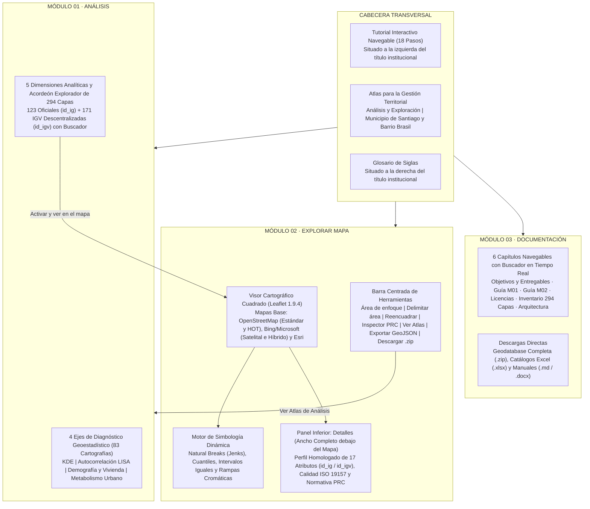

# Manual de Uso del Atlas para la Gestión Territorial
### Análisis y Exploración | Municipio de Santiago y Barrio Brasil

* **Plataforma Web Interactiva:** [https://atlasvgiuah.netlify.app](https://atlasvgiuah.netlify.app)
* **Repositorio Espejo (GitHub Pages):** [https://geojota.github.io/atlas-vgi-barrio-brasil/](https://geojota.github.io/atlas-vgi-barrio-brasil/)
* **Cobertura Cartográfica:** 294 Capas Espaciales Operativas (123 Oficiales del Estado de Chile con identificador `id_ig` + 171 Coberturas Descentralizadas de Información Geográfica Voluntaria, IGV, con identificador `id_igv`, 100 % en español).
* **Dimensiones de Análisis:** 5 Dimensiones Analíticas (Sociodemográfica, Socioeconómica, Socioambiental, Sociosanitaria y Sociourbana).
* **Diagnóstico Geoestadístico:** 83 Cartografías Temáticas organizadas en 4 Ejes de Evidencia Espacial.
* **Arquitectura de Navegación:** 3 Módulos Operacionales Principales (*Módulo 01 · Análisis*, *Módulo 02 · Explorar Mapa* y *Módulo 03 · Documentación*), acompañados en la cabecera por el **Tutorial Interactivo de 18 pasos** y el **Glosario de siglas**.

---

## 1. Propósito general y estructura navegable de la plataforma

El **Atlas para la Gestión Territorial** es una plataforma de información geográfica abierta, dinámica y adaptable a cualquier dispositivo o tamaño de ventana, diseñada para el diagnóstico espacial, la consulta normativa y la toma de decisiones en el Municipio de Santiago y el Barrio Brasil.

La plataforma articula dos regímenes complementarios de producción cartográfica bajo un perfil homologado de **17 atributos y métricas de calidad ISO 19157**:

1. **Información Geográfica Oficial del Estado de Chile (123 coberturas · clave primaria `id_ig`):** Coberturas emitidas por ministerios y organismos públicos (IDE Chile / SNIT, MINVU, INE Censo 2024, MDSF / RSH, SUBDERE, MTT / UOCT, CMN, MMA, SII y Municipalidad de Santiago).
2. **Información Geográfica Voluntaria Descentralizada (171 coberturas · clave primaria `id_igv`):** Cada descriptor levantado por la comunidad en OpenStreetMap y GBIF (farmacias, árboles urbanos, centros de salud, escuelas, paraderos, ciclovías, rebajes peatonales, ferias libres y 52 especies biológicas individualizadas) opera como una **capa independiente**, traducida al español y lista para visualizarse o descargarse.

---

## 2. Inducción guiada: Tutorial Interactivo Navegable (18 pasos) y Glosario de Siglas

En la franja superior de la cabecera se disponen dos utilidades permanentes en flancos opuestos del título para evitar cualquier superposición visual:

1. **Tutorial Interactivo (a la izquierda del título):** Recorrido pedagógico de **18 pasos** estructurado en 4 bloques navegables (*Visión General*, *Módulo 01 · Análisis*, *Módulo 02 · Mapa* y *Módulo 03 · Documentación*). Incluye una barra de pestañas por módulo y 18 botones numéricos directos que presentan primero el propósito de cada módulo antes de explicar para qué sirve cada uno de sus componentes.
2. **Glosario de Siglas (a la derecha del título):** Ventana de consulta rápida con la definición en lenguaje claro de todas las siglas utilizadas en la plataforma (`IGV`, `KDE`, `LISA`, `PRC`, `OGUC`, `IDE`, `RSH`, `BIP`, entre otras).

---

## 3. Guía operativa de los 3 Módulos de la plataforma

### 3.1. Módulo 01: Análisis

Presenta el diagnóstico geoestadístico del territorio y la organización temática del catálogo antes de pasar a la exploración libre en el visor:

1. **Cuatro Ejes de Diagnóstico Geoestadístico (83 Cartografías Temáticas):**
   * **Eje 01 · Concentración Territorial de Actividad IGV en Santiago (14 mapas KDE):** Estimación de densidad por núcleo sobre 79.841 entidades geométricas y 112.264 nodos en malla regular de 20 m, evidenciando la concentración en el eje Alameda y Barrio Brasil frente al sector sur de la comuna.
   * **Eje 02 · Segregación Espacial, Hotspots y Áreas de Rezago (11 mapas LISA):** Indicadores locales de asociación espacial (Anselin, 1995) sobre las 1.711 manzanas censales de Santiago (clústeres Alto-Alto `HH` y bolsones Bajo-Bajo `LL`).
   * **Eje 03 · Estructura Sociodemográfica, Habitabilidad y Morfología Urbana (34 mapas):** Distribución poblacional del Censo 2024, vulnerabilidad del Registro Social de Hogares (RSH), tipologías de vivienda, arriendo, cités y conservación histórica.
   * **Eje 04 · Metabolismo Urbano, Movilidad y Espacio Público (24 mapas):** Accesibilidad caminable a áreas verdes y salud, arbolado urbano, ruido ambiental (>68 dBA) y gestión de residuos sólidos en las 5 zonas de aseo municipal.
2. **Las 5 Dimensiones Analíticas y el Explorador de 294 Coberturas:**
   * **Dimensión 1 · Sociodemográfica y Habitacional:** Censo 2024, vulnerabilidad RSH, vivienda y unidades vecinales.
   * **Dimensión 2 · Socioeconómica y Comercial:** Inversión pública BIP/MOP, comercio barrial, ferias libres y telecomunicaciones.
   * **Dimensión 3 · Socioambiental y Espacio Público:** Áreas verdes, arbolado urbano, biodiversidad ciudadana (GBIF) y residuos sólidos.
   * **Dimensión 4 · Sociosanitaria y Salud:** Red asistencial (CESFAM y hospitales), farmacias y cobertura sanitaria.
   * **Dimensión 5 · Sociourbana, Movilidad y Normativa:** Zonificación PRC Santiago, patrimonio protegido, Metro, ciclovías y accesibilidad universal.
   * Desde el acordeón inferior, el usuario puede filtrar las 294 capas por palabra clave o fuente (Oficiales vs. IGV) y pulsar **Ver en el mapa** para encenderlas automáticamente en el Módulo 02.

---

### 3.2. Módulo 02: Explorar Mapa

Reúne el visor cartográfico interactivo, las herramientas de análisis espacial en vivo y el panel inferior de inspección:

1. **Barra de Herramientas Centrada y Adaptable:**
   * **Área de enfoque:** Conmuta el encuadre entre *Barrio Brasil Completo* y *Comuna de Santiago*.
   * **Delimitar área:** Dibuja un rectángulo sobre el mapa y calcula su superficie exacta en hectáreas (`ha`) y metros cuadrados (`m²`) proyectados en `EPSG:32719` (UTM Huso 19 Sur).
   * **Reencuadrar:** Restablece la vista al encuadre territorial activo.
   * **Inspector normativo (PRC):** Al activarlo y hacer clic sobre un predio o manzana, intersecta las capas del Plan Regulador Comunal de Santiago y la OGUC, desplegando la normativa edificatoria exclusivamente cuando es consultada.
   * **Ver Atlas de Análisis:** Regresa al Módulo 01 conservando el estado de trabajo.
   * **Exportar vista (GeoJSON):** Descarga las entidades activas en pantalla con su simbología cromática embebida.
   * **Descargar base de datos (.zip):** Abre el acceso directo al paquete maestro comprimido con las 294 capas.
2. **Visor Cartográfico Cuadrado y 5 Mapas Base (Sin Claves de API):**
   * El lienzo posee una proporción amplia y cuadrada para maximizar el área visual de exploración e incorpora 5 mapas base en la esquina superior derecha:
     1. **OpenStreetMap Estándar (Predeterminado)**
     2. **OpenStreetMap Humanitario (HOT)**
     3. **Imagen Satelital (Bing / Microsoft)**
     4. **Satelital Híbrido con Calles (Bing / Microsoft)**
     5. **Imagen Satelital (Esri World Imagery)**
3. **Motor de Simbología Dinámica (*Natural Breaks* / Jenks):**
   * Permite clasificar cualquier variable numérica mediante Cortes Naturales de Jenks, Cuantiles, Intervalos Iguales o Desviación Estándar, o categorizar variables nominales con paletas cromáticas adaptadas a cada dimensión.
4. **Panel Inferior "Detalles" (Debajo del Mapa):**
   * Ubicado inmediatamente debajo del visor cartográfico a todo lo ancho, presenta la ficha técnica de la entidad seleccionada con su **perfil homologado de 17 atributos** (`id_ig` para las 123 capas oficiales e `id_igv` para las 171 capas de IGV), indicadores de calidad ISO 19157, linaje institucional o comunitario y botón de descarga individual en GeoJSON.

---

### 3.3. Módulo 03: Documentación

Integra en 6 capítulos navegables con buscador en tiempo real toda la documentación de uso, arquitectura, licencias y descargas:

* **DOC · 01:** Fundamentación, Objetivos, Entregables Verificados y Cifras Clave.
* **DOC · 02:** Guía del Módulo 01 (Análisis Territorial, 4 Ejes Geoestadísticos y 5 Dimensiones).
* **DOC · 03:** Guía del Módulo 02 (Explorar Mapa, Simbología Dinámica y Panel de Detalles).
* **DOC · 04:** Licencias Abiertas (`CC BY 4.0`, `CC BY-SA 4.0`, `ODbL 1.0`, `GNU AGPLv3`, Ley N° 20.285 / Ley N° 21.180), Descarga de Geodatabase (`.zip`) y Catálogos en Excel (`.xlsx`).
* **DOC · 05:** Inventario General filtrable de las 294 Coberturas Integradas (123 Oficiales `id_ig` + 171 IGV `id_igv`).
* **DOC · 06:** Arquitectura del Sistema, Flujos de Trabajo y Guía de Actualización Técnica.
