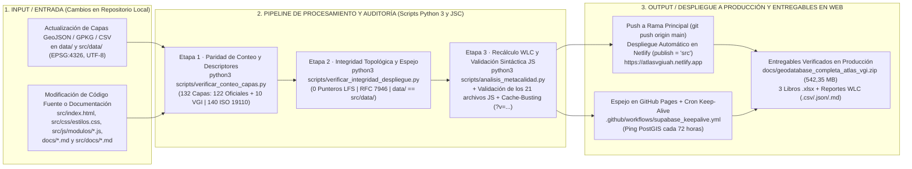
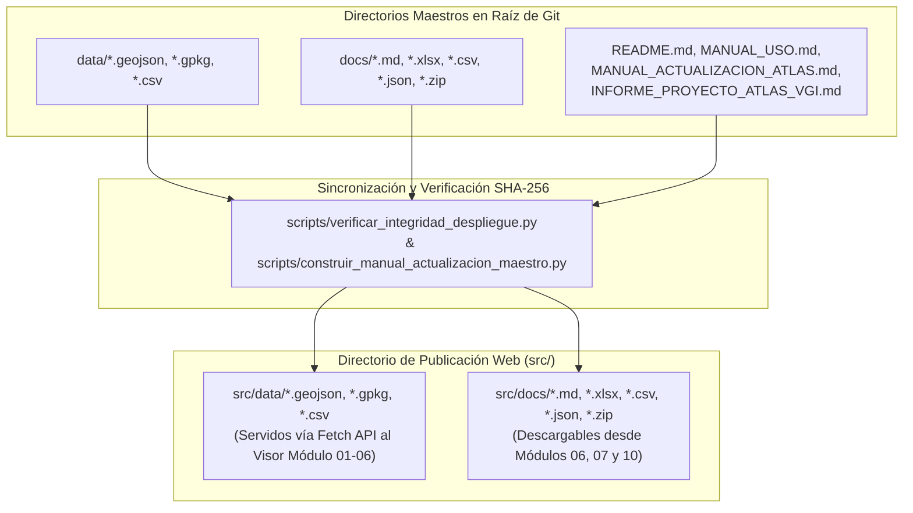

# Protocolo de Integridad de Datos, Verificación Automatizada y Despliegue a Producción — Atlas VGI

* **Entorno de Producción Primaria (Netlify CDN):** [https://atlasvgiuah.netlify.app](https://atlasvgiuah.netlify.app)
* **Entorno de Respaldo (GitHub Pages):** [https://geojota.github.io/atlas-vgi-barrio-brasil/](https://geojota.github.io/atlas-vgi-barrio-brasil/)
* **Parámetros Auditados:** **132 Capas Operativas** (`122` Oficiales + `10` VGI) · **140 Descriptores ISO 19110:2016** · **4 Storyboards (75 Cartografías)** · **21 Módulos JS ES6+** · **Paridad Simétrica `data/` ↔ `src/data/` y `docs/` ↔ `src/docs/`**.

---

## 1. Propósito del Protocolo de Integridad y Despliegue

Este documento define las reglas de validación técnica, los bancos de pruebas automatizadas en Python 3, la sincronización de directorios espejo, el control de caché (*Cache-Busting*) y el flujo de despliegue continuo hacia producción del **Atlas de Información Geográfica Voluntaria (VGI)**.

Su cumplimiento garantiza que ninguna actualización de código o de cartografía genere enlaces rotos (`HTTP 404`), archivos truncados por punteros de *Git LFS*, discrepancias en el conteo de las **132 coberturas operativas** o pérdida de sincronización entre el repositorio raíz y el directorio de publicación web (`src/`).

---

## 2. Pipeline General de Auditoría Pre-Despliegue y Publicación Continua (CI/CD)

---

## 3. Reglas de Oro de Integridad del Repositorio

### 3.1. Sincronización Simétrica Obligatoria (`data/` ↔ `src/data/` y `docs/` ↔ `src/docs/`)

Dado que `netlify.toml` establece `publish = "src"` como raíz del servidor HTTP mientras que los scripts de ciencia de datos en `scripts/` operan sobre `data/` y `docs/` en la raíz del repositorio, todo archivo de datos o documentación debe residir de forma idéntica en ambos pares de directorios:

### 3.2. Prohibición Estricta de Punteros Git LFS en Archivos `.geojson` y `.xlsx`
Ningún archivo `.geojson`, `.csv`, `.json` o `.xlsx` servido por la aplicación web puede almacenarse como puntero de texto `version https://git-lfs.github.com/spec/v1`, ya que las llamadas `fetch()` del navegador recibirían el puntero de 130 bytes en lugar de la estructura JSON o binaria real. El script `scripts/verificar_integridad_despliegue.py` inspecciona la cabecera de todos los archivos y bloquea el despliegue si detecta cualquier firma LFS.

### 3.3. Norma Geodésica de Almacenamiento (`EPSG:4326` / RFC 7946)
Todos los archivos `.geojson` en `data/` y `src/data/` deben estar proyectados en coordenadas geográficas **`EPSG:4326` (WGS84 / SIRGAS-Chile)** con longitud en el rango `[-71,8°, -69,5°]` y latitud en el rango `[-34,5°, -32,8°]`. Si una fuente ministerial entrega coberturas en coordenadas planas UTM (`EPSG:32719` o `EPSG:5361`), debe reproyectarse previamente con `scripts/reproyectar_capas_stgo.py` antes de copiarse a `data/` y `src/data/`.

---

## 4. Los 8 Bancos de Pruebas Automatizadas Pre-Despliegue

Antes de ejecutar cualquier `git push origin main`, el equipo mantenedor debe verificar los **8 bancos de pruebas**:

| Banco | Script / Comando de Verificación | Condición de Aprobación (`PASS`) | Archivos Auditados |
| :---: | :--- | :--- | :--- |
| **Banco 1** | `python3 scripts/verificar_conteo_capas.py` | Conteo exacto de **132 capas** (`122` en `CAPAS_OFICIALES` de `ide_chile.js` + `10` en `categorias_osm` de `config.js`), `132` botones en `src/index.html` y `132` entradas en `indicadores_analisis.js`. | `src/js/config.js`, `src/js/modulos/ide_chile.js`, `src/js/modulos/indicadores_analisis.js`, `src/index.html` |
| **Banco 2** | `python3 scripts/verificar_conteo_capas.py` | Conteo exacto de **140 descriptores normativos** en `CATALOGO_DICCIONARIO` (`86` brechas VGI sin homólogo estatal). | `src/js/modulos/diccionario.js`, `src/index.html` |
| **Banco 3** | `python3 scripts/verificar_integridad_despliegue.py` | Existencia física, validez sintáctica JSON (`FeatureCollection`), coordenadas en rango WGS84 (`EPSG:4326`) y **0 punteros Git LFS** en las 132 capas. | `data/*.geojson`, `src/data/*.geojson` |
| **Banco 4** | `python3 scripts/verificar_integridad_despliegue.py` | Paridad simétrica entre `data/` y `src/data/`, y presencia de los entregables en `docs/` y `src/docs/`. | `data/` ↔ `src/data/`, `docs/` ↔ `src/docs/` |
| **Banco 5** | Verificación de Storyboards y Cartografías | Presencia de los **4 Storyboards** en `indicadores_analisis.js` con sus 10 propiedades obligatorias y existencia física de las **75 cartografías PNG** en `src/assets/mapas_storyboards/`. | `src/js/modulos/indicadores_analisis.js`, `src/assets/mapas_storyboards/` |
| **Banco 6** | `python3 scripts/analisis_metacalidad.py` | Cálculo exitoso de las 5 dimensiones ISO 19157/19115 (`C1` a `C5`) y actualización de las matrices WLC. | `docs/ANALISIS_METACALIDAD.md`, `docs/wlc_metacalidad_ranking.csv`, `docs/wlc_metacalidad_resultado.json`, `docs/matriz_metacalidad.json` |
| **Banco 7** | Validación Sintáctica de los 21 Scripts JS | Compilación limpia (`0 SyntaxError`) de los 21 archivos `.js` en `src/js/` y `src/js/modulos/`. | `src/js/*.js`, `src/js/modulos/*.js` |
| **Banco 8** | Control de Caché (`Cache-Busting`) | Parámetro `?v=YYYYMMDD_vN` uniforme y actualizado en todas las etiquetas `<link>` y `<script>` de `src/index.html`. | `src/index.html`, `netlify.toml` |

---

## 5. Configuración de Despliegue en Netlify (`netlify.toml`) y GitHub Actions

### 5.1. Reglas de Publicación, Cabeceras HTTP y Redirecciones (`netlify.toml`)

El archivo `netlify.toml` en la raíz del proyecto controla el comportamiento del CDN en producción:

* **Directorio de publicación:** `publish = "src"`.
* **Cabeceras CORS y Tipos MIME Geoespaciales:** Habilita `Access-Control-Allow-Origin: *` para todos los recursos bajo `/data/*` y `/docs/*`, asignando `application/geo+json; charset=utf-8` a los archivos `.geojson` y `application/geopackage+sqlite3` a los archivos `.gpkg`.
* **Política de Caché Diferenciada:**
  * `/index.html`: `Cache-Control: public, max-age=0, must-revalidate` (garantiza que el navegador consulte siempre la última versión del DOM y de las referencias `?v=...`).
  * `/js/*` y `/css/*`: `Cache-Control: public, max-age=3600, stale-while-revalidate=86400`.
  * `/data/*`: `Cache-Control: public, max-age=86400, stale-while-revalidate=604800` (acelera la carga de las 132 capas vectoriales).
* **Atajos de Redirección HTTP (`302` / `200`):**
  * `/geodatabase` → `/docs/geodatabase_completa_atlas_vgi.zip`
  * `/api/catalogo` → `/docs/matriz_metacalidad.json`
  * `/api/wlc` → `/docs/wlc_metacalidad_resultado.json`

### 5.2. Automatización Keep-Alive del Backend PostGIS (`.github/workflows/supabase_keepalive.yml`)

Para evitar la suspensión por inactividad de la instancia gratuita de PostgreSQL/PostGIS en Supabase, el flujo de trabajo `.github/workflows/supabase_keepalive.yml` se ejecuta automáticamente cada 72 horas (`cron: '0 8 */3 * *'`), realizando una consulta ligera a la API REST (`catalogo_capas?select=id&limit=1`) y registrando el estado operativo del servicio.

---

## 6. Matriz de Diagnóstico y Resolución Rápida de Incidencias

| Síntoma Observado | Causa Raíz Probable | Procedimiento de Corrección |
| :--- | :--- | :--- |
| **Una capa se activa en el panel pero no se dibuja en el visor.** | Las coordenadas del archivo `.geojson` están en metros UTM (`EPSG:32719`) en lugar de grados decimales (`EPSG:4326`). | Ejecutar `python3 scripts/reproyectar_capas_stgo.py` o reproyectar a `EPSG:4326` y copiar el archivo tanto en `data/` como en `src/data/`. |
| **Error `HTTP 404` al encender una capa oficial en producción.** | El archivo se copió en `data/` pero se omitió su copia espejo en `src/data/`, o el nombre en `archivoLocal` (`ide_chile.js`) difiere en mayúsculas/minúsculas. | Copiar el archivo a `src/data/`, verificar la coincidencia exacta de la ruta en `src/js/modulos/ide_chile.js` y ejecutar `python3 scripts/verificar_integridad_despliegue.py`. |
| **El modal de un Storyboard no se despliega al hacer clic.** | Falta una de las 10 propiedades obligatorias (`introduccion`, `datosClave`, `porcentajesClave`, `graficoComparativo`, `diagramaSVG`, `tablaIndicadores`, `cuerpo`, `conclusion`, `analisisPorActor`, `apartadoBibliografico`) en `indicadores_analisis.js`. | Completar la estructura del objeto en `src/js/modulos/indicadores_analisis.js` siguiendo el esquema canónico documentado en el Manual de Actualización. |
| **Los cambios aplicados en `.js` o `.css` no se reflejan en el navegador.** | El navegador conserva en caché local la versión previa del script o de la hoja de estilos. | Incrementar el parámetro `?v=YYYYMMDD_vN` en `src/index.html` antes de hacer `git commit` y recargar con `Ctrl + F5` (`Cmd + Shift + R` en macOS). |
| **El comando `git push origin main` es rechazado (`fetch first`).** | El workflow automático `supabase_keepalive.yml` registró un commit de mantenimiento en la rama remota `main`. | Ejecutar `git pull --rebase origin main` y posteriormente `git push origin main`. |
