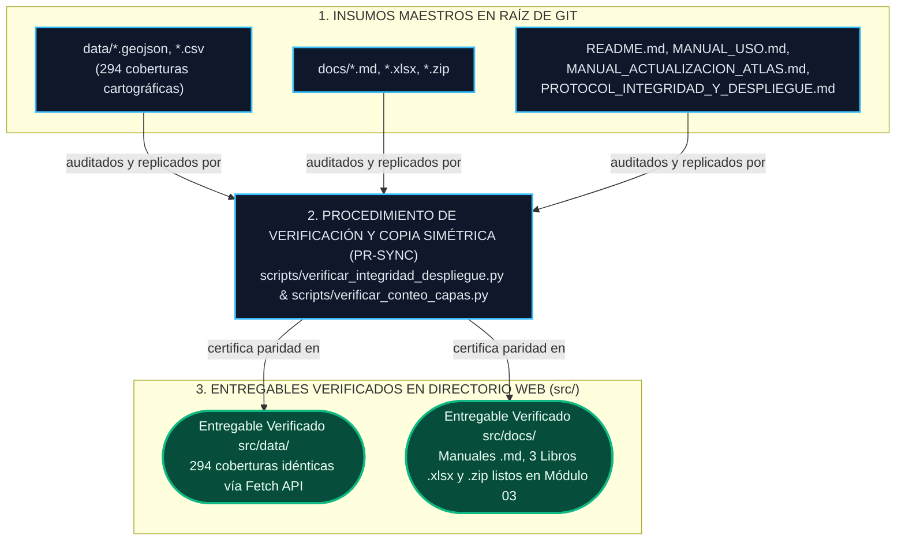

# Protocolo de integridad de datos, verificación pre-despliegue y publicación — Atlas para la Gestión Territorial
## Análisis y Exploración | Municipio de Santiago y Barrio Brasil

* **Entorno de Producción Primaria (Netlify CDN):** [https://atlasvgiuah.netlify.app](https://atlasvgiuah.netlify.app)
* **Entorno de Respaldo (GitHub Pages):** [https://geojota.github.io/atlas-vgi-barrio-brasil/](https://geojota.github.io/atlas-vgi-barrio-brasil/)
* **Parámetros Auditados:** **294 capas cartográficas** (`123` oficiales del Estado con `id_ig` + `171` descentralizadas de IGV con `id_igv`) · **5 dimensiones analíticas** · **4 guiones visuales (83 cartografías)** · **17 atributos homologados ISO 19157** · Paridad simétrica `data/` ↔ `src/data/` y `docs/` ↔ `src/docs/`.

---

## 1. Propósito del protocolo de integridad y despliegue

Este documento define las reglas de validación técnica, los scripts de verificación local en Python 3, la sincronización de directorios espejo, el control de caché (*Cache-Busting*) y el flujo de despliegue hacia producción del **Atlas para la Gestión Territorial**.

Su cumplimiento garantiza que ninguna actualización de código o de cartografía genere enlaces rotos (`HTTP 404`), archivos truncados por punteros de *Git LFS*, discrepancias en el conteo de las **294 coberturas operativas** ni tiempos excesivos de compilación (*timeout*) en Netlify.

---

## 2. Flujo de procedimientos de auditoría y entregables verificados en producción

Cada **subprocedimiento** de preparación o validación integra un **procedimiento** superior que emite explícitamente un **entregable verificado** en local o en producción:

```mermaid
flowchart LR
    classDef subproc fill:#1e293b,stroke:#94a3b8,stroke-dasharray:4 3,color:#e2e8f0
    classDef proc fill:#0f172a,stroke:#38bdf8,stroke-width:2px,color:#e2e8f0
    classDef ent fill:#064e3b,stroke:#10b981,stroke-width:2.5px,color:#ecfdf5

    subgraph PREP["1. PROCEDIMIENTO DE PREPARACIÓN (PR-PREP)"]
        SP1["Subprocedimiento SP1 · Edición de capas GeoJSON / CSV\nen data/ y src/data/ (EPSG:4326, UTF-8)"]:::subproc
        SP2["Subprocedimiento SP2 · Edición de los 3 Módulos e interfaz\n(escalado A/A+/A++, mapa.js, evaluador_normativo.js, docs/)"]:::subproc
    end

    subgraph AUD["2. PROCEDIMIENTO DE AUDITORÍA LOCAL (PR-AUD)"]
        V1["Subprocedimiento V1 · Conteo de 294 Capas\npython3 scripts/verificar_conteo_capas.py"]:::subproc
        V2["Subprocedimiento V2 · Integridad Topológica y Espejo\npython3 scripts/verificar_integridad_despliegue.py\n(0 LFS | RFC 7946 | data/ == src/data/)"]:::subproc
        V3["Subprocedimiento V3 · Caché y Bancos Funcionales\nControl ?v=... y verificación Chromium Desktop/Móvil"]:::proc
        E_AUD(["Entregable Verificado E-AUD\n7 Bancos de Prueba en estado PASS"]):::ent
    end

    subgraph DESP["3. PROCEDIMIENTO DE DESPLIEGUE Y ENTREGABLES EN PRODUCCIÓN"]
        P_PUB["Procedimiento PR-DESP · Publicación\ngit push origin main + sincronización espejo/main\n+ keep-alive Supabase (72 h)"]:::proc
        D_WEB(["Entregable Verificado E-WEB\nPlataforma operativa en Netlify CDN\n(https://atlasvgiuah.netlify.app) y GitHub Pages"]):::ent
        D_ARC(["Entregable Verificado E-DAT/DOC\n294 GeoJSON sin LFS + 3 Libros .xlsx +\ngeodatabase_completa_atlas_vgi.zip (542,35 MB)"]):::ent
    end

    SP1 & SP2 -->|"alimentan"| V1 -->|"continúa en"| V2 -->|"culmina en"| V3 -->|"emite"| E_AUD
    E_AUD -->|"habilita"| P_PUB
    P_PUB -->|"publica"| D_WEB & D_ARC
```

---

## 3. Reglas de integridad y procedimientos de sincronización

### 3.1. Procedimiento de sincronización simétrica (`PR-SYNC` → Paridad verificada `data/` ↔ `src/data/` y `docs/` ↔ `src/docs/`)

Dado que `netlify.toml` establece `publish = "src"` como raíz del servidor HTTP mientras que los scripts de procesamiento en `scripts/` operan sobre `data/` y `docs/` en la raíz del repositorio, el **procedimiento de sincronización (`PR-SYNC`)** asegura mediante scripts auditores que los directorios espejo contengan entregables idénticos antes de publicar:

### 3.2. Prohibición de punteros Git LFS en archivos `.geojson` y `.xlsx`
Ningún archivo `.geojson`, `.csv`, `.json` o `.xlsx` servido por la aplicación web puede almacenarse como puntero de texto `version https://git-lfs.github.com/spec/v1`, ya que las llamadas `fetch()` del navegador recibirían el puntero de 130 bytes en lugar de la estructura JSON o binaria real. El script `scripts/verificar_integridad_despliegue.py` inspecciona la cabecera de todos los archivos y alerta si detecta cualquier firma LFS.

### 3.3. Norma geodésica de almacenamiento (`EPSG:4326` / RFC 7946)
Todos los archivos `.geojson` en `data/` y `src/data/` deben estar proyectados en coordenadas geográficas `EPSG:4326` (WGS84 / SIRGAS-Chile) con longitud en el rango `[-71,8°, -69,5°]` y latitud en el rango `[-34,5°, -32,8°]`.

### 3.4. Desacoplamiento de scripts pesados respecto del build de Netlify
Las auditorías de las 294 capas (`verificar_integridad_despliegue.py` y `verificar_conteo_capas.py`) deben ejecutarse **localmente** antes del commit y nunca dentro del comando `[build] command` de `netlify.toml`, garantizando que el despliegue en Netlify finalice en pocos segundos sin superar el límite de tiempo de ejecución.

---

## 4. Bancos de pruebas pre-despliegue (Subprocedimientos de `PR-AUD` → Entregable `E-AUD`)

Cada banco ejecutado corresponde a un **subprocedimiento de verificación** dentro de **`PR-AUD`**; su aprobación conjunta entrega el **certificado verificable pre-despliegue (`PASS`)** requerido antes de publicar en `origin/main` y `espejo/main`:

| Banco (`Subprocedimiento`) | Comando / Verificación Ejecutada | Entregable / Condición Verificada Resultante (`PASS`) | Archivos Auditados |
| :---: | :--- | :--- | :--- |
| **Banco 1** | `python3 scripts/verificar_conteo_capas.py` | Conteo exacto de **294 capas cartográficas** (`123` oficiales del Estado con `id_ig` + `171` descentralizadas de IGV con `id_igv`). | `src/js/modulos/ide_chile.js`, `src/js/modulos/indicadores_analisis.js`, `src/index.html` |
| **Banco 2** | `python3 scripts/verificar_integridad_despliegue.py` | Existencia física, validez sintáctica JSON (`FeatureCollection`), coordenadas en rango WGS84 (`EPSG:4326`), presencia de los 17 atributos ISO 19157 y 0 punteros Git LFS en las 294 capas. | `data/*.geojson`, `src/data/*.geojson` |
| **Banco 3** | Paridad de directorios espejo | Paridad simétrica entre `data/` y `src/data/`, y presencia de los manuales, los 3 libros `.xlsx` y el paquete `.zip` en `docs/` y `src/docs/`. | `data/` ↔ `src/data/`, `docs/` ↔ `src/docs/` |
| **Banco 4** | Verificación del Módulo 01 (`Análisis`) | Presencia de las 5 dimensiones analíticas y los 4 guiones visuales con las 83 cartografías en `src/img/cartografias/`. | `src/js/modulos/indicadores_analisis.js`, `src/img/cartografias/` |
| **Banco 5** | Verificación del Módulo 02 (`Explorar mapa`) | Funcionamiento de los 5 mapas base sin clave API (`OpenStreetMap Estándar`, `OpenStreetMap HOT`, `Bing/Microsoft Satelital`, `Bing/Microsoft Híbrido` y `Esri World Imagery`) tanto en el control del mapa como dentro de **Simbología Dinámica**, **simbología temática** (`Plano`, `Categorizado`, `Graduado`), **Inspector normativo (PRC)** (consulta de 1 punto y desactivación automática posterior conservando la ficha) y panel inferior de **Detalles**. | `src/js/modulos/mapa.js`, `src/js/modulos/evaluador_normativo.js`, `src/js/app.js` |
| **Banco 6** | Verificación del Módulo 03 (`Documentación`) y Cabecera | Navegación operativa de los 6 capítulos (`DOC · 01` a `DOC · 06`), control dinámico de tamaño de texto (`A` / `A+` / `A++`), Tutorial interactivo de 18 pasos en 4 bloques (a la izquierda del título) y Glosario de siglas (a la derecha del título) sin desbordamiento horizontal en escritorio ni móvil. | `src/js/modulos/manual.js`, `src/js/modulos/tutorial_interactivo.js`, `src/js/app.js`, `src/index.html`, `src/css/estilos.css` |
| **Banco 7** | Control de Caché (`Cache-Busting`) | Parámetro `?v=YYYYMMDD_vNN` uniforme y actualizado en las etiquetas `<link>` y `<script>` de `src/index.html` y en `src/js/config.js`. | `src/index.html`, `src/js/config.js` |
