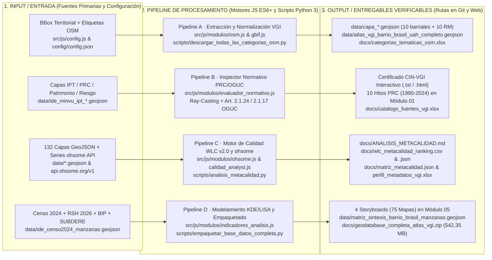
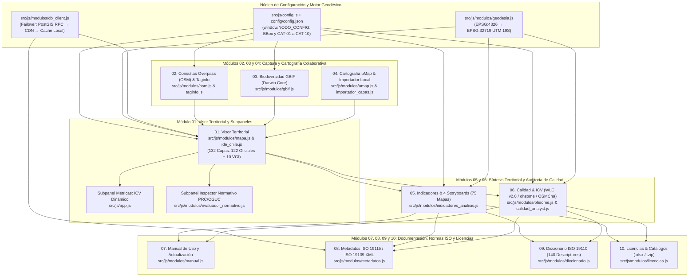

# Atlas de Información Geográfica Voluntaria para la Gestión Territorial

[](https://atlasvgiuah.netlify.app)
[-0284c7?style=for-the-badge)](#3-estructura-de-los-10-módulos-de-la-plataforma-web)
[-9333ea?style=for-the-badge)](#3-estructura-de-los-10-módulos-de-la-plataforma-web)
[](#5-documentación-técnica-del-proyecto)
[](#6-licenciamiento-y-gobernanza-de-datos-abiertos)

Infraestructura de datos espaciales web estática y autónoma orientada a integrar, evaluar y contrastar la cartografía oficial del Estado de Chile con la Información Geográfica Voluntaria (*Volunteered Geographic Information*, VGI; Goodchild, 2007; Haklay, 2010), aplicada al análisis multiescalar del **Barrio Brasil**, el entorno del **Campus Universidad Alberto Hurtado**, la **Comuna de Santiago** y la **Región Metropolitana de Santiago**.

* **Plataforma Web en Producción (CDN Primario):** [https://atlasvgiuah.netlify.app](https://atlasvgiuah.netlify.app)
* **Repositorio Espejo (GitHub Pages):** [https://geojota.github.io/atlas-vgi-barrio-brasil/](https://geojota.github.io/atlas-vgi-barrio-brasil/)
* **Geodatabase Consolidada Descargable (`.zip`):** `docs/geodatabase_completa_atlas_vgi.zip` (`542,35 MB` comprimidos / `~3,33 GB` descomprimidos; `257` archivos distribuidos en `7` subcarpetas temáticas).

---

## 1. Propósito General y Métricas Estructurales

El sistema articula **132 coberturas geográficas operativas** (**122 capas oficiales** provenientes de IDE Chile, MINVU, INE Censo 2024, MTT/UOCT, MDSF RSH, SUBDERE Residuos 2024, Ilustre Municipalidad de Santiago, CMN, MMA y SII, junto con **10 macrocategorías colaborativas VGI** extraídas de OpenStreetMap y GBIF) en una aplicación de página única (*Single-Page Application*, SPA) construida sin dependencias de compilación externa.

| Componente Estructural del Sistema | Métrica / Especificación | Módulos y Rutas Asociadas |
| :--- | :--- | :--- |
| **Coberturas Geográficas Operativas** | **132 capas** (`122` Oficiales del Estado + `10` Macrocategorías VGI `CAT-01` a `CAT-10`) | `src/js/modulos/ide_chile.js`, `src/js/config.js`, `data/*.geojson`, `src/data/*.geojson` |
| **Descriptores Técnicos de Atributos** | **140 descriptores** bajo norma ISO 19110:2016 (`86` brechas VGI sin homólogo estatal) | Módulo `09` (`src/js/modulos/diccionario.js`), `docs/categorias_tematicas_osm.xlsx` |
| **Dimensiones Analíticas y Storyboards** | **5 Dimensiones** y **4 Storyboards Territoriales** con **75 cartografías temáticas** | Módulo `05` (`src/js/modulos/indicadores_analisis.js`), `src/assets/mapas_storyboards/` |
| **Evaluación de Calidad Espacial** | Modelo multicriterio **WLC v2.0** (ISO 19157/19115) + **Índice de Saturación y Maduración Territorial** (ohsome API v1/v2) + **OSMCha** | Módulo `06` (`src/js/modulos/ohsome.js`, `calidad_analyst.js`, `evaluador_calidad_cuantitativa.js`) |
| **Evaluación Normativa Urbana** | Inspector PRC/PRMS/OGUC + **Certificado CIN-VGI** + **10 Hitos Históricos PRC (1990–2024)** | Módulo `01` (`src/js/modulos/evaluador_normativo.js`) |
| **Motor Geodésico de Doble Proyección** | Renderizado web en `EPSG:4326` (WGS84) y cálculo métrico en `EPSG:32719` (UTM Huso 19 Sur / SIRGAS-Chile) | `src/js/modulos/geodesia.js` (Serie de Redfearn / Gauss-Shoelace / Haversine) |
| **Persistencia y Respaldo Relacional** | Arquitectura de triple nivel: PostGIS / Supabase RPC (`Nivel 1`) → CDN Estático (`Nivel 2`) → Caché en Memoria (`Nivel 3`) | `scripts/db/01_schema_postgis.sql`, `scripts/db/02_seed_metadata.sql`, `src/js/modulos/db_client.js` |

---

## 2. Pipelines de Arquitectura y Procesamiento de Datos

El proyecto organiza su flujo de ingeniería de datos y operación web en cuatro pipelines troncales bajo el modelo **`1. INPUT / ENTRADA` → `2. PIPELINE DE PROCESAMIENTO / MÓDULO` → `3. OUTPUT / RUTAS EN GIT Y PLATAFORMA WEB`**:

### 2.1. Pipeline General de los Cuatro Subsistemas (Pipelines A, B, C y D)



### 2.2. Pipeline de Articulación de los 10 Módulos de la Plataforma Web (`src/index.html`)



---

## 3. Estructura de los 10 Módulos de la Plataforma Web

| N° | Pestaña en la Interfaz (`src/index.html`) | ID del Panel DOM | Controladores JavaScript (`src/js/`) | Función Principal y Salidas Verificables |
| :---: | :--- | :--- | :--- | :--- |
| **`01`** | **Visor para la gestión territorial** | `#panel-inicio` | `app.js`, `modulos/mapa.js`, `modulos/ide_chile.js`, `modulos/evaluador_normativo.js`, `modulos/geodesia.js` | Superposición interactiva de las **132 capas** (`122` oficiales + `10` VGI), cálculo del **ICV Dinámico**, dibujo de BBox con área en `EPSG:32719` y emisión del **Certificado CIN-VGI** (con los 10 hitos históricos del PRC 1990–2024). |
| **`02`** | **Consultas Overpass (OSM)** | `#panel-explorador-osm` | `modulos/osm.js`, `modulos/taginfo.js` | Consultas en vivo mediante Overpass QL con failover entre 3 servidores, reconstrucción topológica de nodos/vías, normalización al esquema de 14 atributos y auditoría semántica Taginfo API v4. |
| **`03`** | **Biodiversidad GBIF** | `#panel-biodiversidad-gbif` | `modulos/gbif.js` | Consulta a GBIF API v1 bajo estándar **Darwin Core (DwC)** para registros de flora, arbolado y fauna urbana georreferenciada (`data/capa_biodiversidad.geojson`). |
| **`04`** | **Cartografía uMap** | `#panel-proyectos-umap` | `modulos/umap.js`, `modulos/importador_capas.js` | Integración de proyectos comunitarios uMap e importador local *client-side* para archivos `.geojson`, `.kml`, `.kmz`, `.gpx` y `.csv`. |
| **`05`** | **Indicadores & Storyboards** | `#panel-indicadores` | `modulos/indicadores_analisis.js` | Sistematización de las 132 capas en **5 Dimensiones Analíticas** y **4 Storyboards Territoriales** con **75 cartografías temáticas** (`01`: 11 mapas KDE; `02`: 11 mapas LISA; `03`: 29 mapas Censo 2024/RSH; `04`: 24 mapas Socioambiente/Movilidad/Residuos). |
| **`06`** | **Calidad & ICV** | `#panel-calidad-ohsome` | `modulos/ohsome.js`, `modulos/calidad_analyst.js`, `modulos/evaluador_calidad_cuantitativa.js` | **Submódulo A**: Evaluador Universal WLC v2.0 (ISO 19157/19115). **Submódulo B**: Series históricas ohsome API v1/v2 con **Índice de Saturación y Maduración Territorial (Herfort et al., 2023 / ISO 19157)**. **Submódulo C**: Auditoría de changesets con OSMCha. |
| **`07`** | **Manual de Uso** | `#panel-manual` | `modulos/manual.js` | Documentación interactiva integrada: **Parte I (Manual de Uso)** con inventario filtrable de las 132 capas, y **Parte II (Manual de Actualización Técnica)** con catálogo multi-lenguaje y pipelines de datos. |
| **`08`** | **Metadatos ISO 19115** | `#panel-metadatos-iso` | `modulos/metadatos.js` | Generador de fichas de metadatos conformes al Perfil Nacional de IDE Chile (ISO 19115:2003 / ISO 19115-1:2014) con exportación directa en **JSON** y **XML (ISO 19139:2007)**. |
| **`09`** | **Diccionario (132 Capas)** | `#panel-diccionario` | `modulos/diccionario.js` | Catálogo de Objetos Geográficos (**ISO 19110:2016**) con **140 descriptores normativos**, homologación con IDE Chile e identificación de **86 brechas temáticas cubiertas por VGI**. |
| **`10`** | **Licencias & Catálogos (.xlsx)** | `#panel-licencias` | `modulos/licencias.js` | Marco jurídico de datos abiertos y descarga directa de `docs/geodatabase_completa_atlas_vgi.zip` y de los 3 libros maestros `.xlsx`. |

---

## 4. Estructura del Repositorio y Entregables Verificables en Git

El repositorio mantiene **paridad simétrica** entre los directorios de raíz (`data/` y `docs/`) y los directorios publicados por el servidor web (`src/data/` y `src/docs/`), garantizando rutas idénticas tanto en ejecución local como en despliegues sobre Netlify y GitHub Pages.

```text
nodo-geoabierto/
├── src/                                      # Directorio de publicación web (publish = "src" en netlify.toml)
│   ├── index.html                            # Documento maestro SPA (10 módulos, modales y Lightbox)
│   ├── css/estilos.css                       # Sistema de diseño CSS3 con variables nativas (:root)
│   ├── js/                                   # 21 scripts JavaScript ES6+ (Patrón IIFE modular)
│   │   ├── config.js                         # Configuración global síncrona (window.NODO_CONFIG)
│   │   ├── app.js                            # Orquestador principal de la interfaz y telemetría ICV
│   │   └── modulos/                          # 19 módulos especializados (mapa, ide_chile, ohsome, etc.)
│   ├── assets/mapas_storyboards/             # 75 cartografías temáticas (PNG) para los 4 Storyboards
│   ├── data/                                 # Espejo exacto de data/ para consumo directo vía Fetch API
│   └── docs/                                 # Espejo exacto de docs/ para descarga directa desde el navegador
├── data/                                     # Repositorio maestro de capas GeoJSON (.geojson), GPKG (.gpkg) y CSV
├── docs/                                     # Documentación técnica (.md), reportes WLC (.csv/.json), libros (.xlsx) y .zip
├── config/config.json                        # Parámetros JSON de BBox, comunas RM y 10 categorías VGI
├── scripts/                                  # 25 scripts Python 3 de ETL, calidad WLC, auditoría y empaquetado
│   └── db/                                   # Esquemas SQL PostGIS (01_schema_postgis.sql, 02_seed_metadata.sql)
└── netlify.toml                              # Configuración CDN, cabeceras CORS/Cache y redirecciones HTTP
```

### Catálogo de Entregables Verificables (`docs/` y `src/docs/`)

| Archivo / Entregable en Git y Web | Formato | Descripción y Contenido |
| :--- | :---: | :--- |
| [`docs/geodatabase_completa_atlas_vgi.zip`](docs/geodatabase_completa_atlas_vgi.zip) | `.zip` | Paquete consolidado (`542,35 MB` / `257` archivos en `7` subcarpetas) con las 132 capas del visor, extractos RM, libros Excel, CSV, SQL y metadatos ISO. |
| [`docs/categorias_tematicas_osm.xlsx`](docs/categorias_tematicas_osm.xlsx) | `.xlsx` | Libro Excel de 4 hojas con la taxonomía de las 10 macrocategorías VGI (`CAT-01` a `CAT-10`), etiquetas OSM y homologación ISO 19110. |
| [`docs/catalogo_fuentes_vgi.xlsx`](docs/catalogo_fuentes_vgi.xlsx) | `.xlsx` | Libro Excel de 4 hojas con el inventario de las 132 coberturas operativas, instituciones custodias, escalas y licencias. |
| [`docs/perfil_metadatos_vgi.xlsx`](docs/perfil_metadatos_vgi.xlsx) | `.xlsx` | Libro Excel de 4 hojas con el perfil de metadatos ISO 19115 / IDE Chile y la matriz de evaluación WLC ISO 19157. |
| [`docs/wlc_metacalidad_ranking.csv`](docs/wlc_metacalidad_ranking.csv) y [`.json`](docs/wlc_metacalidad_resultado.json) | `.csv` / `.json` | Ranking multicriterio WLC y resultados por dimensión (`C1` Linaje, `C2` Completitud, `C3` Consistencia Lógica, `C4` Exactitud Posicional, `C5` Actualidad). |
| [`docs/matriz_metacalidad.json`](docs/matriz_metacalidad.json) y [`correlacion_dimensiones_calidad.csv`](docs/correlacion_dimensiones_calidad.csv) | `.json` / `.csv` | Matriz detallada de metacalidad por archivo GeoJSON y matriz de correlación de Pearson entre dimensiones de calidad. |

---

## 5. Documentación Técnica del Proyecto

Toda la documentación se encuentra sincronizada en la raíz del proyecto, en `docs/` y en `src/docs/`:

1. **[`MANUAL_USO.md`](MANUAL_USO.md)** (`docs/MANUAL_USO.md` / `src/docs/MANUAL_USO.md`): Manual operativo de los 10 módulos de la plataforma web, flujos de trabajo con diagramas pipeline, uso del Inspector Normativo PRC/OGUC, los 4 Storyboards (75 cartografías) y los 3 submódulos de Calidad Espacial.
2. **[`MANUAL_ACTUALIZACION_ATLAS.md`](MANUAL_ACTUALIZACION_ATLAS.md)** (`docs/MANUAL_ACTUALIZACION_ATLAS.md` / `src/docs/MANUAL_ACTUALIZACION_ATLAS.md`): Manual de ingeniería de software, arquitectura, catálogo estandarizado multi-lenguaje, pipelines de datos y guía paso a paso para adaptar el Atlas a cualquier territorio.
3. **[`docs/ARQUITECTURA.md`](docs/ARQUITECTURA.md)** y **[`PROTOCOL_INTEGRIDAD_Y_DESPLIEGUE.md`](PROTOCOL_INTEGRIDAD_Y_DESPLIEGUE.md)**: Especificación de la arquitectura cliente-servidor, motor geodésico `EPSG:4326` ↔ `EPSG:32719`, protocolo de 8 bancos de pruebas pre-despliegue y despliegue continuo en Netlify y GitHub Pages.
4. **[`docs/ANALISIS_METACALIDAD.md`](docs/ANALISIS_METACALIDAD.md)**: Reporte técnico del modelo de Combinación Lineal Ponderada (WLC) bajo las normas ISO 19115:2014 e ISO 19157:2013 sobre el repositorio cartográfico.
5. **[`docs/GUIA_BASE_DATOS_SUPABASE.md`](docs/GUIA_BASE_DATOS_SUPABASE.md)**: Guía de despliegue y operación del backend relacional PostgreSQL 15+ / PostGIS 3.4+ en Supabase y automatización Keep-Alive mediante GitHub Actions.
6. **[`docs/DICCIONARIO_CATASTRO_RSD_SUBDERE_2024.md`](docs/DICCIONARIO_CATASTRO_RSD_SUBDERE_2024.md)**: Diccionario de datos y especificación técnica de las coberturas del Catastro Nacional de Residuos Sólidos Domiciliarios (SUBDERE) integradas en el Atlas.
7. **[`INFORME_PROYECTO_ATLAS_VGI.md`](INFORME_PROYECTO_ATLAS_VGI.md)** y **[`docs/TRAZABILIDAD_ACADEMICA.md`](docs/TRAZABILIDAD_ACADEMICA.md)**: Síntesis metodológica, marco conceptual VGI, homologación taxonómica y gobernanza territorial.
8. **[`docs/BIBLIOGRAFIA_SEMINARIO_Y_ATLAS.md`](docs/BIBLIOGRAFIA_SEMINARIO_Y_ATLAS.md)**: Compendio de **125 referencias bibliográficas y normativas** en formato APA 7ª edición que respaldan los módulos, indicadores y storyboards del sistema.

---

## 6. Ejecución Local, Verificación y Licenciamiento

### Ejecución Local y Suite de Auditoría Automatizada

```bash
# 1. Levantar servidor HTTP local apuntando al directorio de publicación web (src/)
python3 -m http.server 8080 --directory src

# 2. Verificar paridad de las 132 capas (122 Oficiales + 10 VGI) y 140 descriptores ISO 19110
python3 scripts/verificar_conteo_capas.py

# 3. Verificar integridad de archivos GeoJSON, ausencia de punteros LFS y sincronización data/ <-> src/data/
python3 scripts/verificar_integridad_despliegue.py

# 4. Recalcular matriz de metacalidad WLC (ISO 19115 / ISO 19157)
python3 scripts/analisis_metacalidad.py
```

### Licenciamiento y Gobernanza de Datos Abiertos

* **Datos Colaborativos de OpenStreetMap:** [Open Database License (ODbL 1.0)](https://opendatacommons.org/licenses/odbl/1-0/) — © Colaboradores de OpenStreetMap.
* **Registros de Biodiversidad (GBIF) y Cartografías Derivadas:** [Creative Commons Atribución-CompartirIgual 4.0 Internacional (CC BY-SA 4.0)](https://creativecommons.org/licenses/by-sa/4.0/deed.es).
* **Coberturas Oficiales del Estado de Chile:** Acceso público y reutilización regidos por la **Ley N° 20.285 sobre Acceso a la Información Pública** y resguardo de microdatos conforme a la **Ley N° 19.628 sobre Protección de la Vida Privada**.
* **Código Fuente del Software:** [GNU Affero General Public License v3.0 (AGPLv3)](https://www.gnu.org/licenses/agpl-3.0.html).
