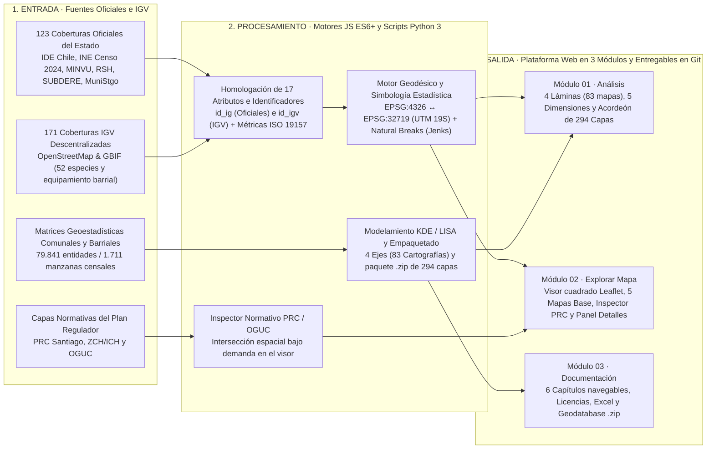
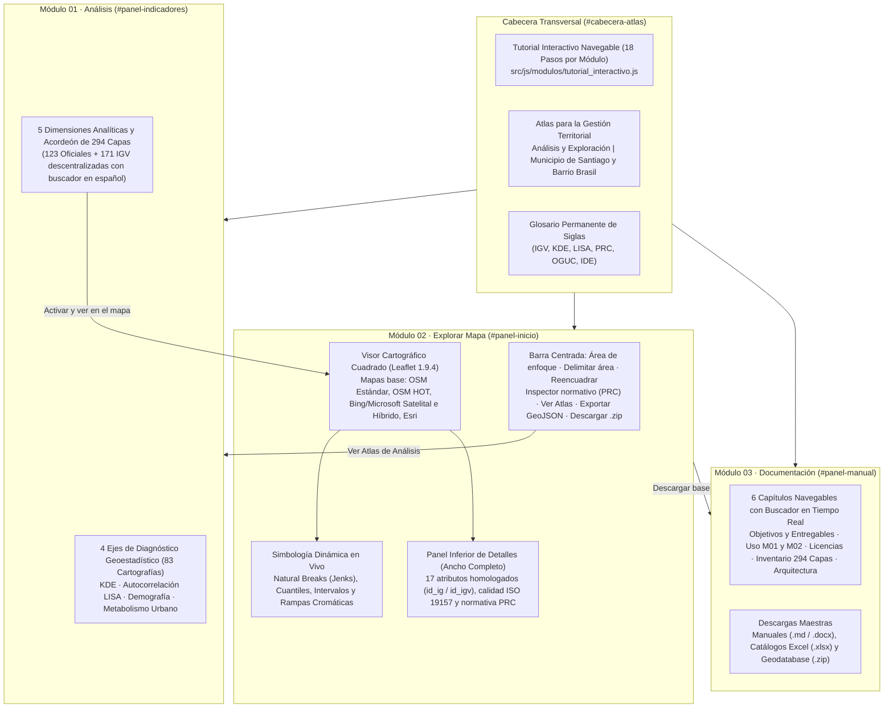

# Atlas para la Gestión Territorial
### Análisis y Exploración | Municipio de Santiago y Barrio Brasil
> Infraestructura de Datos Espaciales, Diagnóstico Geoestadístico y Geodatos Abiertos.

[](https://atlasvgiuah.netlify.app)
[-0284c7?style=for-the-badge)](#13-tabla-11-cifras-clave-del-proyecto-referencia-única)
[-9333ea?style=for-the-badge)](#3-estructura-de-los-3-módulos-de-la-plataforma-web)
[](#5-documentación-técnica-del-proyecto)
[](#6-ejecución-local-verificación-y-licenciamiento)

Plataforma web abierta que integra **123 coberturas oficiales del Estado de Chile** (`id_ig`) y **171 coberturas descentralizadas de Información Geográfica Voluntaria (IGV)** (`id_igv`) para el análisis, la exploración cartográfica y la toma de decisiones en el Municipio de Santiago y el Barrio Brasil.

* **Plataforma web en producción (CDN primario):** [https://atlasvgiuah.netlify.app](https://atlasvgiuah.netlify.app)
* **Repositorio espejo (GitHub Pages):** [https://geojota.github.io/atlas-vgi-barrio-brasil/](https://geojota.github.io/atlas-vgi-barrio-brasil/)
* **Geodatabase consolidada descargable (`.zip`):** `docs/geodatabase_completa_atlas_vgi.zip` (`542,35 MB` comprimidos / `3,33 GB` descomprimidos; `294` capas cartográficas independientes).

---

## 1. Objetivos, entregables verificados y cifras clave del proyecto

### 1.1. Objetivo general
Desarrollar un Atlas para la Gestión Territorial reproducible, interoperable y centrado en el usuario, que integre geodatos abiertos, cartografía participativa y herramientas analíticas para subsanar vacíos de información territorial y apoyar la gestión local y la investigación en la Comuna de Santiago y Barrio Brasil.

### 1.2. Objetivos específicos y entregables verificados
* **OE 1.** Caracterizar la disponibilidad, la cobertura y los vacíos de información geográfica del área de estudio, y definir las bases taxonómicas y de diseño centrado en el usuario que permitan integrar datos colaborativos e institucionales.
  * *Componentes y entregables verificados:* Revisión de plataformas de geodatos abiertos (OpenStreetMap, GBIF e IDE Chile); estructuración de las **5 dimensiones analíticas** del territorio; caracterización de los cuatro perfiles de actores territoriales e inventario de brechas (`docs/ARQUITECTURA.md`, `docs/TRAZABILIDAD.md`, `docs/catalogo_fuentes_vgi.xlsx` y `docs/categorias_tematicas_osm.xlsx`).
* **OE 2.** Consolidar una geodatabase multipropósito que armonice coberturas oficiales e información voluntaria bajo estándares internacionales de calidad y metadatos.
  * *Componentes y entregables verificados:* Descarga, normalización y geoprocesamiento de las **294 coberturas vectoriales** (123 oficiales del Estado de Chile y 171 coberturas de IGV descentralizadas) en `EPSG:4326` y `EPSG:32719`; estructuración del perfil homologado de metadatos y calidad ISO 19157 de **17 atributos** diferenciando `id_ig` (información geográfica oficial) e `id_igv` (información geográfica voluntaria); cruces espaciales comunales y barriales en las 5 dimensiones analíticas (`src/data/*.geojson`, `docs/perfil_metadatos_vgi.xlsx` y matrices de síntesis territorial).
* **OE 3.** Implementar un geoportal web accesible e interoperable que permita visualizar cartografía multinivel, consultar el territorio en tiempo real y descargar geodatos abiertos.
  * *Componentes y entregables verificados:* **Definición de un prototipo sintetizado para usuarios no técnicos:** prototipo más sintetizado que permita a usuarios sin experiencia técnica poder interactuar de forma más simple con la plataforma, estructurado en 3 módulos (*Módulo 01 Análisis*, *Módulo 02 Explorar Mapa* y *Módulo 03 Documentación*); visor cartográfico cuadrado (Leaflet 1.9.4) con mapas base abiertos de OpenStreetMap e imágenes satelitales de Bing, Microsoft y Esri, simbología estadística dinámica (*Natural Breaks* / Jenks) y panel inferior de **Detalles**; Inspector normativo del Plan Regulador Comunal (PRC) y OGUC; 4 ejes de diagnóstico geoestadístico (KDE y LISA) con 83 cartografías temáticas y despliegue continuo en Netlify (`src/index.html`, `src/css/estilos.css`, `src/js/modulos/mapa.js`, `evaluador_normativo.js`, `indicadores_analisis.js` y `netlify.toml`).
* **OE 4.** Evaluar la usabilidad y la pertinencia de la plataforma con distintos perfiles de actores territoriales y asegurar su transferibilidad técnica, metodológica y documental.
  * *Componentes y entregables verificados:* Evaluación de usabilidad (Modalidad 1) y conversaciones situadas con vecinos (Modalidad 2) en el Barrio Brasil; tutorial interactivo navegable de 18 pasos por módulo y glosario de siglas; documentación navegable dentro de la plataforma y en Git (`MANUAL_USO.md`, `MANUAL_ACTUALIZACION_ATLAS.md`, `ARQUITECTURA.md`); empaquetado de la geodatabase completa (`docs/geodatabase_completa_atlas_vgi.zip`) y verificación automatizada de las 294 capas (`scripts/verificar_conteo_capas.py`).

### 1.3. Tabla 1.1: Cifras clave del proyecto (referencia única)

| Componente del sistema | Cifra o especificación | Definición y rutas asociadas |
| :--- | :--- | :--- |
| Coberturas geográficas operativas | 294 capas (123 oficiales `id_ig` + 171 IGV `id_igv`) | `src/js/modulos/catalogo_vgi_descentralizado.js`, `src/js/modulos/ide_chile.js`, `src/data/*.geojson` |
| Perfil homologado de atributos y calidad | 17 atributos por entidad (ISO 19115 / ISO 19157) | Panel inferior **Detalles** en Módulo 02 (`src/js/modulos/mapa.js`) y `docs/perfil_metadatos_vgi.xlsx` |
| Dimensiones y Diagnóstico Geoestadístico | 5 dimensiones analíticas y 4 láminas con 83 cartografías | Módulo 01 (`src/js/modulos/indicadores_analisis.js`), `src/img/cartografias/` |
| Mapas base abiertos y satelitales | 5 mapas base sin requerimiento de clave de API | OpenStreetMap (Estándar y HOT), Bing / Microsoft (Satelital e Híbrido) y Esri World Imagery (`src/js/modulos/mapa.js`) |
| Inducción guiada y terminología | Tutorial interactivo navegable de 18 pasos y Glosario | Cabecera superior (`src/js/modulos/tutorial_interactivo.js` y `#modal-glosario-siglas`) |
| Arquitectura de software | 3 Módulos operacionales (`Análisis`, `Explorar Mapa`, `Documentación`) | Aplicación en `src/` (`publish = "src"` en `netlify.toml`) y scripts en `scripts/` |

---

## 2. Diagramas de arquitectura y flujos de trabajo

### 2.1. Flujo de trabajo integral de ingeniería de datos y operación web



### 2.2. Flujo de navegación e interacción entre los 3 módulos de la plataforma (`src/index.html`)



---

## 3. Estructura de los 3 Módulos de la plataforma web

| N° | Módulo en la Interfaz (`src/index.html`) | ID del Panel DOM | Controladores Principales (`src/js/`) | Función Principal y Entregables Verificables |
| :---: | :--- | :--- | :--- | :--- |
| `01` | **Análisis** | `#panel-indicadores` | `modulos/indicadores_analisis.js`, `modulos/catalogo_vgi_descentralizado.js` | Diagnóstico territorial basado en 83 cartografías temáticas organizadas en 4 láminas (KDE, autocorrelación espacial LISA, demografía/habitabilidad y metabolismo urbano) y explorador de 294 coberturas (123 oficiales + 171 IGV descentralizadas) agrupadas en 5 dimensiones analíticas con activación directa en el visor. |
| `02` | **Explorar Mapa** | `#panel-inicio` | `app.js`, `modulos/mapa.js`, `modulos/ide_chile.js`, `modulos/simbologia_dinamica.js`, `modulos/evaluador_normativo.js`, `modulos/geodesia.js` | Visor cartográfico de proporción cuadrada con 5 mapas base sin requerimiento de API (OpenStreetMap, Bing/Microsoft y Esri), barra de herramientas centrada y adaptable, simbología estadística Jenks, Inspector normativo PRC/OGUC bajo demanda y panel inferior de **Detalles** con perfil de 17 atributos (`id_ig` / `id_igv`). |
| `03` | **Documentación** | `#panel-manual` | `modulos/manual.js`, `modulos/licencias.js` | Documentación interactiva estructurada en 6 capítulos navegables con buscador en tiempo real, marco de licencias abiertas, descarga de manuales (`.md`/`.docx`), catálogos en Excel (`.xlsx`), geodatabase completa (`.zip`) e inventario filtrable de las 294 capas. |

---

## 4. Estructura del repositorio y entregables verificables en Git

```text
nodo-geoabierto/
├── src/                                      # Directorio de publicación web (publish = "src" en netlify.toml)
│   ├── index.html                            # Aplicación web de 3 módulos con visor cuadrado y panel inferior Detalles
│   ├── css/estilos.css                       # Sistema de diseño adaptable a móviles, tablets y pantallas minimizadas/maximizadas
│   ├── js/                                   # Módulos JavaScript ES6+
│   │   ├── config.js                         # Configuración global (áreas de enfoque, título canónico y 5 dimensiones)
│   │   ├── app.js                            # Orquestador de navegación entre los 3 módulos y cabecera
│   │   └── modulos/                          # Módulos operativos (mapa, tutorial_interactivo, manual, simbologia_dinamica, etc.)
│   ├── img/cartografias/                     # 83 cartografías temáticas (JPG) para las 4 láminas del Módulo 01
│   ├── data/                                 # 294 coberturas GeoJSON (123 oficiales + 171 IGV descentralizadas)
│   └── docs/                                 # Manuales (.md/.docx), catálogos Excel (.xlsx) y geodatabase (.zip)
├── data/                                     # Espejo simétrico de las coberturas GeoJSON y tablas territoriales
├── docs/                                     # Espejo simétrico de la documentación técnica y paquetes descargables
├── scripts/                                  # Scripts Python 3 de procesamiento, homologación de 17 atributos y auditoría
└── netlify.toml                              # Configuración de despliegue rápido en Netlify
```

### Catálogo de entregables verificables (`docs/` y `src/docs/`)

| Archivo / Entregable en Git y Web | Formato | Descripción y Contenido |
| :--- | :---: | :--- |
| [`docs/geodatabase_completa_atlas_vgi.zip`](docs/geodatabase_completa_atlas_vgi.zip) | `.zip` | Paquete consolidado (`542,35 MB`) con las 294 coberturas espaciales operativas (123 oficiales + 171 IGV descentralizadas), libros Excel y documentación. |
| [`docs/categorias_tematicas_osm.xlsx`](docs/categorias_tematicas_osm.xlsx) | `.xlsx` | Libro Excel con la organización en 5 dimensiones analíticas, descriptores de las 171 capas IGV, esquema de 17 atributos y referencias APA 7ª ed. |
| [`docs/catalogo_fuentes_vgi.xlsx`](docs/catalogo_fuentes_vgi.xlsx) | `.xlsx` | Libro Excel con el inventario de las 294 coberturas operativas, instituciones custodias, escalas y licencias. |
| [`docs/perfil_metadatos_vgi.xlsx`](docs/perfil_metadatos_vgi.xlsx) | `.xlsx` | Libro Excel con el perfil homologado de 17 atributos (`id_ig` e `id_igv`) bajo normas ISO 19115 e ISO 19157. |

---

## 5. Documentación técnica del proyecto

Toda la documentación está sincronizada en la raíz del proyecto, en `docs/`, en `src/docs/` y es navegable desde el **Módulo 03 · Documentación**:

1. [`MANUAL_USO.md`](MANUAL_USO.md) (`docs/MANUAL_USO.md` / `src/docs/MANUAL_USO.md`): Guía operativa de los 3 módulos, el tutorial interactivo de 18 pasos, las 5 dimensiones analíticas, los mapas base OSM/Bing/Microsoft/Esri, la simbología dinámica Jenks, el Inspector Normativo PRC y el panel inferior de **Detalles**.
2. [`MANUAL_ACTUALIZACION_ATLAS.md`](MANUAL_ACTUALIZACION_ATLAS.md) (`docs/MANUAL_ACTUALIZACION_ATLAS.md` / `src/docs/MANUAL_ACTUALIZACION_ATLAS.md`): Manual de arquitectura, objetivos y entregables verificados, flujos de datos de las 294 capas y guía paso a paso para mantener o replicar el Atlas en otros territorios.
3. [`docs/ARQUITECTURA.md`](docs/ARQUITECTURA.md) (`src/docs/ARQUITECTURA.md`): Especificación de la arquitectura de 3 módulos, flujos de trabajo y catálogo de componentes del sistema.
4. [`docs/TRAZABILIDAD.md`](docs/TRAZABILIDAD.md) (`src/docs/TRAZABILIDAD.md`): Marco conceptual de la Información Geográfica Voluntaria (IGV), articulación en 5 dimensiones, homologación de 17 atributos y evaluación de usabilidad.
5. [`docs/BIBLIOGRAFIA_SEMINARIO_Y_ATLAS.md`](docs/BIBLIOGRAFIA_SEMINARIO_Y_ATLAS.md): Compendio de 125 referencias bibliográficas y normativas en formato APA 7ª edición.

---

## 6. Ejecución local, verificación y licenciamiento

```bash
# 1. Levantar servidor HTTP local apuntando al directorio de publicación web (src/)
python3 -m http.server 8080 --directory src

# 2. Verificar paridad exacta de las 294 capas (123 Oficiales + 171 IGV descentralizadas)
python3 scripts/verificar_conteo_capas.py

# 3. Verificar integridad de archivos GeoJSON y sincronización data/ <-> src/data/
python3 scripts/verificar_integridad_despliegue.py
```

### Licenciamiento y gobernanza de datos abiertos
* **Plataforma, Documentación y Síntesis Cartográfica:** [Creative Commons Atribución 4.0 Internacional (CC BY 4.0)](https://creativecommons.org/licenses/by/4.0/deed.es) / [CC BY-SA 4.0](https://creativecommons.org/licenses/by-sa/4.0/deed.es).
* **Coberturas de Información Geográfica Voluntaria (IGV):** [Open Database License (ODbL 1.0)](https://opendatacommons.org/licenses/odbl/1-0/) (© Colaboradores de OpenStreetMap) y registros de biodiversidad GBIF bajo CC BY 4.0 / CC0.
* **Coberturas Oficiales del Estado de Chile:** Acceso público y reutilización regidos por la Ley N° 20.285 sobre Acceso a la Información Pública, Ley N° 21.180 de Transformación Digital del Estado y resguardo estadístico conforme a la Ley N° 19.628.
* **Código Fuente del Software:** [GNU Affero General Public License v3.0 (AGPLv3)](https://www.gnu.org/licenses/agpl-3.0.html).
