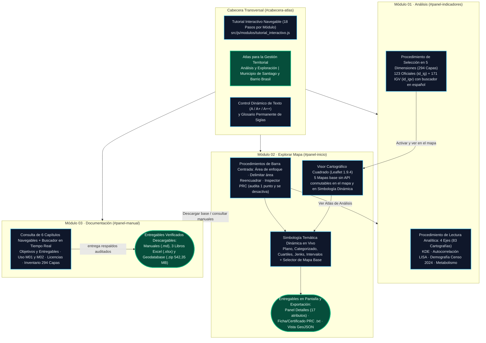

# Atlas para la Gestión Territorial
### Análisis y Exploración | Municipio de Santiago y Barrio Brasil
> Infraestructura de Datos Espaciales, Diagnóstico Geoestadístico y Geodatos Abiertos.

[](https://atlasvgiuah.netlify.app)
[-0284c7?style=for-the-badge)](#13-tabla-11-cifras-clave-del-proyecto-referencia-única)
[-9333ea?style=for-the-badge)](#3-estructura-de-los-3-módulos-de-la-plataforma-web)
[](#5-documentación-técnica-del-proyecto)
[](#6-ejecución-local-verificación-y-licenciamiento)

Plataforma web abierta que integra **123 coberturas oficiales del Estado de Chile** (`id_ig`) y **171 coberturas descentralizadas de Información Geográfica Voluntaria (IGV)** (`id_igv`) para el análisis, la exploración cartográfica y la toma de decisiones en el Municipio de Santiago y el Barrio Brasil.

* **Plataforma web en producción (CDN primario):** [https://atlasvgiuah.netlify.app](https://atlasvgiuah.netlify.app)
* **Repositorio espejo (GitHub Pages):** [https://geojota.github.io/atlas-vgi-barrio-brasil/](https://geojota.github.io/atlas-vgi-barrio-brasil/)
* **Geodatabase consolidada descargable (`.zip`):** `docs/geodatabase_completa_atlas_vgi.zip` (`542,35 MB` comprimidos / `3,33 GB` descomprimidos; `294` capas cartográficas independientes).

---

## 1. Objetivos, entregables verificados y cifras clave del proyecto

### 1.1. Objetivo general
Desarrollar un Atlas para la Gestión Territorial reproducible, interoperable y centrado en el usuario, que integre geodatos abiertos, cartografía participativa y herramientas analíticas para subsanar vacíos de información territorial y apoyar la gestión local y la investigación en la Comuna de Santiago y Barrio Brasil.

### 1.2. Objetivos específicos, procedimientos y entregables verificados

> **Regla metodológica de trazabilidad:** Todo **procedimiento** (o conjunto de **subprocedimientos** que lo integran) produce explícitamente al menos un **entregable verificado** en el repositorio Git o en la plataforma web. Ninguna actividad técnica permanece aislada sin derivar en un producto auditable o formar parte de un procedimiento mayor con entregable verificado.

* **OE 1.** Caracterizar la disponibilidad, la cobertura y los vacíos de información geográfica del área de estudio, y definir las bases taxonómicas y de diseño centrado en el usuario que permitan integrar datos colaborativos e institucionales.
  * *Procedimientos (`PR-01` a `PR-03`):* **`PR-01`** Relevamiento de plataformas abiertas (OpenStreetMap, GBIF e IDE Chile) y diseño de arquitectura web estática; **`PR-02`** Clasificación temática en **5 dimensiones analíticas** y traducción de etiquetas al español; **`PR-03`** Inventario exhaustivo y caracterización de los cuatro perfiles de actores y brechas territoriales.
  * *Entregables verificados (`E1`, `E2`, `E3`):* **`E1`** Arquitectura del sistema y catálogo inicial (`docs/ARQUITECTURA.md`, `docs/catalogo_fuentes_vgi.xlsx`); **`E2`** Cinco dimensiones analíticas y configuración territorial (`docs/categorias_tematicas_osm.xlsx`, `src/js/config.js`); **`E3`** Inventario consolidado de 294 fuentes y matriz de brechas (`docs/catalogo_fuentes_vgi.xlsx`, `docs/TRAZABILIDAD.md`).
* **OE 2.** Consolidar una geodatabase multipropósito que armonice coberturas oficiales e información voluntaria bajo estándares internacionales de calidad y metadatos.
  * *Procedimientos (`PR-04` y `PR-05`):* **`PR-04`** (con subprocedimientos de descarga exhaustiva para la Región Metropolitana y Barrio Brasil en `EPSG:4326` / `EPSG:32719` e inyección automatizada de metadatos ISO 19157 diferenciando `id_ig` oficial e `id_igv` colaborativo); **`PR-05`** Cruce espacial comunal (1.711 manzanas) y barrial en las 5 dimensiones analíticas.
  * *Entregables verificados (`E4`, `E5`):* **`E4`** Geodatabase de **294 coberturas GeoJSON** (123 oficiales + 171 IGV descentralizadas), esquema PostGIS y perfil de 17 atributos (`src/data/*.geojson`, `data/*.geojson`, `docs/perfil_metadatos_vgi.xlsx`, `scripts/db/01_schema_postgis.sql`); **`E5`** Matrices de síntesis territorial comunal y barrial (`data/matriz_sintesis_barrio_brasil_manzanas.geojson`, `data/resumen_catastro_vgi.csv`, `data/bip_inversiones_santiago.csv`).
* **OE 3.** Implementar un geoportal web accesible e interoperable que permita visualizar cartografía multinivel, consultar el territorio en tiempo real y descargar geodatos abiertos.
  * *Procedimientos (`PR-06` y `PR-07`):* **`PR-06`** Implementación del prototipo sintetizado para usuarios no técnicos en 3 módulos (*Módulo 01 Análisis*, *Módulo 02 Explorar Mapa*, *Módulo 03 Documentación*) con visor cuadrado Leaflet 1.9.4, escalado dinámico de tipografía (`A` / `A+` / `A++`) y 5 mapas base sin API; **`PR-07`** Desarrollo de la **simbología temática** (`Plano`, `Categorizado` y `Graduado` multi-método) con conmutador de mapa base integrado, **Inspector normativo del Plan Regulador Comunal (PRC)** bajo demanda con desactivación automática tras auditar un punto, panel inferior de **Detalles** y modelamiento de las 83 cartografías temáticas en 4 ejes.
  * *Entregables verificados (`E6`, `E7`):* **`E6`** Plataforma web sintetizada en 3 módulos y visor cartográfico operativo (`src/index.html`, `src/css/estilos.css`, `src/js/app.js`, `src/js/modulos/mapa.js`); **`E7`** Motores de análisis geoestadístico, simbología temática, evaluación normativa PRC y despliegue continuo en Netlify (`src/js/modulos/evaluador_normativo.js`, `src/js/modulos/mapa.js`, `src/js/modulos/indicadores_analisis.js`, `src/img/cartografias/`, `netlify.toml`).
* **OE 4.** Evaluar la usabilidad y la pertinencia de la plataforma con distintos perfiles de actores territoriales y asegurar su transferibilidad técnica, metodológica y documental.
  * *Procedimientos (`PR-08` y `PR-09`):* **`PR-08`** Aplicación de evaluación de usabilidad (Modalidad 1) y conversaciones situadas con vecinos (Modalidad 2) en Barrio Brasil, desarrollo del tutorial interactivo navegable de 18 pasos, glosario de siglas y documentación navegable; **`PR-09`** Sistematización técnica del catálogo del repositorio, empaquetado de la geodatabase completa y auditoría automatizada en Python 3.
  * *Entregables verificados (`E8`, `E9`):* **`E8`** Trazabilidad de usabilidad, Manual de Uso, Tutorial interactivo (18 pasos) y Módulo 03 navegable (`docs/TRAZABILIDAD.md`, `MANUAL_USO.md`, `src/js/modulos/tutorial_interactivo.js`, `src/js/modulos/manual.js`); **`E9`** Manual de actualización técnica, paquete maestro ZIP (`docs/geodatabase_completa_atlas_vgi.zip`) y reporte verificable de integridad (`MANUAL_ACTUALIZACION_ATLAS.md`, `scripts/verificar_conteo_capas.py`, `scripts/verificar_integridad_despliegue.py`).

### 1.3. Tabla 1.1: Cifras clave del proyecto (referencia única)

| Componente del sistema | Cifra o especificación | Definición y rutas asociadas |
| :--- | :--- | :--- |
| Coberturas geográficas operativas | 294 capas (123 oficiales `id_ig` + 171 IGV `id_igv`) | `src/js/modulos/catalogo_vgi_descentralizado.js`, `src/js/modulos/ide_chile.js`, `src/data/*.geojson` |
| Perfil homologado de atributos y calidad | 17 atributos por entidad (ISO 19115 / ISO 19157) | Panel inferior **Detalles** en Módulo 02 (`src/js/modulos/mapa.js`) y `docs/perfil_metadatos_vgi.xlsx` |
| Dimensiones y Diagnóstico Geoestadístico | 5 dimensiones analíticas y 4 láminas con 83 cartografías | Módulo 01 (`src/js/modulos/indicadores_analisis.js`), `src/img/cartografias/` |
| Mapas base abiertos y satelitales | 5 mapas base sin requerimiento de clave de API | OpenStreetMap (Estándar y HOT), Bing / Microsoft (Satelital e Híbrido) y Esri World Imagery (`src/js/modulos/mapa.js` y selector en Simbología Dinámica) |
| Accesibilidad visual e inducción guiada | Escala dinámica de texto (`A` / `A+` / `A++`), Tutorial (18 pasos) y Glosario | Cabecera superior (`src/index.html`, `src/css/estilos.css`, `src/js/app.js`, `src/js/modulos/tutorial_interactivo.js`) |
| Arquitectura de software | 3 Módulos operacionales (`Análisis`, `Explorar Mapa`, `Documentación`) | Aplicación en `src/` (`publish = "src"` en `netlify.toml`) y scripts en `scripts/` |

### 1.4. Matriz de Procedimientos, Hitos y Entregables Verificados (`PR-01 / E1` a `PR-09 / E9`)

En coherencia con la Carta Gantt del proyecto (`Carta_Gantt_Atlas_VGI.pdf`), cada uno de los **9 procedimientos principales** culmina en un **hito y entregable verificado asociado (`E1` a `E9`)**:

| Hito y Fecha ($\blacklozenge$) | OE | Procedimiento Ejecutado (`PR`) | Entregable Verificado Resultante (`E1` a `E9`) | Localización verificable en el repositorio |
| :---: | :---: | :--- | :--- | :--- |
| **Hito 1** · `03 sep 2026` | `OE 1` | **`PR-01`:** Relevamiento de plataformas abiertas y diseño de arquitectura web | **E1 ·** Arquitectura del sistema y catálogo inicial de fuentes | `docs/ARQUITECTURA.md` y `docs/catalogo_fuentes_vgi.xlsx` (`src/docs/`) |
| **Hito 2** · `09 sep 2026` | `OE 1` | **`PR-02`:** Clasificación temática en 5 dimensiones y homologación territorial | **E2 ·** Cinco dimensiones analíticas, etiquetas IGV y configuración | `docs/categorias_tematicas_osm.xlsx` (`src/docs/`) y `src/js/config.js` |
| **Hito 3** · `16 sep 2026` | `OE 1` | **`PR-03`:** Auditoría de disponibilidad territorial e inventario de brechas | **E3 ·** Inventario consolidado de 294 fuentes y matriz de brechas | `docs/catalogo_fuentes_vgi.xlsx` y `docs/TRAZABILIDAD.md` (`src/docs/`) |
| **Hito 4** · `08 oct 2026` | `OE 2` | **`PR-04`:** Descarga RM/Brasil, normalización `EPSG:4326` e inyección ISO 19157 | **E4 ·** Geodatabase de 294 capas GeoJSON, PostGIS y perfil de 17 atributos (`id_ig` / `id_igv`) | `src/data/*.geojson`, `data/*.geojson`, `docs/perfil_metadatos_vgi.xlsx` y `scripts/db/` |
| **Hito 5** · `19 oct 2026` | `OE 2` | **`PR-05`:** Integración espacial de manzanas censales, RSH, IGV e inversión BIP | **E5 ·** Matriz de síntesis barrial, catastro IGV e inversiones BIP | `data/matriz_sintesis_barrio_brasil_manzanas.geojson`, `data/resumen_catastro_vgi.csv` y `data/bip_inversiones_santiago.csv` |
| **Hito 6** · `27 oct 2026` | `OE 3` | **`PR-06`:** Maquetación del prototipo sintetizado en 3 módulos y visor cuadrado | **E6 ·** Plataforma sintetizada en 3 módulos (*Análisis*, *Explorar mapa*, *Documentación*) y visor | `src/index.html`, `src/css/estilos.css`, `src/js/app.js` y `src/js/modulos/mapa.js` |
| **Hito 7** · `04 nov 2026` | `OE 3` | **`PR-07`:** Implementación del Inspector PRC, simbología temática, Detalles y 83 mapas | **E7 ·** Inspector normativo PRC, simbología temática, panel *Detalles*, 83 mapas y despliegue | `src/js/modulos/evaluador_normativo.js`, `src/js/modulos/mapa.js`, `src/js/modulos/indicadores_analisis.js` y `netlify.toml` |
| **Hito 8** · `09 nov 2026` | `OE 4` | **`PR-08`:** Evaluación de usabilidad (M1/M2), Tutorial de 18 pasos y Módulo 03 | **E8 ·** Evaluación de usabilidad, trazabilidad y Módulo 03 navegable | `docs/TRAZABILIDAD.md`, `MANUAL_USO.md`, `src/js/modulos/tutorial_interactivo.js` y `src/js/modulos/manual.js` |
| **Hito 9** · `12 nov 2026` | `OE 4` | **`PR-09`:** Sistematización del manual técnico, empaquetado ZIP y verificación Python | **E9 ·** Manual de actualización técnica, paquete ZIP (`542,35 MB`) y auditoría de integridad | `MANUAL_ACTUALIZACION_ATLAS.md`, `docs/geodatabase_completa_atlas_vgi.zip` y `scripts/verificar_integridad_despliegue.py` |

---

## 2. Diagramas de arquitectura, procedimientos y entregables verificados

### 2.1. Flujo integral de procedimientos (`PR`) hacia entregables verificados (`E`)

En el siguiente diagrama, los bloques de línea continua azul representan **procedimientos y subprocedimientos ejecutados**, mientras que los bloques redondeados verdes representan los **entregables verificados resultantes**:

```mermaid
flowchart LR
    classDef proc fill:#0f172a,stroke:#38bdf8,stroke-width:2px,color:#e2e8f0
    classDef subproc fill:#1e293b,stroke:#94a3b8,stroke-dasharray:4 3,color:#e2e8f0
    classDef ent fill:#064e3b,stroke:#10b981,stroke-width:2.5px,color:#ecfdf5

    subgraph PROC["PROCEDIMIENTOS Y SUBPROCEDIMIENTOS"]
        SP1["Subprocedimiento PR-04.1<br/>Descarga exhaustiva RM y Barrio Brasil<br/>(123 IG Estatal + 171 IGV OSM/GBIF)"]:::subproc
        PR4["Procedimiento PR-04<br/>Normalización EPSG:4326 / UTM 19S<br/>e inyección de 17 atributos ISO 19157"]:::proc
        PR5["Procedimiento PR-05<br/>Integración censal (1.711 manzanas)<br/>y modelamiento KDE / LISA (83 mapas)"]:::proc
        PR67["Procedimientos PR-06 y PR-07<br/>Visor cuadrado, simbología temática,<br/>5 mapas base e Inspector PRC (1 clic)"]:::proc
        PR89["Procedimientos PR-08 y PR-09<br/>Evaluación usabilidad, documentación<br/>Módulo 03, empaquetado y auditoría"]:::proc
    end

    subgraph ENT["ENTREGABLES VERIFICADOS RESULTANTES"]
        E4(["Entregable E4 · Geodatabase<br/>294 GeoJSON + perfil_metadatos_vgi.xlsx<br/>+ scripts/db/01_schema_postgis.sql"]):::ent
        E5(["Entregable E5 · Síntesis y Láminas<br/>matriz_sintesis_barrio_brasil_manzanas<br/>+ 83 cartografías (.jpg) en Módulo 01"]):::ent
        E67(["Entregables E6 y E7 · Geoportal Web<br/>Plataforma en 3 módulos (Netlify CDN)<br/>con Detalles e Inspector PRC puntual"]):::ent
        E89(["Entregables E8 y E9 · Transferibilidad<br/>Tutorial 18 pasos + Manuales sincronizados<br/>+ geodatabase_completa_atlas_vgi.zip"]):::ent
    end

    SP1 -->|"integra el procedimiento"| PR4
    PR4 -->|"genera"| E4
    E4 -->|"insuma"| PR5
    PR5 -->|"genera"| E5
    E4 & E5 -->|"alimentan"| PR67
    PR67 -->|"genera"| E67
    E67 -->|"valida y documenta"| PR89
    PR89 -->|"genera"| E89
```



### 2.2. Flujo de uso e interacción entre los 3 módulos de la plataforma (`src/index.html`)



---

## 3. Estructura de los 3 Módulos de la plataforma web

| N° | Módulo en la Interfaz (`src/index.html`) | ID del Panel DOM | Controladores Principales (`src/js/`) | Procedimientos Soportados y Entregables Verificables |
| :---: | :--- | :--- | :--- | :--- |
| `01` | **Análisis** | `#panel-indicadores` | `modulos/indicadores_analisis.js`, `modulos/catalogo_vgi_descentralizado.js` | Permite recorrer **83 cartografías temáticas** en 4 láminas (KDE, LISA, demografía y metabolismo urbano) y filtrar las **294 coberturas** en **5 dimensiones analíticas**, generando la activación directa de cada cobertura en el visor del Módulo 02. |
| `02` | **Explorar Mapa** | `#panel-inicio` | `app.js`, `modulos/mapa.js`, `modulos/ide_chile.js`, `modulos/evaluador_normativo.js`, `modulos/geodesia.js` | Integra el visor cuadrado con **5 mapas base sin clave de API** (conmutables tanto en el mapa como dentro de **Simbología Dinámica**), ajuste dinámico de letra (`A / A+ / A++`), simbología temática automática y configurable (`mapa.js`), **Inspector normativo PRC/OGUC** (que audita un punto y desactiva la captura hasta nueva solicitud), **panel Detalles** con los 17 atributos (`id_ig` / `id_igv`), Certificado Normativo `.txt` y exportación GeoJSON. |
| `03` | **Documentación** | `#panel-manual` | `modulos/manual.js`, `modulos/licencias.js` | Ofrece **6 capítulos navegables** con buscador en tiempo real y entrega para descarga directa los manuales técnicos (`.md`), los **3 libros Excel (`.xlsx`)**, el inventario filtrable de las 294 capas y el paquete completo de la geodatabase (`.zip`). |

---

## 4. Estructura del repositorio y entregables verificables en Git

```text
nodo-geoabierto/
├── src/                                      # Directorio de publicación web (publish = "src" en netlify.toml)
│   ├── index.html                            # Aplicación web de 3 módulos con visor cuadrado y panel inferior Detalles
│   ├── css/estilos.css                       # Sistema de diseño adaptable a móviles, tablets y pantallas minimizadas/maximizadas
│   ├── js/                                   # Módulos JavaScript ES6+
│   │   ├── config.js                         # Configuración global (áreas de enfoque, título canónico y 5 dimensiones)
│   │   ├── app.js                            # Orquestador de navegación entre los 3 módulos y cabecera
│   │   └── modulos/                          # Módulos operativos (mapa, tutorial_interactivo, manual, evaluador_normativo, etc.)
│   ├── img/cartografias/                     # 83 cartografías temáticas (JPG) para las 4 láminas del Módulo 01
│   ├── data/                                 # 294 coberturas GeoJSON (123 oficiales + 171 IGV descentralizadas)
│   └── docs/                                 # Manuales (.md/.docx), catálogos Excel (.xlsx) y geodatabase (.zip)
├── data/                                     # Espejo simétrico de las coberturas GeoJSON y tablas territoriales
├── docs/                                     # Espejo simétrico de la documentación técnica y paquetes descargables
├── scripts/                                  # Scripts Python 3 de procesamiento, homologación de 17 atributos y auditoría
└── netlify.toml                              # Configuración de despliegue rápido en Netlify
```

### Catálogo de entregables verificables (`docs/` y `src/docs/`)

| Archivo / Entregable en Git y Web | Formato | Descripción y Contenido |
| :--- | :---: | :--- |
| [`docs/geodatabase_completa_atlas_vgi.zip`](docs/geodatabase_completa_atlas_vgi.zip) | `.zip` | Paquete consolidado (`542,35 MB`) con las 294 coberturas espaciales operativas (123 oficiales + 171 IGV descentralizadas), libros Excel y documentación. |
| [`docs/categorias_tematicas_osm.xlsx`](docs/categorias_tematicas_osm.xlsx) | `.xlsx` | Libro Excel con la organización en 5 dimensiones analíticas, descriptores de las 171 capas IGV, esquema de 17 atributos y referencias APA 7ª ed. |
| [`docs/catalogo_fuentes_vgi.xlsx`](docs/catalogo_fuentes_vgi.xlsx) | `.xlsx` | Libro Excel con el inventario de las 294 coberturas operativas, instituciones custodias, escalas y licencias. |
| [`docs/perfil_metadatos_vgi.xlsx`](docs/perfil_metadatos_vgi.xlsx) | `.xlsx` | Libro Excel con el perfil homologado de 17 atributos (`id_ig` e `id_igv`) bajo normas ISO 19115 e ISO 19157. |

---

## 5. Documentación técnica del proyecto

Toda la documentación está sincronizada en la raíz del proyecto, en `docs/`, en `src/docs/` y es navegable desde el **Módulo 03 · Documentación**:

1. [`MANUAL_USO.md`](MANUAL_USO.md) (`docs/MANUAL_USO.md` / `src/docs/MANUAL_USO.md`): Guía operativa de los 3 módulos, los controles de accesibilidad tipográfica (`A` / `A+` / `A++`), el tutorial interactivo de 18 pasos, las 5 dimensiones analíticas, los mapas base OSM/Bing/Microsoft/Esri (conmutables también desde la simbología dinámica), la simbología temática, el Inspector Normativo PRC puntual y el panel inferior de **Detalles**.
2. [`MANUAL_ACTUALIZACION_ATLAS.md`](MANUAL_ACTUALIZACION_ATLAS.md) (`docs/MANUAL_ACTUALIZACION_ATLAS.md` / `src/docs/MANUAL_ACTUALIZACION_ATLAS.md`): Manual de arquitectura, objetivos y entregables verificados, flujos de datos de las 294 capas y guía paso a paso para mantener o replicar el Atlas en otros territorios.
3. [`docs/ARQUITECTURA.md`](docs/ARQUITECTURA.md) (`src/docs/ARQUITECTURA.md`): Especificación de la arquitectura de 3 módulos, flujos de trabajo y catálogo de componentes del sistema.
4. [`docs/TRAZABILIDAD.md`](docs/TRAZABILIDAD.md) (`src/docs/TRAZABILIDAD.md`): Marco conceptual de la Información Geográfica Voluntaria (IGV), articulación en 5 dimensiones, homologación de 17 atributos y evaluación de usabilidad.
5. [`docs/BIBLIOGRAFIA_SEMINARIO_Y_ATLAS.md`](docs/BIBLIOGRAFIA_SEMINARIO_Y_ATLAS.md): Compendio de 125 referencias bibliográficas y normativas en formato APA 7ª edición.

---

## 6. Ejecución local, verificación y licenciamiento

```bash
# 1. Levantar servidor HTTP local apuntando al directorio de publicación web (src/)
python3 -m http.server 8080 --directory src

# 2. Verificar paridad exacta de las 294 capas (123 Oficiales + 171 IGV descentralizadas)
python3 scripts/verificar_conteo_capas.py

# 3. Verificar integridad de archivos GeoJSON y sincronización data/ <-> src/data/
python3 scripts/verificar_integridad_despliegue.py
```

### Licenciamiento y gobernanza de datos abiertos
* **Plataforma, Documentación y Síntesis Cartográfica:** [Creative Commons Atribución 4.0 Internacional (CC BY 4.0)](https://creativecommons.org/licenses/by/4.0/deed.es) / [CC BY-SA 4.0](https://creativecommons.org/licenses/by-sa/4.0/deed.es).
* **Coberturas de Información Geográfica Voluntaria (IGV):** [Open Database License (ODbL 1.0)](https://opendatacommons.org/licenses/odbl/1-0/) (© Colaboradores de OpenStreetMap) y registros de biodiversidad GBIF bajo CC BY 4.0 / CC0.
* **Coberturas Oficiales del Estado de Chile:** Acceso público y reutilización regidos por la Ley N° 20.285 sobre Acceso a la Información Pública, Ley N° 21.180 de Transformación Digital del Estado y resguardo estadístico conforme a la Ley N° 19.628.
* **Código Fuente del Software:** [GNU Affero General Public License v3.0 (AGPLv3)](https://www.gnu.org/licenses/agpl-3.0.html).
