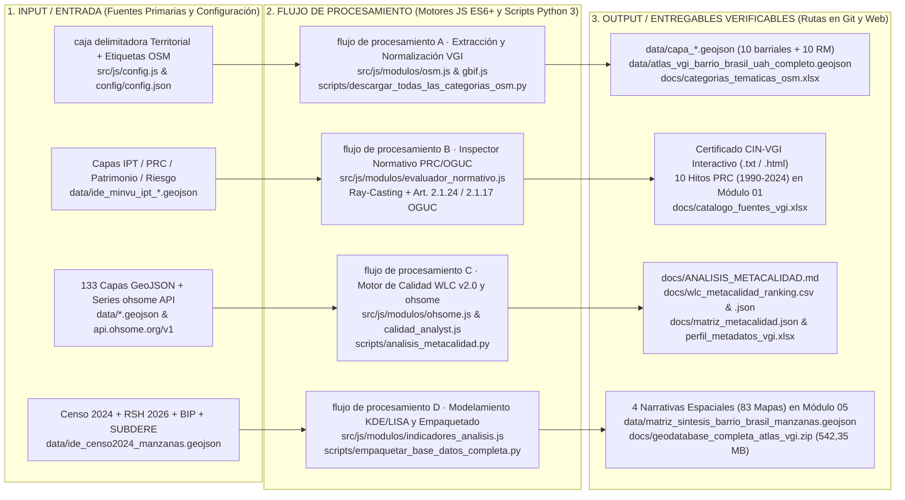
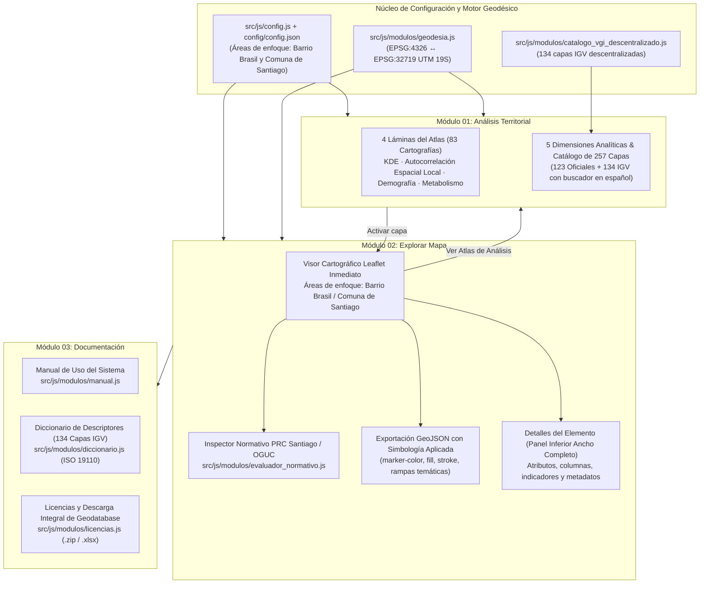

# Atlas para la Gestión Territorial
### Análisis y Exploración | Municipio de Santiago y Barrio Brasil
> **Prototipo 02** · Infraestructura de Datos Espaciales, Narrativas Espaciales y Geodatos Abiertos.

[](https://atlasvgiuah.netlify.app)
[-0284c7?style=for-the-badge)](#13-tabla-11-cifras-clave-del-proyecto-referencia-única)
[-9333ea?style=for-the-badge)](#2-arquitectura-de-los-3-módulos-operacionales-del-prototipo-02)
[](#5-documentación-técnica-del-proyecto)
[](#6-licenciamiento-y-gobernanza-de-datos-abiertos)

Plataforma web abierta que reúne mapas oficiales del Estado de Chile e información geográfica voluntaria (*Volunteered Geographic Information*, VGI; Goodchild, 2007; Haklay, 2010) para el análisis multiescalar del barrio Brasil, el entorno del Campus universitario patrimonial, la comuna de Santiago y la Región Metropolitana de Santiago.

* Plataforma web en producción (CDN primario): [https://atlasvgiuah.netlify.app](https://atlasvgiuah.netlify.app)
* Repositorio espejo (GitHub Pages): [https://geojota.github.io/atlas-vgi-barrio-brasil/](https://geojota.github.io/atlas-vgi-barrio-brasil/)
* Geodatabase consolidada descargable (`.zip`): `docs/geodatabase_completa_atlas_vgi.zip` (`542,35 MB` comprimidos / `3,33 GB` descomprimidos; `257` capas cartográficas independientes).

---

## 1. Objetivos y tabla de cifras clave del proyecto

### 1.1. Objetivo general
Desarrollar un atlas territorial reproducible, interoperable y centrado en la toma de decisiones espaciales, que integre geodatos abiertos oficiales del Estado de Chile, información geográfica voluntaria (VGI/IGV) y herramientas analíticas multicriterio para subsanar vacíos de información, visibilizar patrones socioterritoriales y apoyar la gestión local en el Municipio de Santiago y el Barrio Brasil.

### 1.2. Objetivos específicos
* **OE 1.** Caracterizar la disponibilidad, la cobertura y los vacíos de información geográfica del área de estudio, y definir las bases taxonómicas y de diseño centrado en el usuario que permitan integrar datos colaborativos e institucionales.
* **OE 2.** Consolidar una geodatabase multipropósito que armonice coberturas oficiales e información voluntaria bajo estándares internacionales de calidad y metadatos.
* **OE 3.** Implementar el **Prototipo 02**: un geoportal interactivo estructurado en tres componentes operacionales (Módulo 01 Análisis, Módulo 02 Explorar Mapa y Módulo 03 Documentación).
* **OE 4.** Evaluar la usabilidad y la pertinencia de la plataforma con distintos perfiles de actores territoriales y asegurar su transferibilidad técnica, metodológica y documental.

### 1.3. Tabla 1.1: Cifras clave del proyecto (referencia única)

| Componente del sistema | Cifra o especificación | Definición y rutas asociadas |
| :--- | :--- | :--- |
| Coberturas geográficas operativas | 257 capas (123 oficiales + 134 IGV descentralizadas) | `src/js/modulos/catalogo_vgi_descentralizado.js`, `src/js/modulos/ide_chile.js`, `data/capa_vgi_*.geojson` |
| Descriptores del diccionario de datos | 134 descriptores bajo ISO 19110:2016 (100% en español) | Módulo `03` (`src/js/modulos/diccionario.js`), `docs/categorias_tematicas_osm.xlsx` |
| Dimensiones y Narrativas Espaciales | 5 dimensiones y 4 Narrativas Espaciales con 83 cartografías | Módulo `01` (`src/js/modulos/indicadores_analisis.js`), `src/img/cartografias/` |
| Índice Global de Calidad VGI (IGV) | 95,4 % (91 capas A+ y 43 A de las capas evaluadas) | Calidad espacial multicriterio WLC v2.0 (ISO 19157) y `docs/ANALISIS_METACALIDAD.md` |
| Índice Global de Metacalidad Documental (IGMC) | 96,55 % | Cumplimiento de campos obligatorios de metadatos ISO 19115 / IDE Chile en perfil de metadatos |
| Accesibilidad web | WCAG 2.1 nivel AA general y nivel AAA en texto | Contraste de `4,58:1` a `8,87:1` en componentes (AA) y de `9,43:1` a `19,00:1` en lectura (AAA) |
| Arquitectura de software | 3 Módulos en SPA y scripts de automatización Python | Aplicación en `src/js/` y scripts en `scripts/` |

---

## 2. Flujos de procesamiento de arquitectura y procesamiento de datos

El proyecto organiza su flujo de ingeniería de datos y operación web en cuatro flujos de procesamiento troncales bajo el modelo `1. INPUT / ENTRADA` → `2. PIPELINE DE PROCESAMIENTO / MÓDULO` → `3. OUTPUT / RUTAS EN GIT Y PLATAFORMA WEB`:

### 2.1. Flujo de procesamiento general de los cuatro subsistemas (flujos de procesamiento a, b, c y d)



### 2.2. Flujo de procesamiento de articulación de los 3 Módulos de la plataforma web (`src/index.html`)



---

## 3. Estructura de los 3 Módulos de la plataforma web (Prototipo 02)

| N° | Sección en la Interfaz (`src/index.html`) | ID del Panel DOM | Controladores JavaScript (`src/js/`) | Función Principal y Salidas Verificables |
| :---: | :--- | :--- | :--- | :--- |
| `01` | Análisis | `#panel-indicadores` | `modulos/indicadores_analisis.js`, `modulos/catalogo_vgi_descentralizado.js` | Síntesis territorial basada en 83 cartografías temáticas estructuradas en 4 láminas (KDE, autocorrelación espacial local, demografía y habitabilidad, metabolismo urbano) y catálogo de 257 coberturas (123 oficiales + 134 IGV descentralizadas) organizadas en 5 dimensiones con buscador interactivo en español y activación directa. |
| `02` | Explorar Mapa | `#panel-inicio` | `app.js`, `modulos/mapa.js`, `modulos/ide_chile.js`, `modulos/evaluador_normativo.js`, `modulos/geodesia.js` | Visor Leaflet en primer plano con selector de áreas de enfoque ("Barrio Brasil Completo" y "Comuna de Santiago"), inspector normativo PRC/OGUC, botón "Ver Atlas de Análisis", panel inferior de "Detalles del elemento" a todo lo ancho y exportación GeoJSON con simbología temática embebida. |
| `03` | Documentación | `#panel-manual`, `#panel-diccionario`, `#panel-licencias` | `modulos/manual.js`, `modulos/diccionario.js`, `modulos/licencias.js` | Manual de uso interactivo con inventario de 257 capas, diccionario de descriptores territoriales ISO 19110 (134 capas IGV), marco legal de datos abiertos y descarga directa de `docs/geodatabase_completa_atlas_vgi.zip` y catálogos Excel. |

---

## 4. Estructura del repositorio y entregables verificables en Git

El repositorio mantiene paridad simétrica entre los directorios de raíz (`data/` y `docs/`) y los directorios publicados por el servidor web (`src/data/` y `src/docs/`), garantizando rutas idénticas tanto en ejecución local como en despliegues sobre Netlify y GitHub Pages.

```text
nodo-geoabierto/
├── src/                                      # Directorio de publicación web (publish = "src" en netlify.toml)
│   ├── index.html                            # Documento maestro SPA (3 módulos operacionales y visor Leaflet)
│   ├── css/estilos.css                       # Sistema de diseño CSS3 con variables nativas (:root)
│   ├── js/                                   # 21 scripts JavaScript ES6+ (Patrón IIFE modular)
│   │   ├── config.js                         # Configuración global síncrona (window.NODO_CONFIG)
│   │   ├── app.js                            # Orquestador principal de la interfaz y telemetría ICV
│   │   └── modulos/                          # 19 módulos especializados (mapa, ide_chile, ohsome, etc.)
│   ├── img/cartografias/                     # 83 cartografías temáticas (JPG) para los 4 Narrativas Espaciales
│   ├── data/                                 # Espejo exacto de data/ para consumo directo vía Fetch API
│   └── docs/                                 # Espejo exacto de docs/ para descarga directa desde el navegador
├── data/                                     # Repositorio maestro de capas GeoJSON (.geojson), GPKG (.gpkg) y CSV
├── docs/                                     # Documentación técnica (.md), reportes WLC (.csv/.json), libros (.xlsx) y .zip
├── config/config.json                        # Parámetros JSON de caja delimitadora, comunas RM y 10 categorías VGI
├── scripts/                                  # 25 scripts Python 3 de ETL, calidad WLC, auditoría y empaquetado
│   └── db/                                   # Esquemas SQL PostGIS (01_schema_postgis.sql, 02_seed_metadata.sql)
└── netlify.toml                              # Configuración CDN, cabeceras CORS/Cache y redirecciones HTTP
```

### Catálogo de entregables verificables (`docs/` y `src/docs/`)

| Archivo / Entregable en Git y Web | Formato | Descripción y Contenido |
| :--- | :---: | :--- |
| [`docs/geodatabase_completa_atlas_vgi.zip`](docs/geodatabase_completa_atlas_vgi.zip) | `.zip` | Paquete consolidado (`542,35 MB` / `257` archivos en `7` subcarpetas) con las 133 capas del visor, extractos RM, libros Excel, CSV, SQL y metadatos ISO. |
| [`docs/categorias_tematicas_osm.xlsx`](docs/categorias_tematicas_osm.xlsx) | `.xlsx` | Libro Excel de 4 hojas con la taxonomía de las 10 macrocategorías VGI (`CAT-01` a `CAT-10`), etiquetas OSM y homologación ISO 19110. |
| [`docs/catalogo_fuentes_vgi.xlsx`](docs/catalogo_fuentes_vgi.xlsx) | `.xlsx` | Libro Excel de 4 hojas con el inventario de las 133 coberturas operativas, instituciones custodias, escalas y licencias. |
| [`docs/perfil_metadatos_vgi.xlsx`](docs/perfil_metadatos_vgi.xlsx) | `.xlsx` | Libro Excel de 4 hojas con el perfil de metadatos ISO 19115 / IDE Chile y la matriz de evaluación WLC ISO 19157. |
| [`docs/wlc_metacalidad_ranking.csv`](docs/wlc_metacalidad_ranking.csv) y [`.json`](docs/wlc_metacalidad_resultado.json) | `.csv` / `.json` | Ranking multicriterio WLC y resultados por dimensión (`C1` Linaje, `C2` Completitud, `C3` Consistencia Lógica, `C4` Exactitud Posicional, `C5` Actualidad). |
| [`docs/matriz_metacalidad.json`](docs/matriz_metacalidad.json) y [`correlacion_dimensiones_calidad.csv`](docs/correlacion_dimensiones_calidad.csv) | `.json` / `.csv` | Matriz detallada de metacalidad por archivo GeoJSON y matriz de correlación de Pearson entre dimensiones de calidad. |

---

## 5. Documentación técnica del proyecto

Toda la documentación se encuentra sincronizada en la raíz del proyecto, en `docs/` y en `src/docs/`:

1. [`MANUAL_USO.md`](MANUAL_USO.md) (`docs/MANUAL_USO.md` / `src/docs/MANUAL_USO.md`): Manual operativo de los 3 módulos de la plataforma web, catálogo de 257 capas agrupadas en 5 dimensiones de análisis, uso del Inspector Normativo PRC/OGUC, las 4 Láminas del Atlas (83 cartografías) y panel de detalles al pie del visor.
2. [`MANUAL_ACTUALIZACION_ATLAS.md`](MANUAL_ACTUALIZACION_ATLAS.md) (`docs/MANUAL_ACTUALIZACION_ATLAS.md` / `src/docs/MANUAL_ACTUALIZACION_ATLAS.md`): Manual de ingeniería de software, arquitectura, catálogo estandarizado multi-lenguaje, flujos de procesamiento de datos y guía paso a paso para adaptar el Atlas a cualquier territorio.
3. [`docs/ARQUITECTURA.md`](docs/ARQUITECTURA.md) y [`PROTOCOL_INTEGRIDAD_Y_DESPLIEGUE.md`](PROTOCOL_INTEGRIDAD_Y_DESPLIEGUE.md): Especificación de la arquitectura cliente-servidor, motor geodésico `EPSG:4326` ↔ `EPSG:32719`, protocolo de 8 bancos de pruebas pre-despliegue y despliegue continuo en Netlify y GitHub Pages.
4. [`docs/ANALISIS_METACALIDAD.md`](docs/ANALISIS_METACALIDAD.md): Reporte técnico del modelo de Combinación Lineal Ponderada (WLC) bajo las normas ISO 19115:2014 e ISO 19157:2013 sobre el repositorio cartográfico.
5. [`docs/GUIA_BASE_DATOS_SUPABASE.md`](docs/GUIA_BASE_DATOS_SUPABASE.md): Guía de despliegue y operación del backend relacional PostgreSQL 17 / PostGIS 3.3 en Supabase y automatización Keep-Alive mediante GitHub Actions.
6. [`docs/TRAZABILIDAD_ACADEMICA.md`](docs/TRAZABILIDAD_ACADEMICA.md): Síntesis metodológica, marco conceptual VGI, homologación taxonómica y gobernanza territorial.
7. [`docs/BIBLIOGRAFIA_SEMINARIO_Y_ATLAS.md`](docs/BIBLIOGRAFIA_SEMINARIO_Y_ATLAS.md): Compendio de 125 referencias bibliográficas y normativas en formato APA 7ª edición que respaldan los módulos, indicadores y Narrativas Espaciales del sistema.

---

## 6. Ejecución local, verificación y licenciamiento

### Ejecución local y suite de auditoría automatizada

```bash
# 1. Levantar servidor HTTP local apuntando al directorio de publicación web (src/)
python3 -m http.server 8080 --directory src

# 2. Verificar paridad de las 133 capas (123 Oficiales + 10 VGI) y 140 descriptores ISO 19110
python3 scripts/verificar_conteo_capas.py

# 3. Verificar integridad de archivos GeoJSON, ausencia de punteros LFS y sincronización data/ <-> src/data/
python3 scripts/verificar_integridad_despliegue.py

# 4. Recalcular matriz de metacalidad WLC (ISO 19115 / ISO 19157)
python3 scripts/analisis_metacalidad.py
```

### Licenciamiento y gobernanza de datos abiertos

* Datos Colaborativos de OpenStreetMap: [Open Database License (ODbL 1.0)](https://opendatacommons.org/licenses/odbl/1-0/) — © Colaboradores de OpenStreetMap.
* Registros de Biodiversidad (GBIF) y Cartografías Derivadas: [Creative Commons Atribución-CompartirIgual 4.0 Internacional (CC BY-SA 4.0)](https://creativecommons.org/licenses/by-sa/4.0/deed.es).
* Coberturas Oficiales del Estado de Chile: Acceso público y reutilización regidos por la Ley N° 20.285 sobre Acceso a la Información Pública y resguardo de microdatos conforme a la Ley N° 19.628 sobre Protección de la Vida Privada.
* Código Fuente del Software: [GNU Affero General Public License v3.0 (AGPLv3)](https://www.gnu.org/licenses/agpl-3.0.html).
