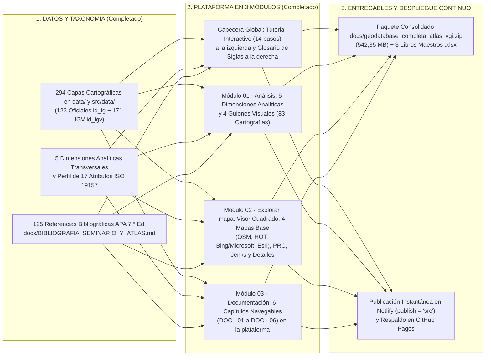

# Bitácora de continuidad, hoja de ruta y trazabilidad de entregables verificados
## Proyecto: Atlas para la Gestión Territorial (`nodo-geoabierto`)
### Análisis y Exploración | Municipio de Santiago y Barrio Brasil

* **Plataforma Web en Producción:** [https://atlasvgiuah.netlify.app](https://atlasvgiuah.netlify.app)
* **Documentación Maestra Vinculada:** [`README.md`](README.md) · [`MANUAL_USO.md`](MANUAL_USO.md) · [`MANUAL_ACTUALIZACION_ATLAS.md`](MANUAL_ACTUALIZACION_ATLAS.md) · [`docs/ARQUITECTURA.md`](docs/ARQUITECTURA.md) · [`docs/TRAZABILIDAD.md`](docs/TRAZABILIDAD.md).

---

## 1. Flujo de trabajo de la arquitectura sintetizada y entregables verificados

---

## 2. Estado consolidado de los entregables verificados

1. **Prototipo sintetizado para usuarios no técnicos (`OE 3`):**
   * Interfaz estructurada en **3 módulos principales** (`01 Análisis`, `02 Explorar mapa` y `03 Documentación`), acompañada en la cabecera por el **Tutorial interactivo de 14 pasos** (ubicado a la izquierda del título principal) y el **Glosario de siglas** (ubicado a la derecha del título principal, evitando cualquier superposición visual).
2. **Catálogo unificado de 294 coberturas cartográficas (`OE 1` y `OE 2`):**
   * **123 capas oficiales del Estado de Chile (`id_ig`)** provenientes de IDE Chile, INE (Censo 2024), MINVU, SUBDERE (Catastro RSD 2024), UOCT/MTT, SUBTEL, MDSF (RSH y BIP), CMN, SII y Municipalidad de Santiago.
   * **171 coberturas descentralizadas de Información Geográfica Voluntaria (`id_igv`)** provenientes de OpenStreetMap y GBIF, agrupadas junto con las capas estatales en las **5 dimensiones analíticas**.
   * **Perfil homologado de 17 atributos ISO 19115 / ISO 19157** embebido en cada entidad y consultable en el panel inferior de **Detalles** del Módulo 02.
3. **Visor cartográfico cuadrado y mapas base sin clave API (`OE 3`):**
   * Lienzo de proporción cuadrada amplia en el Módulo 02 con 4 mapas base abiertos (**OpenStreetMap Estándar**, **OpenStreetMap Humanitario (HOT)**, **Satélite Bing / Microsoft** y **Satélite Esri World Imagery**), motor de **Simbología dinámica** (cortes naturales de Jenks) e **Inspector normativo (PRC)** del Plan Regulador Comunal de Santiago.
4. **Documentación navegable y transferibilidad (`OE 4`):**
   * Documentación integrada en el **Módulo 03 (`Documentación`)** a través de 6 capítulos interactivos (`DOC · 01` a `DOC · 06`) y sincronizada con los archivos Markdown y catálogos Excel (`.xlsx`) del repositorio.

---

## 3. Lista de verificación permanente para mantenedores

* [x] **Paridad de Capas (`294`):** `123` capas oficiales (`id_ig`) + `171` coberturas descentralizadas de IGV (`id_igv`) verificadas con `python3 scripts/verificar_conteo_capas.py`.
* [x] **Organización en 5 Dimensiones:** Coherencia entre el Módulo 01 (`Análisis`), el árbol de capas del Módulo 02 (`Explorar mapa`) y el catálogo filtrable `DOC · 05` del Módulo 03 (`Documentación`).
* [x] **Mapas Base Operativos (`4`):** OpenStreetMap Estándar, OpenStreetMap Humanitario, Satélite Bing/Microsoft y Satélite Esri (sin mosaicos de Carto).
* [x] **Paridad Simétrica de Directorios:** `data/` ↔ `src/data/` y `docs/` ↔ `src/docs/` sin punteros Git LFS.
* [x] **Build Rápido en Netlify:** Auditorías ejecutadas en pre-commit local para mantener despliegues instantáneos en producción.
