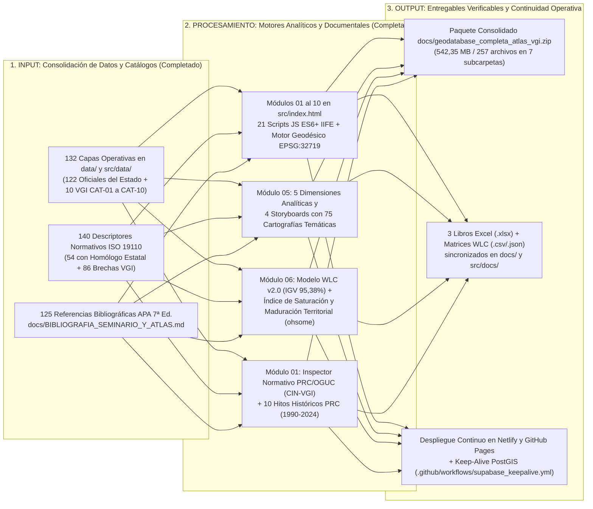
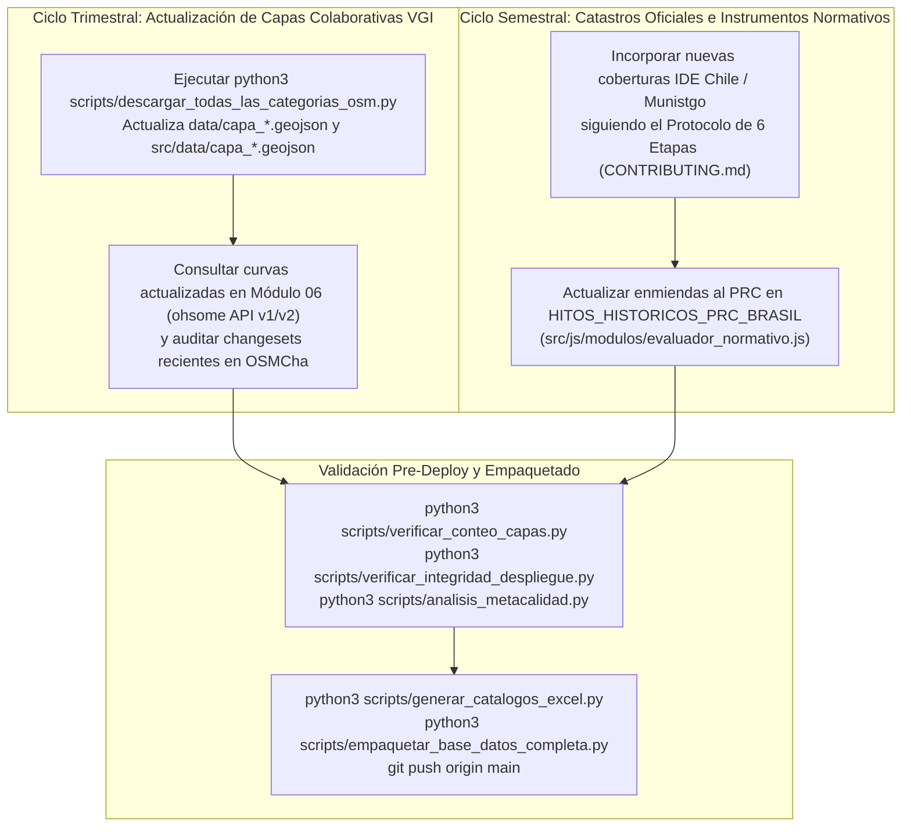

# Bitácora de Continuidad, Hoja de Ruta y Trazabilidad de Entregas
### Proyecto: Atlas de Información Geográfica Voluntaria para la Gestión Territorial (`nodo-geoabierto`)

* **Plataforma Web en Producción:** [https://atlasvgiuah.netlify.app](https://atlasvgiuah.netlify.app)
* **Documentación Maestra Vinculada:** [`MANUAL_ACTUALIZACION_ATLAS.md`](MANUAL_ACTUALIZACION_ATLAS.md) · [`MANUAL_USO.md`](MANUAL_USO.md) · [`docs/ARQUITECTURA.md`](docs/ARQUITECTURA.md) · [`docs/ANALISIS_METACALIDAD.md`](docs/ANALISIS_METACALIDAD.md).

---

## 1. Pipeline de Evolución Arquitectónica y Mantenimiento Continuo del Atlas VGI

---

## 2. Estado Consolidado de Entregas Técnicas (Octubre 2026)

### 2.1. Estandarización Integral de Documentación, Pipelines y Rutas Verificables (Octubre 2026)
1. **Alineación Estricta entre Plataforma Web, Repositorio Git y Documentación Técnica:**
   * Sincronización de métricas y rutas en todos los documentos del proyecto (`README.md`, `MANUAL_USO.md`, `MANUAL_ACTUALIZACION_ATLAS.md`, `docs/ARQUITECTURA.md`, `PROTOCOL_INTEGRIDAD_Y_DESPLIEGUE.md`, `CONTRIBUTING.md`, `docs/GUIA_BASE_DATOS_SUPABASE.md`, `docs/ANALISIS_METACALIDAD.md`, `INFORME_PROYECTO_ATLAS_VGI.md`, `docs/TRAZABILIDAD_ACADEMICA.md`, `docs/DICCIONARIO_CATASTRO_RSD_SUBDERE_2024.md` y `docs/BIBLIOGRAFIA_SEMINARIO_Y_ATLAS.md`) y sus réplicas en `docs/` y `src/docs/`.
   * Integración de diagramas tipo pipeline (`1. INPUT / ENTRADA` → `2. PIPELINE DE PROCESAMIENTO / MÓDULO` → `3. OUTPUT / RUTAS EN GIT Y PLATAFORMA WEB`) en toda la documentación técnica.
   * Normalización de todas las expresiones matemáticas a bloques limpios en notación Unicode/ASCII, eliminando comandos LaTeX crudos para asegurar legibilidad directa en cualquier visor Markdown.
2. **Denominación Metodológica en el Módulo 06 (`ohsome.js`, `calidad_analyst.js` y `index.html`):**
   * Formalización del indicador histórico de completitud y actividad comunitaria bajo la denominación **Índice de Saturación y Maduración Territorial (Herfort et al., 2023 / ISO 19157)**, ponderando la **Asíntota de Completitud Geométrica (`60%`)** y la **Diversidad de Contribuyentes Activos (`40%`)**.
3. **Catálogo Estandarizado Multi-Lenguaje:**
   * Documentación sistemática de los archivos de la plataforma según su lenguaje (`HTML5`, `CSS3`, `21 scripts JavaScript ES6+ IIFE`, `SQL/PostGIS`, `Overpass QL`, `JSON/GeoJSON/TOML` y `25 scripts Python 3`), incorporada tanto en el **Módulo 07 (`src/js/modulos/manual.js`)** como en `MANUAL_ACTUALIZACION_ATLAS.md` y `docs/ARQUITECTURA.md`.

---

### 2.2. Consolidación de las 132 Capas Operativas, 4 Storyboards (75 Mapas) e Inspector PRC
1. **Inventario de 132 Coberturas Geográficas (`122` Oficiales + `10` VGI):**
   * Integración del **Censo de Población y Vivienda 2024 (INE)** en 5 escalas territoriales (incluyendo `data/ide_censo2024_manzanas.geojson` con `1.711` manzanas y `216` variables para la Comuna de Santiago).
   * Integración de las **13 capas del Catastro Nacional de Residuos Sólidos Domiciliarios (SUBDERE RSD 2024)** en `data/subdere_rsd_*.geojson` con diccionarios de columnas embebidos (`126` descriptores).
   * Integración de las series comunales de Santiago (`bbdd_01_santiago.geojson` a `bbdd_91_santiago.geojson`), Registro Social de Hogares 2026 (`data/RSH_*_UV_2026_*.geojson`), Banco Integrado de Proyectos (`data/bip_inversiones_santiago.csv`), semáforos UOCT 2026 (`data/semaforos_rm_uoct_2026.geojson`), antenas SUBTEL (`data/subtel_antenas_rm_2026.geojson`) y ruido ambiental MMA (`data/mma_ruido_ambiental_santiago.geojson`).
2. **Articulación de los 4 Storyboards Territoriales con 75 Cartografías Temáticas (`Módulo 05`):**
   * **Storyboard 01 (`11` mapas):** Análisis de concentración espacial mediante Densidad de Kernel (`KDE`).
   * **Storyboard 02 (`11` mapas):** Autocorrelación espacial local bivariada (`LISA` / `I de Moran`).
   * **Storyboard 03 (`29` mapas):** Demografía y habitabilidad Censo 2024, vulnerabilidad RSH e inversión pública BIP.
   * **Storyboard 04 (`24` mapas):** Metabolismo urbano, socioambiente, movilidad sustentable y gestión de residuos SUBDERE RSD.
3. **Inspector Normativo PRC/OGUC y Expediente Histórico (`1990–2024`) en el Módulo 01:**
   * Evaluación espacial *Point-in-Polygon* sobre la zonificación del Plan Regulador Comunal de Santiago, reglas de los **Arts. 2.1.24 y 2.1.17 de la OGUC**, protección patrimonial (`ZCH`, `ICH`, Monumentos Nacionales), línea de tiempo de las **10 modificaciones históricas al PRC en el Barrio Brasil (1990–2024)** y descarga del **Certificado CIN-VGI (`.txt`)**.

---

## 3. Pipeline de Mantenimiento Periódico y Próximos Ciclos de Actualización

### Lista de Verificación Permanente para Mantenedores:
* [x] **Paridad de Capas (`132`):** `122` capas oficiales en `src/js/modulos/ide_chile.js` + `10` macrocategorías VGI en `src/js/config.js`.
* [x] **Paridad de Descriptores (`140`):** `54` con homólogo oficial en IDE Chile + `86` brechas VGI en `src/js/modulos/diccionario.js`.
* [x] **Paridad de Storyboards (`4` ejes / `75` mapas):** Cartografías PNG verificadas en `src/assets/mapas_storyboards/`.
* [x] **Paridad Simétrica de Directorios:** `data/` ↔ `src/data/` y `docs/` ↔ `src/docs/` sin punteros Git LFS.
* [x] **Auditoría de MetaCalidad WLC v2.0:** Índice Global `IGV = 95,38%` (`Grado A+ Excelente`).
