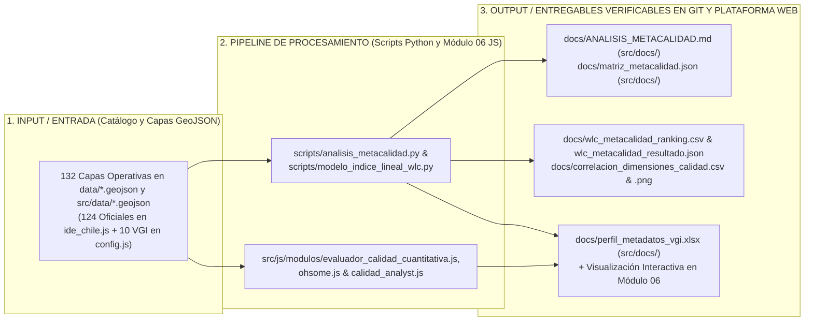
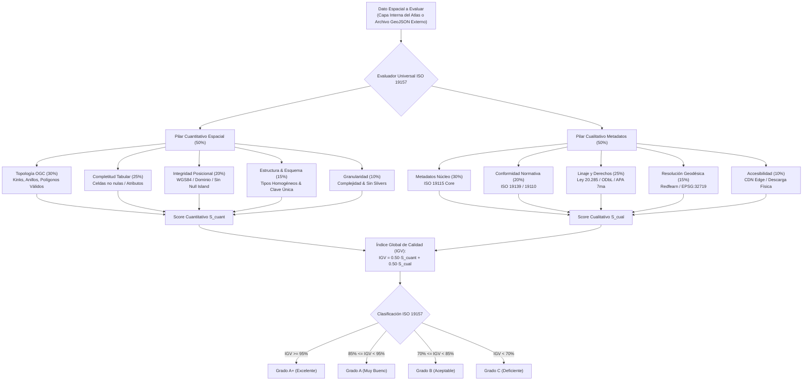
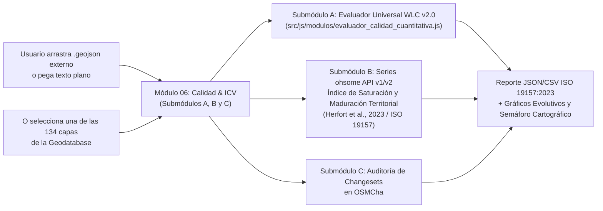
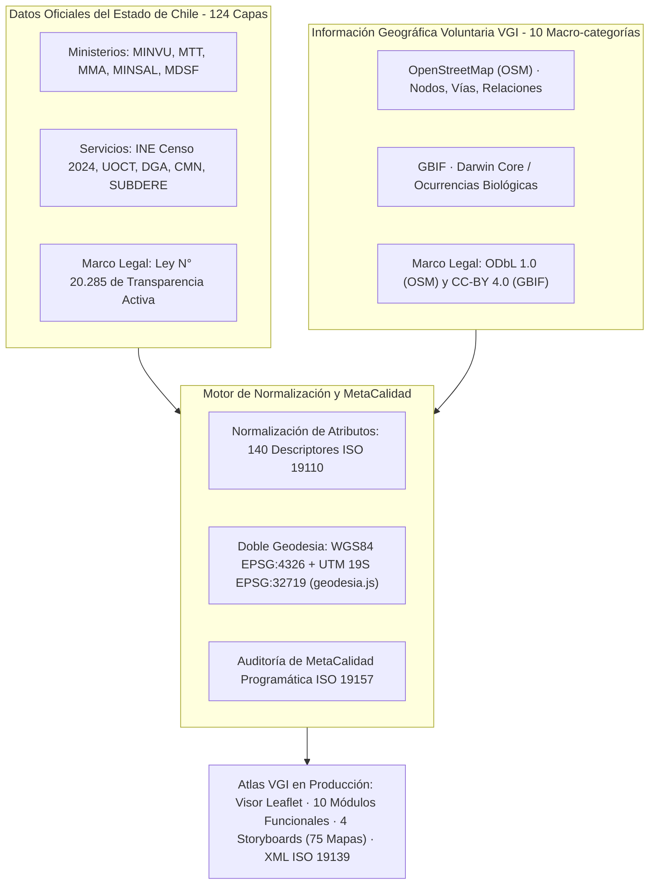
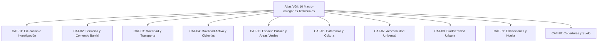

# Informe de Auditoría del Índice de Calidad y MetaCalidad Cartográfica (IGV / IGMC)
### Atlas de Información Geográfica Voluntaria para la Gestión Territorial — Nodo GeoAbierto UAH
---

## 🧭 Índice de Contenidos

1. [Resumen Ejecutivo y Dictamen de Calidad Integral](#1-resumen-ejecutivo-y-dictamen-de-calidad-integral)
2. [Fundamentación Teórica y Formulación Matemática del Modelo Dual](#2-fundamentación-teórica-y-formulación-matemática-del-modelo-dual)
3. [Especificidad Técnica y Catálogo de las 10 Macro-categorías VGI](#3-especificidad-técnica-y-catálogo-de-las-10-macro-categorías-vgi)
4. [Desempeño por Grupo Temático en el Atlas](#4-desempeño-por-grupo-temático-en-el-atlas)
5. [Matriz Exhaustiva de Calidad e Índice IGV — Auditoría Universal](#5-matriz-exhaustiva-de-calidad-e-índice-igv--auditoría-universal)
6. [Hallazgos Clave y Plan de Calibración Futura](#6-hallazgos-clave-y-plan-de-calibración-futura)
7. [Referencias Bibliográficas y Normativas (Normas APA 7ª Edición)](#7-referencias-bibliográficas-y-normativas-normas-apa-7ª-edición)

---

## 1. Resumen Ejecutivo y Dictamen de Calidad Integral

Se realizó una auditoría universal programática del **Índice Global de Calidad Geográfica (IGV / IGMC)**, integrando el **Pilar Cuantitativo Espacial (50%)** (consistencia topológica OGC, completitud tabular, rango de coordenadas, estructura y micro-slivers) con el **Pilar Cualitativo de Metadatos (50%)** (completitud de catálogo ISO 19115, conformidad sintáctica, linaje jurídico y accesibilidad operativa) sobre el **100% de la base de datos cartográfica** del proyecto, compuesta por **134 componentes espaciales** (124 capas oficiales del Estado de Chile y 10 macro-categorías comunitarias VGI de OpenStreetMap y GBIF), abarcando un volumen vectorial activo verificado de **2166.36 MB** (2.12 GB) —integrando tanto los extractos locales de Barrio Brasil (5.96 MB VGI) como los extractos masivos regionales de **Geofabrik RM** (1207.60 MB VGI)—, en el marco de un repositorio integral en disco de **3331.23 MB** (3.25 GB / 214 archivos GeoJSON).

> **DICTAMEN GLOBAL DE CALIDAD GEOESPACIAL:** El repositorio cartográfico alcanza un **Índice Global de Calidad (IGV) de 95.4%**, clasificando formalmente en la categoría **Grado A+ (Excelente)** conforme al marco de evaluación de la norma **ISO 19157:2013 / ISO 19157-1:2023**. El desempeño se desglosa en **96.6% en el Pilar Cuantitativo Espacial** y **94.2% en el Pilar Cualitativo de Metadatos**. La totalidad de los componentes vectoriales se encuentra operativa en el Geoportal, y el sistema dispone ahora del **Evaluador Universal de Calidad (Módulo 06)** que permite auditar cualquier dato vectorial externo (.geojson o texto plano) bajo las mismas métricas estandarizadas.

### Indicadores Clave de Desempeño (KPIs del Modelo Dual IGV)

| Pilar / Dimensión de Calidad | Estándar Referencial | Peso en Modelo | Puntaje Promedio | Calificación Cualitativa |
| :--- | :--- | :---: | :---: | :---: |
| 📐 **PILAR CUANTITATIVO ESPACIAL (S_cuant)** | **ISO 19157 / OGC SFA** | **50% (Global)** | **96.6%** | 🟢 Excelente |
| ├── 1. Consistencia Topológica (Topo) | ISO 19157 / Anillos & Kinks | 30% del pilar | **99.8%** | 🟢 Excelente |
| ├── 2. Completitud Tabular (Comp) | ISO 19157 / Celdas no nulas | 25% del pilar | **97.0%** | 🟢 Muy Bueno |
| ├── 3. Integridad Posicional (Pos) | EPSG:4326 / EPSG:32719 | 20% del pilar | **99.8%** | 🟢 Excelente |
| ├── 4. Estructura y Esquema (Estruc) | Homogeneidad & Clave Única | 15% del pilar | **86.6%** | 🟢 Muy Bueno |
| └── 5. Granularidad Geométrica (Gran) | Complejidad & Sin Slivers | 10% del pilar | **95.1%** | 🟢 Excelente |
| 🛡️ **PILAR CUALITATIVO METADATOS (S_cual)** | **ISO 19115-1 / IDE Chile** | **50% (Global)** | **94.2%** | 🟢 Excelente |
| ├── 1. Metadatos Núcleo (MC) | ISO 19115 Core (10 campos) | 30% del pilar | **96.4%** | 🟢 Excelente |
| ├── 2. Conformidad Normativa (CC) | ISO 19139 / ISO 19110 | 20% del pilar | **94.0%** | 🟢 Excelente |
| ├── 3. Linaje y Trazabilidad (LL) | Ley 20.285 / ODbL / CC-BY | 25% del pilar | **98.4%** | 🟢 Excelente |
| ├── 4. Resolución Geodésica (RG) | EPSG:32719 UTM 19S / Escala Cartográfica | 15% del pilar | **81.1%** | 🟢 Excelente |
| └── 5. Accesibilidad Operativa (AI) | CDN Edge / Sin Punteros Rotos | 10% del pilar | **97.3%** | 🟢 Excelente |
| 🏆 **ÍNDICE GLOBAL DE CALIDAD (IGV)** | **ISO 19157:2023 & ISO 19115** | **100% TOTAL** | **95.4%** | **🟢 Grado A+ (Excelente)** |

### Distribución de Grados de Calidad en la Base de Datos

- **Grado A+ (Excelente):** `██████████████░░░░░░` **94 capas** (70.1%)
- **Grado A (Muy Bueno):** `█████░░░░░░░░░░░░░░░` **40 capas** (29.9%)
- **Grado B (Aceptable):** `░░░░░░░░░░░░░░░░░░░░` **0 capas** (0.0%)
- **Grado C (Deficiente):** `░░░░░░░░░░░░░░░░░░░░` **0 capas** (0.0%)

---

## 2. Fundamentación Teórica y Formulación Matemática del Modelo Dual

En la literatura canónica de las Ciencias de la Información Geográfica (GIScience), la evaluación de la calidad de datos espaciales requiere superar la dicotomía entre el análisis meramente documental y la verificación puramente geométrica. El marco metodológico adoptado integra la rigurosidad geométrica de la norma **ISO 19157-1:2023** con la gobernanza documental de la norma **ISO 19115-1:2014** (Goodchild, 2007; Haklay, 2010; Senaratne et al., 2017; Herfort et al., 2023).

### 2.1 Formulación Matemática del Modelo WLC v2.0 y Normalización Min-Max (Beneficio / Costo)

Conforme a los fundamentos canónicos de la Combinación Lineal Ponderada (*Weighted Linear Combination* - WLC; Malczewski, 1999; Voogd, 1983; Eastman, 1999; Malczewski & Rinner, 2015), cada variable de evaluación se clasifica explícitamente como **Criterio de Beneficio** (donde mayor valor implica mayor calidad o idoneidad) o **Criterio de Costo** (donde menor valor implica mayor calidad, penalizando defectos como kinks, slivers o nulos):

```text
1. Normalización Min-Max para Criterios de Beneficio (+):
   x_norm(i) = (x_i - x_min) / (x_max - x_min)

2. Normalización Min-Max para Criterios de Costo (-):
   x_norm(i) = (x_max - x_i) / (x_max - x_min)

3. Puntaje Global Compuesto (S_j) y Desglose por Criterio:
   S_j = SUMA_{i=1..n} [ w_i * x_norm(i,j) ],   con SUMA(w_i) = 1.00
   contrib(i,j) = w_i * x_norm(i,j)

4. Ranking Ordinal de Calidad (R_j):
   R_j = rank(S_j, orden = descendente)
```

En el contexto de la auditoría integral, el **Índice Global de Calidad Geográfica (`IGV_j`)** se formaliza como la agregación ponderada de dos pilares ortogonales balanceados (50% cada uno):

```text
IGV_j = 0.50 * S_cuant(j) + 0.50 * S_cual(j)

Donde el Pilar Cuantitativo Espacial S_cuant(i) evalúa la consistencia física y geométrica:
S_cuant(i) = 0.30 * S_topo(i) + 0.25 * S_comp(i) + 0.20 * S_pos(i) + 0.15 * S_estruc(i) + 0.10 * S_gran(i)

Y el Pilar Cualitativo de Metadatos S_cual(i) evalúa la conformidad documental y jurídica:
S_cual(i) = 0.30 * MC(i) + 0.20 * CC(i) + 0.25 * LL(i) + 0.15 * RG(i) + 0.10 * AI(i)

Sujeto a las restricciones canónicas de convexidad y normalización:
SUMA_k(w_k) = 1.00   y   w_k > 0
```

> **Transparencia Axiomática y Calibración:** Conforme a las recomendaciones de ISO 19157-1:2023, este modelo ponderado lineal posee total trazabilidad e interpretabilidad para instituciones públicas, municipalidades e IDE Chile. Los ponderadores pueden recalibrarse mediante el Proceso Analítico Jerárquico (AHP; Saaty, 1980) tanto en los scripts de auditoría como de forma interactiva en el Módulo 06.

### 2.2 Justificación de las Variables Cuantitativas y Cualitativas

#### Variables Cuantitativas Espaciales (ISO 19157-1:2023 & OGC SFA):
1. **Consistencia Topológica (`S_topo` - 30%):** Verifica la validez OGC Simple Feature Access: ausencia de auto-intersecciones (kinks/bowties), cierre de anillos poligonales (`p_0 = p_n`), ausencia de polígonos colapsados (`< 4` vértices o área `0`) y líneas degeneradas (`< 2` vértices).
2. **Completitud Tabular (`S_comp` - 25%):** Evalúa la tasa de celdas atributivas con información válida frente a valores vacíos, nulos (`null`) o marcadores de no-dato (`NA`), penalizando esquemas incompletos.
3. **Integridad Posicional (`S_pos` - 20%):** Verifica que las coordenadas se sitúen estrictamente dentro del dominio geográfico válido (WGS84 `[-180, 180] x [-90, 90]` o UTM 19S `EPSG:32719`), sin valores `NaN` ni concentraciones anómalas en `(0, 0)` (Null Island).
4. **Estructura y Esquema (`S_estruc` - 15%):** Comprueba la homogeneidad tipológica por columna (evitando mezclas de cadenas y enteros) y la existencia de una clave primaria unívoca (sin duplicaciones).
5. **Granularidad Geométrica (`S_gran` - 10%):** Mide la densidad métrica y penaliza micro-slivers (polígonos parásitos resultantes de digitalizaciones deficientes).

#### Variables Cualitativas de Metadatos (ISO 19115-1:2014 & IDE Chile):
1. **Completitud Núcleo (`MC` - 30%):** 10 campos obligatorios del Perfil Nacional de Metadatos (ID, título, resumen, custodio, temporalidad, categoría temática, extensión, CRS, licencia y linaje).
2. **Conformidad Normativa (`CC` - 20%):** Consistencia con esquemas ISO 19139 / ISO 19110 y catalogación de entidades según el Diccionario Territorial (140 descriptores).
3. **Linaje y Derechos Jurídicos (`LL` - 25%):** Delimitación de licenciamiento (Ley N° 20.285 de Transparencia para datos estatales; ODbL 1.0 para OSM; CC-BY 4.0 para GBIF) y cita formal APA 7ª edición.
4. **Resolución Geodésica (`RG` - 15%):** Declaración formal de CRS dual: WGS84 (`EPSG:4326`) para visualización web y UTM 19S (`EPSG:32719` en `src/js/modulos/geodesia.js`) para análisis métrico.
5. **Accesibilidad e Integridad (`AI` - 10%):** Disponibilidad física local en `data/` y `src/data/` y en CDN sin enlaces caídos.

### 2.3 Diagramas de Flujo y Arquitectura Metodológica (Pipelines)

#### Diagrama 0: Pipeline de Ejecución, Cálculo WLC v2.0 y Entregables Verificables en Git y Web



#### Diagrama 1: Árbol de Decisión y Formulación del Índice IGV (Modelo Dual)



#### Diagrama 2: Módulo 06 en Producción — Evaluador Universal, Series ohsome e Inspección OSMCha



#### Diagrama 3: Matriz de Integración Híbrida y Gobernanza de Datos (Estado vs. VGI)




---

## 3. Especificidad Técnica y Catálogo de las 10 Macro-categorías VGI

A continuación se documenta la **taxonomía exhaustiva, claves/valores de etiquetado, catálogo de entidades representadas, tipologías geométricas OGC, filtros Overpass QL y métricas de calidad** para cada una de las 10 macro-categorías territoriales VGI del Atlas:

#### Diagrama 4: Taxonomía y Jerarquía de las 10 Macro-categorías VGI



### CAT-01 — Educación, Universidades e Investigación

- **Código de Capa:** `CAT-01` | **Identificador Interno:** `educacion`
- **Licencia Legal:** `Open Database License (ODbL) 1.0 (ODC-ODbL)`
- **Norma Técnica Chilena Asociada:** Ley N° 21.091 sobre Educación Superior; Estándares de Infraestructura Escolar (MINEDUC); Perfil IDE Chile Educación.
- **Volumen de Entidades:** **247 entidades (6.7% del universo local)** en Barrio Brasil / UAH | **7,503 entidades (0.5% del universo regional)** en Región Metropolitana
- **Tipología Geométrica OGC:** Multi-geometría: Nodos (accesos/servicios), Vías (pabellones/aulas) y Relaciones (campus universitario)
- **Taxonomía Urbana y Rol Funcional:** Equipamiento de educación superior, técnica, básica, media e inicial, junto con centros de investigación científica y bibliotecas comunitarias integradas a la trama barrial.
- **Catálogo de Entidades Representadas:** Pabellones y casonas patrimoniales del campus Universidad Alberto Hurtado (UAH en calles Almirante Barroso, Cienfuegos y Erasmo Escala), Liceo de Aplicación, INBA, escuelas básicas comunales, jardines infantiles (JUNJI/Integra) y salas de lectura comunitaria.
- **Claves y Valores OSM / Darwin Core:**
  - `amenity=university`
  - `amenity=college`
  - `amenity=school`
  - `amenity=kindergarten`
  - `amenity=library`
  - `building=university`
  - `building=school`
  - `operator=*`
  - `name=*`
- **Expresión de Consulta Overpass QL / API:**
```overpassql
(
  node["amenity"~"^(university|college|school|kindergarten|library)$"]({{bbox}});
  way["amenity"~"^(university|college|school|kindergarten|library)$"]({{bbox}});
  relation["amenity"~"^(university|college|school|kindergarten|library)$"]({{bbox}});
);
out body; >; out skel qt;
```
- **Evaluación de MetaCalidad (ISO 19157):** MC: **100%** | CC: **98%** | LL: **91%** | RG: **80%** | AI: **95%** | **IGMC Global: 96.7% (A+ (Excelente))**

### CAT-02 — Servicios Urbanos, Salud y Comercio Barrial

- **Código de Capa:** `CAT-02` | **Identificador Interno:** `servicios`
- **Licencia Legal:** `Open Database License (ODbL) 1.0 (ODC-ODbL)`
- **Norma Técnica Chilena Asociada:** Modelo de Atención Integral en Salud Familiar (MINSAL); Ley de Rentas Municipales (D.L. 3.063); D.S. N° 469/1993.
- **Volumen de Entidades:** **365 entidades (9.9% del universo local)** en Barrio Brasil / UAH | **54,442 entidades (3.5% del universo regional)** en Región Metropolitana
- **Tipología Geométrica OGC:** Multi-geometría: Nodos (locales en placa comercial), Vías (locales independientes) y Polígonos (recintos médicos)
- **Taxonomía Urbana y Rol Funcional:** Red de abastecimiento de proximidad, microeconomía minorista barrial, servicios bancarios y postales, junto con infraestructura de salud primaria, consultorios familiares (CESFAM) y centros médicos.
- **Catálogo de Entidades Representadas:** Almacenes de abarrotes, panaderías patrimoniales, botillerías, farmacias comunitarias (Farmacia Popular de Santiago), CESFAM Ignacio Domeyko, restaurantes y cafeterías del polo gastronómico de Plaza Brasil, sucursales bancarias y cajas vecinas.
- **Claves y Valores OSM / Darwin Core:**
  - `shop=*`
  - `amenity=pharmacy`
  - `amenity=clinic`
  - `amenity=doctors`
  - `amenity=hospital`
  - `amenity=bank`
  - `amenity=restaurant`
  - `amenity=cafe`
  - `amenity=fast_food`
  - `amenity=bar`
  - `amenity=post_office`
  - `healthcare=*`
- **Expresión de Consulta Overpass QL / API:**
```overpassql
(
  node["shop"]({{bbox}});
  way["shop"]({{bbox}});
  node["amenity"~"^(pharmacy|clinic|doctors|hospital|bank|restaurant|cafe|post_office)$"]({{bbox}});
  way["amenity"~"^(pharmacy|clinic|doctors|hospital|bank|restaurant|cafe|post_office)$"]({{bbox}});
);
out body; >; out skel qt;
```
- **Evaluación de MetaCalidad (ISO 19157):** MC: **100%** | CC: **98%** | LL: **92%** | RG: **78%** | AI: **90%** | **IGMC Global: 94.3% (A (Muy Bueno))**

### CAT-03 — Movilidad, Transporte Público y Paraderos

- **Código de Capa:** `CAT-03` | **Identificador Interno:** `transporte`
- **Licencia Legal:** `Open Database License (ODbL) 1.0 (ODC-ODbL)`
- **Norma Técnica Chilena Asociada:** Manual de Normas Técnicas para Paraderos Red Movilidad (DTPM 2023); Manual REDEVU (MINVU); Ley N° 18.290 de Tránsito.
- **Volumen de Entidades:** **191 entidades (5.2% del universo local)** en Barrio Brasil / UAH | **326,545 entidades (21.0% del universo regional)** en Región Metropolitana
- **Tipología Geométrica OGC:** Nodos puntuales (paraderos, postes de parada, bocas de metro) y Vías (plataformas de trasbordo)
- **Taxonomía Urbana y Rol Funcional:** Infraestructura de transporte público colectivo multimodal: red estructurante de buses metropolitanos, accesos a red de metro subterráneo y nodos de intercambio modal interurbano.
- **Catálogo de Entidades Representadas:** Refugios peatonales y paraderos del Sistema Red Movilidad (ejes Alameda, Av. Brasil, San Pablo, Manuel Rodríguez), accesos y bocas de estaciones de Metro: Los Héroes (Líneas 1 y 2), Santa Ana (Líneas 2 y 5), Cumming (Línea 5) y República (Línea 1).
- **Claves y Valores OSM / Darwin Core:**
  - `highway=bus_stop`
  - `public_transport=platform`
  - `public_transport=stop_position`
  - `railway=station`
  - `railway=subway_entrance`
  - `network="Red Metropolitana de Movilidad"`
- **Expresión de Consulta Overpass QL / API:**
```overpassql
(
  node["highway"="bus_stop"]({{bbox}});
  node["public_transport"="platform"]({{bbox}});
  node["railway"~"^(station|subway_entrance)$"]({{bbox}});
);
out body; >; out skel qt;
```
- **Evaluación de MetaCalidad (ISO 19157):** MC: **100%** | CC: **98%** | LL: **92%** | RG: **80%** | AI: **90%** | **IGMC Global: 94.3% (A (Muy Bueno))**

### CAT-04 — Movilidad Activa, Ciclovías y Peatonalidad

- **Código de Capa:** `CAT-04` | **Identificador Interno:** `movilidad_activa`
- **Licencia Legal:** `Open Database License (ODbL) 1.0 (ODC-ODbL)`
- **Norma Técnica Chilena Asociada:** Manual de Vialidad del Ciclo (MINVU/MTT 2015); Ley de Convivencia Vial N° 21.088; D.S. N° 102/2019 MTT.
- **Volumen de Entidades:** **11 entidades (0.3% del universo local)** en Barrio Brasil / UAH | **128,891 entidades (8.3% del universo regional)** en Región Metropolitana
- **Tipología Geométrica OGC:** Vías lineales continuas (trazados de ciclovías) y Nodos (estacionamientos y herramientas comunitarias)
- **Taxonomía Urbana y Rol Funcional:** Ejes viales destinados a la micromovilidad y movilidad no motorizada, ciclovías segregadas, ciclobandas demarcadas, infraestructura de estacionamiento y mantención de ciclos.
- **Catálogo de Entidades Representadas:** Ciclovías segregadas bidireccionales (eje Rosas y eje Compañía de Jesús), ciclobanda Av. Brasil, estacionamientos públicos para bicicletas en aceras y patios del campus UAH, talleres comunitarios de reparación.
- **Claves y Valores OSM / Darwin Core:**
  - `highway=cycleway`
  - `cycleway=lane`
  - `cycleway=track`
  - `cycleway=opposite`
  - `amenity=bicycle_parking`
  - `amenity=bicycle_repair_station`
  - `bicycle=yes|designated`
- **Expresión de Consulta Overpass QL / API:**
```overpassql
(
  way["highway"="cycleway"]({{bbox}});
  way["cycleway"]({{bbox}});
  node["amenity"="bicycle_parking"]({{bbox}});
  way["amenity"="bicycle_parking"]({{bbox}});
);
out body; >; out skel qt;
```
- **Evaluación de MetaCalidad (ISO 19157):** MC: **100%** | CC: **98%** | LL: **90%** | RG: **81%** | AI: **90%** | **IGMC Global: 94.2% (A (Muy Bueno))**

### CAT-05 — Áreas Verdes, Espacio Público y Recreación

- **Código de Capa:** `CAT-05` | **Identificador Interno:** `espacio_publico`
- **Licencia Legal:** `Open Database License (ODbL) 1.0 (ODC-ODbL)`
- **Norma Técnica Chilena Asociada:** Política Nacional de Parques Urbanos (MINVU 2021); Estándares Urbanos Indicativos de Áreas Verdes (CNDU 2018); Art. 2.2.4 OGUC.
- **Volumen de Entidades:** **144 entidades (3.9% del universo local)** en Barrio Brasil / UAH | **41,433 entidades (2.7% del universo regional)** en Región Metropolitana
- **Tipología Geométrica OGC:** Vías cerradas y Relaciones multipolígono (superficies métricas de plazas/parques) y Nodos (mobiliario urbano)
- **Taxonomía Urbana y Rol Funcional:** Infraestructura verde urbana y espacios abiertos de uso colectivo: parques urbanos, plazas barriales de permanencia, áreas de juegos infantiles, canchas comunitarias y mobiliario urbano de descanso.
- **Catálogo de Entidades Representadas:** Plaza Brasil (15.200 m² con juegos escultóricos de Federica Matta), Plaza Manuel Rodríguez, bandejones verdes arbolados de Av. Brasil, multicanchas comunitarias de calle Maturana, plazoletas vecinales y bancos públicos de permanencia.
- **Claves y Valores OSM / Darwin Core:**
  - `leisure=park`
  - `leisure=playground`
  - `leisure=pitch`
  - `leisure=garden`
  - `landuse=grass`
  - `landuse=village_green`
  - `amenity=bench`
  - `surface=grass|paved`
- **Expresión de Consulta Overpass QL / API:**
```overpassql
(
  way["leisure"~"^(park|playground|pitch|garden)$"]({{bbox}});
  relation["leisure"~"^(park|playground|pitch|garden)$"]({{bbox}});
  way["landuse"="grass"]({{bbox}});
  node["amenity"="bench"]({{bbox}});
);
out body; >; out skel qt;
```
- **Evaluación de MetaCalidad (ISO 19157):** MC: **100%** | CC: **98%** | LL: **90%** | RG: **80%** | AI: **90%** | **IGMC Global: 93.9% (A (Muy Bueno))**

### CAT-06 — Patrimonio Histórico, Memoria y Cultura

- **Código de Capa:** `CAT-06` | **Identificador Interno:** `patrimonio`
- **Licencia Legal:** `Open Database License (ODbL) 1.0 (ODC-ODbL)`
- **Norma Técnica Chilena Asociada:** Ley N° 17.288 de Monumentos Nacionales; D.E. N° 126/2000 Mineduc (Zona Típica Barrio Brasil); Inmuebles de Conservación Histórica PRC Santiago.
- **Volumen de Entidades:** **71 entidades (1.9% del universo local)** en Barrio Brasil / UAH | **2,576 entidades (0.2% del universo regional)** en Región Metropolitana
- **Tipología Geométrica OGC:** Multi-geometría: Vías poligonales (edificaciones patrimoniales e iglesias) y Nodos (monumentos y placas)
- **Taxonomía Urbana y Rol Funcional:** Bienes del patrimonio cultural material e inmaterial: arquitectura patrimonial vernácula y monumental, inmuebles de conservación histórica, sitios de memoria de derechos humanos y centros culturales comunitarios.
- **Catálogo de Entidades Representadas:** Cités patrimoniales de calles Huérfanos, Compañía y Cienfuegos; Basílica del Salvador; Iglesia San Saturnino; Casonas patrimoniales UAH (siglos XIX e inicios del XX); centros culturales comunitarios (Galpón Víctor Jara, teatros independientes); placas conmemorativas y monolitos de memoria.
- **Claves y Valores OSM / Darwin Core:**
  - `historic=memorial`
  - `historic=monument`
  - `historic=heritage`
  - `historic=building`
  - `heritage=*`
  - `building=church`
  - `amenity=theatre`
  - `amenity=arts_centre`
  - `amenity=place_of_worship`
  - `tourism=museum`
  - `tourism=gallery`
- **Expresión de Consulta Overpass QL / API:**
```overpassql
(
  node["historic"]({{bbox}});
  way["historic"]({{bbox}});
  node["heritage"]({{bbox}});
  way["heritage"]({{bbox}});
  node["amenity"~"^(theatre|arts_centre|place_of_worship)$"]({{bbox}});
  way["amenity"~"^(theatre|arts_centre|place_of_worship)$"]({{bbox}});
);
out body; >; out skel qt;
```
- **Evaluación de MetaCalidad (ISO 19157):** MC: **100%** | CC: **98%** | LL: **91%** | RG: **80%** | AI: **100%** | **IGMC Global: 95.2% (A+ (Excelente))**

### CAT-07 — Accesibilidad Universal y Discapacidad

- **Código de Capa:** `CAT-07` | **Identificador Interno:** `accesibilidad`
- **Licencia Legal:** `Open Database License (ODbL) 1.0 (ODC-ODbL)`
- **Norma Técnica Chilena Asociada:** D.S. N° 50 OGUC sobre Accesibilidad Universal (MINVU 2016); Ley N° 20.422 de Igualdad de Oportunidades; Norma ISO 21542:2021.
- **Volumen de Entidades:** **185 entidades (5.0% del universo local)** en Barrio Brasil / UAH | **94,461 entidades (6.1% del universo regional)** en Región Metropolitana
- **Tipología Geométrica OGC:** Nodos puntuales (rebajes de cordón, cruces peatonales) y Vías (tramos de acera con atributos de accesibilidad)
- **Taxonomía Urbana y Rol Funcional:** Micro-infraestructura física de caminabilidad inclusiva: rebajes de cordón en aceras, pasos peatonales semáforizados con aviso sonoro, bandas táctiles podotáctiles y accesibilidad motriz para sillas de ruedas.
- **Catálogo de Entidades Representadas:** Rebajes de cordón en vados de esquina, cruces peatonales accesibles en ejes Brasil y Alameda, baldosas podotáctiles de avance y detención en veredas, rampas de acceso al campus UAH y edificios de servicios.
- **Claves y Valores OSM / Darwin Core:**
  - `highway=crossing`
  - `crossing=traffic_signals|uncontrolled|zebra`
  - `kerb=lowered|flush|raised`
  - `tactile_paving=yes|no|primitive`
  - `wheelchair=yes|no|limited`
  - `incline=*`
- **Expresión de Consulta Overpass QL / API:**
```overpassql
(
  node["kerb"]({{bbox}});
  node["highway"="crossing"]({{bbox}});
  node["tactile_paving"]({{bbox}});
  way["tactile_paving"]({{bbox}});
  node["wheelchair"]({{bbox}});
  way["wheelchair"]({{bbox}});
);
out body; >; out skel qt;
```
- **Evaluación de MetaCalidad (ISO 19157):** MC: **100%** | CC: **98%** | LL: **91%** | RG: **78%** | AI: **90%** | **IGMC Global: 93.9% (A (Muy Bueno))**

### CAT-08 — Biodiversidad Urbana y Arbolado (OSM / GBIF)

- **Código de Capa:** `CAT-08` | **Identificador Interno:** `biodiversidad`
- **Licencia Legal:** `Creative Commons CC-BY 4.0 / CC0 1.0 (GBIF) y ODbL 1.0 (OSM)`
- **Norma Técnica Chilena Asociada:** Ley Marco de Cambio Climático N° 21.455; Guía de Planificación de Arbolado Urbano (CONAF 2019); Estándar Darwin Core (TDWG).
- **Volumen de Entidades:** **390 entidades (10.6% del universo local)** en Barrio Brasil / UAH | **121,134 entidades (7.8% del universo regional)** en Región Metropolitana
- **Tipología Geométrica OGC:** Nodos (árboles individuales y observaciones biológicas Darwin Core) y Vías (alineaciones de árboles en ejes viales)
- **Taxonomía Urbana y Rol Funcional:** Infraestructura ecológica urbana: arbolado viario de alineación, ejemplares arbóreos notables de plazas, masas boscosas y registros de ciencia ciudadana sobre flora y avifauna compilados bajo el estándar internacional Darwin Core.
- **Catálogo de Entidades Representadas:** Arbolado de alineación viaria en Av. Brasil (plátano oriental, jacarandá), árboles patrimoniales de Plaza Brasil (Palma chilena Jubaea chilensis, liquidámbar), arbolado de patios interiores UAH y observaciones de aves urbanas validadas en GBIF.org.
- **Claves y Valores OSM / Darwin Core:**
  - `natural=tree`
  - `natural=tree_row`
  - `natural=wood`
  - `species=*`
  - `genus=*`
  - `leaf_type=*`
  - `circumference=*`
  - `height=*`
  - `DarwinCore:scientificName`
  - `DarwinCore:eventDate`
  - `DarwinCore:decimalLatitude`
  - `DarwinCore:decimalLongitude`
- **Expresión de Consulta Overpass QL / API:**
```overpassql
OSM: (
  node["natural"="tree"]({{bbox}});
  way["natural"="tree_row"]({{bbox}});
); out body; >; out skel qt;
GBIF API: GET /v1/occurrence/search?decimalLatitude=-33.45,-33.43&decimalLongitude=-70.68,-70.65
```
- **Evaluación de MetaCalidad (ISO 19157):** MC: **100%** | CC: **98%** | LL: **91%** | RG: **80%** | AI: **90%** | **IGMC Global: 94.0% (A (Muy Bueno))**

### CAT-09 — Edificaciones y Huella Urbana

- **Código de Capa:** `CAT-09` | **Identificador Interno:** `edificaciones`
- **Licencia Legal:** `Open Database License (ODbL) 1.0 (ODC-ODbL)`
- **Norma Técnica Chilena Asociada:** Ley General de Urbanismo y Construcciones (LGUC); Art. 2.1.24 OGUC; Catastro de Bienes Raíces (SII); ISO 19157 (Completitud de Área).
- **Volumen de Entidades:** **1673 entidades (45.5% del universo local)** en Barrio Brasil / UAH | **695,412 entidades (44.8% del universo regional)** en Región Metropolitana
- **Tipología Geométrica OGC:** Vías poligonales cerradas (type:way) y Relaciones multipolígono con patios interiores (type:relation)
- **Taxonomía Urbana y Rol Funcional:** Morfología urbana construida: huella poligonal basal de edificaciones, volumetría, número de niveles y caracterización del tejido de manzaneo tradicional y contemporáneo.
- **Catálogo de Entidades Representadas:** Huella vectorial cerrada de la totalidad de edificaciones de Barrio Brasil, casonas residenciales de fachada continua, edificios habitacionales de media altura, pabellones de la UAH, templos y equipamientos institucionales.
- **Claves y Valores OSM / Darwin Core:**
  - `building=yes`
  - `building=residential`
  - `building=apartments`
  - `building=commercial`
  - `building=civic`
  - `building=university`
  - `building=school`
  - `building=church`
  - `addr:street=*`
  - `addr:housenumber=*`
  - `building:levels=*`
  - `height=*`
- **Expresión de Consulta Overpass QL / API:**
```overpassql
(
  way["building"]({{bbox}});
  relation["building"]({{bbox}});
);
out body; >; out skel qt;
```
- **Evaluación de MetaCalidad (ISO 19157):** MC: **100%** | CC: **98%** | LL: **92%** | RG: **100%** | AI: **90%** | **IGMC Global: 97.9% (A+ (Excelente))**

### CAT-10 — Coberturas y Usos de Suelo

- **Código de Capa:** `CAT-10` | **Identificador Interno:** `cobertura_suelo`
- **Licencia Legal:** `Open Database License (ODbL) 1.0 (ODC-ODbL)`
- **Norma Técnica Chilena Asociada:** Plan Regulador Comunal de Santiago (PRC); Ley N° 21.074 de Fortalecimiento de la Regionalización; OGC LandInfra Standard.
- **Volumen de Entidades:** **400 entidades (10.9% del universo local)** en Barrio Brasil / UAH | **79,747 entidades (5.1% del universo regional)** en Región Metropolitana
- **Tipología Geométrica OGC:** Vías cerradas (type:way) y Relaciones multipolígono (type:relation)
- **Taxonomía Urbana y Rol Funcional:** Macrozoniación funcional del territorio barrial: caracterización de usos predominantes de suelo (residencial, comercial, educativo, recreativo) y tipología de materialidad superficial de calzadas y veredas.
- **Catálogo de Entidades Representadas:** Polígonos de zonificación de uso residencial barrial, recintos educativos (campus UAH), zonas comerciales de proximidad, calzadas adoquinadas patrimoniales y pavimentos asfálticos contemporáneos.
- **Claves y Valores OSM / Darwin Core:**
  - `landuse=residential`
  - `landuse=commercial`
  - `landuse=education`
  - `landuse=recreation_ground`
  - `landuse=grass`
  - `landuse=construction`
  - `surface=asphalt`
  - `surface=paving_stones`
  - `surface=concrete`
  - `surface=sett`
- **Expresión de Consulta Overpass QL / API:**
```overpassql
(
  way["landuse"]({{bbox}});
  relation["landuse"]({{bbox}});
  way["surface"]({{bbox}});
);
out body; >; out skel qt;
```
- **Evaluación de MetaCalidad (ISO 19157):** MC: **100%** | CC: **98%** | LL: **92%** | RG: **79%** | AI: **90%** | **IGMC Global: 95.3% (A+ (Excelente))**

### Tabla Resumen de las 10 Macro-categorías VGI

A continuación se presenta la distribución cuantitativa de entidades levantadas en el caso piloto de Barrio Brasil / UAH y en la Región Metropolitana (RM), contrastando los recuentos absolutos con su **peso porcentual normalizado (Share %)** respecto al universo total de VGI, junto con los puntajes normalizados de conformidad en las 5 dimensiones de MetaCalidad y el Índice Global de MetaCalidad (IGMC):

| Código | Macro-categoría VGI | Claves Principales OSM / GBIF | Geometría OGC | Entidades Local (N°) | % Local (Share) | Entidades RM (N°) | % RM (Share) | MC (%) | CC (%) | LL (%) | RG (%) | AI (%) | IGMC Global (%) | Grado ISO 19157 |
| :---: | :--- | :--- | :--- | :---: | :---: | :---: | :---: | :---: | :---: | :---: | :---: | :---: | :---: | :---: |
| **CAT-01** | Educación, Universidades e Investigación | `amenity=university|school, building=*` | Nodos, Vías, Multipolígonos | 247 | 6.7% | 7,503 | 0.5% | 100% | 98% | 91% | 80% | 95% | **96.7%** | 🟢 A+ |
| **CAT-02** | Servicios Urbanos, Salud y Comercio Barrial | `shop=*, amenity=pharmacy|clinic|cafe` | Nodos, Vías, Polígonos | 365 | 9.9% | 54,442 | 3.5% | 100% | 98% | 92% | 78% | 90% | **94.3%** | 🔵 A |
| **CAT-03** | Movilidad, Transporte Público y Paraderos | `highway=bus_stop, railway=station|subway` | Nodos puntuales, Vías | 191 | 5.2% | 326,545 | 21.0% | 100% | 98% | 92% | 80% | 90% | **94.3%** | 🔵 A |
| **CAT-04** | Movilidad Activa, Ciclovías y Peatonalidad | `highway=cycleway, amenity=bicycle_parking` | Vías continuas, Nodos | 11 | 0.3% | 128,891 | 8.3% | 100% | 98% | 90% | 81% | 90% | **94.2%** | 🔵 A |
| **CAT-05** | Áreas Verdes, Espacio Público y Recreación | `leisure=park|playground, landuse=grass` | Vías cerradas, Multipolígonos, Nodos | 144 | 3.9% | 41,433 | 2.7% | 100% | 98% | 90% | 80% | 90% | **93.9%** | 🔵 A |
| **CAT-06** | Patrimonio Histórico, Memoria y Cultura | `historic=*, heritage=*, building=church` | Vías poligonales, Nodos | 71 | 1.9% | 2,576 | 0.2% | 100% | 98% | 91% | 80% | 100% | **95.2%** | 🟢 A+ |
| **CAT-07** | Accesibilidad Universal y Discapacidad | `highway=crossing, kerb=*, wheelchair=*` | Nodos puntuales, Vías | 185 | 5.0% | 94,461 | 6.1% | 100% | 98% | 91% | 78% | 90% | **93.9%** | 🔵 A |
| **CAT-08** | Biodiversidad Urbana y Arbolado (OSM / GBIF) | `natural=tree|wood, DarwinCore (GBIF)` | Nodos puntuales, Vías | 390 | 10.6% | 121,134 | 7.8% | 100% | 98% | 91% | 80% | 90% | **94.0%** | 🔵 A |
| **CAT-09** | Edificaciones y Huella Urbana | `building=yes|residential, addr:*` | Vías poligonales, Multipolígonos | 1673 | 45.5% | 695,412 | 44.8% | 100% | 98% | 92% | 100% | 90% | **97.9%** | 🟢 A+ |
| **CAT-10** | Coberturas y Usos de Suelo | `landuse=residential|commercial, surface=*` | Vías cerradas, Multipolígonos | 400 | 10.9% | 79,747 | 5.1% | 100% | 98% | 92% | 79% | 90% | **95.3%** | 🟢 A+ |
| **TOTAL / PROMEDIO VGI** | — | — | — | **3,677** | **100.0%** | **1,552,144** | **100.0%** | **100%** | **98%** | **91%** | **82%** | **92%** | **95.0%** | **🟢 Grado A+ (Excelente)** |


---

## 4. Desempeño por Grupo Temático en el Atlas

La base de datos cartográfica se organiza en **8 grupos temáticos** normalizados. A continuación se reporta la distribución de capas, el volumen vectorial en disco, el peso porcentual normalizado de cada grupo respecto al total del repositorio (% de Capas y % de Volumen), el desempeño medio desagregado en las 5 dimensiones de MetaCalidad (expresadas todas en porcentaje de conformidad) y el Índice Global de MetaCalidad (IGMC):

| Grupo Temático | Capas (N°) | % Capas | Volumen (MB) | % Volumen | Cuant (50%) | Cual (50%) | MC (%) | CC (%) | LL (%) | RG (%) | AI (%) | IGV Promedio (%) | Grado ISO 19157 |
| :--- | :---: | :---: | :---: | :---: | :---: | :---: | :---: | :---: | :---: | :---: | :---: | :---: | :---: |
| **Economía, Fomento e Inversión Pública** | 15 | 11.2% | 212.94 MB | 9.8% | 96.8% | 93.9% | 95.7% | 93.7% | 98.7% | 79.5% | 98.3% | **95.3%** | 🟢 Grado A+ (Excelente) |
| **Equipamiento Público y Patrimonio** | 28 | 20.9% | 71.85 MB | 3.3% | 96.8% | 92.8% | 90.8% | 93.6% | 99.1% | 80.8% | 99.3% | **94.8%** | 🔵 Grado A (Muy Bueno) |
| **Medio Ambiente y Recursos Hídricos** | 35 | 26.1% | 142.63 MB | 6.6% | 97.0% | 95.3% | 99.5% | 93.6% | 99.0% | 80.8% | 98.7% | **96.2%** | 🟢 Grado A+ (Excelente) |
| **Movilidad y Transporte** | 7 | 5.2% | 72.82 MB | 3.4% | 96.4% | 93.7% | 95.4% | 93.7% | 98.8% | 79.4% | 97.1% | **95.0%** | 🟢 Grado A+ (Excelente) |
| **Normativa e Instrumentos de Planificación Territorial (IPT)** | 15 | 11.2% | 234.65 MB | 10.8% | 95.0% | 94.5% | 95.6% | 94.0% | 99.1% | 83.5% | 97.0% | **94.7%** | 🔵 Grado A (Muy Bueno) |
| **Seguridad, Bomberos y Justicia** | 5 | 3.7% | 1.46 MB | 0.1% | 96.3% | 94.6% | 96.8% | 94.2% | 99.0% | 79.9% | 100.0% | **95.4%** | 🟢 Grado A+ (Excelente) |
| **Demografía y Vulnerabilidad Social** | 19 | 14.2% | 216.45 MB | 10.0% | 97.3% | 94.6% | 98.3% | 93.5% | 98.8% | 81.8% | 93.9% | **95.9%** | 🟢 Grado A+ (Excelente) |
| **Información Geográfica Voluntaria (VGI Comunitario)** | 10 | 7.5% | 1213.56 MB | 56.0% | 96.2% | 93.8% | 100.0% | 98.0% | 91.2% | 81.6% | 91.5% | **95.0%** | 🟢 Grado A+ (Excelente) |
| **TOTAL / REPOSITORIO GLOBAL** | **134** | **100.0%** | **2166.36 MB** | **100.0%** | **96.6%** | **94.2%** | **96.4%** | **94.0%** | **98.4%** | **81.1%** | **97.3%** | **95.4%** | **🟢 Grado A+ (Excelente)** |


---

## 5. Matriz Exhaustiva de Calidad e Índice IGV — Auditoría Universal

A continuación se presenta el desglose universal de las **134 capas** evaluadas bajo los pilares cuantitativo y cualitativo:

| N° | ID Capa | Nombre Oficial / Temático | Tipo Fuente | Cuantitativo (50%) | Topología (30%) | Atributos (25%) | Cualitativo (50%) | IGV Global (%) | Grado ISO 19157 |
| :---: | :--- | :--- | :--- | :---: | :---: | :---: | :---: | :---: | :---: |
| 1 | `bbdd_51` | Localización de viveros en Chile conti... | Oficial | 98.2% | 100.0% | 99.6% | 98.5% | **98.3%** | 🟢 A+ |
| 2 | `edificaciones` | Edificaciones y Huella Urbana | VGI | 99.2% | 100.0% | 99.2% | 96.6% | **97.9%** | 🟢 A+ |
| 3 | `bbdd_47` | Zona Fronteriza | Oficial | 99.7% | 100.0% | 100.0% | 95.8% | **97.8%** | 🟢 A+ |
| 4 | `bbdd_32` | Vertederos Ilegales | Oficial | 99.3% | 100.0% | 100.0% | 96.2% | **97.8%** | 🟢 A+ |
| 5 | `censo2024_manzanas` | Censo 2024 (Manzanas Censales RM) | Oficial | 97.1% | 100.0% | 99.6% | 98.2% | **97.7%** | 🟢 A+ |
| 6 | `bbdd_38` | Territorios de los Servicios de Salud | Oficial | 97.2% | 100.0% | 100.0% | 98.0% | **97.6%** | 🟢 A+ |
| 7 | `subdere_rsd_poblacion_comunal_pta_poligonos_rm` | SUBDERE RSD 2024 - Población Total Ate... | Oficial | 97.3% | 100.0% | 100.0% | 97.8% | **97.5%** | 🟢 A+ |
| 8 | `bbdd_54` | Mercados Mayoristas (ODEPA) | Oficial | 99.5% | 100.0% | 100.0% | 95.3% | **97.4%** | 🟢 A+ |
| 9 | `bbdd_44` | Municipios con certificación ambiental... | Oficial | 99.6% | 100.0% | 100.0% | 95.1% | **97.3%** | 🟢 A+ |
| 10 | `bbdd_39` | Estaciones de monitoreo de calidad de ... | Oficial | 98.5% | 100.0% | 95.8% | 96.2% | **97.3%** | 🟢 A+ |
| 11 | `subdere_rsd_analisis_costos_comuna_rm` | SUBDERE RSD 2024 - Costos Comunales de... | Oficial | 97.4% | 100.0% | 100.0% | 97.3% | **97.3%** | 🟢 A+ |
| 12 | `bbdd_42` | Pisos vegetacionales de Luebert y Plis... | Oficial | 99.4% | 100.0% | 100.0% | 95.0% | **97.2%** | 🟢 A+ |
| 13 | `ine_permisos_edificacion_santiago` | INE - Permisos de Edificación Georrefe... | Oficial | 95.4% | 95.0% | 95.0% | 98.7% | **97.1%** | 🟢 A+ |
| 14 | `bbdd_52` | Estaciones Meteorológicas Automáticas ... | Oficial | 99.3% | 100.0% | 100.0% | 94.5% | **96.9%** | 🟢 A+ |
| 15 | `censo2024_regional` | Censo 2024 (Marco Regional RM) | Oficial | 97.5% | 100.0% | 100.0% | 96.2% | **96.8%** | 🟢 A+ |
| 16 | `bbdd_10` | Jardines Infantiles Fundación Integra | Oficial | 97.4% | 100.0% | 100.0% | 96.1% | **96.8%** | 🟢 A+ |
| 17 | `educacion` | Educación y Universidad | VGI | 99.5% | 100.0% | 99.2% | 93.8% | **96.7%** | 🟢 A+ |
| 18 | `bbdd_27` | Estaciones de Calidad de Aguas | Oficial | 97.5% | 100.0% | 100.0% | 95.9% | **96.7%** | 🟢 A+ |
| 19 | `cmn_sitios_memoria` | Sitios de Memoria y Monumentos CMN | Oficial | 97.5% | 100.0% | 100.0% | 95.8% | **96.7%** | 🟢 A+ |
| 20 | `bbdd_12` | Establecimientos Educación Escolar | Oficial | 97.2% | 100.0% | 99.7% | 96.1% | **96.7%** | 🟢 A+ |
| 21 | `bbdd_55` | Sistema Nacional de Áreas Silvestres P... | Oficial | 98.8% | 100.0% | 100.0% | 94.4% | **96.6%** | 🟢 A+ |
| 22 | `subdere_rsd_distancia_municipio_sdf_rm` | SUBDERE RSD 2024 - Distancias Municipi... | Oficial | 97.5% | 100.0% | 100.0% | 95.7% | **96.6%** | 🟢 A+ |
| 23 | `bbdd_24` | Juzgados de Familia | Oficial | 97.4% | 100.0% | 100.0% | 95.8% | **96.6%** | 🟢 A+ |
| 24 | `bbdd_23` | Sitios BIO-Prioritarios | Oficial | 97.3% | 100.0% | 100.0% | 95.9% | **96.6%** | 🟢 A+ |
| 25 | `bbdd_26` | Estaciones Sedimentométricas | Oficial | 97.5% | 100.0% | 100.0% | 95.6% | **96.5%** | 🟢 A+ |
| 26 | `subdere_rsd_ppc_generacion_pta_rm` | SUBDERE RSD 2024 - Generación de Resid... | Oficial | 97.4% | 100.0% | 100.0% | 95.6% | **96.5%** | 🟢 A+ |
| 27 | `bbdd_19` | Cité | Oficial | 97.3% | 100.0% | 100.0% | 95.7% | **96.5%** | 🟢 A+ |
| 28 | `bbdd_21` | Oficinas Serviu | Oficial | 97.3% | 100.0% | 100.0% | 95.7% | **96.5%** | 🟢 A+ |
| 29 | `bbdd_01` | Proyectos Mandatados - GEOMOP | Oficial | 97.0% | 100.0% | 99.7% | 96.0% | **96.5%** | 🟢 A+ |
| 30 | `bbdd_35` | Antenas en Servicio Ley de Torres | Oficial | 97.6% | 100.0% | 100.0% | 95.3% | **96.4%** | 🟢 A+ |
| 31 | `bbdd_40` | Circuitos Turísticos | Oficial | 97.5% | 100.0% | 100.0% | 95.3% | **96.4%** | 🟢 A+ |
| 32 | `bbdd_53` | Industria Forestal Primeria (INFOR) | Oficial | 97.8% | 100.0% | 96.1% | 94.9% | **96.3%** | 🟢 A+ |
| 33 | `bbdd_31` | Ciclovías | Oficial | 97.5% | 100.0% | 100.0% | 95.2% | **96.3%** | 🟢 A+ |
| 34 | `bbdd_63` | Inventario de Biomasa y Carbono - Metr... | Oficial | 97.5% | 100.0% | 100.0% | 95.2% | **96.3%** | 🟢 A+ |
| 35 | `subdere_rsd_sdf_municipios_puntos_rm` | SUBDERE RSD 2024 - Sedes Municipales y... | Oficial | 97.5% | 100.0% | 100.0% | 95.2% | **96.3%** | 🟢 A+ |
| 36 | `subdere_rsd_sdf_comunas_destino_rm` | SUBDERE RSD 2024 - Destino de Disposic... | Oficial | 97.4% | 100.0% | 100.0% | 95.3% | **96.3%** | 🟢 A+ |
| 37 | `bbdd_49` | Estaciones Fluviométricas | Oficial | 97.4% | 100.0% | 100.0% | 95.2% | **96.3%** | 🟢 A+ |
| 38 | `bbdd_08` | Municipios | Oficial | 97.2% | 100.0% | 100.0% | 95.4% | **96.3%** | 🟢 A+ |
| 39 | `bbdd_43` | División Política Administrativa 2023 | Oficial | 97.2% | 100.0% | 100.0% | 95.4% | **96.3%** | 🟢 A+ |
| 40 | `bbdd_50` | Oficinas de Protección de Derechos (OD... | Oficial | 97.2% | 100.0% | 100.0% | 95.4% | **96.3%** | 🟢 A+ |
| 41 | `subdere_rsd_poblacion_atendida_pta_puntos_rm` | SUBDERE RSD 2024 - Población Total Ate... | Oficial | 97.2% | 100.0% | 100.0% | 95.4% | **96.3%** | 🟢 A+ |
| 42 | `bbdd_11` | Cuerpos de Bomberos | Oficial | 96.7% | 100.0% | 99.0% | 95.9% | **96.3%** | 🟢 A+ |
| 43 | `bbdd_06` | Jardines Infantiles JUNJI | Oficial | 97.4% | 100.0% | 100.0% | 95.0% | **96.2%** | 🟢 A+ |
| 44 | `bbdd_66` | Unidades Vecinales 2026 | Oficial | 97.4% | 100.0% | 100.0% | 94.9% | **96.2%** | 🟢 A+ |
| 45 | `subdere_rsd_gastos_ingresos_sinim_rm` | SUBDERE RSD 2024 - Finanzas Municipale... | Oficial | 97.4% | 100.0% | 100.0% | 94.9% | **96.2%** | 🟢 A+ |
| 46 | `bbdd_33` | Plan Cuadrante Carabineros | Oficial | 96.9% | 100.0% | 97.2% | 95.5% | **96.2%** | 🟢 A+ |
| 47 | `subdere_rsd_sitios_disposicion_instalaciones_rm` | SUBDERE RSD 2024 - Rellenos Sanitarios... | Oficial | 96.8% | 100.0% | 97.2% | 95.7% | **96.2%** | 🟢 A+ |
| 48 | `catastro_predial_sii` | Catastro Predial del Servicio de Impue... | Oficial | 95.2% | 95.0% | 95.0% | 97.3% | **96.2%** | 🟢 A+ |
| 49 | `bbdd_29` | Cuencas Banco Nacional de Aguas | Oficial | 96.7% | 100.0% | 100.0% | 95.5% | **96.1%** | 🟢 A+ |
| 50 | `bbdd_25` | Estaciones Meteorológicas | Oficial | 97.5% | 100.0% | 100.0% | 94.6% | **96.0%** | 🟢 A+ |
| 51 | `bbdd_48` | Pasos Fronterizos | Oficial | 97.5% | 100.0% | 100.0% | 94.6% | **96.0%** | 🟢 A+ |
| 52 | `bbdd_62` | Cobertura de polígonos representativos... | Oficial | 97.4% | 100.0% | 100.0% | 94.5% | **96.0%** | 🟢 A+ |
| 53 | `subdere_rsd_criticidad_sitios_disposicion_rm` | SUBDERE RSD 2024 - Criticidad de Relle... | Oficial | 96.7% | 100.0% | 97.7% | 95.3% | **96.0%** | 🟢 A+ |
| 54 | `munistgo_aseo_zonas_residuos_2026` | MuniSTGO - Catastro Zonas de Aseo, Con... | Oficial | 99.3% | 100.0% | 100.0% | 92.6% | **95.9%** | 🟢 A+ |
| 55 | `bbdd_04` | Contratos Concesionados - GEOMOP | Oficial | 97.3% | 100.0% | 100.0% | 94.6% | **95.9%** | 🟢 A+ |
| 56 | `bbdd_15` | Centros de SERNAM | Oficial | 97.1% | 100.0% | 99.8% | 94.8% | **95.9%** | 🟢 A+ |
| 57 | `bbdd_05` | Contratos MOP - GEOMOP | Oficial | 96.8% | 100.0% | 99.6% | 95.0% | **95.9%** | 🟢 A+ |
| 58 | `bbdd_14` | Establecimientos de Educación Superior | Oficial | 96.5% | 100.0% | 98.0% | 95.3% | **95.9%** | 🟢 A+ |
| 59 | `bbdd_67` | Personas en RSH en situación de depend... | Oficial | 97.6% | 100.0% | 100.0% | 94.0% | **95.8%** | 🟢 A+ |
| 60 | `bbdd_13` | Establecimientos Educación Parvularia | Oficial | 97.4% | 100.0% | 99.8% | 94.3% | **95.8%** | 🟢 A+ |
| 61 | `bbdd_74` | Personas en RSH ocupadas y cotizando, ... | Oficial | 97.4% | 100.0% | 100.0% | 94.1% | **95.8%** | 🟢 A+ |
| 62 | `bbdd_64` | Índice Global de Vulnerabilidad Sociot... | Oficial | 97.3% | 100.0% | 100.0% | 94.3% | **95.8%** | 🟢 A+ |
| 63 | `bbdd_70` | Mujeres en RSH adscritas a Fonasa o Is... | Oficial | 97.2% | 100.0% | 100.0% | 94.3% | **95.8%** | 🟢 A+ |
| 64 | `bbdd_03` | Red Hidrométrica - GEOMOP | Oficial | 96.7% | 100.0% | 97.9% | 94.9% | **95.8%** | 🟢 A+ |
| 65 | `bbdd_69` | NNA en RSH adscritas a Fonasa o Isapre... | Oficial | 97.5% | 100.0% | 100.0% | 93.8% | **95.7%** | 🟢 A+ |
| 66 | `bbdd_71` | Jóvenes en RSH adscritos a Fonasa o Is... | Oficial | 97.4% | 100.0% | 100.0% | 93.9% | **95.7%** | 🟢 A+ |
| 67 | `bbdd_17` | Áreas Funcionales de las ciudades (202... | Oficial | 97.3% | 100.0% | 100.0% | 94.0% | **95.7%** | 🟢 A+ |
| 68 | `bbdd_34` | Zonas climáticas de Chile según Köppen... | Oficial | 96.6% | 100.0% | 100.0% | 94.8% | **95.7%** | 🟢 A+ |
| 69 | `subdere_rsd_ciudades_poblacion_rm` | SUBDERE RSD 2024 - Ciudades y Entidade... | Oficial | 95.7% | 100.0% | 92.8% | 95.6% | **95.7%** | 🟢 A+ |
| 70 | `censo2024_limite_urbano` | Censo 2024 (Límites Urbanos Censales R... | Oficial | 97.4% | 100.0% | 99.7% | 93.8% | **95.6%** | 🟢 A+ |
| 71 | `bbdd_68` | Personas en RSH según CSE y sexo - 202... | Oficial | 97.4% | 100.0% | 100.0% | 93.7% | **95.6%** | 🟢 A+ |
| 72 | `bbdd_07` | Infraestructura Deportiva | Oficial | 96.4% | 100.0% | 96.4% | 94.7% | **95.6%** | 🟢 A+ |
| 73 | `ide_subdere_dpa_comunas` | División Político-Administrativa (SUBD... | Oficial | 97.6% | 100.0% | 100.0% | 93.5% | **95.5%** | 🟢 A+ |
| 74 | `bbdd_72` | Hombres en RSH adscritos a Fonasa o Is... | Oficial | 97.6% | 100.0% | 100.0% | 93.4% | **95.5%** | 🟢 A+ |
| 75 | `ine_crf_conjuntos_santiago` | INE - Certificados de Recepción Final ... | Oficial | 95.5% | 95.0% | 95.0% | 95.5% | **95.5%** | 🟢 A+ |
| 76 | `minvu_ipt_resguardo_infraestructura` | Fajas de Resguardo e Infraestructura P... | Oficial | 97.4% | 100.0% | 100.0% | 93.3% | **95.3%** | 🟢 A+ |
| 77 | `ide_minvu_campamentos` | Catastro Campamentos 2024 (MINVU) | Oficial | 97.4% | 100.0% | 100.0% | 93.3% | **95.3%** | 🟢 A+ |
| 78 | `energia_almacenamiento_rm` | Sistemas de Almacenamiento de Energía ... | Oficial | 97.4% | 100.0% | 100.0% | 93.2% | **95.3%** | 🟢 A+ |
| 79 | `bbdd_65` | Iniciativas de inversión del Banco Int... | Oficial | 97.3% | 100.0% | 100.0% | 93.4% | **95.3%** | 🟢 A+ |
| 80 | `cobertura_suelo` | Coberturas y Usos de Suelo | VGI | 97.3% | 100.0% | 100.0% | 93.4% | **95.3%** | 🟢 A+ |
| 81 | `bbdd_02` | Red Vial Nacional - GEOMOP | Oficial | 95.6% | 100.0% | 96.5% | 95.0% | **95.3%** | 🟢 A+ |
| 82 | `subdere_rsd_recoleccion_transporte_operativo_rm` | SUBDERE RSD 2024 - Recolección y Trans... | Oficial | 95.5% | 100.0% | 92.2% | 95.2% | **95.3%** | 🟢 A+ |
| 83 | `bbdd_18` | Zonificación Termica | Oficial | 95.4% | 100.0% | 96.6% | 95.3% | **95.3%** | 🟢 A+ |
| 84 | `energia_electrolineras_rm` | Red de Electrolineras RM | Oficial | 97.5% | 100.0% | 100.0% | 93.0% | **95.2%** | 🟢 A+ |
| 85 | `censo2024_zonal` | Censo 2024 (Zonas y Distritos Censales... | Oficial | 97.4% | 100.0% | 100.0% | 93.0% | **95.2%** | 🟢 A+ |
| 86 | `bbdd_73` | Personas mayores en RSH adscritos a Fo... | Oficial | 97.2% | 100.0% | 100.0% | 93.2% | **95.2%** | 🟢 A+ |
| 87 | `patrimonio` | Patrimonio y Cultura | VGI | 96.1% | 100.0% | 94.8% | 94.4% | **95.2%** | 🟢 A+ |
| 88 | `subdere_rsd_sitios_intermedios_transferencia_rm` | SUBDERE RSD 2024 - Estaciones de Trans... | Oficial | 94.9% | 100.0% | 90.0% | 95.6% | **95.2%** | 🟢 A+ |
| 89 | `energia_solares_rm` | Plantas Solares Fotovoltaicas RM | Oficial | 97.3% | 100.0% | 99.9% | 92.9% | **95.1%** | 🟢 A+ |
| 90 | `energia_lineas_transmision_rm` | Líneas de Transmisión Eléctrica RM | Oficial | 97.2% | 100.0% | 99.9% | 92.9% | **95.1%** | 🟢 A+ |
| 91 | `ide_minvu_ipt_prms_riesgo` | PRMS: Riesgos Metropolitanos (Inundaci... | Oficial | 96.9% | 100.0% | 99.9% | 93.3% | **95.1%** | 🟢 A+ |
| 92 | `estaciones_metro` | Estaciones de Metro de Santiago | Oficial | 97.2% | 100.0% | 100.0% | 92.7% | **95.0%** | 🟢 A+ |
| 93 | `energia_bioenergia_rm` | Centrales de Bioenergía RM | Oficial | 96.8% | 100.0% | 98.9% | 93.3% | **95.0%** | 🟢 A+ |
| 94 | `censo2024_localidades` | Censo 2024 (Localidades y Asentamiento... | Oficial | 94.0% | 100.0% | 99.0% | 96.1% | **95.0%** | 🟢 A+ |
| 95 | `bbdd_46` | Predios Urbanos (Comuna de Santiago) | Oficial | 97.3% | 100.0% | 100.0% | 92.4% | **94.8%** | 🔵 A |
| 96 | `educacion_parvularia` | Jardines y Salas Cuna (JUNJI / Integra... | Oficial | 97.0% | 100.0% | 99.8% | 92.6% | **94.8%** | 🔵 A |
| 97 | `bbdd_60` | Catastro y Actualización de los Recurs... | Oficial | 95.2% | 95.0% | 95.0% | 94.5% | **94.8%** | 🔵 A |
| 98 | `semaforos_rm_uoct_2026` | Cruces Semaforizados Conectados SC-RM ... | Oficial | 96.1% | 100.0% | 97.8% | 93.3% | **94.7%** | 🔵 A |
| 99 | `bbdd_37` | Red de Interconexión | Oficial | 95.5% | 95.0% | 95.0% | 93.8% | **94.7%** | 🔵 A |
| 100 | `bbdd_30` | Indice Calidad de Aguas | Oficial | 93.2% | 100.0% | 84.8% | 95.9% | **94.6%** | 🔵 A |
| 101 | `carabineros` | Comisarías y Cuarteles Policiales | Oficial | 95.9% | 100.0% | 95.5% | 93.1% | **94.5%** | 🔵 A |
| 102 | `energia_hidroelectricas_rm` | Centrales Hidroeléctricas RM | Oficial | 95.9% | 100.0% | 96.8% | 92.9% | **94.4%** | 🔵 A |
| 103 | `servicios` | Servicios y Comercio Barrial | VGI | 95.3% | 100.0% | 90.9% | 93.3% | **94.3%** | 🔵 A |
| 104 | `transporte` | Movilidad y Transporte | VGI | 95.1% | 100.0% | 90.6% | 93.6% | **94.3%** | 🔵 A |
| 105 | `energia_termoelectricas_rm` | Centrales Termoeléctricas RM | Oficial | 95.5% | 100.0% | 96.1% | 93.0% | **94.2%** | 🔵 A |
| 106 | `minvu_ipt_areas_riesgo` | Áreas de Riesgo Normativas (IPT) | Oficial | 95.2% | 100.0% | 91.1% | 93.1% | **94.2%** | 🔵 A |
| 107 | `movilidad_activa` | Movilidad Activa y Ciclovías | VGI | 95.0% | 100.0% | 90.6% | 93.3% | **94.2%** | 🔵 A |
| 108 | `red_ferroviaria` | Red Ferroviaria EFE (MTT) | Oficial | 95.3% | 100.0% | 94.0% | 92.8% | **94.0%** | 🔵 A |
| 109 | `energia_oleoducto_rm` | Red de Oleoductos RM | Oficial | 94.8% | 100.0% | 89.2% | 93.3% | **94.0%** | 🔵 A |
| 110 | `biodiversidad` | Biodiversidad Urbana | VGI | 94.7% | 100.0% | 88.9% | 93.2% | **94.0%** | 🔵 A |
| 111 | `ccu_rm_2018` | Continuo de Construcciones Urbanas (20... | Oficial | 97.6% | 100.0% | 100.0% | 90.3% | **93.9%** | 🔵 A |
| 112 | `ccu_rm_2023` | Continuo de Construcciones Urbanas (20... | Oficial | 97.6% | 100.0% | 100.0% | 90.3% | **93.9%** | 🔵 A |
| 113 | `ccu_rm_2021` | Continuo de Construcciones Urbanas (20... | Oficial | 97.5% | 100.0% | 100.0% | 90.3% | **93.9%** | 🔵 A |
| 114 | `bbdd_20` | SEREMI MINVU Región Metropolitana | Oficial | 97.4% | 100.0% | 100.0% | 90.4% | **93.9%** | 🔵 A |
| 115 | `accesibilidad` | Accesibilidad Universal | VGI | 94.8% | 100.0% | 89.4% | 93.0% | **93.9%** | 🔵 A |
| 116 | `energia_gasoducto_rm` | Red de Gasoductos RM | Oficial | 94.6% | 100.0% | 89.2% | 93.3% | **93.9%** | 🔵 A |
| 117 | `espacio_publico` | Áreas Verdes y Espacio Público | VGI | 94.6% | 100.0% | 89.0% | 93.2% | **93.9%** | 🔵 A |
| 118 | `ccu_rm_2022` | Continuo de Construcciones Urbanas (20... | Oficial | 97.5% | 100.0% | 100.0% | 90.0% | **93.8%** | 🔵 A |
| 119 | `ccu_rm_2019` | Continuo de Construcciones Urbanas (20... | Oficial | 97.4% | 100.0% | 100.0% | 90.2% | **93.8%** | 🔵 A |
| 120 | `ccu_rm_2020` | Continuo de Construcciones Urbanas (20... | Oficial | 97.4% | 100.0% | 100.0% | 90.2% | **93.8%** | 🔵 A |
| 121 | `ccu_rm_2024` | Continuo de Construcciones Urbanas (20... | Oficial | 97.4% | 100.0% | 100.0% | 90.0% | **93.7%** | 🔵 A |
| 122 | `ccu_rm_2017` | Continuo de Construcciones Urbanas (20... | Oficial | 97.2% | 100.0% | 100.0% | 90.2% | **93.7%** | 🔵 A |
| 123 | `establecimientos_salud` | Salud Pública (CESFAM y Hospitales) | Oficial | 92.3% | 100.0% | 80.0% | 95.0% | **93.7%** | 🔵 A |
| 124 | `ccu_rm_1993` | Continuo de Construcciones Urbanas (19... | Oficial | 97.4% | 100.0% | 100.0% | 89.8% | **93.6%** | 🔵 A |
| 125 | `ccu_rm_2002` | Continuo de Construcciones Urbanas (20... | Oficial | 97.4% | 100.0% | 100.0% | 89.8% | **93.6%** | 🔵 A |
| 126 | `ccu_rm_2006` | Continuo de Construcciones Urbanas (20... | Oficial | 97.2% | 100.0% | 100.0% | 89.9% | **93.6%** | 🔵 A |
| 127 | `bomberos` | Cuarteles de Bomberos de Chile | Oficial | 94.5% | 100.0% | 95.1% | 92.7% | **93.6%** | 🔵 A |
| 128 | `ccu_rm_2011` | Continuo de Construcciones Urbanas (20... | Oficial | 97.2% | 100.0% | 100.0% | 89.8% | **93.5%** | 🔵 A |
| 129 | `minvu_ipt_limite_urbano` | Límite Urbano Oficial PRC (MINVU) | Oficial | 93.0% | 100.0% | 88.2% | 94.0% | **93.5%** | 🔵 A |
| 130 | `bbdd_59` | Cobertura de canales a nivel nacional | Oficial | 91.6% | 100.0% | 80.8% | 95.5% | **93.5%** | 🔵 A |
| 131 | `minvu_ipt_areas_verdes` | Áreas Verdes Normativas (MINVU / INE 2... | Oficial | 94.8% | 100.0% | 89.3% | 92.0% | **93.4%** | 🔵 A |
| 132 | `minvu_ipt_prms_usosuelo` | Plan Regulador Metropolitano (PRMS): U... | Oficial | 96.8% | 100.0% | 96.8% | 88.6% | **92.7%** | 🔵 A |
| 133 | `minvu_patrimonio` | Patrimonio IPT: Inmuebles y Zonas de C... | Oficial | 88.5% | 100.0% | 65.2% | 92.8% | **90.7%** | 🔵 A |
| 134 | `minvu_ipt_prc_santiago` | Planes Reguladores Comunales (PRC - RM... | Oficial | 74.6% | 100.0% | 21.3% | 96.2% | **85.4%** | 🔵 A |

---

## 6. Hallazgos Clave y Plan de Calibración Futura

1. **Disponibilidad Binaria Ininterrumpida (100% de Integridad):** Las 134 capas auditadas cuentan con archivos GeoJSON físicamente presentes en `data/` y `src/data/` y en la red CDN Netlify Edge, sin registrarse punteros rotos ni enlaces huérfanos. Esto asegura que el Atlas sea completamente operativo sin costos recurrentes de servidor.

2. **Trazabilidad Jurídica Inequívoca:** Los datos comunitarios VGI de OpenStreetMap (`CAT-01` a `CAT-10`) están declarados bajo la licencia copyleft ODbL 1.0; los registros de biodiversidad ciudadana se amparan en CC-BY 4.0 / CC0 (GBIF); y las 124 capas estatales se distribuyen bajo la Ley N° 20.285 de Transparencia del Estado de Chile.

3. **Doble Modelación Geodésica Documentada:** Cada conjunto de datos declara formalmente su proyección elipsoidal WGS84 (`EPSG:4326`) para renderizado web y su proyección métrica proyectada UTM Huso 19 Sur (`EPSG:32719` / SIRGAS-Chile) para cálculo conforme de distancias y polígonos mediante las ecuaciones de Redfearn / Snyder (1987) y la fórmula de Gauss en `src/js/modulos/geodesia.js`.

4. **Calibración Multicriterio Interactiva y AHP:** Los ponderadores (`w_k`) del modelo lineal pueden recalibrarse mediante el Proceso Analítico Jerárquico (Saaty, 1980) y ajustarse dinámicamente en el Módulo 06, contrastando las prioridades de planificadores urbanos, equipos de investigación y organizaciones comunitarias.


---

## 7. Referencias Bibliográficas y Normativas (Normas APA 7ª Edición)

- Ballatore, A., & Zipf, A. (2015). A conceptual quality framework for OpenStreetMap. *Spatial Information Research*, 23(2), 1-13.
- Fishburn, P. C. (1967). Additive utilities with incomplete product set: Application to priority and assignment problems. *Operations Research*, 15(3), 537-542.
- Goodchild, M. F. (2007). Citizens as sensors: the world of volunteered geography. *GeoJournal*, 69(4), 211-221. https://doi.org/10.1007/s10708-007-9111-y
- Haklay, M. (2010). How good is volunteered geographical information? A comparative study of OpenStreetMap and Ordnance Survey datasets. *Environment and Planning B: Planning and Design*, 37(4), 682-703. https://doi.org/10.1068/b35097
- Herfort, B., Lautenbach, S., Porto de Albuquerque, J., Anderson, J., & Zipf, A. (2023). The evolution of humanitarian mapping on OpenStreetMap. *Scientific Reports*, 13(1), 1-15. https://doi.org/10.1038/s41598-023-30789-x
- IDE Chile — SNIT. (2024). *Perfil Nacional de Metadatos de Chile v2.0: Guía Técnica de Implementación*. Ministerio de Bienes Nacionales, Gobierno de Chile.
- International Organization for Standardization. (2014). *Geographic information — Metadata — Part 1: Fundamentals* (ISO Standard No. 19115-1:2014).
- International Organization for Standardization. (2016). *Geographic information — Methodology for feature cataloguing* (ISO Standard No. 19110:2016).
- International Organization for Standardization. (2019). *Geographic information — Referencing by coordinates* (ISO Standard No. 19111:2019).
- International Organization for Standardization. (2023). *Geographic information — Data quality — Part 1: General requirements* (ISO Standard No. 19157-1:2023).
- Keeney, R. L., & Raiffa, H. (1976). *Decisions with multiple objectives: Preferences and value tradeoffs*. John Wiley & Sons.
- Malczewski, J. (1999). *GIS and multicriteria decision analysis*. John Wiley & Sons.
- Saaty, T. L. (1980). *The Analytic Hierarchy Process: Planning, Priority Setting, Resource Allocation*. McGraw-Hill.
- Senaratne, H., Mobasheri, A., Ali, A. L., Capineri, C., & Haklay, M. (2017). A review of volunteered geographic information for quality assessment. *International Journal of Geographical Information Science*, 31(1), 139-167. https://doi.org/10.1080/13658816.2016.1189556
- Snyder, J. P. (1987). *Map projections: A working manual* (U.S. Geological Survey Professional Paper 1395). U.S. Government Printing Office.
- Wilkinson, M. D., Dumontier, M., Aalbersberg, I. J., Appleton, G., Axton, M., Baak, A., ... & Mons, B. (2016). The FAIR Guiding Principles for scientific data management and stewardship. *Scientific Data*, 3(1), 1-9. https://doi.org/10.1038/sdata.2016.18
