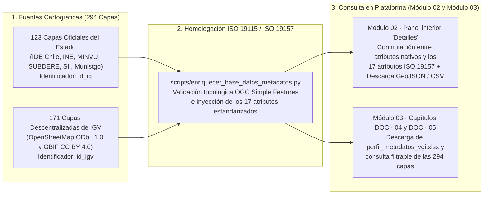

# Especificación del Perfil Homologado de Metadatos y Calidad Espacial (ISO 19115 / ISO 19157)
## Atlas para la Gestión Territorial — Análisis y Exploración | Municipio de Santiago y Barrio Brasil

---

## 1. Propósito del perfil homologado de 17 atributos

El **Atlas para la Gestión Territorial** articula un catálogo unificado de **294 coberturas cartográficas** compuesto por **123 capas oficiales del Estado de Chile (`id_ig`)** y **171 coberturas descentralizadas de Información Geográfica Voluntaria (`id_igv`)** provenientes de OpenStreetMap y GBIF, organizadas transversalmente en **5 dimensiones analíticas**.

Para que cualquier usuario pueda verificar de forma simple y directa el origen, la vigencia, la licencia y la calidad espacial de cada elemento geográfico sin recurrir a índices matemáticos complejos, todas las entidades vectoriales del Atlas incorporan un **perfil homologado de 17 atributos** basado en las normas internacionales **ISO 19115-1:2014** (Metadatos) e **ISO 19157:2013** (Calidad de datos espaciales).

Este perfil se consulta directamente en el panel inferior de **Detalles** del **Módulo 02 (`Explorar mapa`)** al hacer clic sobre cualquier punto, línea o polígono en el visor, y se encuentra documentado en el libro maestro descargable [`docs/perfil_metadatos_vgi.xlsx`](perfil_metadatos_vgi.xlsx).

---

## 2. Flujo de trabajo de estandarización e inspección en el panel `Detalles`

---

## 3. Estructura de los 17 atributos homologados (`id_ig` / `id_igv`)

| N° | Atributo en la entidad | Estándar ISO | Descripción operativa |
|:---:|:---|:---:|:---|
| **01** | `id_ig` / `id_igv` | ISO 19115 | Identificador único del elemento: **`id_ig`** para registros oficiales del Estado de Chile e **`id_igv`** para registros de Información Geográfica Voluntaria. |
| **02** | `nombre_capa` | ISO 19115 | Nombre oficial de la cobertura cartográfica dentro de las 294 capas del Atlas. |
| **03** | `dimension_analitica` | ISO 19115 | Adscripción a una de las 5 dimensiones analíticas: (1) *Sociodemográfica y Habitacional*, (2) *Socioeconómica y Comercial*, (3) *Socioambiental y Espacio Público*, (4) *Sociosanitaria y Salud*, o (5) *Sociourbana, Movilidad y Normativa*. |
| **04** | `tipo_fuente` | ISO 19115 | Clasificación del origen: `Información Geográfica Oficial (Estado de Chile)` o `Información Geográfica Voluntaria (IGV Descentralizada)`. |
| **05** | `institucion_custodia` | ISO 19115 | Organismo público responsable o comunidad colaborativa custodia (`OpenStreetMap Chile` / `GBIF`). |
| **06** | `sistema_referencia` | ISO 19115 | Sistema geodésico de referencia: `EPSG:4326 (WGS 84)` para visualización web y `EPSG:32719 (SIRGAS-Chile UTM 19S)` para cálculos métricos. |
| **07** | `escala_referencia` | ISO 19115 | Escala cartográfica de captura o restitución (`1:1.000` – `1:25.000`). |
| **08** | `fecha_actualizacion` | ISO 19115 | Fecha de vigencia o extracción verificada de los datos (`AAAA-MM-DD`). |
| **09** | `licencia_uso` | ISO 19115 | Marco legal aplicable: `Ley N.° 20.285 (Datos Abiertos del Estado)`, `ODbL 1.0 (OpenStreetMap)` o `CC BY 4.0 (GBIF)`. |
| **10** | `exactitud_posicional` | ISO 19157 | Evaluación de la precisión posicional planimétrica de la geometría. |
| **11** | `consistencia_topologica` | ISO 19157 | Estado de validez geométrica OGC (anillos cerrados, sin auto-intersecciones y conformidad RFC 7946). |
| **12** | `completitud` | ISO 19157 | Evaluación de presencia de atributos descriptivos y cobertura espacial en el área de estudio. |
| **13** | `exactitud_tematica` | ISO 19157 | Conformidad de la clasificación semántica o etiqueta temática asignada al objeto. |
| **14** | `consistencia_temporal` | ISO 19157 | Coherencia temporal del registro dentro del corte operativo del Atlas (2024–2026). |
| **15** | `linaje_fuente` | ISO 19157 | Trazabilidad del flujo de captura, extracción, reproyección y normalización. |
| **16** | `cobertura_territorial` | ISO 19115 | Ámbito geográfico cubierto (`Barrio Brasil`, `Comuna de Santiago` o `Región Metropolitana`). |
| **17** | `archivo_origen` | ISO 19115 | Ruta física del archivo GeoJSON dentro del repositorio (`data/<archivo>.geojson`). |
