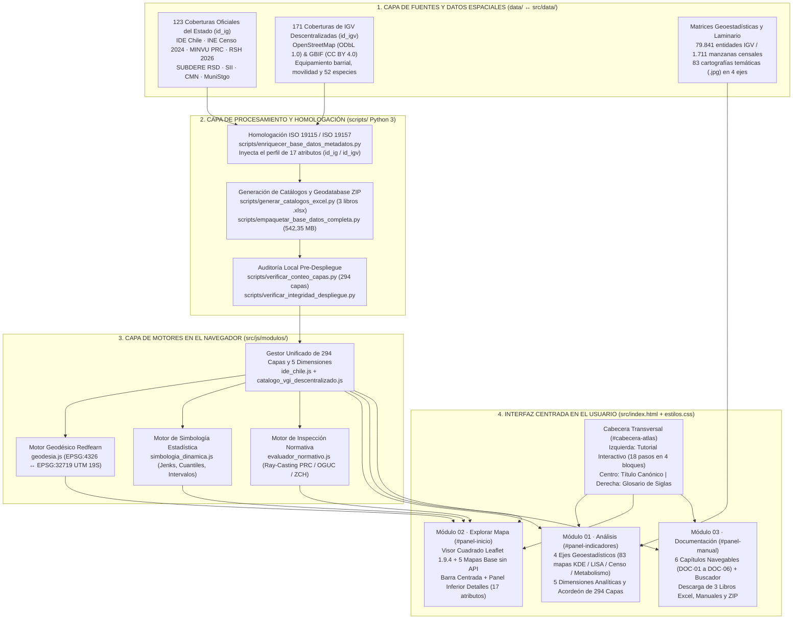
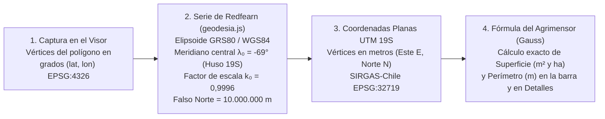

# Arquitectura del Sistema y Flujos de Trabajo — Atlas para la Gestión Territorial
## Análisis y Exploración | Municipio de Santiago y Barrio Brasil

* **Plataforma Web en Producción:** [https://atlasvgiuah.netlify.app](https://atlasvgiuah.netlify.app)
* **Repositorio Espejo (GitHub Pages):** [https://geojota.github.io/atlas-vgi-barrio-brasil/](https://geojota.github.io/atlas-vgi-barrio-brasil/)

---

## 1. Visión general de la arquitectura y principios de diseño del Prototipo 02

El **Atlas para la Gestión Territorial** está concebido como una Infraestructura de Datos Espaciales (IDE) local, pública y reproducible que integra **123 coberturas oficiales del Estado de Chile (`id_ig`)** y **171 coberturas descentralizadas de Información Geográfica Voluntaria (`id_igv`)** en una aplicación web de página única (*Single-Page Application*, SPA) construida en **HTML5 semántico, CSS3 adaptable y JavaScript modular (ES6+)** sin dependencia de compiladores pesados ni servidores propietarios.

### ¿Por qué se eligió esta arquitectura para el Prototipo 02?
Durante el desarrollo y evaluación del proyecto se definió un **prototipo sintetizado para usuarios no técnicos** que permite tanto a vecinas y vecinos como a profesionales municipales e investigadores interactuar de forma simple y directa con los datos territoriales, sustentado en cuatro principios arquitectónicos:
1. **Estructura clara en 3 módulos funcionales:** En lugar de dispersar herramientas en múltiples menús complejos, toda la plataforma se articula en tres vistas complementarias: **Módulo 01 · Análisis** (diagnóstico geoestadístico y exploración por dimensiones), **Módulo 02 · Explorar Mapa** (visor cartográfico cuadrado, simbología, normativa y detalles) y **Módulo 03 · Documentación** (manual navegable en 6 capítulos, descargas y catálogo).
2. **Descentralización temática de las 294 coberturas en 5 Dimensiones Analíticas:** Cada una de las 123 capas estatales y de las 171 capas colaborativas de IGV reside como un archivo `.geojson` independiente y validado en `src/data/` (con espejo exacto en `data/`), agrupado dentro de las **5 Dimensiones Analíticas** para que el navegador cargue en memoria únicamente las capas que el usuario decide encender.
3. **Cero dependencia de claves de API de terceros en los mapas base:** El visor utiliza exclusivamente **5 mosaicos cartográficos y satelitales de acceso directo** (OpenStreetMap Estándar, OpenStreetMap Humanitario HOT, Imagen Satelital Bing/Microsoft, Satelital Híbrido con Calles Bing/Microsoft e Imagen Satelital Esri World Imagery), eliminando riesgos de bloqueo por cuotas o caducidad de credenciales.
4. **Cálculo geodésico y normativo en el navegador del usuario (*Client-Side Geoprocessing*):** Tanto la transformación métrica a **SIRGAS-Chile / UTM Huso 19 Sur (`EPSG:32719`)** para medir superficies reales como la intersección espacial punto-en-polígono del **Inspector normativo (PRC)** se ejecutan instantáneamente en el navegador mediante algoritmos matemáticos propios (`geodesia.js` y `evaluador_normativo.js`).

---

## 2. Diagrama integral de arquitectura y flujos de trabajo de datos

El siguiente diagrama detalla cómo ingresan los datos desde los organismos públicos y las comunidades de mapeo colaborativo, cómo se homologan bajo estándares ISO/OGC y cómo se sirven en los 3 módulos de la plataforma web:

---

## 3. Anatomía detallada de los componentes de software (`src/`)

La totalidad de la aplicación web publicada en producción reside dentro del directorio `src/` (configurado mediante `publish = "src"` en `netlify.toml`). La siguiente tabla explica qué hace cada archivo del sistema y cómo se relaciona con los demás:

| Archivo en el Repositorio | Módulo Asociado | Descripción Clara de su Función Técnica |
| :--- | :---: | :--- |
| [`src/index.html`](../index.html) | Transversal (`SPA`) | Estructura semántica principal de la plataforma. Define la cabecera fija (`#cabecera-atlas`), la barra de navegación de los 3 módulos, los contenedores `#panel-indicadores` (Módulo 01), `#panel-inicio` (Módulo 02 con visor cuadrado y panel inferior `#panel-detalles-entidad`) y `#panel-manual` (Módulo 03), el modal del glosario y el pie de página de licencias. |
| [`src/css/estilos.css`](../css/estilos.css) | Transversal (`UI/UX`) | Hoja de estilos adaptable (*responsive*) para pantallas de escritorio, portátiles minimizadas, tablets y teléfonos móviles. Controla la proporción cuadrada del lienzo `#mapa`, la barra superior centrada de herramientas y las tarjetas de lectura de alto contraste. |
| [`src/js/config.js`](../js/config.js) | Configuración | Almacena las constantes globales del sistema: el título y subtítulo oficial inmutable, las cajas delimitadoras (`bbox`) y centroides de la Comuna de Santiago y del Barrio Brasil, la definición de las **5 Dimensiones Analíticas** y la versión de control de caché (`?v=...`). |
| [`src/js/app.js`](../js/app.js) | Orquestador | Coordina la conmutación entre los 3 módulos, asegura que el subtítulo institucional permanezca siempre sincronizado, administra la barra superior del visor, gestiona la apertura del Glosario de siglas y enlaza las acciones entre el Módulo 01, el Módulo 02 y el Módulo 03. |
| [`src/js/modulos/tutorial_interactivo.js`](../js/modulos/tutorial_interactivo.js) | Cabecera (Izquierda) | Implementa el **Tutorial Interactivo de 18 pasos distribuidos en 4 bloques navegables**. Cambia automáticamente de módulo cuando el usuario avanza entre bloques, resalta en pantalla cada herramienta y explica con lenguaje claro para qué sirve antes de recorrer sus controles internos. |
| [`src/js/modulos/indicadores_analisis.js`](../js/modulos/indicadores_analisis.js) | **Módulo 01 · Análisis** | Renderiza los **4 ejes de diagnóstico geoestadístico** con su visor Lightbox de **83 cartografías temáticas** (KDE, LISA, Demografía Censo 2024 y Metabolismo Urbano), las tarjetas de síntesis de las **5 Dimensiones Analíticas** y el acordeón buscador de las **294 capas** con botón de encendido directo en el mapa. |
| [`src/js/modulos/catalogo_vgi_descentralizado.js`](../js/modulos/catalogo_vgi_descentralizado.js) | Módulos 01, 02 y 03 | Define el catálogo estructurado de las **171 coberturas descentralizadas de Información Geográfica Voluntaria (`id_igv`)** provenientes de OpenStreetMap y GBIF, asignando a cada una su título en español, su dimensión analítica, su geometría, su color y su ruta `data/capa_*.geojson`. |
| [`src/js/modulos/ide_chile.js`](../js/modulos/ide_chile.js) | Módulos 01, 02 y 03 | Gestiona el catálogo de las **123 coberturas oficiales del Estado de Chile (`id_ig`)** y unifica la carga asíncrona bajo demanda (`fetch`) de las 294 capas totales hacia el visor, garantizando su correcta representación vectorial y atribución institucional. |
| [`src/js/modulos/mapa.js`](../js/modulos/mapa.js) | **Módulo 02 · Explorar Mapa** | Inicializa el motor cartográfico **Leaflet 1.9.4**, configura los **5 mapas base sin clave de API** (OSM Estándar, OSM HOT, Bing Satelital, Bing Híbrido con Calles y Esri World Imagery), controla la herramienta de delimitación de área, la exportación GeoJSON y la actualización del panel inferior **Detalles** con los **17 atributos homologados (`id_ig` / `id_igv`)**. |
| [`src/js/modulos/simbologia_dinamica.js`](../js/modulos/simbologia_dinamica.js) | **Módulo 02 · Explorar Mapa** | Motor estadístico en vivo que inspecciona los campos numéricos y nominales de las capas activas y calcula intervalos mediante **Cortes Naturales de Jenks**, Cuantiles, Intervalos Iguales, Desviación Estándar o Categorías Únicas, actualizando los colores del mapa y la leyenda. |
| [`src/js/modulos/evaluador_normativo.js`](../js/modulos/evaluador_normativo.js) | **Módulo 02 · Explorar Mapa** | Ejecuta bajo demanda el algoritmo geométrico de punto en polígono (*ray-casting*) sobre la zonificación del **Plan Regulador Comunal de Santiago (PRC)** y las capas de protección patrimonial (`ZCH`/`ICH`/CMN), emitiendo la ficha normativa y el Certificado de Informaciones Normativas (`.txt`). |
| [`src/js/modulos/geodesia.js`](../js/modulos/geodesia.js) | **Módulo 02 · Explorar Mapa** | Implementa las ecuaciones geodésicas de Redfearn para transformar en tiempo real coordenadas geográficas `EPSG:4326` (WGS 84) al sistema métrico plano oficial de Chile `EPSG:32719` (SIRGAS-Chile / UTM Huso 19 Sur), calculando áreas exactas en `m²` y `ha` mediante la fórmula de Gauss. |
| [`src/js/modulos/manual.js`](../js/modulos/manual.js) | **Módulo 03 · Documentación** | Construye los **6 capítulos navegables (`DOC · 01` a `DOC · 06`)** con buscador en tiempo real, tablas de objetivos y de los 9 hitos con entregable verificado asociado, guías de uso y actualización, descargas de los libros `.xlsx` y `.zip`, e inventario filtrable de las 294 capas. |
| [`src/js/modulos/licencias.js`](../js/modulos/licencias.js) | Módulo 03 y Pie de Página | Suministra las fichas jurídicas y enlaces verificables de las licencias abiertas (`CC BY 4.0`, `ODbL 1.0`, `Ley N.° 20.285` y `GNU AGPLv3`). |

---

## 4. Flujos de trabajo internos de los motores espaciales y estadísticos

Para comprender cómo procesa la información el Atlas sin depender de servidores externos durante la sesión del usuario, a continuación se explican sus cuatro flujos algorítmicos principales:

### 4.1. Flujo de carga bajo demanda (*Lazy Loading*) y homologación de los 17 atributos (`id_ig` / `id_igv`)
Si el navegador intentara descargar las 294 capas al mismo tiempo al abrir la página, la aplicación demoraría varios minutos en iniciar. Para evitarlo:
1. Al iniciar la plataforma, el sistema carga únicamente los catálogos livianos de metadatos (`catalogo_vgi_descentralizado.js` e `ide_chile.js`) y las capas base de referencia del Barrio Brasil y la Comuna de Santiago.
2. Cuando el usuario marca una casilla en el **Módulo 02** o pulsa *"Activar en el mapa"* desde un acordeón del **Módulo 01**, el controlador realiza una petición `fetch('data/<archivo>.geojson')`, almacena la capa en caché de memoria para no volver a descargarla en la misma sesión y la dibuja en el visor.
3. Al hacer clic sobre cualquier entidad dibujada, el controlador lee su bloque de **17 atributos homologados ISO 19115 / ISO 19157**, detecta si su identificador primario es **`id_ig`** (123 capas oficiales del Estado) o **`id_igv`** (171 capas colaborativas de IGV) y despliega la tabla completa en el panel inferior **Detalles**.

### 4.2. Flujo de transformación geodésica (`EPSG:4326` ↔ `EPSG:32719`) en `geodesia.js`
Los estándares web (como GeoJSON RFC 7946 y Leaflet) almacenan las coordenadas en grados de latitud y longitud sobre el elipsoide `WGS 84 (EPSG:4326)`. Sin embargo, calcular áreas directamente en grados produce distorsiones importantes a la latitud de Santiago (`-33,44° S`). Por ello, cuando el usuario utiliza la herramienta **Delimitar área**:

### 4.3. Flujo de clasificación estadística en vivo (`simbologia_dinamica.js`)
Cuando el usuario selecciona un atributo numérico en el panel de **Simbología Dinámica** y elige el método **Cortes Naturales de Jenks**:
1. El motor extrae el vector de valores numéricos válidos $X = \{x_1, x_2, \dots, x_n\}$ de todas las entidades de la capa activa.
2. Ejecuta programación dinámica mediante las matrices de varianza de Fisher-Jenks para encontrar los $k$ cortes de clase ($3 \le k \le 7$) que **minimizan la suma de desviaciones cuadráticas dentro de cada clase (SDCM)** y **maximizan la varianza entre clases distintas (GVF)**.
3. Asigna a cada intervalo el color correspondiente de la rampa seleccionada y actualiza simultáneamente los polígonos/puntos en el visor y los rangos numéricos de la leyenda.

### 4.4. Flujo de evaluación urbanística en el `Inspector normativo (PRC)` (`evaluador_normativo.js`)
Cuando el usuario activa el botón **Inspector normativo (PRC)** en la barra superior del Módulo 02 y hace clic sobre un punto $(lon, lat)$ del mapa:
1. El módulo ejecuta un algoritmo geométrico de trazado de rayos horizontal (*Ray-Casting Point-in-Polygon*) contra los anillos exteriores e interiores de los polígonos de zonificación del Plan Regulador Comunal de Santiago (`ide_minvu_ipt_prc_santiago.geojson`) y de las capas patrimoniales (`ZCH`, `ICH` y Monumentos Nacionales).
2. Recupera el código de zona (por ejemplo, `Zona A`, `Zona B`, `Zona D - Conservación Histórica`) y consulta el diccionario normativo de la Ordenanza Local y de la OGUC.
3. Renderiza en el panel inferior la ficha completa de edificabilidad (altura máxima, constructibilidad, ocupación de suelo, agrupamiento, usos permitidos y prohibidos) y habilita la descarga inmediata del **Certificado de Informaciones Normativas (`.txt`)**.

---

## 5. Arquitectura de despliegue continuo, sincronización simétrica y respaldo PostGIS

Para asegurar que la plataforma opere con máxima velocidad y sin caídas ni tiempos de espera excesivos durante las actualizaciones, el repositorio implementa una arquitectura de **doble espejo local (`data/` ↔ `src/data/` y `docs/` ↔ `src/docs/`)** combinada con **auditoría local pre-despliegue** y respaldo relacional en **PostgreSQL 17 / PostGIS 3.3**:

| Nivel de Infraestructura | Tecnología / Configuración | Función y Ventaja Operativa |
| :--- | :--- | :--- |
| **Publicación Primaria (CDN)** | **Netlify** (`netlify.toml` con `publish = "src"`) | Sirve directamente los archivos estáticos de `src/` con compresión Brotli/Gzip y cabeceras CORS habilitadas para `/data/*.geojson`. Al ejecutar las auditorías pesadas en local antes del commit, el despliegue en Netlify tarda menos de 30 segundos y nunca sufre errores de *timeout*. |
| **Publicación Espejo** | **GitHub Pages** (`espejo/main`) | Mantiene una réplica pública sincronizada de la aplicación y de las 294 coberturas para redundancia institucional y académica. |
| **Base de Datos Espacial en la Nube** | **PostgreSQL 17 + PostGIS 3.3** (`scripts/db/01_schema_postgis.sql` y `02_seed_metadata.sql`) | Provee almacenamiento relacional indexado con `GiST` (geometrías en `EPSG:4326` y `EPSG:32719`) y `GIN` (atributos `JSONB` con `id_ig` / `id_igv`), mantenido activo mediante el flujo `.github/workflows/supabase_keepalive.yml`. |
| **Paquete Offline Autónomo** | [`docs/geodatabase_completa_atlas_vgi.zip`](geodatabase_completa_atlas_vgi.zip) (`542,35 MB`) | Permite descargar en un solo archivo comprimido la totalidad de las 294 capas GeoJSON, las matrices censales/barriales, los 3 libros Excel y los manuales para uso desconectado en cualquier SIG de escritorio. |
