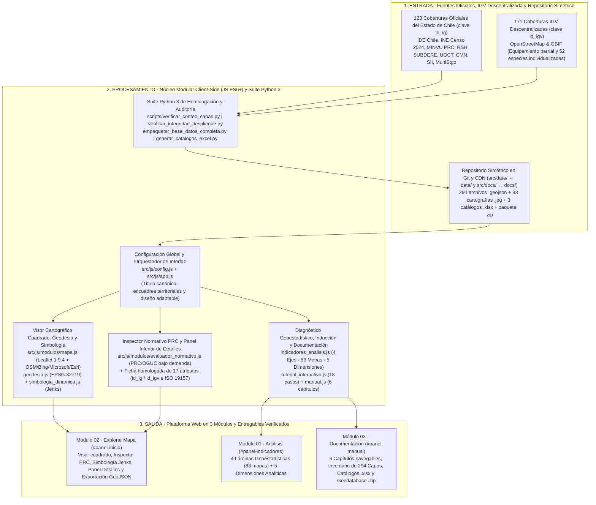
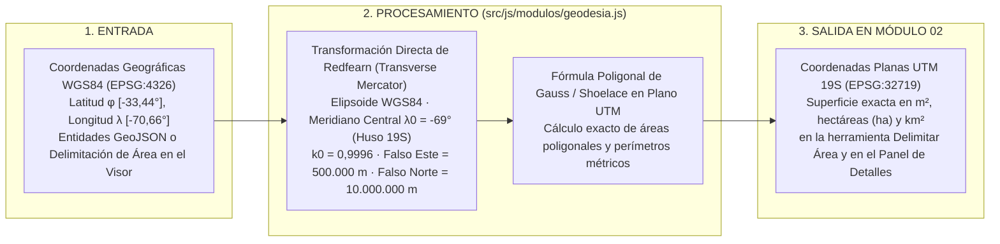
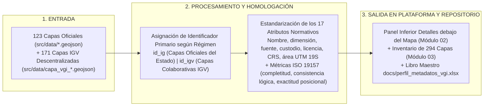
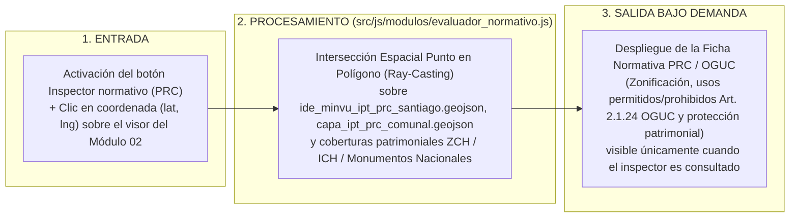

# Arquitectura de Software y Flujos de Trabajo — Atlas para la Gestión Territorial
### Análisis y Exploración | Municipio de Santiago y Barrio Brasil

* **Plataforma Web en Producción (CDN Primario):** [https://atlasvgiuah.netlify.app](https://atlasvgiuah.netlify.app)
* **Repositorio Espejo (GitHub Pages):** [https://geojota.github.io/atlas-vgi-barrio-brasil/](https://geojota.github.io/atlas-vgi-barrio-brasil/)
* **Alcance Arquitectónico:** 294 Capas Operativas (`123` Oficiales con clave `id_ig` + `171` de Información Geográfica Voluntaria, IGV, descentralizadas con clave `id_igv`) · Perfil homologado de 17 atributos (ISO 19115 / ISO 19157) · 5 Dimensiones Analíticas · 4 Ejes de Diagnóstico Geoestadístico (83 Cartografías) · 3 Módulos Operacionales (`Análisis`, `Explorar Mapa`, `Documentación`) · Tutorial Interactivo de 18 pasos · 5 Mapas Base sin requerimiento de API (OpenStreetMap, Bing/Microsoft y Esri).

---

## 1. Principios de diseño y arquitectura general del sistema

El **Atlas para la Gestión Territorial** implementa una **arquitectura web estática, modular y autónoma (*Client-Side GIS* en JavaScript ES6+)** sincronizada con un repositorio cartográfico simétrico (`data/` ↔ `src/data/` y `docs/` ↔ `src/docs/`) para garantizar velocidad de respuesta inmediata, ausencia de tiempos muertos de compilación y funcionamiento fluido en cualquier dispositivo o tamaño de ventana.

### Principios rectores de ingeniería:
1. **Prototipo Sintetizado en 3 Módulos Funcionales:** Estructura modular intuitiva compuesta por **Módulo 01 · Análisis**, **Módulo 02 · Explorar Mapa** y **Módulo 03 · Documentación**, diseñada para que tanto usuarios sin experiencia técnica como analistas territoriales interactúen de forma directa con las 294 coberturas y las 83 cartografías temáticas.
2. **Doble Proyección Geodésica en el Cliente (`EPSG:4326` ↔ `EPSG:32719`):** Todas las capas vectoriales se sirven en formato `GeoJSON` bajo coordenadas geográficas `EPSG:4326` (WGS84, RFC 7946) para su representación en Leaflet 1.9.4, mientras que los cálculos de superficie (`m²`, `ha`, `km²`) y perímetros se ejecutan previa reproyección al vuelo a UTM Huso 19 Sur (`EPSG:32719` / SIRGAS-Chile) mediante la serie trigonométrica de Redfearn en `src/js/modulos/geodesia.js`.
3. **Homologación Universal de 17 Atributos (`id_ig` / `id_igv`):** Tanto las 123 capas oficiales del Estado como las 171 capas colaborativas de IGV comparten el mismo esquema tabular de 17 atributos y métricas de calidad ISO 19157, distinguiendo explícitamente la clave primaria `id_ig` (Información Geográfica Oficial) frente a `id_igv` (Información Geográfica Voluntaria) en el panel inferior de **Detalles**.
4. **Mapas Base 100 % Libres de Claves de API:** El visor prescinde de proveedores que exigen tokens comerciales (como Carto) e integra 5 capas base abiertas y satelitales de alta disponibilidad: OpenStreetMap Estándar, OpenStreetMap Humanitario (HOT), Imagen Satelital Bing/Microsoft (QuadKey nativo), Satelital Híbrido con Calles Bing/Microsoft e Imagen Satelital Esri World Imagery.

---

## 2. Diagrama maestro de arquitectura de tres capas

---

## 3. Flujos de trabajo especializados por subsistema técnico

### 3.1. Flujo geodésico de doble proyección (`EPSG:4326` ↔ `EPSG:32719`)

### 3.2. Flujo de homologación del perfil de 17 atributos (`id_ig` / `id_igv`) e inspección en el Panel de Detalles

### 3.3. Flujo del Inspector Normativo PRC / OGUC bajo demanda (Módulo 02)

---

## 4. Catálogo de componentes de la plataforma

### 4.1. Capa de presentación y estilos adaptables (`HTML5` y `CSS3`)

| Lenguaje | Ruta en el Repositorio | Rol Funcional | Componentes Clave |
| :---: | :--- | :--- | :--- |
| HTML5 | [`src/index.html`](src/index.html) | Documento maestro SPA que estructura la cabecera institucional (con **Tutorial interactivo** a la izquierda del título y **Glosario de siglas** a la derecha), la barra de los 3 módulos (*Análisis*, *Explorar mapa*, *Documentación*), el visor cuadrado con su barra de herramientas centrada, el panel inferior **Detalles** y el pie de página con licencias actualizadas. | Contiene `#cabecera-atlas`, `#panel-indicadores` (Módulo 01), `#panel-inicio` (Módulo 02) y `#panel-manual` (Módulo 03). |
| CSS3 | [`src/css/estilos.css`](src/css/estilos.css) | Sistema de diseño adaptable a cualquier dispositivo y estado de ventana (pantallas maximizadas, minimizadas, divididas, tablets y móviles), estilos del visor cuadrado (`#mapa-atlas`), barra de herramientas centrada (`.barra-herramientas-mapa`) y tarjeta navegable del tutorial interactivo. | Define variables cromáticas en `:root`, grillas fluidas y reglas `@media` responsivas. |

### 4.2. Controladores principales en JavaScript ES6+ (`src/js/`)

| N° | Archivo JavaScript (`src/js/`) | Objeto Global | Responsabilidad Técnica |
| :---: | :--- | :--- | :--- |
| `01` | [`src/js/config.js`](src/js/config.js) | `window.NODO_CONFIG` | Configuración global: título y subtítulo canónicos inmutables, cajas delimitadoras de Barrio Brasil y Comuna de Santiago, y definición de las 5 dimensiones analíticas. |
| `02` | [`src/js/app.js`](src/js/app.js) | Controlador Principal | Orquestación de los 3 módulos, sincronización del panel inferior **Detalles** con el perfil homologado de 17 atributos (`id_ig` / `id_igv`) y exportación de datos. |
| `03` | [`src/js/modulos/mapa.js`](src/js/modulos/mapa.js) | `window.ModuloMapa` | Controlador del visor Leaflet 1.9.4: 5 mapas base (OpenStreetMap Estándar y HOT, Bing/Microsoft Satelital e Híbrido via QuadKey y Esri World Imagery), renderizado vectorial y herramienta de delimitación de área. |
| `04` | [`src/js/modulos/simbologia_dinamica.js`](src/js/modulos/simbologia_dinamica.js) | `window.ModuloSimbologiaDinamica` | Motor estadístico en el navegador para clasificación por Cortes Naturales de Jenks, Cuantiles, Intervalos Iguales, Desviación Estándar y paletas por dimensión. |
| `05` | [`src/js/modulos/indicadores_analisis.js`](src/js/modulos/indicadores_analisis.js) | `window.ModuloIndicadoresAnalisis` | Motor del Módulo 01: renderiza las 4 láminas de diagnóstico geoestadístico (83 cartografías), las tarjetas de las 5 dimensiones analíticas y el acordeón explorador de las 294 capas. |
| `06` | [`src/js/modulos/catalogo_vgi_descentralizado.js`](src/js/modulos/catalogo_vgi_descentralizado.js) | `window.CATALOGO_VGI_DESCENTRALIZADO` | Catálogo estructurado de las 171 coberturas descentralizadas de Información Geográfica Voluntaria (`id_igv`) en español. |
| `07` | [`src/js/modulos/ide_chile.js`](src/js/modulos/ide_chile.js) | `window.ModuloIDEChile` | Catálogo y cargador de las 123 coberturas oficiales del Estado de Chile (`id_ig`), organizadas en las 5 dimensiones analíticas. |
| `08` | [`src/js/modulos/evaluador_normativo.js`](src/js/modulos/evaluador_normativo.js) | `window.ModuloEvaluadorNormativo` | Motor del Inspector Normativo PRC Santiago / OGUC activable bajo demanda sobre el visor del Módulo 02. |
| `09` | [`src/js/modulos/geodesia.js`](src/js/modulos/geodesia.js) | `window.ModuloGeodesia` | Transformación geodésica `EPSG:4326` ↔ `EPSG:32719` (Redfearn) y cálculo de superficies exactas en `m²`, `ha` y `km²`. |
| `10` | [`src/js/modulos/tutorial_interactivo.js`](src/js/modulos/tutorial_interactivo.js) | `window.ModuloTutorialInteractivo` | Tutorial interactivo navegable de 18 pasos con pestañas por módulo, selector numérico directo de pasos y presentación previa de cada módulo. |
| `11` | [`src/js/modulos/manual.js`](src/js/modulos/manual.js) | `window.ModuloManual` | Motor del Módulo 03: renderiza los 6 capítulos navegables de documentación, buscador en tiempo real, descargas y tabla filtrable de las 294 capas. |
| `12` | [`src/js/modulos/licencias.js`](src/js/modulos/licencias.js) | `window.ModuloLicencias` | Gestión del marco jurídico abierto (`CC BY 4.0`, `CC BY-SA 4.0`, `ODbL 1.0`, `GNU AGPLv3`, Ley N° 20.285 / Ley N° 21.180) y descargas maestras. |
