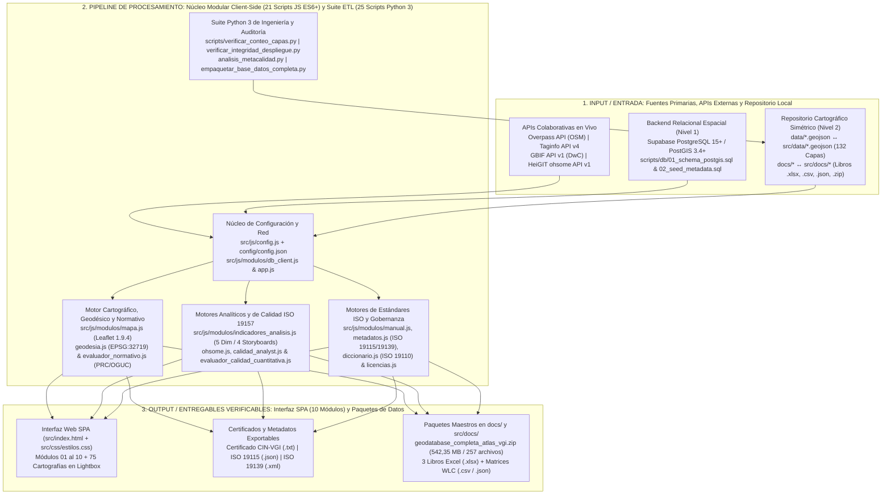
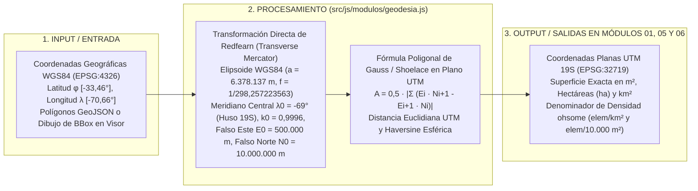
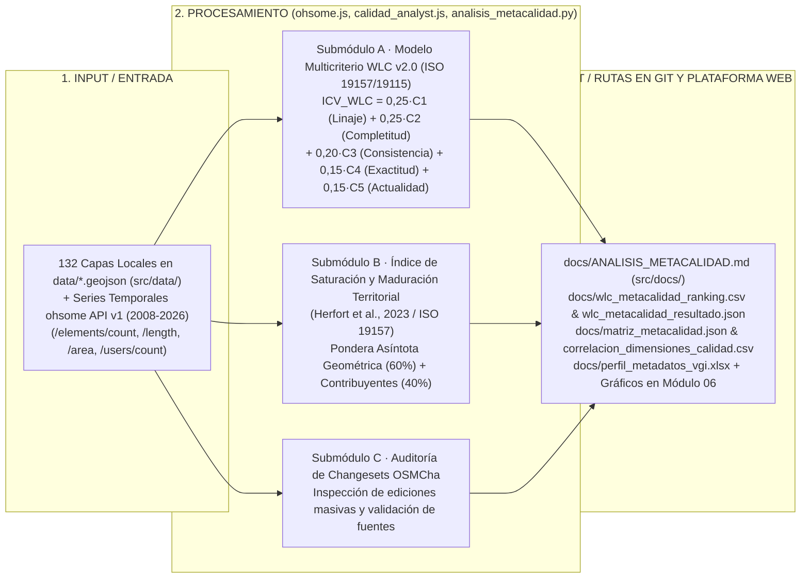
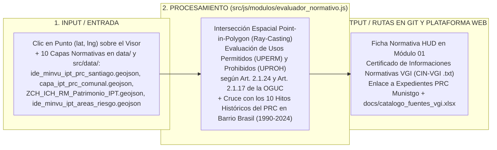

# Arquitectura de Software, Pipelines de Datos y Catálogo Multi-Lenguaje — Atlas VGI

* **Plataforma Web en Producción (CDN Primario):** [https://atlasvgiuah.netlify.app](https://atlasvgiuah.netlify.app)
* **Repositorio Espejo (GitHub Pages):** [https://geojota.github.io/atlas-vgi-barrio-brasil/](https://geojota.github.io/atlas-vgi-barrio-brasil/)
* **Alcance Arquitectónico:** **132 Capas Operativas** (`122` Oficiales + `10` VGI) · **140 Descriptores ISO 19110:2016** · **5 Dimensiones Analíticas** · **4 Storyboards (75 Cartografías)** · **10 Módulos (`01` al `10`)** · **21 Módulos JS ES6+ (IIFE)** · **25 Scripts Python 3** · **Esquema Relacional PostGIS**.

---

## 1. Principios de Diseño y Arquitectura General del Sistema

El **Atlas de Información Geográfica Voluntaria (VGI)** implementa una **arquitectura web estática, modular y autónoma (*Zero-Build Client-Side GIS*)** articulada con un backend relacional opcional en **PostgreSQL 15+ / PostGIS 3.4+ (Supabase)** y un repositorio local espejo de alta disponibilidad (`data/` ↔ `src/data/` y `docs/` ↔ `src/docs/`).

### Principios Rectores de Ingeniería:
1. **Ejecución Nativa sin Empaquetadores Complejos (*No-Bundle ES6+ IIFE*):** El código cliente se estructura en **21 módulos JavaScript ES6+** bajo el **Patrón de Módulo Revelador (*Immediately Invoked Function Expression*, IIFE)** expuestos en el espacio de nombres `window.Modulo*`. Esto elimina vulnerabilidades por obsolescencia de dependencias `node_modules` y permite auditar o modificar cualquier archivo directamente en un editor de texto.
2. **Doble Proyección Geodésica en el Cliente (`EPSG:4326` ↔ `EPSG:32719`):** Todas las capas vectoriales se almacenan e intercambian en formato `GeoJSON` bajo coordenadas geográficas `EPSG:4326` (WGS84, RFC 7946) para su representación en **Leaflet 1.9.4**, mientras que los cálculos de superficie (`m²`, `ha`, `km²`), perímetros y distancias euclidianas se ejecutan previa reproyección al vuelo a **UTM Huso 19 Sur (`EPSG:32719` / SIRGAS-Chile)** mediante la serie trigonométrica de Redfearn en `src/js/modulos/geodesia.js`.
3. **Arquitectura de Persistencia de Triple Nivel (*Triple-Tier Failover*):** El cliente de datos (`src/js/modulos/db_client.js`, `src/js/modulos/ide_chile.js` y `src/js/modulos/osm.js`) resuelve las consultas espaciales con degradación elegante automática:
   * **Nivel 1 (RPC / API Remota):** Funciones espaciales PostGIS en Supabase (`rpc/obtener_entidades_en_bbox`), Overpass API (3 servidores en failover), GBIF API v1 y HeiGIT ohsome API v1.
   * **Nivel 2 (CDN Estático Simétrico):** Archivos preprocesados en `src/data/*.geojson` (sincronizados byte a byte con `data/*.geojson`), servidos con compresión Brotli/Gzip desde Netlify y GitHub Pages.
   * **Nivel 3 (Caché en Memoria RAM del Navegador):** Diccionarios indexados en memoria (`capasOficialesCargadas`, `capasCargadasPorCategoria`) que evitan descargas redundantes durante la sesión.

---

## 2. Pipeline Maestro de Arquitectura de Tres Capas

---

## 3. Pipelines Especializados por Subsistema Técnico (`INPUT` → `PROCESAMIENTO` → `OUTPUT`)

### 3.1. Pipeline Geodésico de Doble Proyección (`EPSG:4326` ↔ `EPSG:32719`)

### 3.2. Pipeline de Evaluación de Calidad Espacial WLC v2.0 e Índice de Saturación Territorial (Módulo 06)

### 3.3. Pipeline del Inspector Normativo PRC/OGUC y Certificado CIN-VGI (Módulo 01)

---

## 4. Catálogo Estandarizado Multi-Lenguaje de la Plataforma

Cada archivo del repositorio cumple un contrato técnico explícito según su lenguaje de programación o especificación de datos:

### 4.1. Capa de Presentación y Estructura DOM (`HTML5` y `CSS3`)

| Lenguaje | Ruta en el Repositorio | Rol Funcional | Componentes Clave y Protocolo de Modificación |
| :---: | :--- | :--- | :--- |
| **HTML5** | [`src/index.html`](src/index.html) | Documento maestro SPA (`1.758` líneas) que estructura las 10 pestañas (`01` a `10`), el visor 2D, acordeones de las 122 capas oficiales, modales de Storyboards, Lightbox y el modal de descarga de la Geodatabase. | Contiene las secciones `<section class="panel" id="panel-...">`, los botones `.chip-oficial[data-capa]` y la carga secuencial de los 21 scripts con parámetro de invalidación de caché `?v=20261026_v13`. |
| **CSS3** | [`src/css/estilos.css`](src/css/estilos.css) | Sistema de diseño visual (`>4.500` líneas) con variables nativas en `:root`, modo oscuro de alto contraste (WCAG 2.1 AA), grillas responsivas y estilos de impresión para certificados normativos. | Define tokens cromáticos (`--papel`, `--tinta`, `--esmeralda`, `--ocre`), clases `.lamina-storyboard-modal`, `.lightbox-figura-overlay` y reglas `@media` para escritorio, tablet y móvil. |

### 4.2. Capa de Lógica de Aplicación Client-Side (`21 Scripts JavaScript ES6+ IIFE`)

| N° | Archivo JavaScript (`src/js/`) | Objeto Global Expuesto | Responsabilidad Técnica y Entradas / Salidas |
| :---: | :--- | :--- | :--- |
| `01` | [`src/js/config.js`](src/js/config.js) | `window.NODO_CONFIG` | Configuración síncrona del nodo: BBox barrial y comunal, las 52 comunas de la RM, endpoints API y definición de las **10 macrocategorías VGI (`CAT-01` a `CAT-10`)**. |
| `02` | [`src/js/modulos/geodesia.js`](src/js/modulos/geodesia.js) | `window.ModuloGeodesia` | Transformación geodésica `EPSG:4326` ↔ `EPSG:32719` (Redfearn), cálculo de áreas poligonales Gauss/Shoelace (`m²`, `ha`, `km²`) y distancias Haversine/UTM. |
| `03` | [`src/js/modulos/db_client.js`](src/js/modulos/db_client.js) | `window.NodoDB` | Cliente de persistencia híbrida con failover automático entre PostgreSQL/PostGIS en Supabase (RPC) y los archivos locales en `src/data/`. |
| `04` | [`src/js/modulos/mapa.js`](src/js/modulos/mapa.js) | `window.ModuloMapa` | Controlador del lienzo Leaflet 1.9.4: teselas base CartoDB/OSM/Esri, renderizado vectorial GeoJSON, simbología por categoría, WMS OGC y herramienta de dibujo de BBox. |
| `05` | [`src/js/modulos/osm.js`](src/js/modulos/osm.js) | `window.ModuloOSM` | Cliente Overpass API con failover entre 3 instancias, constructor de consultas Overpass QL, reconstrucción topológica de nodos/vías y normalización a 14 atributos. |
| `06` | [`src/js/modulos/taginfo.js`](src/js/modulos/taginfo.js) | `window.ModuloTaginfo` | Cliente REST de Taginfo API v4 para verificar frecuencia global de etiquetas `key=value`, combinaciones semánticas y cobertura en la wiki de OSM. |
| `07` | [`src/js/modulos/ohsome.js`](src/js/modulos/ohsome.js) | `window.ModuloOhsome` | Cliente de series históricas HeiGIT ohsome API v1/v2 (`2008–2026`), cálculo de densidad `elem/km²`, `elem/10.000 m²`, `edit/user` e **Índice de Saturación y Maduración Territorial (Herfort et al., 2023 / ISO 19157)**. |
| `08` | [`src/js/modulos/calidad_analyst.js`](src/js/modulos/calidad_analyst.js) | `window.ModuloCalidadAnalyst` | Motor analítico complementario de calidad VGI, curvas de crecimiento asintótico y cruce con auditoría de conjuntos de cambios en OSMCha. |
| `09` | [`src/js/modulos/evaluador_calidad_cuantitativa.js`](src/js/modulos/evaluador_calidad_cuantitativa.js) | `window.ModuloEvaluadorCalidad` | **Submódulo A del Módulo 06:** Evaluador Universal de Calidad Cuantitativa (WLC v2.0 bajo ISO 19157 e ISO 19115) para las 132 capas del catálogo o archivos `.geojson` externos. |
| `10` | [`src/js/modulos/gbif.js`](src/js/modulos/gbif.js) | `window.ModuloGBIF` | Cliente de GBIF API v1 para consulta y mapeo de ocurrencias de biodiversidad urbana bajo el estándar **Darwin Core (DwC)**. |
| `11` | [`src/js/modulos/umap.js`](src/js/modulos/umap.js) | `window.ModuloUMap` | Gestor de proyectos de cartografía colaborativa uMap e inyección de capas ciudadanas en el visor principal. |
| `12` | [`src/js/modulos/importador_capas.js`](src/js/modulos/importador_capas.js) | `window.ImportadorCapas` | Analizador sintáctico local (*Drag & Drop*) para archivos `.geojson`, `.kml`, `.kmz`, `.gpx` y `.csv` georreferenciados. |
| `13` | [`src/js/modulos/ide_chile.js`](src/js/modulos/ide_chile.js) | `window.ModuloIDEChile` | Catálogo maestro y cargador asíncrono de las **122 coberturas oficiales del Estado de Chile** (`CAPAS_OFICIALES`), con soporte GeoJSON local y servicios WMS OGC. |
| `14` | [`src/js/modulos/evaluador_normativo.js`](src/js/modulos/evaluador_normativo.js) | `window.ModuloEvaluadorNormativo` | Motor del Inspector Normativo PRC/PRMS/OGUC (algoritmo *Ray-Casting*), generador del **Certificado CIN-VGI** y repositorio de los **10 hitos históricos del PRC en Barrio Brasil (1990–2024)**. |
| `15` | [`src/js/modulos/indicadores_analisis.js`](src/js/modulos/indicadores_analisis.js) | `window.ModuloIndicadoresAnalisis` | Motor del **Módulo 05**: estructura las **5 Dimensiones Analíticas** (132 capas) y renderiza los **4 Storyboards Territoriales (75 cartografías)**, diagramas SVG y el visor Lightbox. |
| `16` | [`src/js/modulos/manual.js`](src/js/modulos/manual.js) | `window.ModuloManual` | Motor del **Módulo 07**: renderiza interactivamente el Manual de Uso (`USO · 01` a `04` con tabla filtrable de las 132 capas) y el Manual de Actualización Técnica (`ACT · 01` a `05`). |
| `17` | [`src/js/modulos/metadatos.js`](src/js/modulos/metadatos.js) | `window.ModuloMetadatos` | Motor del **Módulo 08**: autocompletado de fichas para las 132 capas y exportación conforme a **ISO 19115 (`.json`)** e **ISO 19139 / Perfil Nacional IDE Chile (`.xml`)**. |
| `18` | [`src/js/modulos/diccionario.js`](src/js/modulos/diccionario.js) | `window.ModuloDiccionario` | Motor del **Módulo 09**: catálogo de **140 descriptores normativos ISO 19110:2016**, homologación institucional e identificación de las **86 brechas temáticas VGI**. |
| `19` | [`src/js/modulos/licencias.js`](src/js/modulos/licencias.js) | `window.ModuloLicencias` | Motor del **Módulo 10**: comparador de licencias abiertas (`ODbL 1.0`, `CC BY-SA 4.0`, `Ley N° 20.285`, `Ley N° 19.628`) y panel de descarga de los libros `.xlsx` y `.zip`. |
| `20` | [`src/js/modulos/territorio.js`](src/js/modulos/territorio.js) | `window.ModuloTerritorio` | Síntesis contextual del área de estudio (Barrio Brasil, Campus UAH y Comuna de Santiago) e indicadores base de superficie y población. |
| `21` | [`src/js/app.js`](src/js/app.js) | Controlador Principal | Orquestador del ciclo de vida `DOMContentLoaded`, navegación entre los 10 paneles, cálculo del **ICV Dinámico** (`actualizarTelemetriaCapasActivas`) y exportación de datos. |

### 4.3. Capa de Datos, Configuración y Backend Relacional (`JSON`, `GeoJSON`, `GPKG`, `SQL`, `TOML`)

| Formato / Lenguaje | Rutas en el Repositorio | Función en la Arquitectura |
| :---: | :--- | :--- |
| **JSON / TOML** | [`config/config.json`](config/config.json), [`netlify.toml`](netlify.toml) | Configuración declarativa de BBox y categorías VGI; reglas de publicación CDN (`publish = "src"`), cabeceras CORS (`Access-Control-Allow-Origin: *`), tipos MIME para `.geojson`/`.gpkg` y redirecciones HTTP. |
| **SQL / PostGIS** | [`scripts/db/01_schema_postgis.sql`](scripts/db/01_schema_postgis.sql), [`scripts/db/02_seed_metadata.sql`](scripts/db/02_seed_metadata.sql) | Definición DDL de tablas relacionales (`catalogo_capas`, `entidades_vgi`, `metricas_calidad_iso19157`), índices espaciales `GiST` (`EPSG:4326` y `EPSG:32719`), índices `GIN` sobre `JSONB`, políticas RLS y funciones RPC. |
| **GeoJSON / GPKG** | `data/*.geojson` ↔ `src/data/*.geojson` | **132 coberturas operativas** del visor y capas regionales de respaldo en formato `RFC 7946` (`EPSG:4326`), acompañadas por las bases relacionales SQLite/GeoPackage (`.gpkg`) en `docs/geodatabase_completa_atlas_vgi.zip`. |

### 4.4. Suite de Ingeniería ETL, Calidad y Verificación (`25 Scripts Python 3` en `scripts/`)

| Grupo Funcional | Scripts Principales en `scripts/` | Entregables Generados / Verificados |
| :--- | :--- | :--- |
| **1. Auditoría y Verificación Pre-Deploy** | `verificar_conteo_capas.py`, `verificar_integridad_despliegue.py`, `auditoria_exhaustiva_capas.py` | Validan la paridad exacta de las **132 capas** (`122` oficiales + `10` VGI), los **140 descriptores ISO 19110**, la ausencia de punteros Git LFS y la sincronización `data/` ↔ `src/data/`. |
| **2. Modelamiento de Calidad WLC (ISO 19157/19115)** | `analisis_metacalidad.py`, `modelo_indice_lineal_wlc.py` | Calculan las 5 dimensiones de calidad y generan `docs/ANALISIS_METACALIDAD.md`, `docs/wlc_metacalidad_ranking.csv`, `docs/wlc_metacalidad_resultado.json`, `docs/matriz_metacalidad.json` y `docs/correlacion_dimensiones_calidad.csv` (`.png`). |
| **3. Ingesta VGI, IDE y Reproyección** | `descargar_todas_las_categorias_osm.py`, `procesar_geofabrik_rm.py`, `integrar_nuevas_capas_2026.py`, `integrar_subdere_rsd_2024.py`, `reproyectar_capas_stgo.py` | Extraen, normalizan y reproyectan a `EPSG:4326` las capas barriales y regionales en `data/` y `src/data/`. |
| **4. Generación de Libros Excel, Manuales y Geodatabase** | `generar_catalogos_excel.py`, `empaquetar_base_datos_completa.py`, `construir_manual_actualizacion_maestro.py` (`manual_p01` a `manual_p08`) | Generan los 3 libros `.xlsx` en `docs/` y `src/docs/`, el paquete `docs/geodatabase_completa_atlas_vgi.zip` (`542,35 MB`) y el `MANUAL_ACTUALIZACION_ATLAS.md`. |
