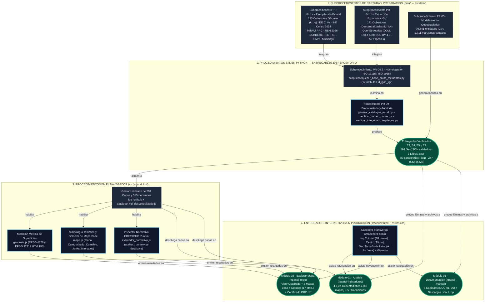

# Arquitectura del Sistema y Flujos de Trabajo — Atlas para la Gestión Territorial
## Análisis y Exploración | Municipio de Santiago y Barrio Brasil

* **Plataforma Web en Producción:** [https://atlasvgiuah.netlify.app](https://atlasvgiuah.netlify.app)
* **Repositorio Espejo (GitHub Pages):** [https://geojota.github.io/atlas-vgi-barrio-brasil/](https://geojota.github.io/atlas-vgi-barrio-brasil/)

---

## 1. Visión general de la arquitectura y principios de diseño del Prototipo 02

El **Atlas para la Gestión Territorial** está concebido como una Infraestructura de Datos Espaciales (IDE) local, pública y reproducible que integra **123 coberturas oficiales del Estado de Chile (`id_ig`)** y **171 coberturas descentralizadas de Información Geográfica Voluntaria (`id_igv`)** en una aplicación web construida en **HTML5 semántico, CSS3 adaptable y JavaScript modular** sin dependencia de instalaciones complejas ni servidores propietarios.

### ¿Por qué se eligió esta estructura para el Prototipo 02?
Durante el desarrollo y evaluación del proyecto se definió un **prototipo sintetizado para usuarios no técnicos** que permite tanto a vecinas y vecinos como a profesionales municipales e investigadores interactuar de forma simple y directa con los datos territoriales, sustentado en cuatro principios:
1. **Estructura clara en 3 módulos funcionales:** En lugar de dispersar herramientas en múltiples menús complejos, toda la plataforma se articula en tres vistas complementarias: **Módulo 01 · Análisis** (diagnóstico geoestadístico y exploración por dimensiones), **Módulo 02 · Explorar Mapa** (visor cartográfico cuadrado, simbología, normativa y detalles) y **Módulo 03 · Documentación** (manual navegable en 6 capítulos, descargas y catálogo).
2. **Descentralización temática de las 294 coberturas en 5 Dimensiones Analíticas:** Cada una de las 123 capas estatales y de las 171 capas colaborativas de IGV reside como un archivo `.geojson` independiente y validado en `src/data/` (con espejo exacto en `data/`), agrupado dentro de las **5 Dimensiones Analíticas** para que el navegador cargue únicamente las capas que el usuario decide encender.
3. **Cero dependencia de claves de API de terceros en los mapas base:** El visor utiliza exclusivamente **5 mosaicos cartográficos y satelitales de acceso directo** (OpenStreetMap Estándar, OpenStreetMap Humanitario HOT, Imagen Satelital Bing/Microsoft, Satelital Híbrido con Calles Bing/Microsoft e Imagen Satelital Esri World Imagery), eliminando riesgos de bloqueo por cuotas o caducidad de credenciales.
4. **Cálculo de superficies y consulta normativa directa en el navegador:** Tanto la medición de áreas en metros cuadrados (`m²`) y hectáreas (`ha`) sobre el sistema métrico oficial de Chile (**SIRGAS-Chile / UTM Huso 19 Sur, `EPSG:32719`**) como la consulta urbanística por predio del **Inspector normativo (PRC)** se ejecutan instantáneamente al interactuar con el mapa.

---

## 2. Diagrama integral de arquitectura, procedimientos y entregables verificados

El siguiente diagrama distingue **subprocedimientos técnicos**, **procedimientos principales** y **entregables verificados** desde la entrada de datos hasta su despliegue en los 3 módulos de la plataforma web:

---

## 3. Anatomía de los componentes de software (`src/`)

La aplicación web publicada en producción reside dentro del directorio `src/` (configurado mediante `publish = "src"` en `netlify.toml`). La siguiente tabla explica qué hace cada archivo del sistema y cómo se relaciona con los demás:

| Archivo en el Repositorio | Módulo Asociado | Descripción Clara de su Función |
| :--- | :---: | :--- |
| [`src/index.html`](../index.html) | Transversal | Estructura semántica principal de la plataforma. Define la cabecera fija (`#cabecera-atlas` con controles `A` / `A+` / `A++`), la barra de navegación de los 3 módulos, los contenedores `#panel-indicadores` (Módulo 01), `#panel-inicio` (Módulo 02 con visor cuadrado, selector de mapa base en Simbología Dinámica y panel inferior `#panel-detalles-entidad`) y `#panel-manual` (Módulo 03), el modal del glosario y el pie de página de licencias. |
| [`src/css/estilos.css`](../css/estilos.css) | Transversal (`UI/UX`) | Hoja de estilos adaptable (*responsive*) con escalado tipográfico dinámico (`clamp()` + `--escala-texto`) para pantallas de escritorio, portátiles minimizadas, tablets y teléfonos móviles. Controla la proporción cuadrada del lienzo `#mapa`, la barra superior centrada de herramientas y las tarjetas de lectura de alto contraste. |
| [`src/js/config.js`](../js/config.js) | Configuración | Almacena las constantes globales del sistema: el título y subtítulo oficial, los encuadres geográficos de la Comuna de Santiago y del Barrio Brasil, la definición de las **5 Dimensiones Analíticas** y la versión de control de caché (`?v=...`). |
| [`src/js/app.js`](../js/app.js) | Orquestador | Coordina el cambio entre los 3 módulos, administra la escala de texto (`A / A+ / A++`), gestiona la desactivación automática del Inspector PRC tras consultar un punto, asegura que el subtítulo institucional permanezca sincronizado y enlaza las acciones entre los módulos. |
| [`src/js/modulos/tutorial_interactivo.js`](../js/modulos/tutorial_interactivo.js) | Cabecera (Izquierda) | Implementa el **Tutorial Interactivo de 18 pasos distribuidos en 4 bloques navegables**. Cambia automáticamente de módulo cuando el usuario avanza entre bloques, resalta en pantalla cada herramienta y explica con lenguaje claro para qué sirve antes de recorrer sus controles internos. |
| [`src/js/modulos/indicadores_analisis.js`](../js/modulos/indicadores_analisis.js) | **Módulo 01 · Análisis** | Presenta los **4 ejes de diagnóstico geoestadístico** con su visor de **83 cartografías temáticas** (KDE, LISA, Demografía Censo 2024 y Metabolismo Urbano), las tarjetas de síntesis de las **5 Dimensiones Analíticas** y el acordeón buscador de las **294 capas** con botón de encendido directo en el mapa. |
| [`src/js/modulos/catalogo_vgi_descentralizado.js`](../js/modulos/catalogo_vgi_descentralizado.js) | Módulos 01, 02 y 03 | Define el catálogo estructurado de las **171 coberturas descentralizadas de Información Geográfica Voluntaria (`id_igv`)** provenientes de OpenStreetMap y GBIF, asignando a cada una su título en español, su dimensión analítica, sus conteos reales RM/Barrio Brasil, su geometría, su color y su ruta `data/capa_*.geojson`. |
| [`src/js/modulos/ide_chile.js`](../js/modulos/ide_chile.js) | Módulos 01, 02 y 03 | Gestiona el catálogo de las **123 coberturas oficiales del Estado de Chile (`id_ig`)** y coordina la carga bajo demanda de las 294 capas totales hacia el visor, garantizando su correcta representación y atribución institucional. |
| [`src/js/modulos/mapa.js`](../js/modulos/mapa.js) | **Módulo 02 · Explorar Mapa** | Inicializa el visor cartográfico **Leaflet 1.9.4**, configura los **5 mapas base sin clave de API** (OSM Estándar, OSM HOT, Bing Satelital, Bing Híbrido con Calles y Esri World Imagery) conmutables también desde el panel **Simbología Dinámica**, integra el motor de **simbología temática** (Plano, Categorizado y Graduado multi-método: Cuartiles, Jenks, Intervalos Iguales, Pretty Breaks y Desviación Estándar), la delimitación de área, la exportación GeoJSON y la actualización del panel inferior **Detalles** con los **17 atributos homologados (`id_ig` / `id_igv`)**. |
| [`src/js/modulos/evaluador_normativo.js`](../js/modulos/evaluador_normativo.js) | **Módulo 02 · Explorar Mapa** | Consulta bajo demanda la zonificación del **Plan Regulador Comunal de Santiago (PRC)** y las capas de protección patrimonial (`ZCH`/`ICH`/CMN) en el punto seleccionado por el usuario (desactivando el modo captura tras auditar ese punto mientras mantiene visible la ficha), emitiendo además el Certificado de Informaciones Normativas (`.txt`). |
| [`src/js/modulos/geodesia.js`](../js/modulos/geodesia.js) | **Módulo 02 · Explorar Mapa** | Permite medir superficies en metros cuadrados (`m²`) y hectáreas (`ha`) y perímetros en metros (`m`) sobre el sistema de referencia métrico oficial de Chile `EPSG:32719` (SIRGAS-Chile / UTM Huso 19 Sur). |
| [`src/js/modulos/manual.js`](../js/modulos/manual.js) | **Módulo 03 · Documentación** | Construye los **6 capítulos navegables (`DOC · 01` a `DOC · 06`)** con buscador en tiempo real, tablas de objetivos, procedimientos y 9 hitos con entregable verificado asociado, guías de uso y actualización, descargas de los libros `.xlsx` y `.zip`, e inventario filtrable de las 294 capas. |
| [`src/js/modulos/licencias.js`](../js/modulos/licencias.js) | Módulo 03 y Pie de Página | Suministra las fichas jurídicas y enlaces verificables de las licencias abiertas (`CC BY 4.0`, `ODbL 1.0`, `Ley N.° 20.285` y `GNU AGPLv3`). |

---

## 4. Funcionamiento de las herramientas principales del visor cartográfico

Para ofrecer una experiencia ágil sin depender de servidores externos durante la sesión del usuario, el visor opera a través de cuatro procesos coordinados:

1. **Carga bajo demanda de las 294 capas y lectura de los 17 atributos (`id_ig` / `id_igv`):**
   * Al abrir la plataforma, el sistema carga primero los catálogos descriptivos y las capas de referencia del Barrio Brasil y de la Comuna de Santiago, logrando un inicio inmediato.
   * Cuando el usuario activa una capa en el **Módulo 02** o pulsa *"Activar en el mapa"* desde un acordeón del **Módulo 01**, el visor descarga únicamente ese archivo `.geojson`, lo guarda en memoria durante la sesión y lo dibuja sobre el mapa.
   * Al hacer clic sobre cualquier elemento, el visor lee su perfil de **17 atributos homologados ISO 19115 / ISO 19157**, identifica si su clave es **`id_ig`** (123 capas oficiales del Estado) o **`id_igv`** (171 capas colaborativas de IGV) y despliega la ficha completa en el panel inferior **Detalles**.
2. **Medición de áreas y perímetros en unidades métricas (`geodesia.js`):**
   * Cuando el usuario utiliza la herramienta **Delimitar área** en la barra superior del Módulo 02, el sistema expresa las coordenadas seleccionadas en el sistema métrico plano oficial de Chile (**SIRGAS-Chile / UTM Huso 19 Sur, `EPSG:32719`**), entregando al instante la superficie en metros cuadrados (`m²`) y hectáreas (`ha`).
3. **Simbología temática y selección de mapa base en vivo (`mapa.js`):**
   * Al cargar una capa, el visor asigna automáticamente su simbología temática acorde con sus datos (Color Único para hitos e IGV, Categorizado para códigos y zonas nominales, o Graduado según Cuartiles, Jenks, Intervalos Iguales o Pretty Breaks). En el panel de **Simbología Dinámica**, el usuario puede además cambiar directamente entre los **5 mapas base sin API** y reconfigurar en vivo la variable, método y paleta cromática tanto en el mapa como en la leyenda.
4. **Consulta urbanística puntual en el `Inspector normativo (PRC)` (`evaluador_normativo.js`):**
   * Al activar el botón **Inspector normativo (PRC)** y hacer clic sobre un predio o manzana, el visor identifica la zona correspondiente del Plan Regulador Comunal de Santiago (`ide_minvu_ipt_prc_santiago.geojson`) y las declaratorias patrimoniales (`ZCH`, `ICH` y Monumentos Nacionales), mostrando en el panel inferior las condiciones de edificación (altura máxima, constructibilidad, ocupación de suelo y usos permitidos) junto con la descarga del **Certificado de Informaciones Normativas (`.txt`)**; inmediatamente después de esa auditoría puntual, desactiva la captura para evitar re-consultas accidentales al navegar por el mapa.

---

## 5. Publicación web y sincronización del repositorio

Para garantizar que tanto la plataforma web como el paquete de datos descargable entreguen siempre la misma información verificada, el repositorio mantiene sincronizados sus directorios de datos y documentación:

| Nivel de Publicación | Configuración en el Repositorio | Función Operativa |
| :--- | :--- | :--- |
| **Plataforma Web Primaria** | **Netlify** (`netlify.toml` con `publish = "src"`) | Publica directamente los archivos estáticos alojados en `src/`, permitiendo un acceso rápido a los 3 módulos, las 294 coberturas GeoJSON y las 83 cartografías temáticas. |
| **Repositorio Espejo** | **GitHub Pages** (`espejo/main`) | Mantiene una réplica pública sincronizada de la aplicación web y de las coberturas espaciales para respaldo institucional y académico. |
| **Sincronización Simétrica** | `data/` ↔ `src/data/` y `docs/` ↔ `src/docs/` | Asegura que las 294 capas `.geojson`, los 3 libros Excel (`.xlsx`) y los manuales (`.md`) disponibles en el repositorio Git sean idénticos a los que sirven el visor web y el Módulo 03. |
| **Geodatabase Descargable** | [`docs/geodatabase_completa_atlas_vgi.zip`](geodatabase_completa_atlas_vgi.zip) (`542,35 MB`) | Reúne en un solo archivo comprimido la totalidad de las 294 capas GeoJSON, las matrices censales y barriales, los 3 libros Excel y los manuales para trabajar sin conexión en cualquier programa SIG. |
