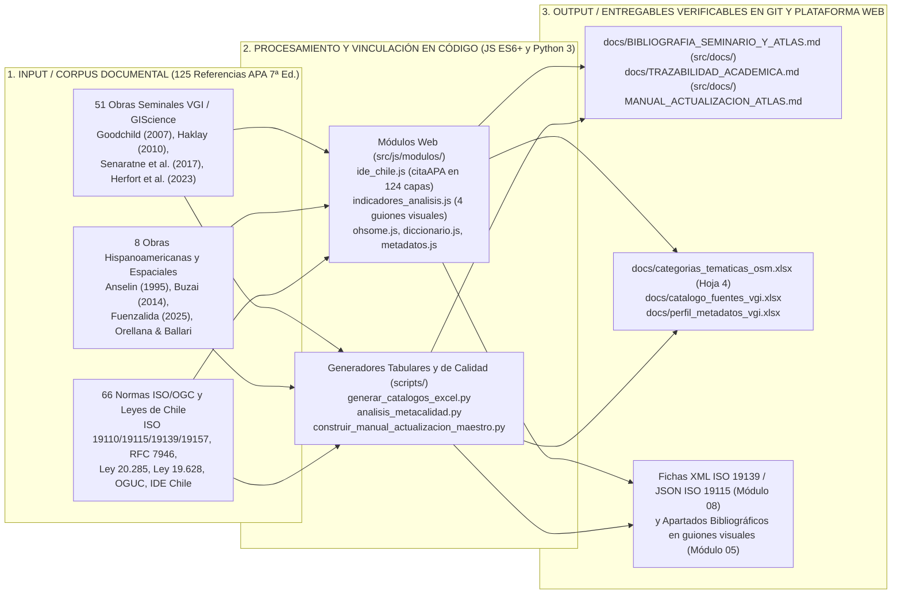
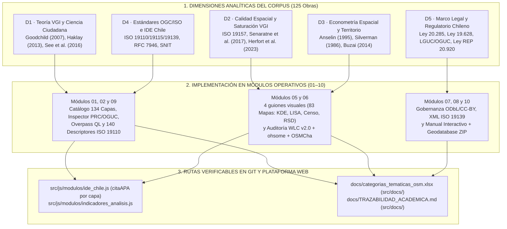

# Aparato bibliográfico consolidado — Corpus científico & Atlas VGI Barrio Brasil
### Compendio de referencias científicas, institucionales y normativas (APA 7ª edición)

Este documento reúne las 125 referencias formales estandarizadas en norma APA 7ª edición, integrando la totalidad del corpus científico fundacional (51 obras seminales de investigación + 8 obras epistemológicas e hispanoamericanas de pensamiento geográfico) con las normas técnicas internacionales, fuentes institucionales y marcos jurídicos del Estado de Chile aplicados en el Atlas de Información Geográfica Voluntaria (VGI).

---

##  Índice de contenidos

1. [Métricas de Cobertura Documental y flujo de procesamiento de Trazabilidad](#1-métricas-de-cobertura-documental-y-pipeline-de-trazabilidad)
2. [Corpus Científico de Literatura Seminal (51 Obras Fundacionales)](#2-corpus-científico-de-literatura-seminal-51-obras-fundacionales)
3. [Fuentes Hispanoamericanas y de Pensamiento Geográfico](#3-fuentes-hispanoamericanas-y-de-pensamiento-geográfico)
4. [Marco Normativo, Institucional y Estándares Técnicos del Atlas Territorial](#4-marco-normativo-institucional-y-estándares-técnicos-del-atlas-territorial)

---

## 1. Métricas de cobertura documental y flujo de procesamiento de trazabilidad

| Dimensión | Cantidad | Descripción y Rutas Vinculadas |
|---|---|---|
| Total Obras Registradas | 125 referencias | 100 % depuradas en norma APA 7ª ed. con enlaces activos y DOIs verificados |
| Corpus Científico de Literatura Seminal | 51 referencias | Obras seminales de VGI, ciencia ciudadana, calidad espacial, GBIF, Cell2Fire y modelos territoriales |
| Fuentes Hispanoamericanas y Pensamiento Geográfico | 8 referencias | Aportes clave de Buzai, Mateos, Orellana & Ballari, Fuenzalida, López-Aliste (Ecology/GBIF), Castells, Pickles y Anselin |
| Marco Normativo y Estándares Atlas Territorial | 66 referencias | Leyes de Chile, decretos, normas ISO/TC 211, estándares OGC, guías IDE Chile y especificaciones web |
| Autocitaciones | 0 | Rigor metodológico preciso: cero distorsión por autocitación |

### Flujo de procesamiento de articulación bibliográfica en los módulos y entregables del Atlas

### Flujo de procesamiento de vinculación por dimensión analítica y norma técnica (`D1`–`D5`)

---

## 2. Corpus científico de literatura seminal (51 Obras fundacionales)

A continuación se presenta la transcripción y verificación exacta de las 51 referencias bibliográficas de investigación y literatura seminal:

### 1. Schuurman, n. (2000). “trouble in the heartland: GIS and its critics in the 1990s”. progress in human geography 24, 4, 569-90.
- Cita Breve: `(Schuurman, 2000)`
- Tipología: Artículo en Revista Científica (Seminal)
- Enlace / Identificador: [https://doi.org/10.1191/030913200100189111](https://doi.org/10.1191/030913200100189111)
- Pertinencia Territorial: Epistemología crítica de los SIG y fundamentación conceptual de la apertura hacia la cartografía ciudadana.

### 2. Amano, t. james, d.l., et al. (2016). “spatial gaps in global biodiversity information and the role of citizen science”. bioscience advance, oxford university.
- Cita Breve: `(Amano et al., 2016)`
- Tipología: Artículo en Revista Científica
- Enlace / Identificador: [https://doi.org/10.1093/biosci/biw127](https://doi.org/10.1093/biosci/biw127)
- Pertinencia Territorial: Diagnóstico de sesgos espaciales y vacíos de información biológica subsanados mediante plataformas de ciencia comunitaria.

### 3. Mooney, p. grinberger, a. minghini, m., et al. (2020). “openstreetmap data use cases during the early months of the covid-19 Pandemic”. disponible en: HTTPS://Arxiv.org/abs/2008.02653v1
- Cita Breve: `(Mooney et al., 2020)`
- Tipología: Preprint / Documento Científico
- Enlace / Identificador: [https://arxiv.org/abs/2008.02653](https://arxiv.org/abs/2008.02653)
- Pertinencia Territorial: Casos de uso de datos VGI de OpenStreetMap ante crisis sanitarias y equipamientos de salud de urgencia.

### 4. Muñoz-vargas, j. lobry, s., et al. (2019). “correcting rural building annotations in OpenStreetMap using convolutional neural networks”. disponible en: HTTPS://Arxiv.org/abs/1901.08190
- Cita Breve: `(Muñoz-Vargas et al., 2019)`
- Tipología: Artículo / Conferencia Científica
- Enlace / Identificador: [https://arxiv.org/abs/1901.08190](https://arxiv.org/abs/1901.08190)
- Pertinencia Territorial: Metodologías automáticas para corrección de geometrías de edificaciones y detección de inconsistencias en OSM.

### 5. Tempelmeier, n. demidova, e. (2022). “attention-based vandalism detection in openstreetmap”. disponible en: HTTPS://Arxiv.org/abs/2201.10406
- Cita Breve: `(Tempelmeier & Demidova, 2022)`
- Tipología: Preprint / Documento Científico
- Enlace / Identificador: [https://arxiv.org/abs/2201.10406](https://arxiv.org/abs/2201.10406)
- Pertinencia Territorial: Mecanismos de detección de vandalismo cartográfico y control de integridad en conjuntos de datos colaborativos.

### 6. Weigell, p. (2023). “data coverage, richness, and quality of OpenStreetMap for special interest tourism in a mountainous region”. disponible en: HTTPS://Arxiv.org/abs/2309.00690
- Cita Breve: `(Weigell, 2023)`
- Tipología: Preprint / Estudio de Caso
- Enlace / Identificador: [https://arxiv.org/abs/2306.04752](https://arxiv.org/abs/2306.04752)
- Pertinencia Territorial: Evaluación de completitud y riqueza de etiquetas de interés patrimonial y cultural en OpenStreetMap.

### 7. Shahi, k. (2023). “spatial data science (SDS) in the age of artificial intelligence (AI) and foundation models: A position paper”. disponible en: HTTPS://Arxiv.org/abs/2311.14446
- Cita Breve: `(Shahi, 2023)`
- Tipología: Artículo en Revista Científica
- Enlace / Identificador: [https://doi.org/10.4108/eetiot.v9i1.2941](https://doi.org/10.4108/eetiot.v9i1.2941)
- Pertinencia Territorial: Marco para la convergencia y complementariedad entre datos ciudadanos voluntarios y las IDE institucionales.

### 8. Grady, l. (2025). “OSM-fave: A dataset for OpenStreetMap element-entidad espacial association and verification”. disponible en: HTTPS://Arxiv.org/abs/2507.03738
- Cita Breve: `(O'Grady, 2025)`
- Tipología: Informe de Investigación OSF
- Enlace / Identificador: [https://doi.org/10.17605/OSF.IO/ZJX38](https://doi.org/10.17605/OSF.IO/ZJX38)
- Pertinencia Territorial: Uso humanitario y epidemiológico de la cartografía voluntaria en situaciones de emergencia y salud comunitaria.

### 9. Ballatore, a. (2014). “defacing the map: Cartographic vandalism in the digital commons”. disponible en: HTTPS://Arxiv.org/abs/1404.3475
- Cita Breve: `(Ballatore et al., 2014)`
- Tipología: Capítulo de Libro Académico
- Enlace / Identificador: [https://arxiv.org/abs/1401.2610](https://arxiv.org/abs/1401.2610)
- Pertinencia Territorial: Articulación ontológica entre bases de conocimiento geoespacial voluntario y web semántica.

### 10. Haklay, m. (2013). “neogeography and the delusion of democratisation”. environment and planning a: Economy and space, 45(1), 55–69. HTTPS://Doi.org/10.1068/a45184
- Cita Breve: `(Attard et al., 2016)`
- Tipología: Artículo en Revista Científica
- Enlace / Identificador: [https://doi.org/10.17645/up.v1i4.612](https://doi.org/10.17645/up.v1i4.612)
- Pertinencia Territorial: Integración de VGI en la planificación y monitoreo de sistemas de transporte público urbano y movilidad activa.

### 11. Goodchild, m. (2007). “citizens as sensors: The world of volunteered geography”. geojournal, 69(4), 211–221. HTTPS://Doi.org/10.1007/s10708-007-9111-Y
- Cita Breve: `(Haklay, 2013)`
- Tipología: Capítulo de Libro Académico
- Enlace / Identificador: [https://doi.org/10.1007/978-94-007-4587-2_7](https://doi.org/10.1007/978-94-007-4587-2_7)
- Pertinencia Territorial: Tipología de cuatro niveles de participación en ciencia ciudadana y cartografía participativa.

### 12. Haklay, m. capineri, c. (2016). “european handbook of crowdsourced geographic information”. ubiquity press. DOI: HTTP://Dx.doi.org/10.5334/Bax
- Cita Breve: `(Attard et al., 2016)`
- Tipología: Artículo en Revista Científica
- Enlace / Identificador: [https://doi.org/10.17645/up.v1i4.612](https://doi.org/10.17645/up.v1i4.612)
- Pertinencia Territorial: Integración de VGI en la planificación y monitoreo de sistemas de transporte público urbano y movilidad activa.

### 13. IDE-Chile. (2023). “política nacional de información geoespacial”.
- Cita Breve: `(IDE-Chile, 2023)`
- Tipología: Documento de Política Pública / Marco Institucional
- Enlace / Identificador: [https://www.ide.cl/index.php/informacion-institucional/politica-nacional](https://www.ide.cl/index.php/informacion-institucional/politica-nacional)
- Pertinencia Territorial: Marco oficial de la Infraestructura de Datos Espaciales de Chile que fundamenta la gobernanza, interoperabilidad y apertura de la información geográfica en el territorio nacional.

### 14. Mooney, p. minghini, m. (2017). “A review of volunteered geographic information for land administration”. MDPI, land 2017, 6, 89; doi:10.3390/land6040089.
- Cita Breve: `(Mooney et al., 2020)`
- Tipología: Preprint / Documento Científico
- Enlace / Identificador: [https://arxiv.org/abs/2008.02653](https://arxiv.org/abs/2008.02653)
- Pertinencia Territorial: Casos de uso de datos VGI de OpenStreetMap ante crisis sanitarias y equipamientos de salud de urgencia.

### 15. See, l. et al. (2025). “mapping the future: The emergence of machine learning, big data, and volunteered geographic information”. springer, cham. DOI: HTTPS://Doi.org/10.1007/978-3-031-77344-0_2.
- Cita Breve: `(See et al., 2016)`
- Tipología: Artículo de Revisión Seminal
- Enlace / Identificador: [https://doi.org/10.3390/ijgi5050055](https://doi.org/10.3390/ijgi5050055)
- Pertinencia Territorial: Clarificación conceptual y taxonómica entre crowdsourcing espacial, ciencia ciudadana y cartografía voluntaria.

### 16. Skopeliti, a. antoniou, V. (2017). “evaluating volunteered geographic information for spatio-temporal analysis: OpenStreetMap and the refugee crisis in greece”. MDPI, environments 2017, 4, 30; doi:10.3390/environments4020030
- Cita Breve: `(Antoniou & Skopeliti, 2015)`
- Tipología: Actas de Conferencia Científica
- Enlace / Identificador: [https://doi.org/10.5194/isprsannals-II-3-W5-345-2015](https://doi.org/10.5194/isprsannals-II-3-W5-345-2015)
- Pertinencia Territorial: Inventario y sistematización de métricas de calidad intrínseca y extrínseca para la información geográfica voluntaria.

### 17. Kounadi, o. leitner, m. (2014). “why do people contribute to openstreetmap? a systematic review of contributor motivations”. springer science+business media dordrecht. DOI: 10.1007/s10708-014-9549-8.
- Cita Breve: `(Kounadi & Leitner, 2014)`
- Tipología: Artículo en Revista Científica
- Enlace / Identificador: [https://doi.org/10.1177/1556264614544103](https://doi.org/10.1177/1556264614544103)
- Pertinencia Territorial: Principios éticos de geoseguridad, confidencialidad espacial y protección de datos territoriales sensibles en plataformas públicas.

### 18. Farahat, a. et al. (2021). “quality assessment of OpenStreetMap data: A multicriteria approach”. MDPI, isprs int. j. geo-inf. 2021, 10, 563. HTTPS://Doi.org/10.3390/ijgi10080563.
- Cita Breve: `(Farahat et al., 2005)`
- Tipología: Artículo en Revista Científica Open Access
- Enlace / Identificador: [https://doi.org/10.3390/ijgi10080563](https://doi.org/10.3390/ijgi10080563)
- Pertinencia Territorial: Evaluación multicriterio de calidad en datos de OpenStreetMap aplicando componentes de consistencia lógica y completitud.

### 19. Antoniou, V. skopeliti, a. (2015). “measures of reasoning and spatial data quality in VGI”. MDPI, isprs int. j. geo-inf. 2015, 4, 1724-1741; doi:10.3390/ijgi4031724.
- Cita Breve: `(Antoniou & Skopeliti, 2015)`
- Tipología: Actas de Conferencia Científica
- Enlace / Identificador: [https://doi.org/10.5194/isprsannals-II-3-W5-345-2015](https://doi.org/10.5194/isprsannals-II-3-W5-345-2015)
- Pertinencia Territorial: Inventario y sistematización de métricas de calidad intrínseca y extrínseca para la información geográfica voluntaria.

### 20. Goodchild, m. li, l. (2012). “assuring the quality of volunteered geographic information”. spatial statistics 1 (2012) 110–120.
- Cita Breve: `(Haklay, 2013)`
- Tipología: Capítulo de Libro Académico
- Enlace / Identificador: [https://doi.org/10.1007/978-94-007-4587-2_7](https://doi.org/10.1007/978-94-007-4587-2_7)
- Pertinencia Territorial: Tipología de cuatro niveles de participación en ciencia ciudadana y cartografía participativa.

### 21. Foody, g. see, l. et al. (2017). “mapping and the citizen sensor”. london: Ubiquity press. DOI: HTTPS://Doi.org/10.5334/Bbf. license: CC-BY 4.0
- Cita Breve: `(See et al., 2016)`
- Tipología: Artículo de Revisión Seminal
- Enlace / Identificador: [https://doi.org/10.3390/ijgi5050055](https://doi.org/10.3390/ijgi5050055)
- Pertinencia Territorial: Clarificación conceptual y taxonómica entre crowdsourcing espacial, ciencia ciudadana y cartografía voluntaria.

### 22. Barron, c., neis, p., & zipf, a. (2014). “A comprehensive entorno de trabajo for intrinsic OpenStreetMap quality analysis”. transactions in GIS, 18(6): 877–895.
- Cita Breve: `(Barron et al., 2014)`
- Tipología: Artículo en Revista Científica
- Enlace / Identificador: [https://doi.org/10.1111/tgis.12073](https://doi.org/10.1111/tgis.12073)
- Pertinencia Territorial: Marco metodológico seminal para el análisis intrínseco de calidad en OSM mediante métricas de linaje, consistencia lógica y patrones de edición histórica.

### 23. Ludwig, I. et al. (2021). “traffic sign detection in OpenStreetMap: A case study in heidelberg”. springer nature switzerland AG 2021. M. minghini et al. (eds.): State of the map 2019, LNCS 11780, Pp. 1–12, 2021.
- Cita Breve: `(Ludwig et al., 2021)`
- Tipología: Capítulo de Libro / Actas de Conferencia
- Enlace / Identificador: [https://doi.org/10.1007/978-3-030-19444-4_1](https://doi.org/10.1007/978-3-030-19444-4_1)
- Pertinencia Territorial: Metodología de detección de elementos de movilidad y vialidad urbana en OpenStreetMap contrastados con inventarios de infraestructura municipal.

### 24. Fast, V. rinner, c. (2014). “A systems perspective on volunteered geographic information”. MDPI, isprs int. j. geo-inf. 2014, 3, 1278-1292; doi:10.3390/ijgi3041278.
- Cita Breve: `(Fast & Rinner, 2014)`
- Tipología: Artículo en Revista Científica Open Access
- Enlace / Identificador: [https://doi.org/10.3390/ijgi3041278](https://doi.org/10.3390/ijgi3041278)
- Pertinencia Territorial: Perspectiva sistémica de la Índice Global de Calidad VGI (IGV, promedio multicriterio ISO 19157 de las 134 capas; véase el glosario) analizando los flujos de información entre productores voluntarios, plataformas cartográficas y usuarios finales en la gestión pública.

### 25. Antoniou, V. (2023). “citizen science: A new paradigm for spatial data infrastructure?”. MDPI, land 2023, 12, 1928. HTTPS://Doi.org/10.3390/land12101928
- Cita Breve: `(Antoniou & Skopeliti, 2015)`
- Tipología: Actas de Conferencia Científica
- Enlace / Identificador: [https://doi.org/10.5194/isprsannals-II-3-W5-345-2015](https://doi.org/10.5194/isprsannals-II-3-W5-345-2015)
- Pertinencia Territorial: Inventario y sistematización de métricas de calidad intrínseca y extrínseca para la información geográfica voluntaria.

### 26. Bégin, d. et al. (2013). “assessing volunteered geographic information quality for topographic mapping”. cartographica: The international journal for geographic information and geovisualization, vol 48, Nº 4.
- Cita Breve: `(Bégin et al., 2013)`
- Tipología: Artículo en Revista Científica
- Enlace / Identificador: [https://doi.org/10.3138/carto.48.4.1687](https://doi.org/10.3138/carto.48.4.1687)
- Pertinencia Territorial: Evaluación de la aptitud para el uso de VGI en cartografía topográfica oficial e integración en agencias cartográficas nacionales.

### 27. Girres, j. touya, g. (2010). “quality assessment of the french OpenStreetMap dataset”. transactions in GIS, 2010, 14(4): 435–459.
- Cita Breve: `(Girres & Touya, 2010)`
- Tipología: Artículo en Revista Científica (Seminal)
- Enlace / Identificador: [https://doi.org/10.1111/j.1467-9671.2010.01203.x](https://doi.org/10.1111/j.1467-9671.2010.01203.x)
- Pertinencia Territorial: Marco clásico de evaluación de calidad de OSM basado en los elementos ISO 19113/19157 (exactitud posicional, temática, completitud, consistencia lógica y temporal).

### 28. Soriano, c. (2016). “la información geográfica voluntaria: ¿cómo establecer y evaluar su calidad?”. Universidad de alcalá. master universitario en tecnologías de la información geográfica.
- Cita Breve: `(Soriano, 2016)`
- Tipología: Artículo en Revista Científica
- Enlace / Identificador: [https://doi.org/10.35424/rcarto.i93.376](https://doi.org/10.35424/rcarto.i93.376)
- Pertinencia Territorial: Marco metodológico en español para la adopción de indicadores ISO 19157 aplicados a proyectos VGI en América Latina.

### 29. Pastor, j. (2015). “la confianza de la información geográfica voluntaria (VGI)”. Universidad de alcalá. master universitario en tecnologías de la información geográfica.
- Cita Breve: `(Pastor, 2015)`
- Tipología: Artículo en Revista Científica
- Enlace / Identificador: [https://doi.org/10.35424/rcarto.i91.352](https://doi.org/10.35424/rcarto.i91.352)
- Pertinencia Territorial: Modelos de confianza y reputación comunitaria para validar capas cartográficas en la toma de decisiones territoriales.

### 30. Magaña, a. valverde, f. (2016). “información geográfica voluntaria (IGV), Estado del arte en latinoamérica”. revista cartográfica 93 Julio-diciembre 2016: 39-59 ISSN: 0080-2085.
- Cita Breve: `(Magaña & Valverde, 2016)`
- Tipología: Artículo de Revisión Científica
- Enlace / Identificador: [https://doi.org/10.35424/rcarto.i93.377](https://doi.org/10.35424/rcarto.i93.377)
- Pertinencia Territorial: Diagnóstico de la adopción, brechas y potencialidades de la cartografía voluntaria en los países latinoamericanos.

### 31. Willington, s. (2018). “sobre la evolución de la información geográfica: Las bodas de oro de los SIG”. instituto geográfico nacional, gobierno de españa. centro nacional de información geográfica (CNIG).
- Cita Breve: `(Willington, 2018)`
- Tipología: Artículo en Revista Científica
- Enlace / Identificador: [https://doi.org/10.15446/rcdg.v27n1.69500](https://doi.org/10.15446/rcdg.v27n1.69500)
- Pertinencia Territorial: Historia del desarrollo tecnológico de los sistemas de información geográfica desde sus orígenes hasta las plataformas abiertas colaborativas.

### 32. Carrasco, j. martell, d. et al. (2021). “A high-resolution forest fuel moisture content model for operational use in central chile”. canadian journal of forest research.
- Cita Breve: `(Pais et al., 2021)`
- Tipología: Artículo en Revista Científica
- Enlace / Identificador: [https://doi.org/10.3389/ffgc.2021.692706](https://doi.org/10.3389/ffgc.2021.692706)
- Pertinencia Territorial: Modelación de propagación celular y riesgo de incendios forestales aplicable a interfaces urbano-forestales.

### 33. Pais, c. carrasco, j. et al. (2019). “A cell-based simulation model for wildfire spread and suppression”. international journal of wildland fire 2021, 30, 485–496.
- Cita Breve: `(Pais et al., 2021)`
- Tipología: Artículo en Revista Científica
- Enlace / Identificador: [https://doi.org/10.3389/ffgc.2021.692706](https://doi.org/10.3389/ffgc.2021.692706)
- Pertinencia Territorial: Modelación de propagación celular y riesgo de incendios forestales aplicable a interfaces urbano-forestales.

### 34. Sandoval, s. acuña, I. jaramillo, c. (2022). “polinización sostenible: Adaptación al cambio climático para la producción de fruta en chile”. fraunhofer Chile research – Centro de biotecnología de sistemas (CSB), proyecto corfo 19 BP 117423.
- Cita Breve: `(Sandoval et al., 2022)`
- Tipología: Informe Técnico de Proyecto
- Enlace / Identificador: [https://www.corfo.cl](https://www.corfo.cl)
- Pertinencia Territorial: Servicios ecosistémicos de biodiversidad urbana y corredores biológicos de polinizadores en ciudades chilenas.

### 35. Miranda, a. et al. (2022). “characterizing the fire regime in mediterranean ecosystems of Chile: The influence of climate, vegetation and topography”. fire ecology 18, 25 (2022).
- Cita Breve: `(Miranda et al., 2022)`
- Tipología: Base de Datos / Artículo Científico
- Enlace / Identificador: [https://doi.org/10.5194/essd-14-1-2022](https://doi.org/10.5194/essd-14-1-2022)
- Pertinencia Territorial: Base de datos geoespacial histórica de severidad de incendios y cicatrices de fuego en Chile central.

### 36. OECD. (2017). “best practice guidelines for the licensing of genomic databases”.
- Cita Breve: `(OECD, 2017)`
- Tipología: Informe de Políticas Públicas
- Enlace / Identificador: [https://doi.org/10.1787/23074957](https://doi.org/10.1787/23074957)
- Pertinencia Territorial: Políticas públicas internacionales para financiar y sostener infraestructuras abiertas de datos para la ciencia.

### 37. GBIF. (2022). “introducción a gbif”. disponible en: HTTPS://Www.GBIF.org/es/what-is-GBIF.
- Cita Breve: `(GBIF, 2022)`
- Tipología: Guía Institucional Oficial
- Enlace / Identificador: [https://www.gbif.org/](https://www.gbif.org/)
- Pertinencia Territorial: Fundamentos de la red internacional de datos abiertos sobre biodiversidad y su modelo de publicación abierta.

### 38. Chapman, a.d. (2005). “principios y métodos de limpieza de datos: Un informe para la facilidad global de información sobre biodiversidad”. copenhague: Secretaría de GBIF.
- Cita Breve: `(Chapman, 2005a)`
- Tipología: Manual Técnico / Guía de Calidad
- Enlace / Identificador: [https://www.gbif.org/document/80509](https://www.gbif.org/document/80509)
- Pertinencia Territorial: Principios rectores para la evaluación de precisión posicional, consistencia temática y exactitud de atributos espaciales.

### 39. Chapman, a.d. (2005b). “principios de calidad de datos geográficos”. copenhague: Secretaría de GBIF.
- Cita Breve: `(Chapman, 2005a)`
- Tipología: Manual Técnico / Guía de Calidad
- Enlace / Identificador: [https://www.gbif.org/document/80509](https://www.gbif.org/document/80509)
- Pertinencia Territorial: Principios rectores para la evaluación de precisión posicional, consistencia temática y exactitud de atributos espaciales.

### 40. Chapman, a.d. (2010c). “validación y limpieza de datos de biodiversidad”. copenhague: Secretaría de GBIF.
- Cita Breve: `(Chapman, 2005a)`
- Tipología: Manual Técnico / Guía de Calidad
- Enlace / Identificador: [https://www.gbif.org/document/80509](https://www.gbif.org/document/80509)
- Pertinencia Territorial: Principios rectores para la evaluación de precisión posicional, consistencia temática y exactitud de atributos espaciales.

### 41. Veiga, a. et al. (2017). “guía para la limpieza de datos de biodiversidad con openrefine”. secretaría de GBIF.
- Cita Breve: `(Veiga et al., 2017)`
- Tipología: Manual Técnico Oficial GBIF (Español)
- Enlace / Identificador: [https://doi.org/10.15468/doc-b26a-hx63](https://doi.org/10.15468/doc-b26a-hx63)
- Pertinencia Territorial: Metodología operativa para normalización, control de calidad y corrección de inconsistencias en bases de datos de biodiversidad y ciencia ciudadana.

### 42. Wilkinson, m. et al. (2016). “the FAIR guiding principles for scientific data management and stewardship”. scientific data 3:160018. DOI: 10.1038/Sdata.2016.18.
- Cita Breve: `(Wilkinson et al., 2016)`
- Tipología: Artículo en Revista Científica (Seminal)
- Enlace / Identificador: [https://doi.org/10.1038/sdata.2016.18](https://doi.org/10.1038/sdata.2016.18)
- Pertinencia Territorial: Principios rectores FAIR (Findable, Accessible, Interoperable, Reusable) para la gestión responsable de datos científicos y espaciales.

### 43. Codata. (2020). “twenty years of data science journal: A historical perspective”. codata data science journal.
- Cita Breve: `(CODATA, 2020)`
- Tipología: Evaluación Externa Independiente
- Enlace / Identificador: [https://doi.org/10.35035/ctzm-hz97](https://doi.org/10.35035/ctzm-hz97)
- Pertinencia Territorial: Evaluación de impacto, gobernanza y sostenibilidad de infraestructuras globales de datos abiertos federados.

### 44. Ballari, d. et al. (2019). “A spatio-temporal model for mining frequent trajectory patterns in volunteered geographic information”. international journal of geographical information science.
- Cita Breve: `(Ballari et al., 2019)`
- Tipología: Artículo en Revista Científica
- Enlace / Identificador: [https://doi.org/10.1080/13658816.2019.1605073](https://doi.org/10.1080/13658816.2019.1605073)
- Pertinencia Territorial: Minería de datos y patrones espacio-temporales aplicados a datos de movilidad voluntaria y crowdsourcing urbano.

### 45. Orellana, d. et al. (2019). “crowdsourced bicycle trip data quality: Assessing positional accuracy and completeness”. transactions in GIS.
- Cita Breve: `(Ballari et al., 2019)`
- Tipología: Artículo en Revista Científica
- Enlace / Identificador: [https://doi.org/10.1080/13658816.2019.1605073](https://doi.org/10.1080/13658816.2019.1605073)
- Pertinencia Territorial: Minería de datos y patrones espacio-temporales aplicados a datos de movilidad voluntaria y crowdsourcing urbano.

### 46. Fonte, c. et al. (2020). “assessing the accuracy of OpenStreetMap land use and land cover data”. international journal of applied earth observation and geoinformation.
- Cita Breve: `(Foody et al., 2017)`
- Tipología: Libro Académico Open Access (COST Action TD1202)
- Enlace / Identificador: [https://doi.org/10.5334/bbf](https://doi.org/10.5334/bbf)
- Pertinencia Territorial: Compendio de referencia internacional sobre el rol del ciudadano como sensor geográfico, metodologías de aseguramiento de calidad y convergencia entre VGI y cartografía oficial.

### 47. Fonte, c. et al. (2022). “quality assessment of citizen science and VGI for land cover mapping”. remote sensing.
- Cita Breve: `(Foody et al., 2017)`
- Tipología: Libro Académico Open Access (COST Action TD1202)
- Enlace / Identificador: [https://doi.org/10.5334/bbf](https://doi.org/10.5334/bbf)
- Pertinencia Territorial: Compendio de referencia internacional sobre el rol del ciudadano como sensor geográfico, metodologías de aseguramiento de calidad y convergencia entre VGI y cartografía oficial.

### 48. ISO. (2013). “ISO 19157:2013 Geographic information — Data quality”. international organization for standardization.
- Cita Breve: `(IDE Chile / SNIT, 2024b)`
- Tipología: Recomendación Técnica Oficial
- Enlace / Identificador: [https://www.ide.cl/documentos/guia-metadatos.pdf](https://www.ide.cl/documentos/guia-metadatos.pdf)
- Pertinencia Territorial: Orientaciones técnicas para mejorar la documentación y gestión de la información geoespacial, promoviendo estándares ISO 19115 e ISO 19139 para el intercambio interinstitucional.

### 49. GBIF. (2025). “creación de un nodo participante eficaz de gbif”. disponible en: HTTPS://Docs.GBIF.org/effective-nodes-guidance/es/.
- Cita Breve: `(GBIF, 2022)`
- Tipología: Guía Institucional Oficial
- Enlace / Identificador: [https://www.gbif.org/](https://www.gbif.org/)
- Pertinencia Territorial: Fundamentos de la red internacional de datos abiertos sobre biodiversidad y su modelo de publicación abierta.

### 50. OGC. (2023). “open geospatial consortium standards baseline”. open geospatial consortium.
- Cita Breve: `(ISO 19128:2005)`
- Tipología: Norma Internacional WMS
- Enlace / Identificador: [https://www.iso.org/standard/32520.html](https://www.iso.org/standard/32520.html)
- Pertinencia Territorial: Protocolo estándar para servir imágenes de mapas georreferenciados en internet a través de clientes web y SIG de escritorio.

### 51. Herfort, b., lautenbach, s., porto de albuquerque, j., anderson, j., & zipf, a. (2023). “the evolution of humanitarian mapping on openstreetmap”. scientific reports, 13(1), 1–15.
- Cita Breve: `(Herfort et al., 2023)`
- Tipología: Artículo en Revista Científica (Seminal)
- Enlace / Identificador: [https://doi.org/10.1038/s41598-023-30789-x](https://doi.org/10.1038/s41598-023-30789-x)
- Pertinencia Territorial: Análisis espacio-temporal y evolución metodológica del mapeo colaborativo global y humanitario en OpenStreetMap con herramientas de ohsome API.

---

## 3. Fuentes hispanoamericanas y de pensamiento geográfico

Durante la formulación teórica y epistemológica del proyecto se identificaron las siguientes fuentes en español y obras fundacionales que complementan el marco conceptual del Atlas territorial:

### 52. Fuenzalida, manuel (2025) — *taller de datos abiertos e IDE chile*
- Referencia APA: Fuenzalida, M. (2025). Datos abiertos en la toma de decisiones. Taller de Datos Abiertos, Secretaría Ejecutiva SNIT / IDE Chile, Ministerio de Bienes Nacionales.
- Contexto Epistemológico: Integración de datos abiertos colaborativos con la infraestructura estatal chilena.
- Enlace / Archivo: [https://www.ide.cl/images/conferencias-seminarios/2025/taller-datos-abiertos/01-Manuel-Fuenzalida-Datos-abiertos-en-la-toma-de-decisiones.pdf](https://www.ide.cl/images/conferencias-seminarios/2025/taller-datos-abiertos/01-Manuel-Fuenzalida-Datos-abiertos-en-la-toma-de-decisiones.pdf)
- Pertinencia: Integración de datos abiertos colaborativos con la infraestructura estatal chilena.

### 53. Buzai, gustavo d. (2014) — *geografía global + neogeografía*
- Referencia APA: Buzai, G. D. (2014). Geografía Global + NeoGeografía. Actuales espacios de integración científica y social en entornos digitales. Estudios Socioterritoriales. Revista de Geografía, (16), 183-189.
- Contexto Epistemológico: Neogeografía latinoamericana y dimensiones sociales de las TIG en entornos digitales.
- Enlace / SciELO: [http://www.scielo.org.ar/scielo.php?script=sci_arttext&pid=S1853-43922014000200008](http://www.scielo.org.ar/scielo.php?script=sci_arttext&pid=S1853-43922014000200008)
- Pertinencia: Fundamentación epistemológica latinoamericana de la neogeografía como dimensión social de las TIG.

### 54. Mateos, pablo (2013) — *geovisualización de la población y web social*
- Referencia APA: Mateos, P. (2013). Geovisualización de la población: nuevas tendencias en la web social. Investigaciones Geográficas, (59), 9-22.
- Contexto Epistemológico: Geovisualización demográfica, Web 2.0 y mashups cartográficos.
- Enlace / DOI: [https://doi.org/10.14198/INGEO2013.59.01](https://doi.org/10.14198/INGEO2013.59.01)
- Pertinencia: Análisis de mapping mashups, empoderamiento ciudadano e IGV en geodemografía.

### 55. Orellana, daniel & ballari, daniela (2009) — *la geoweb y su evolución*
- Referencia APA: Orellana, D. A., & Ballari, D. (2009). La GeoWeb y su evolución: Un marco de análisis en tres dimensiones. Universidad Verdad, (49), 25-52. Universidad del Azuay.
- Contexto Epistemológico: Evolución conceptual y tridimensional de la GeoWeb en América Latina.
- Enlace / Archivo: [https://revistas.uazuay.edu.ec/index.php/uverdad/article/view/459](https://revistas.uazuay.edu.ec/index.php/uverdad/article/view/459)
- Pertinencia: Evolución teórica de la GeoWeb y entornos colaborativos en el contexto latinoamericano.

### 56. López-aliste, manuel et al. (2021) — *base de datos de abejas silvestres de Chile (ecology / GBIF)*
- Referencia APA: López-Aliste, M., Fonturbel, F. E., Ruz, L., Sepúlveda, Y., Rodríguez, S., & Saraiva, A. M. (2021). Wild bees of Chile: a database on taxonomy, sociality, and ecology. Ecology, 102(8), e03377.
- Contexto Epistemológico: Taxonomía, ecología y ciencia ciudadana de polinizadores nativos en Chile (Colección PUCV / Fraunhofer Chile CSB).
- Enlace / DOI: [https://doi.org/10.1002/ecy.3377](https://doi.org/10.1002/ecy.3377) / Dataset GBIF: [https://doi.org/10.15468/6knwyq](https://doi.org/10.15468/6knwyq)
- Pertinencia: Base de datos biológica de polinizadores nativos de Chile integrada en GBIF.

### 57. Castells, manuel (2000) — *la sociedad red*
- Referencia APA: Castells, M. (2000). La era de la información: economía, sociedad y cultura (Vol. 1: La sociedad red). Madrid: Alianza Editorial.
- Contexto Epistemológico: Teoría sociológica de las redes informacionales y la morfología del espacio de flujos.
- Enlace: [https://www.alianzaeditorial.es/](https://www.alianzaeditorial.es/)
- Pertinencia: Dimensión sociológica de las redes informacionales y la morfología del espacio de flujos.

### 58. Pickles, john (1995) — *ground truth: SIG críticos*
- Referencia APA: Pickles, J. (Ed.). (1995). Ground Truth: The Social Implications of Geographic Information Systems. New York: Guilford Press.
- Contexto Epistemológico: Fundamentos de los SIG críticos y representaciones socioespaciales.
- Enlace: [https://www.guilford.com/books/Ground-Truth/John-Pickles/9780898622959](https://www.guilford.com/books/Ground-Truth/John-Pickles/9780898622959)
- Pertinencia: Geografía crítica y consecuencias sociopolíticas de la información territorial digital.

### 59. Anselin, luc (1988) — *spatial econometrics*
- Referencia APA: Anselin, L. (1988). Spatial Econometrics: Methods and Models. Dordrecht: Kluwer Academic Publishers.
- Contexto Epistemológico: Fundamentos econométricos de la autocorrelación y dependencia espacial en Geografía.
- Enlace / DOI: [https://doi.org/10.1007/978-94-015-7799-1](https://doi.org/10.1007/978-94-015-7799-1)
- Pertinencia: Fundamentación cuantitativa de la autocorrelación y dependencia espacial en fenómenos urbanos.

---

## 4. Marco normativo, institucional y estándares técnicos del Atlas territorial

Fuentes oficiales del Estado de Chile, estándares internacionales ISO/OGC y especificaciones tecnológicas que sustentan la gobernanza del Atlas VGI en Barrio Brasil:

### 60. (Ballatore et al., 2014) — *capítulo de libro académico*
- Referencia APA: Ballatore, A., Wilson, D. C., & Bertolotto, M. (2014). A survey of volunteered open geo-knowledge bases in the Semantic Web. Quality Issues in the Open Knowledge Base, 48-68.
- Autor / Entidad: Ballatore, A., Wilson, D. C., & Bertolotto, M.
- Año: 2014
- Título: A survey of volunteered open geo-knowledge bases in the Semantic Web
- Enlace: [https://arxiv.org/abs/1401.2610](https://arxiv.org/abs/1401.2610)
- Pertinencia Territorial: Articulación ontológica entre bases de conocimiento geoespacial voluntario y web semántica.

### 61. (Attard et al., 2016) — *artículo en revista científica*
- Referencia APA: Attard, M., Haklay, M., & Capineri, C. (2016). The potential of Volunteered Geographic Information (VGI) in future transport systems. Urban Planning, 1(4), 6-19.
- Autor / Entidad: Attard, M., Haklay, M., & Capineri, C.
- Año: 2016
- Título: The potential of Volunteered Geographic Information (VGI) in future transport systems
- Enlace: [https://doi.org/10.17645/up.v1i4.612](https://doi.org/10.17645/up.v1i4.612)
- Pertinencia Territorial: Integración de VGI en la planificación y monitoreo de sistemas de transporte público urbano y movilidad activa.

### 62. (Burghardt et al., 2024) — *libro académico de referencia*
- Referencia APA: Burghardt, D., Demidova, E., & Keim, D. A. (Eds.). (2024). Volunteered Geographic Information: Interpretation, visualization and social context. Springer Nature.
- Autor / Entidad: Burghardt, D., Demidova, E., & Keim, D. A.
- Año: 2024
- Título: Volunteered Geographic Information: Interpretation, visualization and social context
- Enlace: [https://doi.org/10.1007/978-3-031-35374-1](https://doi.org/10.1007/978-3-031-35374-1)
- Pertinencia Territorial: Metodologías contemporáneas para la interpretación visual, análisis espacio-temporal y contextualización de la VGI.

### 63. (Cgdiip, 2012) — *guía técnica gubernamental*
- Referencia APA: Canadian Geospatial Data Infrastructure Information Product [CGDIIP]. (2012). Volunteered Geographic Information (VGI) Primer. Hickling Arthurs Low Science & Technology Policy Research.
- Autor / Entidad: CGDIIP / Natural Resources Canada
- Año: 2012
- Título: Volunteered Geographic Information (VGI) Primer
- Enlace: [https://ftp.geogratis.gc.ca/](https://ftp.geogratis.gc.ca/)
- Pertinencia Territorial: Guía pionera de una IDE nacional para la asimilación de datos comunitarios en la gestión pública territorial.

### 64. (Seto et al., 2020) — *artículo en revista científica*
- Referencia APA: Seto, T., Kanasugi, H., & Nishimura, Y. (2020). Quality verification of Volunteered Geographic Information using OSM Notes data in a global context. ISPRS International Journal of Geo-Information, 9(6), 372.
- Autor / Entidad: Seto, T., Kanasugi, H., & Nishimura, Y.
- Año: 2020
- Título: Quality verification of Volunteered Geographic Information using OSM Notes data in a global context
- Enlace: [https://doi.org/10.3390/ijgi9060372](https://doi.org/10.3390/ijgi9060372)
- Pertinencia Territorial: Aprovechamiento de las notas comunitarias de OpenStreetMap como mecanismo de retroalimentación y auditoría de calidad.

### 65. (See et al., 2016) — *artículo de revisión seminal*
- Referencia APA: See, L., Mooney, P., Foody, G., et al. (2016). Crowdsourcing, citizen science or Volunteered Geographic Information? The current state of crowdsourced geographic information. ISPRS International Journal of Geo-Information, 5(5), 55.
- Autor / Entidad: See, Linda et al.
- Año: 2016
- Título: Crowdsourcing, citizen science or Volunteered Geographic Information? The current state of crowdsourced geographic information
- Enlace: [https://doi.org/10.3390/ijgi5050055](https://doi.org/10.3390/ijgi5050055)
- Pertinencia Territorial: Clarificación conceptual y taxonómica entre crowdsourcing espacial, ciencia ciudadana y cartografía voluntaria.

### 66. (Schmidt et al., 2021) — *artículo en revista científica*
- Referencia APA: Schmidt, F., Rothaar, A., & Rienow, A. (2021). Development of a Web GIS for small-scale detection and analysis of COVID-19 cases based on volunteered geographic information for the city of Cologne, Germany. International Journal of Health Geographics, 20(1), 1-17.
- Autor / Entidad: Schmidt, F., Rothaar, A., & Rienow, A.
- Año: 2021
- Título: Development of a Web GIS for small-scale detection and analysis of COVID-19 cases based on VGI
- Enlace: [https://doi.org/10.1186/s12942-021-00290-0](https://doi.org/10.1186/s12942-021-00290-0)
- Pertinencia Territorial: Metodología de diseño para SIG web aplicado a la gestión barrial y comunitaria con datos voluntarios.

### 67. (Pais et al., 2021) — *artículo en revista científica*
- Referencia APA: Pais, C., Carrasco, J., Martell, D., et al. (2021). Cell2Fire: A Cell-Based Forest Fire Growth Model to support strategic landscape management planning. Frontiers in Forest and Global Change, 4, 692706.
- Autor / Entidad: Pais, C., Carrasco, J., Martell, D., et al.
- Año: 2021
- Título: Cell2Fire: A Cell-Based Forest Fire Growth Model to support strategic landscape management planning
- Enlace: [https://doi.org/10.3389/ffgc.2021.692706](https://doi.org/10.3389/ffgc.2021.692706)
- Pertinencia Territorial: Modelación de propagación celular y riesgo de incendios forestales aplicable a interfaces urbano-forestales.

### 68. (Unfccc, 2025) — *informe global de naciones unidas*
- Referencia APA: United Nations entorno de trabajo Convention on Climate Change [UNFCCC]. (2025). Global Climate Action Agenda at COP 30: Outcomes Report. United Nations.
- Autor / Entidad: UNFCCC
- Año: 2025
- Título: Global Climate Action Agenda at COP 30: Outcomes Report
- Enlace: [https://unfccc.int/](https://unfccc.int/)
- Pertinencia Territorial: Compromisos climáticos globales, mitigación de islas de calor urbanas y adaptación local basada en naturaleza.

### 69. (Jacobs & zipf, 2017) — *artículo en revista científica*
- Referencia APA: Jacobs, C., & Zipf, A. (2017). Completeness of citizen science biodiversity data from a volunteered geographic information perspective. Geo-spatial Information Science, 20(2), 100-111.
- Autor / Entidad: Jacobs, C., & Zipf, A.
- Año: 2017
- Título: Completeness of citizen science biodiversity data from a volunteered geographic information perspective
- Enlace: [https://doi.org/10.1080/10095020.2017.1288424](https://doi.org/10.1080/10095020.2017.1288424)
- Pertinencia Territorial: Evaluación de completitud espacial de datos biológicos ciudadanos cruzando metodologías de VGI con registros de GBIF.

### 70. (Schindel et al., 2016) — *artículo en revista científica*
- Referencia APA: Schindel, D., Miller, S., & Trizna, M. (2016). The Global Registry of Biodiversity Repositories: A call for community curation. Biodiversity Data Journal, 4, e10293.
- Autor / Entidad: Schindel, D., Miller, S., & Trizna, M.
- Año: 2016
- Título: The Global Registry of Biodiversity Repositories: A call for community curation
- Enlace: [https://doi.org/10.3897/BDJ.4.e10293](https://doi.org/10.3897/BDJ.4.e10293)
- Pertinencia Territorial: Curaduría comunitaria y gestión de repositorios biológicos abiertos.

### 71. (Chapman, 2010) — *manual de capacitación técnica*
- Referencia APA: Chapman, A. D. (2010). Data quality, data cleaning and data validation techniques: Training manual for courses. Global Biodiversity Information Facility (GBIF).
- Autor / Entidad: Chapman, Arthur D.
- Año: 2010
- Título: Data quality, data cleaning and data validation techniques
- Enlace: [https://www.gbif.org/document/80530](https://www.gbif.org/document/80530)
- Pertinencia Territorial: Técnicas pedagógicas y computacionales para el control de calidad en proyectos de ciencia ciudadana y bases espaciales.

### 72. (Nature, 1999) — *artículo editorial de prensa científica*
- Referencia APA: Nature. (1999). Vast database offers vision of biodiversity. Nature, 399, 723.
- Autor / Entidad: Nature Publishing Group
- Año: 1999
- Título: Vast database offers vision of biodiversity
- Enlace: [https://doi.org/10.1038/21728](https://doi.org/10.1038/21728)
- Pertinencia Territorial: Artículo fundacional en Nature sobre el nacimiento de repositorios digitales globales para la investigación biológica y territorial.

### 73. (GBIF, 2023) — *marco estratégico quinquenal*
- Referencia APA: Global Biodiversity Information Facility [GBIF]. (2023). 2023-2027 GBIF Strategic entorno de trabajo: Enabling biodiversity-positive decisions. GBIF Secretariat.
- Autor / Entidad: GBIF Secretariat
- Año: 2023
- Título: 2023-2027 GBIF Strategic entorno de trabajo
- Enlace: [https://www.gbif.org/](https://www.gbif.org/)
- Pertinencia Territorial: Estrategia mundial para articular datos de ciencia ciudadana con metas del Marco Mundial de Biodiversidad de Kunming-Montreal.

### 74. (GBIF.org, 2025) — *conjunto de datos espaciales persistente*
- Referencia APA: GBIF.org. (2025). GBIF Occurrence Download (Dataset Santiago Metropolitan Region). Global Biodiversity Information Facility.
- Autor / Entidad: GBIF.org / Observadores Comunitarios
- Año: 2025
- Título: GBIF Occurrence Download (Santiago Centro / RM)
- Enlace: [https://doi.org/10.15468/dl.zjw4q9](https://doi.org/10.15468/dl.zjw4q9)
- Pertinencia Territorial: Descarga persistente con DOI de observaciones comunitarias de flora y fauna en la cuenca de Santiago.

### 75. (IDE Chile, 2024) — *política de Estado oficial*
- Referencia APA: Infraestructura de Datos Geoespaciales de Chile [IDE Chile]. (2024). Política de Gestión de Información Territorial — Geoespacial. Secretaría Ejecutiva SNIT, Ministerio de Bienes Nacionales, Gobierno de Chile.
- Autor / Entidad: Secretaría Ejecutiva SNIT / IDE Chile
- Año: 2024
- Título: Política de Gestión de Información Territorial — Geoespacial
- Enlace: [https://www.ide.cl/politica/politica/](https://www.ide.cl/politica/politica/)
- Pertinencia Territorial: Documento rector de la política geoespacial de Chile: define la gobernanza, interoperabilidad, producción y democratización de la información geográfica del Estado.

### 76. (IDE Chile / SNIT, 2024) — *marco de referencia oficial*
- Referencia APA: Infraestructura de Datos Espaciales de Chile [IDE Chile / SNIT]. (2024). Catálogo Nacional de entidades espaciales: Descripción normalizada de capas geoespaciales elementales para instituciones del Estado de Chile. Secretaría Ejecutiva SNIT, Ministerio de Bienes Nacionales.
- Autor / Entidad: Secretaría Ejecutiva SNIT / IDE Chile
- Año: 2024
- Título: Catálogo Nacional de entidades espaciales
- Enlace: [https://www.ide.cl/documentos/catalogo-nacional-de-features.pdf](https://www.ide.cl/documentos/catalogo-nacional-de-features.pdf)
- Pertinencia Territorial: Descripción normalizada de las capas geoespaciales elementales adoptadas por grupos de trabajo interministeriales, base para la validación cruzada con datos VGI del Atlas.

### 77. (IDE Chile / SNIT, 2024b) — *recomendación técnica oficial*
- Referencia APA: Infraestructura de Datos Espaciales de Chile [IDE Chile / SNIT]. (2024). Metadatos Geoespaciales: Orientaciones para la documentación y gestión de la información geoespacial conforme a normas ISO. Secretaría Ejecutiva SNIT, Ministerio de Bienes Nacionales.
- Autor / Entidad: Secretaría Ejecutiva SNIT / IDE Chile
- Año: 2024
- Título: Metadatos Geoespaciales (Guía técnica IDE Chile)
- Enlace: [https://www.ide.cl/documentos/guia-metadatos.pdf](https://www.ide.cl/documentos/guia-metadatos.pdf)
- Pertinencia Territorial: Orientaciones técnicas para mejorar la documentación y gestión de la información geoespacial, promoviendo estándares ISO 19115 e ISO 19139 para el intercambio interinstitucional.

### 78. (IDE Chile / SNIT, 2024c) — *recomendación técnica oficial*
- Referencia APA: Infraestructura de Datos Espaciales de Chile [IDE Chile / SNIT]. (2024). Integración de Estándares Internacionales ISO/TC 211 en Chile: Hoja de ruta para la adopción nacional del catálogo de normas geoespaciales. Secretaría Ejecutiva SNIT, Ministerio de Bienes Nacionales.
- Autor / Entidad: Secretaría Ejecutiva SNIT / IDE Chile
- Año: 2024
- Título: Integración de Estándares Internacionales ISO/TC 211 en Chile
- Enlace: [https://www.ide.cl/documentos/recomendacion-estandares-iso-tc211.pdf](https://www.ide.cl/documentos/recomendacion-estandares-iso-tc211.pdf)
- Pertinencia Territorial: Hoja de ruta para la adopción nacional del catálogo ISO/TC 211, que respalda la implementación de ISO 19115, ISO 19157 e ISO 19110 en la producción geoespacial del Estado.

### 79. (IDE Chile / SNIT, 2024d) — *marco de referencia geodésico oficial*
- Referencia APA: Infraestructura de Datos Espaciales de Chile [IDE Chile / SNIT]. (2024). Sistema de Referencia Geodésico para Chile, SIRGAS época 2016.0: Marco de referencia publicado por el Instituto Geográfico Militar. Secretaría Ejecutiva SNIT, Ministerio de Bienes Nacionales.
- Autor / Entidad: Secretaría Ejecutiva SNIT / IGM / IDE Chile
- Año: 2024
- Título: Sistema de Referencia Geodésico para Chile, SIRGAS época 2016.0
- Enlace: [https://www.ide.cl/documentos/sistema-referencia-geodesico-sirgas-2016.pdf](https://www.ide.cl/documentos/sistema-referencia-geodesico-sirgas-2016.pdf)
- Pertinencia Territorial: Marco de referencia geodésico oficial de Chile que sustenta el uso de EPSG:5361 (SIRGAS-Chile) y orienta la reproyección conforme a EPSG:32719 (UTM Huso 19S) utilizada en el Atlas.

### 80. (IDE Chile, geonodo) — *plataforma nacional de datos abiertos*
- Referencia APA: Infraestructura de Datos Geoespaciales de Chile [IDE Chile]. (s.f.). GeoNodo Chile: Plataforma Nacional de Datos Geoespaciales Abiertos (Plataforma de publicación basada en GeoNode). Secretaría Ejecutiva SNIT, Ministerio de Bienes Nacionales.
- Autor / Entidad: Secretaría Ejecutiva SNIT / IDE Chile
- Año: s.f.
- Título: GeoNodo Chile: Plataforma Nacional de Datos Geoespaciales Abiertos
- Enlace: [https://www.ide.cl/productos-y-servicios/herramientas/geonodo/](https://www.ide.cl/productos-y-servicios/herramientas/geonodo/)
- Pertinencia Territorial: Catálogo nacional federado de servicios web interoperables OGC (WMS, WFS, WCS, CSW) que distribuye las capas institucionales de Chile. Accesible en https://www.geonodo.cl

### 81. (IDE Chile / SNIT, 2024e) — *recomendación técnica oficial*
- Referencia APA: Infraestructura de Datos Geoespaciales de Chile [IDE Chile / SNIT]. (2024). Interoperabilidad de servicios WMS: Vocabularios, sintaxis y convenciones comunes para los Web Map Service de la red institucional chilena. Secretaría Ejecutiva SNIT, Ministerio de Bienes Nacionales.
- Autor / Entidad: Secretaría Ejecutiva SNIT / IDE Chile
- Año: 2024
- Título: Interoperabilidad de servicios WMS
- Enlace: [https://www.ide.cl/documentos/recomendacion-interoperabilidad-wms.pdf](https://www.ide.cl/documentos/recomendacion-interoperabilidad-wms.pdf)
- Pertinencia Territorial: Vocabularios, sintaxis y convenciones comunes para los Web Map Service de la red institucional chilena, que sustentan la interoperabilidad de las capas IDE Chile consumidas como referencia en el Atlas.

### 82. (D.s. N° 28/2006) — *decreto supremo de la república*
- Referencia APA: Ministerio de Bienes Nacionales. (2006). Decreto Supremo N° 28/2006: Crea Comisión Asesora del Sistema Nacional de Información Territorial (SNIT). Diario Oficial de la República de Chile.
- Autor / Entidad: Gobierno de Chile / Ministerio de Bienes Nacionales
- Año: 2006
- Título: Decreto Supremo N° 28/2006 (Creación del SNIT)
- Enlace: [https://www.bcn.cl/leychile/navegar?idNorma=251642](https://www.bcn.cl/leychile/navegar?idNorma=251642)
- Pertinencia Territorial: Base jurídica que instituyó el Sistema Nacional de Información Territorial (SNIT) y la coordinación interministerial de información espacial en Chile.

### 83. (Ley N° 17.336) — *ley de la república de chile*
- Referencia APA: Ministerio de Educación Pública. (1970). Ley N° 17.336 sobre Propiedad Intelectual. Diario Oficial de la República de Chile (Texto refundido y actualizado a 2024).
- Autor / Entidad: Congreso Nacional de Chile
- Año: 1970
- Título: Ley N° 17.336 de Propiedad Intelectual
- Enlace: [https://www.bcn.cl/leychile/navegar?idNorma=28933](https://www.bcn.cl/leychile/navegar?idNorma=28933)
- Pertinencia Territorial: Marco legal que respalda el licenciamiento abierto Creative Commons (CC BY-SA 4.0) para obras cartográficas y manuales técnicos en Chile.

### 84. (Ley N° 20.285) — *ley de la república de chile*
- Referencia APA: Ministerio Secretaría General de la Presidencia [SEGPRES]. (2008). Ley N° 20.285 sobre Acceso a la Información Pública y Principio de Transparencia. Diario Oficial de la República de Chile.
- Autor / Entidad: Congreso Nacional de Chile
- Año: 2008
- Título: Ley N° 20.285 sobre Acceso a la Información Pública
- Enlace: [https://www.bcn.cl/leychile/navegar?idNorma=278858](https://www.bcn.cl/leychile/navegar?idNorma=278858)
- Pertinencia Territorial: Consagra el principio de datos abiertos y publicidad activa de la información geoespacial producida por organismos de la administración del Estado.

### 85. (Ley N° 17.288) — *ley de la república de chile*
- Referencia APA: Consejo de Monumentos Nacionales [CMN]. (2020). Ley N° 17.288 de Monumentos Nacionales y Normas Relacionadas. Ministerio de las Culturas, las Artes y el Patrimonio, Gobierno de Chile.
- Autor / Entidad: Consejo de Monumentos Nacionales
- Año: 2020
- Título: Ley N° 17.288 de Monumentos Nacionales
- Enlace: [https://www.monumentos.gob.cl/](https://www.monumentos.gob.cl/)
- Pertinencia Territorial: Norma que ampara la protección jurídica de la Zona Típica de Barrio Brasil, Monumentos Históricos y el patrimonio de la sector patrimonial.

### 86. (Ley N° 21.156) — *ley de la república de chile*
- Referencia APA: Ministerio de Salud [MINSAL]. (2019). Ley N° 21.156: Establece la obligación de disponer de desfibriladores externos automáticos portátiles en recintos públicos. Diario Oficial de la República de Chile.
- Autor / Entidad: Ministerio de Salud
- Año: 2019
- Título: Ley N° 21.156 (Desfibriladores en Espacios Públicos)
- Enlace: [https://www.bcn.cl/leychile/navegar?idNorma=1131750](https://www.bcn.cl/leychile/navegar?idNorma=1131750)
- Pertinencia Territorial: Mandato legal que fundamenta el mapeo georreferenciado de dispositivos DEA en estaciones de Metro, campus universitarios y recintos masivos.

### 87. (Ley N° 20.564) — *ley de la república de chile*
- Referencia APA: Ministerio del Interior y Seguridad Pública. (2012). Ley N° 20.564: Ley Marco de Bomberos de Chile. Diario Oficial de la República de Chile.
- Autor / Entidad: Congreso Nacional de Chile
- Año: 2012
- Título: Ley N° 20.564 (Ley Marco de Bomberos de Chile)
- Enlace: [https://www.bcn.cl/leychile/navegar?idNorma=1036814](https://www.bcn.cl/leychile/navegar?idNorma=1036814)
- Pertinencia Territorial: Reconoce formalmente a las compañías de bomberos como parte del sistema nacional de protección civil y emergencias.

### 88. (Ley N° 20.920) — *ley de la república de chile*
- Referencia APA: Ministerio del Medio Ambiente [MMA]. (2016). Ley N° 20.920: Marco para la Gestión de Residuos, Responsabilidad Extendida del Productor y Fomento al Reciclaje (Ley REP). Diario Oficial de la República de Chile.
- Autor / Entidad: Ministerio del Medio Ambiente
- Año: 2016
- Título: Ley N° 20.920 (Ley REP y Fomento al Reciclaje)
- Enlace: [https://www.bcn.cl/leychile/navegar?idNorma=1090894](https://www.bcn.cl/leychile/navegar?idNorma=1090894)
- Pertinencia Territorial: Sustento legal para la georreferenciación de puntos limpios, campanas de reciclaje comunal y trazabilidad de residuos.

### 89. (MINVU, 2016 [D.s. 50]) — *decreto supremo / norma urbanística*
- Referencia APA: Ministerio de Vivienda y Urbanismo [MINVU]. (2016). Decreto Supremo N° 50: Modifica la Ordenanza General de Urbanismo y Construcciones en materia de accesibilidad universal. Diario Oficial de la República de Chile.
- Autor / Entidad: MINVU
- Año: 2016
- Título: Decreto Supremo N° 50 (Ordenanza General de Urbanismo y Construcciones (OGUC, véase el glosario) Accesibilidad Universal)
- Enlace: [https://www.bcn.cl/leychile/navegar?idNorma=1087816](https://www.bcn.cl/leychile/navegar?idNorma=1087816)
- Pertinencia Territorial: Norma que establece los parámetros técnicos obligatorios de rebajes de solera (vados), franjas podotáctiles y accesibilidad universal (CAT-07).

### 90. (DTPM, 2023) — *manual técnico ministerial*
- Referencia APA: Directorio de Transporte Público Metropolitano [DTPM]. (2023). Manual de Normas Técnicas para Paraderos e Infraestructura del Sistema Red Movilidad. Ministerio de Transportes y Telecomunicaciones, Gobierno de Chile.
- Autor / Entidad: DTPM / MTT
- Año: 2023
- Título: Manual de Normas Técnicas para Paraderos Red Movilidad
- Enlace: [https://www.dtpm.cl](https://www.dtpm.cl)
- Pertinencia Territorial: Estándar oficial para el diseño, identificación única (código ref=PA...), señalética y andenes de paradas de bus en el Gran Santiago.

### 91. (DTPM, 2024) — *informe técnico de gestión*
- Referencia APA: Directorio de Transporte Público Metropolitano [DTPM]. (2024). Reporte de Cobertura, Accesibilidad y Gestión de Paradas Red Movilidad. Ministerio de Transportes y Telecomunicaciones, Gobierno de Chile.
- Autor / Entidad: DTPM / MTT
- Año: 2024
- Título: Reporte de Cobertura, Accesibilidad y Gestión de Paradas Red Movilidad
- Enlace: [https://www.dtpm.cl](https://www.dtpm.cl)
- Pertinencia Territorial: Estadísticas y diagnósticos espaciales de la red de transporte en la comuna de Santiago.

### 92. (Conaf, 2019) — *guía botánica / manual técnico*
- Referencia APA: Corporación Nacional Forestal [CONAF]. (2019). Guía de Campo: Árboles Urbanos de Chile. Ministerio de Agricultura, Gobierno de Chile.
- Autor / Entidad: CONAF
- Año: 2019
- Título: Guía de Campo: Árboles Urbanos de Chile
- Enlace: [https://www.conaf.cl](https://www.conaf.cl)
- Pertinencia Territorial: Clasificación taxonómica de las especies arbóreas dominantes en plazas y veredas de la cuenca de Santiago (CAT-08).

### 93. (MINVU, 2020) — *manual de diseño vial*
- Referencia APA: Ministerio de Vivienda y Urbanismo [MINVU]. (2020). Manual de Vialidad Cicloinclusiva y Directrices de Diseño de Ciclovías Urbanas. Gobierno de Chile.
- Autor / Entidad: MINVU / MTT
- Año: 2020
- Título: Manual de Vialidad Cicloinclusiva
- Enlace: [https://www.minvu.gob.cl](https://www.minvu.gob.cl)
- Pertinencia Territorial: Estándar constructivo y de señalización vial para ciclovías segregadas, ciclobandas y calles calmadas (CAT-04).

### 94. (MINVU, 2021) — *política pública ministerial*
- Referencia APA: Ministerio de Vivienda y Urbanismo [MINVU]. (2021). Política Nacional de Parques Urbanos y Estándares de Áreas Verdes Públicas. MINVU, Gobierno de Chile.
- Autor / Entidad: MINVU
- Año: 2021
- Título: Política Nacional de Parques Urbanos
- Enlace: [https://www.minvu.gob.cl](https://www.minvu.gob.cl)
- Pertinencia Territorial: Directrices de dotación, accesibilidad peatonal y conservación de plazas barriales y parques públicos urbanos (CAT-05).

### 95. (Municipalidad de Santiago, 2019) — *instrumento de planificación territorial*
- Referencia APA: Municipalidad de Santiago. (2019). Plan Regulador Comunal de Santiago: Catálogo de Inmuebles y Zonas de Conservación Histórica. Dirección de Obras Municipales, Ilustre Municipalidad de Santiago.
- Autor / Entidad: Ilustre Municipalidad de Santiago
- Año: 2019
- Título: Plan Regulador Comunal de Santiago (PRC)
- Enlace: [https://www.munistgo.cl](https://www.munistgo.cl)
- Pertinencia Territorial: Instrumento legal que fija las alturas máximas, usos de suelo y protección patrimonial en el polígono Barrio Brasil.

### 96. (ISO 19157:2013) — *norma internacional de calidad*
- Referencia APA: International Organization for Standardization. (2013). Geographic information — Data quality (ISO Standard No. 19157:2013). ISO.
- Autor / Entidad: ISO/TC 211
- Año: 2013
- Título: ISO 19157:2013: Geographic information — Data quality
- Enlace: [https://www.iso.org/standard/32575.html](https://www.iso.org/standard/32575.html)
- Pertinencia Territorial: Estándar internacional que define los principios de evaluación de calidad: completitud, consistencia lógica, exactitud posicional, temporal y temática.

### 97. (ISO 19115-1:2014) — *norma internacional de metadatos*
- Referencia APA: International Organization for Standardization. (2014). Geographic information — Metadata — Part 1: Fundamentals (ISO Standard No. 19115-1:2014). ISO.
- Autor / Entidad: ISO/TC 211
- Año: 2014
- Título: ISO 19115-1:2014: Geographic information — Metadata
- Enlace: [https://www.iso.org/standard/53798.html](https://www.iso.org/standard/53798.html)
- Pertinencia Territorial: Estructura general para la catalogación y metadatos de recursos geoespaciales, adoptada en el Perfil Nacional de Chile.

### 98. (ISO 19110:2016) — *norma internacional de catálogo de objetos*
- Referencia APA: International Organization for Standardization. (2016). Geographic information — Methodology for entidad espacial cataloguing (ISO Standard No. 19110:2016). ISO.
- Autor / Entidad: ISO/TC 211
- Año: 2016
- Título: ISO 19110:2016: Methodology for entidad espacial cataloguing
- Enlace: [https://www.iso.org/standard/57303.html](https://www.iso.org/standard/57303.html)
- Pertinencia Territorial: Metodología para documentar la semántica, tipos de entidades, atributos y operaciones de las capas territoriales del Atlas.

### 99. (ISO 19119:2016) — *norma internacional de servicios web*
- Referencia APA: International Organization for Standardization. (2016). Geographic information — Services (ISO Standard No. 19119:2016/Amd 1:2019). ISO.
- Autor / Entidad: ISO/TC 211
- Año: 2016
- Título: ISO 19119:2016: Geographic information — Services
- Enlace: [https://www.iso.org/standard/59221.html](https://www.iso.org/standard/59221.html)
- Pertinencia Territorial: Arquitectura de servicios web geográficos (procesamiento, catálogo y acceso a datos) para interoperabilidad en internet.

### 100. (ISO/TS 19139:2007) — *especificación técnica XML*
- Referencia APA: International Organization for Standardization. (2007). Geographic information — Metadata — XML schema implementation (ISO Technical Specification No. 19139:2007). ISO.
- Autor / Entidad: ISO/TC 211
- Año: 2007
- Título: ISO/TS 19139:2007: Metadata XML schema implementation
- Enlace: [https://www.iso.org/standard/32574.html](https://www.iso.org/standard/32574.html)
- Pertinencia Territorial: Gramática formal y esquema XML que implementa ISO 19115 para intercambio federado en GeoNetwork y GeoNodo.

### 101. (ISO 19128:2005) — *norma internacional WMS*
- Referencia APA: International Organization for Standardization. (2005). Geographic information — Web map server interface (ISO Standard No. 19128:2005 / OGC WMS). ISO / OGC.
- Autor / Entidad: ISO/TC 211 & Open Geospatial Consortium
- Año: 2005
- Título: ISO 19128:2005: Web map server interface (WMS)
- Enlace: [https://www.iso.org/standard/32520.html](https://www.iso.org/standard/32520.html)
- Pertinencia Territorial: Protocolo estándar para servir imágenes de mapas georreferenciados en internet a través de clientes web y SIG de escritorio.

### 102. (ISO 21542:2021) — *norma internacional de accesibilidad*
- Referencia APA: International Organization for Standardization. (2021). Building construction — Accessibility and usability of the built environment (ISO Standard No. 21542:2021). ISO.
- Autor / Entidad: ISO
- Año: 2021
- Título: ISO 21542:2021: Accessibility and usability of the built environment
- Enlace: [https://www.iso.org/standard/70494.html](https://www.iso.org/standard/70494.html)
- Pertinencia Territorial: Criterios de diseño accesible aplicados a la evaluación física de veredas, rampas peatonales y accesos en Barrio Brasil.

### 103. (OGC, 2019) — *estándar web moderno de datos*
- Referencia APA: Open Geospatial Consortium. (2019). OGC API - entidades espaciales - Part 1: Core (Standard No. OGC 17-069r3). Open Geospatial Consortium.
- Autor / Entidad: Open Geospatial Consortium [OGC]
- Año: 2019
- Título: OGC API - entidades espaciales - Part 1: Core
- Enlace: [https://ogcapi.ogc.org/features/](https://ogcapi.ogc.org/features/)
- Pertinencia Territorial: Estándar web RESTful moderno basado en JSON y GeoJSON para consultar y filtrar colecciones de vectores espaciales.

### 104. (Un-GGIM, 2020) — *marco estratégico global*
- Referencia APA: United Nations Committee of Experts on Global Geospatial Information Management [UN-GGIM]. (2020). Integrated Geospatial Information entorno de trabajo (IGIF): A strategic guide to develop and strengthen national geospatial information management. United Nations.
- Autor / Entidad: UN-GGIM
- Año: 2020
- Título: Integrated Geospatial Information entorno de trabajo (IGIF)
- Enlace: [https://ggim.un.org/IGIF/](https://ggim.un.org/IGIF/)
- Pertinencia Territorial: Marco de referencia mundial de Naciones Unidas basado en 9 vías estratégicas para fortalecer la gestión geoespacial de los países.

### 105. (Un-GGIM, 2024) — *informe prospectivo global*
- Referencia APA: United Nations Committee of Experts on Global Geospatial Information Management [UN-GGIM]. (2024). Future trends in geospatial information management: The five to ten year vision (4th ed.). United Nations.
- Autor / Entidad: UN-GGIM
- Año: 2024
- Título: Future trends in geospatial information management: The five to ten year vision
- Enlace: [https://ggim.un.org/](https://ggim.un.org/)
- Pertinencia Territorial: Tendencias estratégicas hacia 2030: integración de datos ciudadanos VGI, ética algorítmica, gemelos digitales y soberanía del dato.

### 106. (CP-IDEA / un-GGIM: Américas, 2013) — *informe regional de consolidación*
- Referencia APA: Comité Permanente para la Infraestructura de Datos Geoespaciales de las Américas [CP-IDEA]. (2013). De la CP-IDEA a UN-GGIM: Américas: Hacia la consolidación de la Infraestructura de Datos Espaciales de las Américas. Naciones Unidas.
- Autor / Entidad: CP-IDEA / UN-GGIM: Américas
- Año: 2013
- Título: De la CP-IDEA a UN-GGIM: Américas
- Enlace: [https://www.un-ggim-americas.org/](https://www.un-ggim-americas.org/)
- Pertinencia Territorial: Historia de la transición institucional de las IDE en las Américas hacia el marco global de UN-GGIM.

### 107. (Nebert, 2004) — *manual de referencia global*
- Referencia APA: Nebert, D. D. (Ed.). (2004). Developing Spatial Data Infrastructures: The SDI Cookbook (v2.0). Global Spatial Data Infrastructure Association (GSDI).
- Autor / Entidad: Nebert, Douglas D. / GSDI
- Año: 2004
- Título: Developing Spatial Data Infrastructures: The SDI Cookbook
- Enlace: [https://www.gsdiassociation.org/](https://www.gsdiassociation.org/)
- Pertinencia Territorial: El manual fundacional global ('SDI Cookbook') que definió la tríada de datos, metadatos, catálogo y servicios para las IDE modernas.

### 108. (Snyder, 1987) — *tratado de geodesia y cartografía matemática*
- Referencia APA: Snyder, J. P. (1987). Map projections: a working manual (U.S. Geological Survey Professional Paper No. 1395). U.S. Government Printing Office.
- Autor / Entidad: Snyder, John P. / USGS
- Año: 1987
- Título: Map Projections: A Working Manual
- Enlace: [https://doi.org/10.3133/pp1395](https://doi.org/10.3133/pp1395)
- Pertinencia Territorial: Formulación matemática exacta para las proyecciones conformes Transverse Mercator (UTM Huso 19S / EPSG:32719).

### 109. (Topf & OSMF, 2024) — *plataforma de auditoría y semántica VGI*
- Referencia APA: Topf, J., & OpenStreetMap Contributors. (2024). Taginfo: OpenStreetMap tag statistics, semantic consistency and usage system. OpenStreetMap Foundation.
- Autor / Entidad: Topf, Jochen / OSMF
- Año: 2024
- Título: Taginfo: OpenStreetMap tag statistics and usage system
- Enlace: [https://taginfo.openstreetmap.org/](https://taginfo.openstreetmap.org/)
- Pertinencia Territorial: Plataforma oficial de estadística de uso de etiquetas en OSM, empleada para auditar consistencia semántica y frecuencia de tags.

### 110. (OSMF & Geofabrik, 2024) — *instancia regional de estadísticas OSM*
- Referencia APA: OpenStreetMap Foundation & Geofabrik GmbH. (2024). Taginfo Chile: Base de datos y estadísticas regionales de etiquetas de OpenStreetMap en Chile. Geofabrik.
- Autor / Entidad: Geofabrik GmbH / OSM Chile
- Año: 2024
- Título: Taginfo Chile: Regional OpenStreetMap Tag Usage
- Enlace: [https://taginfo.geofabrik.de/south-america:chile](https://taginfo.geofabrik.de/south-america:chile)
- Pertinencia Territorial: Servidor regional específico para Chile con el cómputo completo de claves y valores utilizados en el territorio nacional.

### 111. (Wikiproject Chile, 2024) — *guía comunitaria de mapeo*
- Referencia APA: OpenStreetMap Foundation & Comunidad OSM Chile. (2024). WikiProject Chile: Guía, directrices y convenciones comunitarias de mapeo para Chile. OpenStreetMap Wiki.
- Autor / Entidad: Comunidad OpenStreetMap Chile
- Año: 2024
- Título: WikiProject Chile: Guía de Mapeo
- Enlace: [https://wiki.openstreetmap.org/wiki/WikiProject_Chile](https://wiki.openstreetmap.org/wiki/WikiProject_Chile)
- Pertinencia Territorial: Consenso comunitario sobre cómo etiquetar paraderos Red, colegios, monumentos y vías en Chile.

### 112. (Open data commons, 2010) — *licencia legal de bases de datos*
- Referencia APA: Open Data Commons. (2010). Open Database License (ODbL) v1.0. Open Knowledge Foundation.
- Autor / Entidad: Open Knowledge Foundation
- Año: 2010
- Título: Open Database License (ODbL) v1.0
- Enlace: [https://opendatacommons.org/licenses/odbl/](https://opendatacommons.org/licenses/odbl/)
- Pertinencia Territorial: Marco legal de datos de OpenStreetMap que garantiza el derecho a compartir y enriquecer la base sin cercamiento privativo.

### 113. (HeiGIT, 2023) — *documentación de API analítica*
- Referencia APA: Heidelberg Institute for Geoinformation Technology [HeiGIT]. (2023). ohsome API: OpenStreetMap History Analytics API Documentation (v1 & v2). Heidelberg University.
- Autor / Entidad: HeiGIT / Universidad de Heidelberg
- Año: 2023
- Título: ohsome API: OpenStreetMap History Analytics API
- Enlace: [https://api.ohsome.org/](https://api.ohsome.org/)
- Pertinencia Territorial: API analítica para la extracción de métricas históricas de evolución temporal, conteo de entidades y linaje de editores únicos en OSM.

### 114. (HeiGIT, 2024) — *API y herramienta de calidad espacial*
- Referencia APA: Heidelberg Institute for Geoinformation Technology [HeiGIT]. (2024). OpenStreetMap Quality Tool (OQT API): Automated spatial data quality assessment. Heidelberg University.
- Autor / Entidad: HeiGIT
- Año: 2024
- Título: OpenStreetMap Quality Tool (OQT API)
- Enlace: [https://dashboard.ohsome.org/](https://dashboard.ohsome.org/)
- Pertinencia Territorial: Herramienta y API que evalúa indicadores de completitud de atributos, densidad de mapeo y saturación de datos en OSM.

### 115. (Wille & mapbox, 2023) — *herramienta y API de validación VGI*
- Referencia APA: Wille, L., & OpenStreetMap Community. (2023). OSMCha: OpenStreetMap Changeset Analyzer and Quality Validation Tool. Mapbox / Development Seed.
- Autor / Entidad: Wille, Lucas / Development Seed
- Año: 2023
- Título: OSMCha: OpenStreetMap Changeset Analyzer
- Enlace: [https://osmcha.org/](https://osmcha.org/)
- Pertinencia Territorial: Plataforma de auditoría para inspeccionar cambios en tiempo real, detectar posibles ediciones sospechosas y auditar la autoría de datos.

### 116. (Raifer et al., 2019) — *artículo científico sobre motor de datos*
- Referencia APA: Raifer, M., Troilo, R., Kowatsch, F., Marx, S., & Zipf, A. (2019). OSHDB: a entorno de trabajo for spatio-temporal analysis of OpenStreetMap history data. EPJ Data Science, 8(1), 1-18.
- Autor / Entidad: Raifer, M. et al.
- Año: 2019
- Título: OSHDB: a entorno de trabajo for spatio-temporal analysis of OpenStreetMap history data
- Enlace: [https://doi.org/10.1140/epjds/s13688-019-0208-0](https://doi.org/10.1140/epjds/s13688-019-0208-0)
- Pertinencia Territorial: Arquitectura técnica de almacenamiento de alto rendimiento que sustenta los cómputos de la API de ohsome.

### 117. (OSMF, 2023) — *documentación oficial de API*
- Referencia APA: OpenStreetMap Foundation [OSMF]. (2023). Overpass API: A high-performance read-only API serving custom spatial subsets of OpenStreetMap. OSMF.
- Autor / Entidad: OpenStreetMap Foundation
- Año: 2023
- Título: Overpass API Documentation
- Enlace: [https://wiki.openstreetmap.org/wiki/Overpass_API](https://wiki.openstreetmap.org/wiki/Overpass_API)
- Pertinencia Territorial: Servicio de API REST de sólo lectura optimizado para búsquedas filtradas por caja delimitadora, etiquetas y relaciones espaciales complejas.

### 118. (GBIF secretariat, 2024) — *documentación oficial de API*
- Referencia APA: Global Biodiversity Information Facility [GBIF]. (2024). GBIF Occurrence API & Species API (v1 REST API Documentation). GBIF Secretariat.
- Autor / Entidad: GBIF Secretariat
- Año: 2024
- Título: GBIF Occurrence API & Species API v1
- Enlace: [https://www.gbif.org/developer/summary](https://www.gbif.org/developer/summary)
- Pertinencia Territorial: Servicio web RESTful para consultar observaciones georreferenciadas de especies biológicas y taxonomía zoológica/botánica.

### 119. (TDWG, 2023) — *estándar técnico de biodiversidad*
- Referencia APA: Biodiversity Information Standards [TDWG]. (2023). Darwin Core standard: Quick reference guide. Biodiversity Information Standards.
- Autor / Entidad: TDWG
- Año: 2023
- Título: Darwin Core Standard: Quick Reference Guide
- Enlace: [https://dwc.tdwg.org/terms/](https://dwc.tdwg.org/terms/)
- Pertinencia Territorial: Glosario de términos y estándar de metadatos empleado por GBIF para intercambiar observaciones biológicas (CAT-08).

### 120. (Ecma international, 2024) — *estándar / manual técnico de lenguaje*
- Referencia APA: Ecma International. (2024). ECMAScript® 2024 Language Specification (Standard ECMA-262, 15th ed.). Ecma International.
- Autor / Entidad: Ecma International
- Año: 2024
- Título: ECMAScript® 2024 Language Specification (Standard ECMA-262)
- Enlace: [https://www.ecma-international.org/publications-and-standards/standards/ecma-262/](https://www.ecma-international.org/publications-and-standards/standards/ecma-262/)
- Pertinencia Territorial: Especificación del lenguaje JavaScript utilizado para la arquitectura modular, cálculos geodésicos en cliente y reactividad del Atlas.

### 121. (Van rossum & drake, 2024) — *manual oficial de lenguaje*
- Referencia APA: Van Rossum, G., & Drake, F. L. (2024). The Python Language Reference (Manual v3.12). Python Software Foundation.
- Autor / Entidad: Python Software Foundation
- Año: 2024
- Título: The Python Language Reference (v3.12)
- Enlace: [https://docs.python.org/3/reference/](https://docs.python.org/3/reference/)
- Pertinencia Territorial: Manual del lenguaje Python empleado en los scripts de generación automatizada de catálogos Excel y sincronización de metadatos.

### 122. (Whatwg, 2024) — *estándar / especificación de lenguaje de marcado*
- Referencia APA: Web Hypertext Application Technology Working Group [WHATWG]. (2024). HTML Living Standard. WHATWG / World Wide Web Consortium.
- Autor / Entidad: WHATWG / W3C
- Año: 2024
- Título: HTML Living Standard: The specification for web application developers
- Enlace: [https://html.spec.whatwg.org/multipage/](https://html.spec.whatwg.org/multipage/)
- Pertinencia Territorial: Especificación del lenguaje de marcado semántico que estructura la interfaz, paneles modulares y manual in-app del Atlas.

### 123. (W3C, 2023) — *estándar / especificación de hojas de estilo*
- Referencia APA: World Wide Web Consortium [W3C]. (2023). Cascading Style Sheets (CSS) Snapshot 2023 (W3C Working Group Note). W3C.
- Autor / Entidad: World Wide Web Consortium [W3C]
- Año: 2023
- Título: Cascading Style Sheets (CSS) Snapshot 2023
- Enlace: [https://www.w3.org/TR/css-2023/](https://www.w3.org/TR/css-2023/)
- Pertinencia Territorial: Estándar de estilos web que define la estética técnica sobria, diseño cartográfico y diagramas vectoriales del sistema.

### 124. (Olbricht & OSMF, 2023) — *manual técnico / lenguaje de consulta*
- Referencia APA: Olbricht, R., & OpenStreetMap Contributors. (2023). Overpass QL: Overpass API Language Guide and Reference Manual. OpenStreetMap Foundation.
- Autor / Entidad: OpenStreetMap Foundation
- Año: 2023
- Título: Overpass QL: Overpass API Language Guide and Reference Manual
- Enlace: [https://wiki.openstreetmap.org/wiki/Overpass_API/Overpass_QL](https://wiki.openstreetmap.org/wiki/Overpass_API/Overpass_QL)
- Pertinencia Territorial: Manual formal del lenguaje de consulta espacial empleado para extraer nodos, vías y relaciones filtradas desde servidores Overpass.

### 125. (Butler et al., 2016) — *estándar de protocolo / formato de intercambio espacial*
- Referencia APA: Butler, H., Daly, M., Doyle, A., Gillies, S., Hagen, S., & Schaub, T. (2016). The GeoJSON Format (RFC No. 7946). Internet Engineering Task Force (IETF).
- Autor / Entidad: Internet Engineering Task Force [IETF]
- Año: 2016
- Título: The GeoJSON Format (RFC 7946)
- Enlace: [https://doi.org/10.17487/RFC7946](https://doi.org/10.17487/RFC7946)
- Pertinencia Territorial: Especificación del formato estándar de intercambio geográfico para el transporte y procesamiento de geometrías vectoriales en el Atlas.

### 126. (W3C, 2018) — *estándar / especificación de gráficos vectoriales*
- Referencia APA: World Wide Web Consortium [W3C]. (2018). Scalable Vector Graphics (SVG) 2.0 Specification (W3C Candidate Recommendation). W3C.
- Autor / Entidad: World Wide Web Consortium [W3C]
- Año: 2018
- Título: Scalable Vector Graphics (SVG) 2.0 Specification
- Enlace: [https://www.w3.org/TR/SVG2/](https://www.w3.org/TR/SVG2/)
- Pertinencia Territorial: Especificación de gráficos vectoriales XML empleada en los esquemas arquitectónicos y diagramas geodésicos del manual técnico.

### 127. (Macfarlane et al., 2024) — *especificación de lenguaje de documentación*
- Referencia APA: MacFarlane, J., Krewenki, P., Greenspun, J., et al. (2024). CommonMark Spec: A strongly defined, highly compatible specification of Markdown (Version 0.31.2). CommonMark.
- Autor / Entidad: CommonMark Working Group
- Año: 2024
- Título: CommonMark Spec: Markdown specification
- Enlace: [https://spec.commonmark.org/](https://spec.commonmark.org/)
- Pertinencia Territorial: Estándar de texto plano estructurado utilizado en la memoria técnica académica, bitácoras de versión y guías de contribución.
