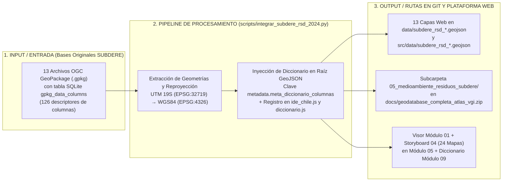
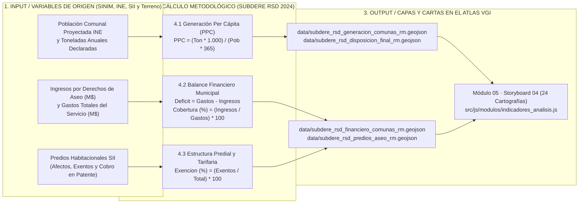

# Catastro Nacional de Residuos Sólidos Domiciliarios (RSD 2024) — Región Metropolitana
## Subsecretaría de Desarrollo Regional y Administrativo (SUBDERE)
### Especificación Técnica, Pipeline de Datos y Diccionario de Atributos en el Atlas VGI

Este documento presenta la catalogación técnica, los pipelines de procesamiento e interoperabilidad, las formulaciones metodológicas y el diccionario de los **126 descriptores de columnas** correspondientes a las **13 capas espaciales oficiales** del Catastro Nacional de Residuos Sólidos Domiciliarios (RSD 2024), publicado por la Subsecretaría de Desarrollo Regional y Administrativo (SUBDERE) e integrado en las **132 coberturas operativas** del **Atlas de Información Geográfica Voluntaria (VGI)**.

---

## 🧭 Índice de Contenidos

1. [Ficha Institucional y Metadatos Generales](#1-ficha-institucional-y-metadatos-generales)
2. [Pipeline de Procesamiento y Conservación de Diccionarios en GeoPackage y GeoJSON](#2-pipeline-de-procesamiento-y-conservación-de-diccionarios-en-geopackage-y-geojson)
3. [Catálogo de las 13 Capas Oficiales Integradas y sus Rutas en Git y Web](#3-catálogo-de-las-13-capas-oficiales-integradas-y-sus-rutas-en-git-y-web)
4. [Síntesis Metodológica y Formulaciones Clave (SUBDERE 2024)](#4-síntesis-metodológica-y-formulaciones-clave-subdere-2024)
5. [Diccionario Maestro de Columnas y Variables (126 Descriptores)](#5-diccionario-maestro-de-columnas-y-variables-126-descriptores)
6. [Instrucciones de Carga en SIG de Escritorio, Python y Plataforma Web](#6-instrucciones-de-carga-en-sig-de-escritorio-python-y-plataforma-web)
7. [Cita Bibliográfica Sugerida (Norma APA 7ª Edición)](#7-cita-bibliográfica-sugerida-norma-apa-7ª-edición)

---

## 1. Ficha Institucional y Metadatos Generales

| Parámetro | Detalle Institucional |
| :--- | :--- |
| **Entidad Custodia** | Subsecretaría de Desarrollo Regional y Administrativo (SUBDERE) |
| **Ministerio** | Ministerio del Interior y Seguridad Pública, Gobierno de Chile |
| **Programa Responsable** | Programa Nacional de Residuos Sólidos |
| **Fecha de Publicación** | Marzo de 2024 |
| **Período de Referencia** | 2022–2024 (Datos operativos, presupuestarios SINIM y proyecciones censales) |
| **Ámbito Territorial** | Región Metropolitana de Santiago (`CUT 13`) — 52 municipios y comunas |
| **Marco Normativo** | Ley N° 20.285 sobre Acceso a la Información Pública; DFL 1/2006 de Interior (LOC Municipalidades); Ley N° 20.920 (Ley REP); D.S. N° 189/2005 (MINSAL, Reglamento Rellenos Sanitarios) |
| **Repositorio Oficial de Origen** | [Portal Proactiva SUBDERE](https://proactiva.subdere.gov.cl/handle/123456789/635) |
| **Documento Técnico de Síntesis** | [Síntesis Nacional Catastro RSD 2024 (PDF, 42 páginas)](https://proactiva.subdere.gov.cl/bitstream/handle/123456789/635/Sintesis%20Nacional_Diagn%c3%b3stico%20y%20Catastro%20Nacional%20de%20RSD%20Marzo_2024.pdf?sequence=1&isAllowed=y) |
| **Formatos Almacenados** | OGC GeoPackage (`.gpkg`) con comentarios nativos en `gpkg_data_columns` y GeoJSON (`.geojson`) en `EPSG:4326` para el visor web |
| **Sistema de Referencia (CRS)** | WGS84 (`EPSG:4326`) para visualización web y reproyección a UTM Huso 19 Sur (`EPSG:32719`) para cálculos métricos |

---

## 2. Pipeline de Procesamiento y Conservación de Diccionarios en GeoPackage y GeoJSON



Un requerimiento técnico central para este conjunto de datos consiste en la **preservación íntegra de los comentarios y alias de columnas**:

1. **Estructura en GeoJSON (`RFC 7946`):** El formato GeoJSON estándar almacena pares clave-valor dentro de `properties`, por lo que cada archivo `data/subdere_rsd_*.geojson` incorpora en su raíz el objeto `metadata.meta_diccionario_columnas` con los títulos, definiciones, fórmulas y unidades de medida de cada atributo.
2. **Estructura en GeoPackage (`OGC GPKG`):** Cada archivo `.gpkg` conserva las tablas del estándar OGC `gpkg_data_columns` y `gpkg_extensions`, registrando:
   * `table_name`: Nombre de la tabla espacial.
   * `column_name`: Código del campo (`PTA`, `Ppc_corr`, `Aseo_año`, `Criticidad`).
   * `name` y `title`: Título normalizado y etiqueta legible en español.
   * `description`: Definición técnica, fórmula de cálculo y unidad de medida.

---

## 3. Catálogo de las 13 Capas Oficiales Integradas y sus Rutas en Git y Web

| N° | ID en `src/js/modulos/ide_chile.js` | Ruta GeoJSON en `data/` y `src/data/` | Geometría | Registros | Columnas | Archivo GeoPackage Original |
| :-: | :--- | :--- | :--- | :-: | :-: | :--- |
| `01` | `subdere_rsd_analisis_costos_comuna_rm` | `data/subdere_rsd_analisis_costos_comuna_rm.geojson` | Polígonos Comunales | 73 | 23 | `Analisis_Costos_Comuna_RM.gpkg` |
| `02` | `subdere_rsd_poblacion_atendida_pta_puntos_rm` | `data/subdere_rsd_poblacion_atendida_pta_puntos_rm.geojson` | Puntos (Centroides) | 52 | 27 | `Poblacion_Comunal_Atendida_PTA_p_RM.gpkg` |
| `03` | `subdere_rsd_poblacion_comunal_pta_poligonos_rm` | `data/subdere_rsd_poblacion_comunal_pta_poligonos_rm.geojson` | Polígonos Comunales | 73 | 29 | `Poblacion_Comunal_PTA_RM.gpkg` |
| `04` | `subdere_rsd_ciudades_poblacion_rm` | `data/subdere_rsd_ciudades_poblacion_rm.geojson` | Polígonos Urbanos | 81 | 13 | `Ciudades_Pb_Pol_RM.gpkg` |
| `05` | `subdere_rsd_criticidad_sitios_disposicion_rm` | `data/subdere_rsd_criticidad_sitios_disposicion_rm.geojson` | Puntos (Rellenos) | 4 | 33 | `Criticidad_Sitios_Disposicion_RSD_Ene24_RM.gpkg` |
| `06` | `subdere_rsd_distancia_municipio_sdf_rm` | `data/subdere_rsd_distancia_municipio_sdf_rm.geojson` | Líneas de Transporte | 52 | 6 | `Distancia_Municipio_SDF_RM.gpkg` |
| `07` | `subdere_rsd_gastos_ingresos_sinim_rm` | `data/subdere_rsd_gastos_ingresos_sinim_rm.geojson` | Polígonos Comunales | 100 | 32 | `Gastos_Ingresos_SINIM_RM.gpkg` |
| `08` | `subdere_rsd_recoleccion_transporte_operativo_rm` | `data/subdere_rsd_recoleccion_transporte_operativo_rm.geojson` | Polígonos Comunales | 73 | 18 | `Recoleccion_Transporte_RM.gpkg` |
| `09` | `subdere_rsd_ppc_generacion_pta_rm` | `data/subdere_rsd_ppc_generacion_pta_rm.geojson` | Polígonos Comunales | 73 | 16 | `RSD_PPC_PTA_RM.gpkg` |
| `10` | `subdere_rsd_sdf_comunas_destino_rm` | `data/subdere_rsd_sdf_comunas_destino_rm.geojson` | Polígonos Comunales | 73 | 21 | `SDF_Comunas_RM.gpkg` |
| `11` | `subdere_rsd_sdf_municipios_puntos_rm` | `data/subdere_rsd_sdf_municipios_puntos_rm.geojson` | Puntos (Municipios) | 52 | 20 | `SDF_Municipios_RM.gpkg` |
| `12` | `subdere_rsd_sitios_disposicion_instalaciones_rm` | `data/subdere_rsd_sitios_disposicion_instalaciones_rm.geojson` | Puntos (Instalaciones) | 4 | 27 | `Sitios_Disposicion_RSD_Ene24_RM.gpkg` |
| `13` | `subdere_rsd_sitios_intermedios_transferencia_rm` | `data/subdere_rsd_sitios_intermedios_transferencia_rm.geojson` | Puntos (Transferencia) | 1 | 20 | `Sitios_Intermedios_Disposicion_RSD_Ene24_RM.gpkg` |

---

## 4. Síntesis Metodológica y Formulaciones Clave (SUBDERE 2024)



El Catastro de Residuos Sólidos Domiciliarios de SUBDERE emplea indicadores normalizados para caracterizar el servicio de recolección, transporte y disposición final a escala comunal y metropolitana:

### 4.1. Población Atendida (`PTA`, `PCA` y `PFP`)
* **Población Comunal Atendida (`PCA`):** Población residente comunal que cuenta efectivamente con servicio de recolección de residuos domiciliarios:
  ```text
  PCA = (Poblacion_Urbana * Proporcion_Cobertura_Urbana) + (Poblacion_Rural * Proporcion_Cobertura_Rural)
  ```
* **Población Flotante Turística (`PFP`):** Número estimado de personas equivalentes al año generadas por pernoctaciones y flujos diarios según registros de SERNATUR y bases técnicas del Fondo Común Municipal.
* **Población Total Atendida (`PTA`):** Base demográfica total sobre la que se calculan las tasas de generación y requerimientos sanitarios:
  ```text
  PTA = PCA + PFP
  ```

### 4.2. Tasas de Generación Per Cápita (`Ppc` y `Ppc_corr`)
* **Producción Per Cápita Residente (`Ppc`):** Generación diaria de residuos considerando exclusivamente la población residente comunal atendida (`PCA`):
  ```text
  Ppc = (RSDyA_Ton * 1.000) / (PCA * 365)   [Unidad: kg / (hab * día)]
  ```
* **Producción Per Cápita Corregida (`Ppc_corr`):** Generación diaria considerando la población total atendida incluida la población flotante (`PTA`):
  ```text
  Ppc_corr = (RSDyA_Ton * 1.000) / (PTA * 365)   [Unidad: kg / (hab * día)]
  ```
  *Alcance territorial:* Esta corrección resulta indispensable en comunas centrales como **Santiago** (Barrio Brasil / Centro Histórico) o Providencia, donde la elevada afluencia diaria de población flotante incrementa el tonelaje recolectado respecto de la población residente censada.

### 4.3. Costos del Servicio de Aseo Comunal
* **Costo Total de Aseo Anual (`Aseo_año`):** Suma de los contratos devengados de recolección y transporte (`RT_año`) más la tarifa por disposición final en relleno sanitario (`DF_año`):
  ```text
  Aseo_año = RT_año + DF_año   [Unidad: CLP / año]
  ```
* **Costo Unitario por Habitante (`Aseo_Hab`):** Costo total anual dividido por la población comunal atendida:
  ```text
  Aseo_Hab = Aseo_año / PCA   [Unidad: CLP / (hab * año)]
  ```
* **Costo Unitario por Tonelada (`Aseo_Ton`):** Costo total anual dividido por el tonelaje anual de residuos gestionados:
  ```text
  Aseo_Ton = Aseo_año / RSDyA_Ton   [Unidad: CLP / Ton]
  ```

### 4.4. Sitios de Disposición Final en la Región Metropolitana
En la Región Metropolitana operan tres rellenos sanitarios autorizados y una estación de transferencia metropolitana que reciben los residuos de los 52 municipios:
1. **Relleno Sanitario Loma Los Colorados:** Ubicado en Til Til (KDM S.A.), recibe los residuos de la zona norte y centro de la capital (incluida la Comuna de Santiago).
2. **Relleno Sanitario Santa Marta:** Ubicado en Talagante (Consorcio Santa Marta S.A.), receptor principal de la zona sur y suroriente.
3. **Relleno Sanitario Santiago Poniente:** Ubicado en Maipú (Proactiva / Veolia), atiende comunas de la zona poniente y surponiente.
4. **Estación de Transferencia Quilicura (KDM):** Instalación intermedia de compactación y transbordo ferroviario/carretero hacia Loma Los Colorados.

---

## 5. Diccionario Maestro de Columnas y Variables (126 Descriptores)

| Campo Original | Título Descriptivo | Definición Técnica | Unidad de Medida | Fuente Oficial |
| :--- | :--- | :--- | :--- | :--- |
| `Aseo_Hab` | **Costo Anual de Aseo por Habitante** | Gasto municipal anual en aseo dividido por el número de habitantes residentes (`Aseo_año / Pobl_INE`). | CLP / hab · año | SUBDERE / SINIM |
| `Aseo_SINIM` | **Gasto en Aseo Reportado al SINIM** | Gasto devengado en el ítem de aseo, recolección de basura y vertederos según balances presupuestarios del SINIM. | CLP / año | SINIM |
| `Aseo_Ton` | **Costo de Aseo por Tonelada de Residuos** | Costo unitario global por cada tonelada de residuo gestionada (`Aseo_año / RSDyA`). | CLP / Ton | SUBDERE / SINIM |
| `Aseo_ao` | **Gasto Anual Total en Servicios de Aseo** | Gasto total devengado anual del municipio por concepto de recolección, transporte y disposición final de residuos. | CLP / año | SINIM / Contratos Municipales |
| `Aseo_año` | **Gasto Anual Total en Servicios de Aseo** | Gasto total devengado anual del municipio por concepto de recolección, transporte y disposición final de residuos. | CLP / año | SINIM / Contratos Municipales |
| `AutSanitar` | **Resolución de Autorización Sanitaria** | Resolución Sanitaria emitida por la SEREMI de Salud que autoriza la operación de la instalación bajo D.S. N° 189/2008. | Resolución Sanitaria | SEREMI Salud / MINSAL |
| `CAP_PROV` | **Capital Provincial** | Condición de capital provincial de la entidad urbana (`'SI'` / `'NO'`). | Texto | SUBDERE / DPA |
| `CATEGORIA` | **Categoría Censal de Entidad** | Clasificación censal de la entidad urbana o rural (Ciudad, Pueblo, Aldea). | Texto | INE |
| `COD_COM` | **Código Numérico de Comuna** | Identificador numérico entero de la comuna. | Entero | SUBDERE / INE |
| `COD_P` | **Código Numérico de Provincia** | Identificador numérico entero de la provincia. | Entero | SUBDERE / INE |
| `COD_R` | **Código Numérico de Región** | Identificador numérico entero de la región político-administrativa (`13` para la Región Metropolitana). | Entero | SUBDERE / INE |
| `COMUNA` | **Nombre de la Comuna** | Denominación oficial de la comuna del territorio evaluado. | Texto | DPA / SUBDERE |
| `COMUNA_QUE_DISPONE` | **Comuna Generadora que Envía Residuos** | Nombre de la comuna que traslada y descarga sus residuos en la instalación de disposición final. | Texto | SUBDERE |
| `CUT_COM` | **Código Único Territorial de la Comuna** | Código oficial de la comuna según la DPA del Estado de Chile (ej. `'13101'` para Santiago). | Código DPA | SUBDERE / DPA |
| `CUT_PROV` | **Código Único Territorial de la Provincia** | Código oficial de la provincia según la DPA del Estado de Chile (ej. `'131'` para Provincia de Santiago). | Código DPA | SUBDERE / DPA |
| `CUT_REG` | **Código Único Territorial de la Región** | Código oficial de la región según la División Político-Administrativa (DPA) del Estado de Chile (`'13'`). | Código DPA | SUBDERE / DPA |
| `Cierre` | **Año Proyectado de Cierre** | Año estimado de agotamiento de capacidad y término de la fase operativa del sitio. | Año | SUBDERE |
| `Clase` | **Clasificación Sanitaria y Operativa del Sitio** | Tipo de instalación según D.S. N° 189/2008 MINSAL (`'Relleno Sanitario'`, `'Relleno Manual'`, `'Vertedero'`, `'Estación de Transferencia'`). | Texto | SUBDERE / MINSAL |
| `CobRural` | **Cobertura Rural de Recolección** | Porcentaje de cobertura del servicio de recolección en asentamientos rurales. | % | Encuesta SUBDERE / Municipios |
| `CobUrbana` | **Cobertura Urbana de Recolección** | Porcentaje de cobertura del servicio municipal o concesionado de recolección en el área urbana. | % | Encuesta SUBDERE / Municipios |
| `Cob_Rur` | **Cobertura de Aseo en Zona Rural** | Porcentaje de la población rural que dispone de servicio de recolección domiciliaria o en puntos de acopio. | % | Encuesta SUBDERE / Municipios |
| `Cob_Urb` | **Cobertura de Aseo en Zona Urbana** | Porcentaje de la población urbana que cuenta con servicio formal de recolección de residuos sólidos domiciliarios. | % | Encuesta SUBDERE / Municipios |
| `Comuna` | **Nombre de la Comuna** | Denominación oficial de la comuna en capas de trazado y distancias. | Texto | SUBDERE |
| `Costo_Ton` | **Tarifa por Tonelada Dispuesta** | Precio o tarifa unitaria cobrada por el sitio de disposición final por cada tonelada de RSDyA ingresada. | CLP / Ton | SUBDERE |
| `Costo_a` | **Costo Anual de Disposición Final** | Monto anual pagado por la municipalidad al sitio de disposición por la recepción de sus residuos. | CLP / año | SUBDERE |
| `Crit_PTA` | **Nivel de Criticidad por Población Total Atendida** | Categorización del impacto social según el volumen de población que depende del sitio. | Categoría | SUBDERE |
| `Crit_VU` | **Nivel de Criticidad por Vida Útil** | Categorización del riesgo de agotamiento por vida útil (`'Crítica'` para `< 3 años`, `'Media'`, `'Baja'`). | Categoría | SUBDERE |
| `Criticidad` | **Calificación Integral de Criticidad del Sitio** | Evaluación final de criticidad técnica, sanitaria y operativa del sitio de disposición final (`'Crítica'`, `'Alta'`, `'Media'`, `'Baja'`). | Categoría | SUBDERE |
| `DF_Hab` | **Costo de Disposición Final por Habitante** | Costo per cápita de la disposición final en relleno sanitario (`DF_año / Pobl_INE`). | CLP / hab · año | SUBDERE |
| `DF_Ton` | **Costo de Disposición Final por Tonelada** | Tarifa media por tonelada dispuesta en el relleno sanitario (`DF_año / RSDyA`). | CLP / Ton | SUBDERE |
| `DF_ao` | **Costo Anual de Disposición Final** | Gasto anual devengado por el pago de tarifas de ingreso y disposición final en el relleno sanitario. | CLP / año | Chile Proveedores / SINIM |
| `DF_año` | **Costo Anual de Disposición Final** | Gasto anual devengado por el pago de tarifas de ingreso y disposición final en el relleno sanitario. | CLP / año | Chile Proveedores / SINIM |
| `DerAseo` | **Recaudación Total por Derechos de Aseo** | Ingresos percibidos por concepto de tarifas de aseo domiciliario cobradas a vecinos y comercios. | CLP / año | SINIM |
| `Deraseo_Dir` | **Recaudación por Derechos de Aseo de Cobro Directo** | Cobros de tarifas de aseo facturados y recaudados directamente por el municipio. | CLP / año | SINIM |
| `DistSDF` | **Distancia Estimada al Sitio de Disposición Final** | Distancia media de transporte desde el centro de gravedad comunal hasta el relleno sanitario receptor. | Kilómetros (km) | SUBDERE / Geoproceso |
| `Dist_SDF` | **Distancia de Transporte al Sitio de Disposición Final** | Distancia efectiva en kilómetros desde el municipio hasta la báscula de entrada del sitio receptor. | Kilómetros (km) | SUBDERE / Geoproceso |
| `ENTIDAD` | **Entidad Poblada** | Nombre de la ciudad, asentamiento o localidad poblada reconocida por el INE. | Texto | INE |
| `ESTE` | **Coordenada Este UTM** | Coordenada geográfica proyectada en metros en el eje X (`EPSG:32719`, UTM WGS84 Huso 19 Sur). | Metros | SUBDERE |
| `Estado` | **Estado Operativo del Sitio** | Situación operativa formal (`'Operativo'`, `'En Cierre'`, `'Paralizado'`, `'Cerrado'`). | Texto | SUBDERE |
| `FrecRural` | **Frecuencia Semanal de Recolección Rural** | Número de días a la semana en que se efectúa la recolección en localidades y caminos rurales. | Días / semana | Encuesta SUBDERE |
| `FrecUrbana` | **Frecuencia Semanal de Recolección Urbana** | Número de días a la semana en que el camión recolector recorre el área urbana (`3`, `6` o `7` días/semana). | Días / semana | Encuesta SUBDERE |
| `Fuente` | **Fuente de Origen del Dato de Generación** | Plataforma o registro de procedencia del reporte de residuos (`'Encuesta SUBDERE'`, `'RETC - Ventanilla Única MMA'`). | Texto | SUBDERE |
| `Gastos_Mu` | **Gastos Municipales Totales Devengados** | Presupuesto anual total ejecutado y devengado por la municipalidad según el SINIM. | CLP / año | SINIM / SUBDERE |
| `IPP` | **Ingresos Propios Permanentes (IPP)** | Ingresos generados por la propia gestión municipal (derechos de aseo, patentes comerciales, permisos de circulación). | CLP / año | SINIM |
| `ImpT` | **Recaudación de Aseo vía Impuesto Territorial (TGR)** | Recaudación de derechos de aseo canalizada a través de las cuotas del Impuesto Territorial (Contribuciones). | CLP / año | TGR / SINIM |
| `IngTran` | **Ingresos por Transferencias del Estado** | Transferencias corrientes y de capital recibidas desde el Gobierno Central, SUBDERE o Gobierno Regional. | CLP / año | SINIM |
| `Ing_FCM` | **Ingresos por Fondo Común Municipal (FCM)** | Aporte financiero recibido por la municipalidad proveniente del Fondo Común Municipal. | CLP / año | SINIM / SUBDERE |
| `Ingre_Mu` | **Ingresos Municipales Totales Percibidos** | Total de recursos financieros percibidos por la municipalidad durante el ejercicio anual. | CLP / año | SINIM |
| `Ini_Oper` | **Año de Inicio de Operaciones** | Año formal en que la instalación comenzó la recepción de residuos sólidos domiciliarios. | Año | SUBDERE / SEREMI Salud |
| `InvRExt` | **Inversión Financiada con Recursos Externos** | Monto de inversión municipal financiado mediante fondos externos (FNDR, PMU, PMB, Ministerios). | CLP / año | SINIM |
| `InvRP` | **Inversión Financiada con Recursos Propios** | Monto de inversión ejecutado con recursos propios de la municipalidad. | CLP / año | SINIM |
| `Inversion` | **Inversión Municipal Total** | Gasto municipal devengado en proyectos de inversión real e iniciativas de infraestructura. | CLP / año | SINIM |
| `Km` | **Distancia Lineal en Kilómetros** | Longitud métrica de la ruta de transporte hacia el sitio de disposición final. | Kilómetros (km) | SUBDERE |
| `ModRecoleccion` | **Modalidad Vehicular de Recolección** | Tipología de vehículos predominante en las rutas de recolección (Camión compactador, Camión tolva, Caja ampliroll). | Texto | Encuesta SUBDERE |
| `NComun` | **Número de Comunas Atendidas por el Sitio** | Cantidad de municipalidades que envían y disponen sus residuos en esta instalación. | Comunas | SUBDERE |
| `NOMBRE` | **Nombre Oficial del Sitio de Disposición Final** | Nombre del relleno sanitario, vertedero o estación de transferencia (`'Relleno Sanitario Loma Los Colorados'`, `'Santa Marta'`, `'Santiago Poniente'`). | Texto | SUBDERE / SEREMI Salud |
| `NORTE` | **Coordenada Norte UTM** | Coordenada geográfica proyectada en metros en el eje Y (`EPSG:32719`, UTM WGS84 Huso 19 Sur). | Metros | SUBDERE |
| `Operacio` | **Régimen de Operación de la Instalación** | Modelo de administración del sitio de disposición final (`'Privada'`, `'Municipal'`, `'Mixta'`). | Texto | SUBDERE |
| `Operador` | **Empresa u Organismo Operador** | Empresa o consorcio responsable de la operación diaria del relleno (`KDM Tratamiento`, `Consorcio Santa Marta`, `Proactiva/Veolia`). | Texto | SUBDERE |
| `OtrosIngr` | **Otros Ingresos Municipales** | Otros recursos y rentas percibidas por el municipio. | CLP / año | SINIM |
| `PCA` | **Población Comunal Atendida (PCA)** | Total de población residente con cobertura de servicios de aseo en la comuna (`PCA_Urb + PCA_Rur`). | Habitantes | SUBDERE |
| `PCA_2022` | **Población Comunal Atendida Año 2022** | Población comunal con cobertura de recolección de aseo registrada en el año base 2022. | Habitantes | SUBDERE |
| `PCA_PRA` | **Participación de PCA Comunal sobre la Población Regional Atendida** | Porcentaje que representa la población atendida de la comuna sobre el total atendido en la Región Metropolitana. | % | SUBDERE |
| `PCA_PTA` | **Porcentaje de PCA sobre la PTA** | Proporción que representa la población residente atendida respecto al universo de la Población Total Atendida (%). | % | SUBDERE |
| `PCA_Pob` | **Porcentaje de Población Atendida sobre Población Total** | Relación porcentual entre la población comunal atendida (`PCA`) y la población proyectada comunal (`Pob_2022`). | % | SUBDERE |
| `PCA_Rur` | **Población Comunal Atendida en Zona Rural** | Número de habitantes rurales efectivamente atendidos por el servicio de aseo (`Pob_Rur * Cob_Rur`). | Habitantes | SUBDERE |
| `PCA_Urb` | **Población Comunal Atendida en Zona Urbana** | Número de habitantes urbanos efectivamente beneficiarios del servicio de extracción de residuos (`Pob_Urb * Cob_Urb`). | Habitantes | SUBDERE |
| `PFP` | **Población Flotante Promedio Ponderada** | Población flotante promedio anualizada calculada para ponderar el incremento en la generación de residuos domiciliarios. | Habitantes promedio | SUBDERE |
| `PFP_PTA` | **Porcentaje de Población Flotante sobre la PTA** | Proporción que representa la población flotante turística respecto a la Población Total Atendida (%). | % | SUBDERE |
| `PFP_R` | **Población Flotante Regional** | Población flotante turística acumulada a nivel regional. | Habitantes | SUBDERE |
| `PFT_2022` | **Población Flotante Turística Año 2022** | Estimación del volumen de población flotante en temporada alta según calificación anual de SERNATUR y bases técnicas del FCM. | Habitantes flotantes | SERNATUR / SINIM / SUBDERE |
| `PPon_PTA` | **Puntaje Ponderado por Población Atendida** | Puntaje ponderador asignado en función de la magnitud de la Población Total Atendida. | Puntaje | SUBDERE |
| `PRA` | **Población Regional Atendida** | Total de habitantes con cobertura de servicios de aseo a nivel regional. | Habitantes | SUBDERE |
| `PROVINCIA` | **Nombre de la Provincia** | Denominación oficial de la provincia político-administrativa. | Texto | DPA / SUBDERE |
| `PTA` | **Población Total Atendida (PTA)** | Suma de la Población Comunal Atendida residente más la Población Flotante Promedio (`PTA = PCA + PFP`). | Habitantes totales | SUBDERE |
| `PTA_22` | **Población Total Atendida Consolidada 2022** | Población total atendida (residente con cobertura + flotante) registrada para el año 2022. | Habitantes | SUBDERE |
| `PTA_R` | **Población Total Atendida Regional** | Población total atendida en toda la Región Metropolitana (`PRA + PFP_R`). | Habitantes | SUBDERE |
| `PTAc_PTAr` | **Participación de PTA Comunal sobre la PTA Regional** | Porcentaje de la Población Total Atendida de la comuna en el contexto regional metropolitano. | % | SUBDERE |
| `P_Cierre` | **Estado del Plan de Cierre** | Condición administrativa y técnica del Plan de Cierre y Sellado de la instalación (`'Aprobado'`, `'En Trámite'`, `'Sin Plan'`). | Texto | SEREMI Salud / SUBDERE |
| `Po_InvRP` | **Porcentaje de Inversión con Recursos Propios** | Proporción de la inversión financiada con fondos autónomos del municipio (%). | % | SINIM |
| `Pob_2022` | **Población Proyectada al Año 2022 (INE)** | Estimación y proyección de población total comunal realizada por el INE para el año 2022. | Habitantes | INE / SUBDERE |
| `Pob_Rur` | **Población en Zona Rural** | Habitantes residentes en áreas rurales o asentamientos dispersos de la comuna según el INE. | Habitantes | INE / SUBDERE |
| `Pob_Urb` | **Población en Zona Urbana** | Habitantes residentes en el área urbana consolidada de la comuna según la delimitación censal del INE. | Habitantes | INE / SUBDERE |
| `Pobl_INE` | **Población Comunal Oficial INE** | Población comunal de referencia según estadísticas del INE. | Habitantes | INE |
| `PorDAseo` | **Porcentaje de Derechos de Aseo sobre Ingresos Totales** | Participación porcentual de la recaudación de aseo sobre el total de ingresos municipales percibidos. | % | SINIM |
| `PorImpT` | **Porcentaje de Cobro de Aseo vía Impuesto Territorial** | Proporción de la recaudación de aseo que ingresa a través del rol de contribuciones TGR. | % | SINIM |
| `Por_Aseo` | **Porcentaje del Presupuesto Municipal Destinado a Aseo** | Participación porcentual del gasto en aseo sobre el gasto total municipal devengado (`Aseo_SINIM / Gastos_Mu * 100`). | % | SINIM / SUBDERE |
| `Por_CoDir` | **Porcentaje de Cobro Directo de Aseo** | Proporción de la recaudación de aseo que ingresa por cobro directo municipal. | % | SINIM |
| `Por_RExt` | **Porcentaje de Inversión con Recursos Externos** | Proporción de la cartera de inversiones financiada con fondos sectoriales o regionales externos (%). | % | SINIM |
| `Por_Trans` | **Porcentaje de Transferencias Fiscales** | Proporción de transferencias del Estado sobre los ingresos totales (%). | % | SINIM |
| `PorcOtros` | **Porcentaje de Otros Ingresos** | Participación de otros ingresos no tributarios sobre el total percibido (%). | % | SINIM |
| `Porc_FCM` | **Porcentaje de Dependencia del Fondo Común Municipal** | Nivel de dependencia del presupuesto municipal respecto a las transferencias del FCM (`Ing_FCM / Ingre_Mu * 100`). | % | SINIM |
| `Porc_IPP` | **Porcentaje de Ingresos Propios Permanentes** | Proporción de autonomía financiera del municipio (`IPP / Ingre_Mu * 100`). | % | SINIM |
| `Porc_Inv` | **Porcentaje de Inversión sobre Gasto Municipal** | Porcentaje del presupuesto municipal devengado que se destina a inversión efectiva (`Inversion / Gastos_Mu * 100`). | % | SINIM |
| `Porc_Rur` | **Porcentaje de Población Rural** | Proporción porcentual de habitantes rurales respecto a la población total comunal. | % | INE / SUBDERE |
| `Porc_urb` | **Porcentaje de Población Urbana** | Proporción porcentual de habitantes urbanos respecto a la población total comunal. | % | INE / SUBDERE |
| `Ppc` | **Producción Per Cápita de Residuos (PPC Base PCA)** | Cantidad promedio de residuos generados diariamente por habitante residente (`(RSDyA_Ton * 1000) / (PCA * 365)`). | kg / hab · día | SUBDERE |
| `Ppc_Corr` | **Producción Per Cápita Corregida por Población Flotante (PPC Base PTA)** | Generación per cápita diaria calculada sobre la Población Total Atendida (`(RSDyA_Ton * 1000) / (PTA * 365)`). | kg / hab · día | SUBDERE |
| `Ppc_corr` | **Producción Per Cápita Corregida por Población Flotante (PPC Base PTA)** | Generación per cápita diaria calculada sobre la Población Total Atendida (`(RSDyA_Ton * 1000) / (PTA * 365)`). | kg / hab · día | SUBDERE |
| `Ppon_VU` | **Puntaje Ponderado por Vida Útil Remanente** | Puntuación técnica asignada según los años de vida útil restantes del sitio. | Puntaje | SUBDERE |
| `Propieta` | **Propietario del Terreno e Instalación** | Persona jurídica o institución dueña del predio donde opera el sitio. | Texto | SUBDERE |
| `RCA` | **Resolución de Calificación Ambiental (RCA)** | Resolución de Calificación Ambiental favorable emitida por el Servicio de Evaluación Ambiental (SEA / COREMA). | RCA | SEA / MMA |
| `REGION` | **Nombre de la Región** | Denominación oficial de la región político-administrativa. | Texto | DPA / SUBDERE |
| `RETC_ID` | **Identificador Oficial en Registro RETC (MMA)** | Código único del establecimiento asignado por el Registro de Emisiones y Transferencias de Contaminantes del MMA. | Código RETC | RETC / MMA |
| `RSD_Ton` | **Toneladas Anuales de RSDyA Recibidas** | Volumen anual de residuos sólidos domiciliarios y asimilables recepcionados en el sitio de disposición final. | Toneladas/año | SUBDERE / RETC |
| `RSD_corr` | **Generación de RSDyA Corregida** | Volumen anual de residuos corregido y conciliado según registros de balanza en sitios de disposición final. | Toneladas/año | SUBDERE |
| `RSDyA` | **Generación Total de Residuos Sólidos Domiciliarios y Asimilables** | Volumen anual de residuos sólidos domiciliarios y asimilables generados en la comuna y dispuestos en sitios autorizados. | Toneladas/año | Encuesta SUBDERE / RETC MMA |
| `RSDyA_22` | **Generación de RSDyA Año 2022** | Toneladas anuales de residuos domiciliarios y asimilables reportadas por el municipio para el año 2022. | Toneladas/año | SUBDERE / RETC |
| `RT_Hab` | **Costo de Recolección y Transporte por Habitante** | Costo per cápita del servicio de recolección y transporte (`RT_año / Pobl_INE`). | CLP / hab · año | SUBDERE |
| `RT_Ton` | **Costo de Recolección y Transporte por Tonelada** | Costo unitario de recolección y transporte por cada tonelada transportada (`RT_año / RSDyA`). | CLP / Ton | SUBDERE |
| `RT_ao` | **Costo Anual de Recolección y Transporte** | Monto total devengado por el municipio para el contrato u operación de recolección y transporte de basura. | CLP / año | Chile Proveedores / SINIM |
| `RT_año` | **Costo Anual de Recolección y Transporte** | Monto total devengado por el municipio para el contrato u operación de recolección y transporte de basura. | CLP / año | Chile Proveedores / SINIM |
| `RTyDF_Hab` | **Costo Consolidado RT + DF por Habitante** | Gasto total anual por habitante en la gestión completa de sus residuos sólidos domiciliarios. | CLP / hab · año | SUBDERE |
| `RTyDF_Ton` | **Costo Consolidado RT + DF por Tonelada** | Costo total unitario por tonelada gestionada integralmente (recolección, flete y disposición). | CLP / Ton | SUBDERE |
| `RTyDF_ao` | **Costo Anual Consolidado RT + DF** | Suma de los costos anuales de Recolección, Transporte y Disposición Final (`RT_año + DF_año`). | CLP / año | SUBDERE |
| `RTyDF_año` | **Costo Anual Consolidado RT + DF** | Suma de los costos anuales de Recolección, Transporte y Disposición Final (`RT_año + DF_año`). | CLP / año | SUBDERE |
| `RecDiferenciada` | **Existencia de Recolección Diferenciada / Reciclaje** | Indica si el municipio opera programas formales de recolección segregada de reciclables en origen (`'SI'` / `'NO'`). | Texto (`'SI'` / `'NO'`) | Encuesta SUBDERE / Ley REP |
| `SITIO` | **Nombre del Sitio de Disposición Final Destinatario** | Nombre de la instalación receptora donde la comuna deposita sus residuos. | Texto | SUBDERE |
| `SistRecoleccion` | **Sistema Operativo de Recolección** | Mecanismo técnico de recolección domiciliaria implementado (Puerta a puerta, Contenedores comunitarios, Puntos limpios o Mixto). | Texto | Encuesta SUBDERE |
| `TIPO` | **Tipo de Asentamiento** | Clasificación territorial urbana o rural. | Texto | INE |
| `TipoServicio` | **Modalidad de Administración del Servicio** | Régimen de gestión del servicio de aseo y recolección (Concesión privada, Administración Municipal directa, Mixto). | Texto | Encuesta SUBDERE / Municipios |
| `Ubicacio` | **Comuna y Sector de Emplazamiento del Sitio** | Comuna o sector geográfico donde se localiza físicamente la instalación de disposición final. | Texto | SUBDERE |
| `Ubicación` | **Comuna y Sector de Emplazamiento del Sitio** | Comuna o sector geográfico donde se localiza físicamente la instalación de disposición final. | Texto | SUBDERE |
| `VU_PTA` | **Índice Combinado de Criticidad (Vida Útil / Población)** | Índice multivariado que cruza la urgencia de agotamiento con la masa crítica poblacional atendida. | Índice | SUBDERE |
| `VidaUtil` | **Vida Útil Remanente Estimada** | Capacidad volumétrica remanente proyectada en años de operación a contar de enero de 2024. | Años | SUBDERE / SEA |
| `cod_com2` | **Código Comunal Secundario** | Identificador numérico comunal alternativo homologado en las bases del SINIM. | Entero | SINIM / SUBDERE |

---

## 6. Instrucciones de Carga en SIG de Escritorio, Python y Plataforma Web

### 6.1. Apertura en QGIS desde el Paquete Consolidado
1. Descomprima `docs/geodatabase_completa_atlas_vgi.zip` y navegue a la subcarpeta:
   `05_medioambiente_residuos_subdere/`
2. Arrastre los archivos `.geojson` o `.gpkg` al lienzo de QGIS (versión 3.22 o superior).
3. Para examinar los comentarios de columnas en los archivos `.gpkg`, abra *Propiedades de la Capa* → pestaña *Campos*, donde se despliegan los nombres y alias extraídos de `gpkg_data_columns`.

### 6.2. Carga Programática en Python (`GeoPandas` / `SQLite3`)
```python
import geopandas as gpd
import json

# 1. Cargar geometrías y atributos desde la ruta oficial en el repositorio
ruta_geojson = "data/subdere_rsd_analisis_costos_comuna_rm.geojson"
gdf = gpd.read_file(ruta_geojson)
print(gdf[["COMUNA", "RSDyA", "Aseo_Hab", "Aseo_Ton"]].head())

# 2. Inspeccionar el diccionario de columnas embebido en metadata
with open(ruta_geojson, "r", encoding="utf-8") as f:
    raw = json.load(f)
diccionario = raw.get("metadata", {}).get("meta_diccionario_columnas", {})
print(f"Columnas documentadas en la capa: {len(diccionario)}")
```

### 6.3. Acceso desde la Plataforma Web del Atlas VGI
* **En el Módulo 01 (Visor Territorial):** Abra el subpanel `🏛 Capas IDE` y despliegue el acordeón de **Medio Ambiente, Aseo y Residuos (SUBDERE / MMA)** para activar cualquiera de las 13 capas con un clic.
* **En el Módulo 05 (Indicadores & Storyboards):** Seleccione el **Storyboard 04 (Metabolismo Urbano, Socioambiente, Movilidad y Residuos — 24 Cartografías Temáticas)** para explorar las láminas comparativas de generación per cápita (`Ppc_corr`), costos municipales SINIM y flujos hacia los rellenos sanitarios metropolitanos.

---

## 7. Cita Bibliográfica Sugerida (Norma APA 7ª Edición)

> Subsecretaría de Desarrollo Regional y Administrativo [SUBDERE]. (2024). *Diagnóstico y catastro nacional de residuos sólidos domiciliarios: Síntesis Nacional y Catastro RSD 2024*. Programa Nacional de Residuos Sólidos, Ministerio del Interior y Seguridad Pública, Gobierno de Chile. https://proactiva.subdere.gov.cl/handle/123456789/635
