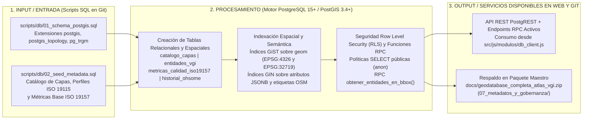
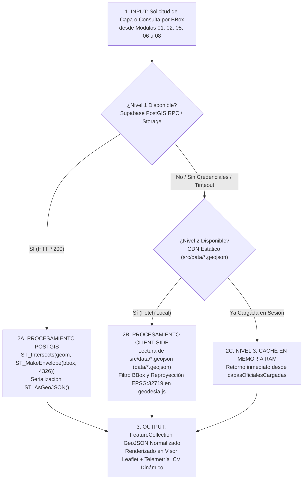
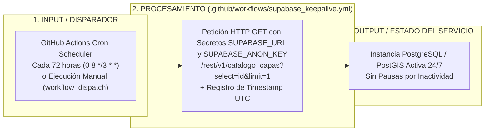

# Guía de Base de Datos Espacial PostgreSQL / PostGIS en Supabase y Resiliencia Híbrida — Atlas VGI

* **Plataforma Web en Producción:** [https://atlasvgiuah.netlify.app](https://atlasvgiuah.netlify.app)
* **Archivos de Esquema y Cliente:** [`scripts/db/01_schema_postgis.sql`](scripts/db/01_schema_postgis.sql) · [`scripts/db/02_seed_metadata.sql`](scripts/db/02_seed_metadata.sql) · [`src/js/modulos/db_client.js`](src/js/modulos/db_client.js) · [`.github/workflows/supabase_keepalive.yml`](.github/workflows/supabase_keepalive.yml).
* **Cobertura Gestionada:** **132 Capas Operativas** (`122` Oficiales del Estado + `10` Macrocategorías VGI `CAT-01` a `CAT-10`) · **140 Descriptores ISO 19110:2016** · **Metadatos ISO 19115 / ISO 19157**.

---

## 1. Propósito de la Arquitectura Relacional Híbrida (PostGIS + CDN Estático)

El **Atlas de Información Geográfica Voluntaria (VGI)** implementa un modelo de persistencia espacial híbrida que combina la capacidad analítica de **PostgreSQL 15+ con la extensión espacial PostGIS 3.4+ (alojada en Supabase)** con la velocidad y disponibilidad perpetua de un **repositorio estático de archivos GeoJSON en CDN (`src/data/*.geojson` ↔ `data/*.geojson`)**.

Esta arquitectura asegura que la plataforma opere con **cero tiempo de inactividad**: si el cliente dispone de conexión al motor PostGIS, puede ejecutar recortes por *Bounding Box* e intersecciones espaciales mediante funciones **RPC (Remote Procedure Calls)**; si la instancia remota no se encuentra configurada o experimenta latencia, el módulo [`src/js/modulos/db_client.js`](src/js/modulos/db_client.js) conmuta de manera transparente hacia las **132 capas locales** y la caché en memoria RAM.

---

## 2. Pipelines de Base de Datos Espacial y Failover (`INPUT` → `PROCESAMIENTO` → `OUTPUT`)

### 2.1. Pipeline de Inicialización del Esquema PostGIS y Carga Semilla



### 2.2. Pipeline de Resolución de Consultas con Triple Failover (`src/js/modulos/db_client.js`)



---

## 3. Estructura del Esquema Relacional Espacial (`scripts/db/01_schema_postgis.sql`)

| Tabla / Objeto en PostgreSQL | Tipo de Objeto | Columnas Clave y Geometría PostGIS | Índices y Restricciones |
| :--- | :---: | :--- | :--- |
| **`public.catalogo_capas`** | Tabla Maestro | `id` (`TEXT PK`), `codigo_bbdd`, `nombre`, `institucion`, `origen` (`'VGI'` \| `'OFICIAL'`), `tipo_geometria`, `archivo_local`, `srid_nativo` (`4326`), `licencia`, `metadatos_iso19115` (`JSONB`). | `PRIMARY KEY (id)`, Índice `GIN` sobre `metadatos_iso19115`, RLS lectura pública (`SELECT TO anon`). |
| **`public.entidades_vgi`** | Tabla Espacial | `uid` (`UUID PK`), `id_capa` (`FK`), `osm_id`, `categoria_vgi` (`CAT-01` a `CAT-10`), `nombre`, `subtipo`, `atributos` (`JSONB`), `geom` (`GEOMETRY(Geometry, 4326)`), `geom_utm19s` (`GEOMETRY(Geometry, 32719)`). | Índice espacial `GiST` sobre `geom` y `geom_utm19s`, Índice `GIN` sobre `atributos`. |
| **`public.metricas_calidad_iso19157`** | Tabla de Auditoría | `id_capa` (`FK`), `c1_linaje`, `c2_completitud`, `c3_consistencia`, `c4_exactitud`, `c5_actualidad`, `icv_wlc_total`, `fase_madurez_ohsome`, `fecha_calculo`. | `FOREIGN KEY (id_capa) REFERENCES catalogo_capas(id)`, verificaciones de rango `[0, 100]`. |
| **`public.obtener_entidades_en_bbox`** | Función RPC (`PL/pgSQL`) | Parámetros: `p_id_capa TEXT, p_min_lon FLOAT, p_min_lat FLOAT, p_max_lon FLOAT, p_max_lat FLOAT`. Retorna `JSONB` (`FeatureCollection` RFC 7946). | Usa `ST_Intersects` con índice `GiST` y calcula área `ST_Area(geom_utm19s)` en `m²`. |

---

## 4. Procedimiento Paso a Paso de Configuración en Supabase

### Paso 1 · Creación del Proyecto y Habilitación de PostGIS
1. Ingrese a [https://supabase.com/dashboard](https://supabase.com/dashboard) y cree un proyecto nuevo (por ejemplo, `atlas-vgi-uah`, región `South America - São Paulo`).
2. Abra la sección **SQL Editor** → **New Query**.

### Paso 2 · Ejecución de los Scripts DDL y Semilla de Metadatos
1. Copie el contenido íntegro de [`scripts/db/01_schema_postgis.sql`](scripts/db/01_schema_postgis.sql), péguelo en el editor SQL y presione **Run**. Este script activa la extensión `postgis`, crea las tablas, configura los índices `GiST`/`GIN`, declara las funciones RPC y habilita las políticas de seguridad **Row Level Security (RLS)** de solo lectura para la clave pública `anon`.
2. Abra una segunda consulta en el **SQL Editor**, copie el contenido de [`scripts/db/02_seed_metadata.sql`](scripts/db/02_seed_metadata.sql) y presione **Run** para poblar el catálogo inicial de coberturas y sus perfiles de metadatos ISO 19115 / ISO 19157.

### Paso 3 · Configuración del Bucket en Supabase Storage (Opcional para Capas Masivas)
1. En el menú lateral de Supabase, diríjase a **Storage** → **New Bucket**.
2. Asigne el nombre exacto **`geodatos-atlas`** y active la casilla **Public bucket**.
3. Esto permite alojar coberturas regionales de gran volumen (como los extractos metropolitanos de Geofabrik RM o el paquete `geodatabase_completa_atlas_vgi.zip`) descargables mediante URLs públicas firmadas por CDN.

### Paso 4 · Vinculación de Credenciales Públicas en el Cliente Web (`src/js/config.js`)
1. En el panel de Supabase, vaya a **Project Settings** → **API** y copie la **Project URL** y la clave pública **`anon` / `public`** (nunca exponga la clave `service_role` en archivos del cliente).
2. En [`src/js/config.js`](src/js/config.js) y [`config/config.json`](config/config.json), actualice el bloque `supabase`:
   ```javascript
   supabase: {
     habilitado: true,
     url: 'https://tu-proyecto-id.supabase.co',
     anonKey: 'eyJhbGciOiJIUzI1NiIsInR5cCI6IkpXVCJ9...',
     bucketStorage: 'geodatos-atlas',
     esquema: 'public'
   }
   ```

---

## 5. Pipeline de Mantenimiento Continuo Keep-Alive (`.github/workflows/supabase_keepalive.yml`)

Las instancias gratuitas de Supabase entran en pausa tras 7 días sin actividad. Para garantizar la disponibilidad continua del backend PostGIS sin intervención manual, el repositorio incluye el flujo automatizado [`.github/workflows/supabase_keepalive.yml`](.github/workflows/supabase_keepalive.yml):


