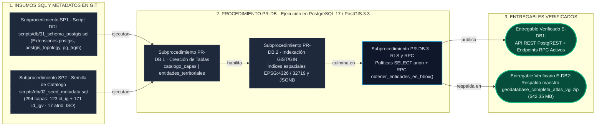

# Guía de base de datos espacial PostgreSQL / PostGIS en Supabase y resiliencia híbrida — Atlas para la Gestión Territorial
## Análisis y Exploración | Municipio de Santiago y Barrio Brasil

* **Plataforma Web en Producción:** [https://atlasvgiuah.netlify.app](https://atlasvgiuah.netlify.app)
* **Archivos de Esquema y Cliente:** [`scripts/db/01_schema_postgis.sql`](scripts/db/01_schema_postgis.sql) · [`scripts/db/02_seed_metadata.sql`](scripts/db/02_seed_metadata.sql) · [`.github/workflows/supabase_keepalive.yml`](.github/workflows/supabase_keepalive.yml).
* **Cobertura Gestionada:** **294 capas cartográficas** (`123` oficiales del Estado con `id_ig` + `171` coberturas descentralizadas de IGV con `id_igv`) agrupadas en las **5 dimensiones analíticas** y enriquecidas con el **perfil homologado de 17 atributos ISO 19115 / ISO 19157**.

---

## 1. Propósito de la arquitectura relacional híbrida (PostGIS + CDN estático)

El **Atlas para la Gestión Territorial** implementa un modelo de persistencia espacial híbrida que combina la capacidad analítica de PostgreSQL 17 con la extensión espacial PostGIS 3.3 (alojada en Supabase) con la velocidad y disponibilidad permanente de un repositorio estático de archivos GeoJSON servidos por CDN (`src/data/*.geojson` ↔ `data/*.geojson`).

Esta arquitectura asegura que el **Módulo 02 (`Explorar mapa`)** opere con cero tiempo de inactividad: el visor carga de manera directa las 294 coberturas vectoriales normalizadas en `EPSG:4326` y mantiene sincronizado el respaldo relacional en PostGIS para consultas espaciales avanzadas.

---

## 2. Flujos de trabajo de la base de datos espacial

### 2.1. Procedimiento de inicialización PostGIS y entregables verificados en Supabase y respaldo ZIP

---

## 3. Estructura del esquema relacional espacial (`scripts/db/01_schema_postgis.sql`)

| Tabla / Objeto en PostgreSQL | Tipo de Objeto | Columnas Clave y Geometría PostGIS | Índices y Restricciones |
| :--- | :---: | :--- | :--- |
| `public.catalogo_capas` | Tabla Maestra | `id` (`TEXT PK`), `codigo_identificador` (`id_ig` / `id_igv`), `nombre`, `institucion_custodia`, `tipo_fuente` (`'IG_OFICIAL'` \| `'IGV_DESCENTRALIZADA'`), `dimension_analitica`, `tipo_geometria`, `archivo_local`, `srid_nativo` (`4326`), `licencia`, `perfil_iso19157` (`JSONB`). | `PRIMARY KEY (id)`, Índice `GIN` sobre `perfil_iso19157`, RLS lectura pública (`SELECT TO anon`). |
| `public.entidades_territoriales` | Tabla Espacial | `uid` (`UUID PK`), `id_capa` (`FK`), `id_registro` (`id_ig` o `id_igv`), `dimension_analitica`, `nombre`, `atributos` (`JSONB`), `geom` (`GEOMETRY(Geometry, 4326)`), `geom_utm19s` (`GEOMETRY(Geometry, 32719)`). | Índice espacial `GiST` sobre `geom` y `geom_utm19s`, Índice `GIN` sobre `atributos`. |
| `public.obtener_entidades_en_bbox` | Función RPC (`PL/pgSQL`) | Parámetros: `p_id_capa TEXT, p_min_lon FLOAT, p_min_lat FLOAT, p_max_lon FLOAT, p_max_lat FLOAT`. Retorna `JSONB` (`FeatureCollection` RFC 7946). | Usa `ST_Intersects` con índice `GiST` y calcula superficie `ST_Area(geom_utm19s)` en `m²`. |

---

## 4. Procedimiento paso a paso de configuración en Supabase

1. Ingrese a [https://supabase.com/dashboard](https://supabase.com/dashboard) y cree el proyecto en la región `South America - São Paulo`.
2. En **SQL Editor → New Query**, ejecute [`scripts/db/01_schema_postgis.sql`](scripts/db/01_schema_postgis.sql) para habilitar `postgis`, crear las tablas, índices `GiST`/`GIN` y políticas RLS de lectura pública.
3. Ejecute [`scripts/db/02_seed_metadata.sql`](scripts/db/02_seed_metadata.sql) para poblar el catálogo con las 294 coberturas y sus descriptores ISO 19115 / ISO 19157.
4. El flujo automatizado [`.github/workflows/supabase_keepalive.yml`](.github/workflows/supabase_keepalive.yml) ejecuta una consulta ligera cada 72 horas (`cron: '0 8 */3 * *'`) para mantener activa la instancia sin pausas por inactividad.
