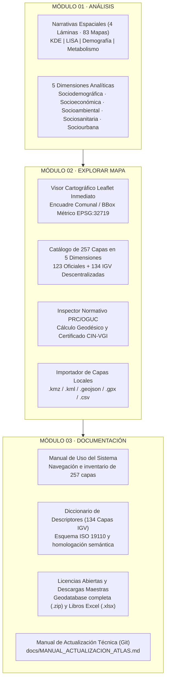

# Manual de Uso del Atlas para la Gestión Territorial (Prototipo 02)
### Análisis y Exploración | Municipio de Santiago y Barrio Brasil

* **Plataforma Web Interactiva:** [https://atlasvgiuah.netlify.app](https://atlasvgiuah.netlify.app)
* **Repositorio Espejo (GitHub Pages):** [https://geojota.github.io/atlas-vgi-barrio-brasil/](https://geojota.github.io/atlas-vgi-barrio-brasil/)
* **Cobertura Cartográfica:** 257 Capas Espaciales Operativas (123 Oficiales del Estado de Chile + 134 Coberturas Descentralizadas de Información Geográfica Voluntaria IGV 100% en español).
* **Dimensiones de Análisis:** 5 Dimensiones Estratégicas (Sociodemográfica, Socioeconómica, Socioambiental, Sociosanitaria, Sociourbana).
* **Síntesis Territorial:** 83 Cartografías Temáticas organizadas en 4 Narrativas Espaciales Basadas en Datos.
* **Arquitectura de Navegación:** 3 Módulos Operacionales Principales (Módulo 01 · Análisis, Módulo 02 · Explorar Mapa y Módulo 03 · Documentación).

---

## 1. Propósito general y estructura operativa del Prototipo 02

El **Atlas para la Gestión Territorial** es una infraestructura de información geográfica abierta y reproducible, diseñada para el análisis espacial, la toma de decisiones informadas y la planificación comunal en el Municipio de Santiago y el Barrio Brasil.

La plataforma articula dos regímenes de producción cartográfica complementarios:

1. **Cartografía Oficial del Estado de Chile (123 coberturas):** Datos espaciales emitidos por ministerios y organismos públicos (IDE Chile / SNIT, MINVU, INE, MDSF, SUBDERE, MTT, UOCT, CMN, MMA, SII y Municipalidad de Santiago).
2. **Información Geográfica Voluntaria — IGV Descentralizado (134 coberturas):** Cada descriptor de la comunidad (farmacias, árboles urbanos, cesfam, escuelas, paraderos, zonas de calma, cruces peatonales, ferias libres, etc.) opera como una **capa independiente por separado**, con su propio archivo `.geojson` descargable, traducida 100% al español y buscable en tiempo real.

---

## 2. Guía de uso de los 3 Módulos Operacionales

### 2.1. Módulo 01: Análisis Territorial

El primer módulo al entrar a la plataforma presenta la síntesis interpretativa del territorio comunal y barrial. Se organiza en dos componentes fundamentales:

#### 1. Narrativas Espaciales Basadas en Datos (4 Láminas Temáticas)
Elaboradas a partir de **83 cartografías temáticas** que representan patrones de concentración, segregación espacial, estructura demográfica, habitabilidad, movilidad y metabolismo urbano:
* **Lámina 01 · Concentración Territorial de Actividad IGV en Santiago (14 mapas KDE):** Análisis espacial de densidad continua sobre la geodatabase comunitaria (79.841 entidades directas y 112.264 nodos en malla de 20 m), semáforos UOCT y dinámica de edificación. Visibiliza la polarización entre el eje Alameda, Barrio Brasil, Santa Ana y Parque Almagro frente al arco sur y suroriente de la comuna.
* **Lámina 02 · Segregación Espacial, Hotspots y Áreas de Rezago en Santiago (11 mapas LISA):** Análisis de autocorrelación espacial local (Anselin, 1995) sobre las 1.711 manzanas censales de Santiago: núcleos estadísticos Alto-Alto (HH), bolsones Bajo-Bajo (LL) y desajustes de cobertura colaborativa.
* **Lámina 03 · Estructura Sociodemográfica, Habitabilidad y Morfología Urbana en Santiago (34 mapas):** Distribución de los 432.081 habitantes según Censo 2024, prevalencia del departamento (92,7%) y arriendo (72,1%), alturas de edificación, Coeficiente de Ocupación del Suelo (COS) y persistencia de cités.
* **Lámina 04 · Metabolismo Urbano de Santiago (24 mapas):** Dinámica de movilidad sustentable (84,6% de viajes en modos activos/públicos), brechas de acceso a áreas verdes y salud en bordes comunales, exposición a ruido (>68 dBA) y gestión de residuos sólidos en las 5 zonas de aseo municipal.

#### 2. Dimensiones Analíticas
Las 257 coberturas espaciales del Atlas se integran conceptual y operativamente en 5 dimensiones estratégicas:
1. **Sociodemográfica y Habitacional:** Censo 2024, vulnerabilidad social (RSH), tipologías habitacionales y unidades vecinales.
2. **Socioeconómica y Comercial:** Inversión pública (BIP/MOP), comercio barrial, ferias libres, empleo y redes energéticas.
3. **Socioambiental y Espacio Público:** Infraestructura verde, arbolado urbano, biodiversidad ciudadana (GBIF) y residuos sólidos.
4. **Sociosanitaria y Salud:** Red asistencial de salud (CESFAM y hospitales), farmacias de barrio y cobertura territorial.
5. **Sociourbana, Movilidad y Normativa:** Zonificación PRC Santiago, patrimonio protegido, Metro, ciclovías y accesibilidad universal.

---

### 2.2. Módulo 02: Explorar Mapa

El segundo módulo entrega acceso directo e interactivo al visor espacial y al catálogo completo de datos:

#### 1. Visor Cartográfico Leaflet Inmediato
* **Visualización directa:** Sin pantallas intermedias ni tarjetas de resumen obstructivas. El mapa aparece listo para operar.
* **Encuadre territorial y BBox:** Permite alternar entre el polígono comunal/barrial o trazar un rectángulo personalizado mediante **⛶ Dibujar Bbox**, con cálculo instantáneo de superficie en m² y hectáreas reproyectado a `EPSG:32719`.
* **Inspector puntual de atributos:** Al hacer clic sobre cualquier punto, línea o polígono, se despliegan sus atributos estandarizados y custodio formal.

#### 2. Catálogo Cartográfico y Explorador de Coberturas (257 Capas)
Sistematización de las 257 capas del Atlas agrupadas en las 5 Dimensiones de Análisis:
* **Separación clara:** Cada dimensión presenta dos bloques claramente diferenciados:
  * 🏛️ *Coberturas Oficiales del Estado de Chile* (123 capas).
  * 👥 *Coberturas de Información Geográfica Voluntaria — IGV Descentralizado* (134 capas).
* **Descentralización VGI:** Cada uno de los 134 descriptores comunitarios cuenta con su archivo `.geojson` descargable de forma independiente.
* **100% en Español:** Toda la nomenclatura, nombres de capas y descriptores están redactados en español.
* **Búsqueda en vivo:** La barra `#busqueda-capas-atlas` filtra de forma instantánea cualquier cobertura por nombre en español (ej: farmacias, árboles, cesfam, escuelas, censo, metro...), código o institución.
* **Chips de filtro:** Permite filtrar con un clic entre dimensiones o aislar solo coberturas oficiales o solo IGV.

#### 3. Inspector Normativo PRC Santiago / PRMS / OGUC
Permite auditar cualquier coordenada del territorio comunal haciendo clic sobre el mapa para generar el **Certificado de Informaciones Normativas VGI (CIN-VGI)**:
* Zonificación del PRC Santiago y PRMS con usos permitidos y prohibidos (Art. 2.1.24 OGUC).
* Restricciones por áreas de riesgo (Art. 2.1.17 OGUC), áreas verdes normadas y afectación patrimonial.
* Dinámica histórica de permisos de edificación DOM (2010–2025) y recepciones finales CRF (2011–2025 del INE).

#### 4. Importador de Capas Locales
Permite arrastrar y soltar archivos `.kmz`, `.kml`, `.geojson`, `.gpx` y `.csv`. El procesamiento se realiza 100% en la memoria del navegador sin transmitir datos a servidores externos.

---

### 2.3. Módulo 03: Documentación

El tercer módulo consolida el respaldo metodológico, técnico y legal de la plataforma:

1. **Manual de Uso del Sistema:** Guía interactiva paso a paso con inventario dinámico de las 257 coberturas.
2. **Diccionario de Descriptores (134 Capas IGV):** Catálogo formal de atributos según ISO 19110 y su homologación semántica con los estándares del Estado de Chile (IDE Chile - SNIT).
3. **Licencias Abiertas y Descarga Integral:** Marco jurídico de datos abiertos (Open Database License ODbL 1.0, Creative Commons CC BY-SA 4.0, Ley N° 20.285 de Transparencia) y enlace de descarga de la Geodatabase Completa en archivo comprimido (`.zip`) y catálogos en Excel (`.xlsx`).
4. **Manual de Actualización Técnica para Desarrolladores:** Disponible directamente en el repositorio Git (`docs/MANUAL_ACTUALIZACION_ATLAS.md`) con las instrucciones para el mantenimiento del stack tecnológico, pipelines de sincronización y adición de coberturas.

---

## 3. Descargas de Datos y Archivos Maestros

| Recurso | Formato | Contenido |
| :--- | :--- | :--- |
| **Geodatabase Completa del Atlas** | `.zip` | Colección completa de las 257 coberturas en GeoJSON + GeoPackage + metadatos |
| **Catálogo de Fuentes y Brechas** | `.xlsx` | Matriz de 257 capas con homologación IDE Chile vs IGV |
| **Categorías Temáticas OSM** | `.xlsx` | Clasificación de descriptores y etiquetas territoriales |
| **Manual de Uso del Atlas** | `.md` | Manual de navegación y operación de la interfaz web |
| **Manual de Actualización Técnica** | `.md` | Documentación de ingeniería y mantenimiento en Git |
| **Bibliografía Seminario y Atlas** | `.md` | Referencias teóricas y metodológicas en norma APA 7ma ed. |
