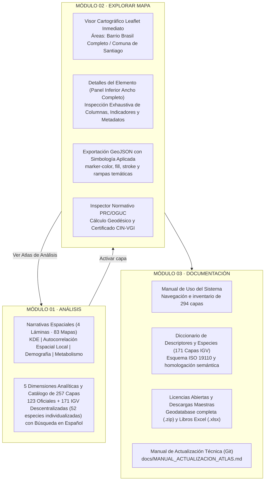

# Manual de Uso del Atlas para la Gestión Territorial
### Análisis y Exploración | Municipio de Santiago y Barrio Brasil

* **Plataforma Web Interactiva:** [https://atlasvgiuah.netlify.app](https://atlasvgiuah.netlify.app)
* **Repositorio Espejo (GitHub Pages):** [https://geojota.github.io/atlas-vgi-barrio-brasil/](https://geojota.github.io/atlas-vgi-barrio-brasil/)
* **Cobertura Cartográfica:** 294 Capas Espaciales Operativas (123 Oficiales del Estado de Chile + 171 Coberturas Descentralizadas de Información Geográfica Voluntaria IGV 100% en español).
* **Dimensiones de Análisis:** 5 Dimensiones Estratégicas (Sociodemográfica, Socioeconómica, Socioambiental, Sociosanitaria, Sociourbana).
* **Síntesis Territorial:** 83 Cartografías Temáticas organizadas en 4 Narrativas Espaciales Basadas en Datos.
* **Arquitectura de Navegación:** 3 Módulos Operacionales Principales (Módulo 01 · Análisis, Módulo 02 · Explorar Mapa y Módulo 03 · Documentación).

---

## 1. Propósito general y estructura operativa de la plataforma

El **Atlas para la Gestión Territorial** es una infraestructura de información geográfica abierta y reproducible, diseñada para el análisis espacial, la toma de decisiones informadas y la planificación comunal en el Municipio de Santiago y el Barrio Brasil.

La plataforma articula dos regímenes de producción cartográfica complementarios:

1. **Cartografía Oficial del Estado de Chile (123 coberturas):** Datos espaciales emitidos por ministerios y organismos públicos (IDE Chile / SNIT, MINVU, INE, MDSF, SUBDERE, MTT, UOCT, CMN, MMA, SII y Municipalidad de Santiago).
2. **Información Geográfica Voluntaria — IGV Descentralizado (171 coberturas, incluyendo 52 especies biológicas individualizadas):** Cada descriptor de la comunidad (farmacias, árboles urbanos, cesfam, escuelas, paraderos, zonas de calma, cruces peatonales, ferias libres, etc.) opera como una **capa independiente por separado**, con su propio archivo `.geojson` descargable, traducida 100% al español y buscable en tiempo real.

---

## 2. Guía de uso de los 3 Módulos Operacionales

### 2.1. Módulo 01: Análisis Territorial

El primer módulo al entrar a la plataforma presenta la síntesis interpretativa del territorio comunal y barrial. Se organiza en dos componentes fundamentales:

#### 1. Narrativas Espaciales Basadas en Datos (4 Láminas Temáticas)
Elaboradas a partir de **83 cartografías temáticas** que representan patrones de concentración, segregación espacial, estructura demográfica, habitabilidad, movilidad y metabolismo urbano:
* **Lámina 01 · Concentración Territorial de Actividad IGV en Santiago (14 mapas KDE):** Análisis espacial de densidad continua sobre la geodatabase comunitaria (79.841 entidades directas y 112.264 nodos en malla de 20 m), semáforos UOCT y dinámica de edificación. Visibiliza la polarización entre el eje Alameda, Barrio Brasil, Santa Ana y Parque Almagro frente al arco sur y suroriente de la comuna.
* **Lámina 02 · Segregación Espacial, Hotspots y Áreas de Rezago en Santiago (11 mapas de autocorrelación espacial local):** Análisis de autocorrelación espacial local (Anselin, 1995) sobre las 1.711 manzanas censales de Santiago: núcleos estadísticos Alto-Alto (HH), bolsones Bajo-Bajo (LL) y desajustes de cobertura colaborativa.
* **Lámina 03 · Estructura Sociodemográfica, Habitabilidad y Morfología Urbana en Santiago (34 mapas):** Distribución de los 432.081 habitantes según Censo 2024, prevalencia del departamento (92,7%) y arriendo (72,1%), alturas de edificación, Coeficiente de Ocupación del Suelo (COS) y persistencia de cités.
* **Lámina 04 · Metabolismo Urbano de Santiago (24 mapas):** Dinámica de movilidad sustentable (84,6% de viajes en modos activos/públicos), brechas de acceso a áreas verdes y salud en bordes comunales, exposición a ruido (>68 dBA) y gestión de residuos sólidos en las 5 zonas de aseo municipal.

#### 2. Dimensiones Analíticas y Catálogo de 294 Coberturas
Las **294 coberturas espaciales** del Atlas se exploran y activan directamente desde este apartado mediante acordeones interactivos estructurados en 5 dimensiones estratégicas:
1. **Sociodemográfica y Habitacional:** Censo 2024, vulnerabilidad social (RSH), tipologías habitacionales y unidades vecinales (31 capas: 19 oficiales + 12 IGV).
2. **Socioeconómica y Comercial:** Inversión pública (BIP/MOP), comercio barrial, ferias libres, empleo y redes energéticas (43 capas: 17 oficiales + 26 IGV).
3. **Socioambiental y Espacio Público:** Infraestructura verde, arbolado urbano, biodiversidad ciudadana (GBIF) y residuos sólidos (74 capas: 35 oficiales + 39 IGV).
4. **Sociosanitaria y Salud:** Red asistencial de salud (CESFAM y hospitales), farmacias de barrio y cobertura territorial (13 capas: 5 oficiales + 8 IGV).
5. **Sociourbana, Movilidad y Normativa:** Zonificación PRC Santiago, patrimonio protegido, Metro, ciclovías y accesibilidad universal (96 capas: 47 oficiales + 49 IGV).

* **Interacción directa:** Cada capa dispone de un interruptor para activarla/desactivarla en el mapa, un botón para enfocarla en el visor y un enlace de descarga directa en GeoJSON.
* **Búsqueda y filtros:** Incluye buscador en tiempo real 100% en español y selector por tipo de origen (Oficiales vs. IGV Descentralizado).

---

### 2.2. Módulo 02: Explorar Mapa

El segundo módulo entrega acceso directo e interactivo al visor espacial y al panel de detalles de elementos:

#### 1. Visor Cartográfico Leaflet Inmediato
* **Visualización directa:** Sin pantallas intermedias ni elementos obstructivos. El mapa aparece listo para operar.
* **Mapas Base 100% Abiertos (Sin API Keys):** Erradica dependencias comerciales que exijan credenciales o cobros por uso. Cuenta con 4 capas base de alta disponibilidad:
  * **CartoDB Dark Matter (Predeterminado):** Tema táctico oscuro que maximiza el contraste de las geometrías y análisis espaciales.
  * **OpenStreetMap Estándar:** Cartografía comunitaria mundial con toponimia barrial completa.
  * **CartoDB Positron:** Base clara minimalista para trabajo diurno e informes impresos.
  * **Imagen Satelital (Esri World Imagery):** Ortoimágenes globales de alta resolución sin clave API.
* **Simbología Inteligente Predeterminada al Cargar Capas:**
  * **Datos cuantitativos (índices, censos, áreas, montos):** Clasificación automática mediante **Natural Breaks (Jenks)** en 5 clases, minimizando la varianza intraclase y reflejando cortes naturales del territorio.
  * **Datos cualitativos o de entidades (PRC, equipamientos, usos):** Clasificación **categorizada** con paletas armónicas contrastantes por entidad.
  * **Rampas temáticas por dimensión:** Sociodemográfica (Cian/Viridis), Socioeconómica (Ámbar/YlOrRd), Socioambiental (Verde/Greens), Sociosanitaria (Magenta/Magma) y Sociourbana (Violeta/Purples).
  * **Panel de personalización:** El analista puede ajustar libremente métodos estadísticos (Jenks, cuartiles, intervalos iguales, desviación estándar), número de clases y rampas en el panel flotante *Simbología Dinámica*.
* **Áreas de Enfoque:** Selector rápido con dos escalas territoriales calibradas:
  * **Barrio Brasil Completo:** Encuadre al polígono barrial y su área de influencia directa.
  * **Comuna de Santiago:** Visión comunal integral (BBox: `[-70.6923, -33.4785, -70.6251, -33.4257]`).
* **Botón "Ver Atlas de Análisis":** Permite conmutar al instante al Módulo 01 para examinar las láminas analíticas o seleccionar nuevas capas.
* **Exportar vista (GeoJSON) con Simbología Aplicada:** Descarga la totalidad de las entidades visibles, incorporando directamente en las propiedades de cada feature los estilos gráficos configurados (`marker-color`, `stroke`, `fill`, `fill-opacity`, `simbologia_color`, `simbologia_modo`, etc.) para asegurar idéntica representación en QGIS u otros SIG.

#### 2. Panel Inferior "Detalles del Elemento" (Ancho Completo)
Ubicado inmediatamente debajo del visor cartográfico, este panel se despliega aprovechando el 100% del ancho de la pantalla al hacer clic sobre cualquier elemento del mapa:
* **Amplitud visual:** Máximo espacio para inspeccionar tablas de atributos extensas, valores censales, normativas urbanas y campos descriptivos.
* **Columnas e indicadores:** Organización clara de metadatos, custodio de origen, coordenadas y botón de descarga individual en GeoJSON.

#### 3. Inspector Normativo PRC Santiago / PRMS / OGUC
Permite auditar cualquier coordenada del territorio comunal haciendo clic sobre el mapa para generar el **Certificado de Informaciones Normativas VGI (CIN-VGI)**:
* Zonificación del PRC Santiago y PRMS con usos permitidos y prohibidos (Art. 2.1.24 OGUC).
* Restricciones por áreas de riesgo (Art. 2.1.17 OGUC), áreas verdes normadas y afectación patrimonial.
* Dinámica histórica de permisos de edificación DOM (2010–2025) y recepciones finales CRF (2011–2025 del INE).

---

### 2.3. Módulo 03: Documentación

El tercer módulo consolida en una experiencia unificada y explorable el respaldo metodológico, técnico y legal de la plataforma:

1. **Manual de Uso del Sistema:** Guía interactiva estructurada por capítulos con buscador en tiempo real, tabla de contenidos lateral e inventario dinámico de las 294 coberturas espaciales (123 oficiales + 134 IGV descentralizadas).
2. **Marco Jurídico de Licencias Abiertas Integrado:** Adopta un régimen tripartito de bienes comunes digitales que garantiza la reciprocidad comunitaria (Ley N° 17.336 de Propiedad Intelectual y Ley N° 20.285 de Transparencia):
   * **CC BY-SA 4.0** para la documentación, manuales y cartografía.
   * **ODbL 1.0** para las bases de datos espaciales y capas IGV (compatibilidad nativa con OpenStreetMap Foundation).
   * **GNU AGPLv3** para el código fuente de la plataforma web y scripts.
3. **Descarga Directa de Catálogos y Geodatabase:** Acceso directo a la descarga de la Geodatabase Completa comprimida (`geodatabase_completa_atlas_vgi.zip`, 542 MB) y los libros estructurados en Excel (`categorias_tematicas_osm.xlsx`, `perfil_metadatos_vgi.xlsx`, `catalogo_fuentes_vgi.xlsx`, `wlc_metacalidad_ranking.csv`).
4. **Manual de Actualización Técnica para Desarrolladores:** Se preserva y mantiene en el repositorio Git (`docs/MANUAL_ACTUALIZACION_ATLAS.md`) para consultar la ingeniería del stack, sincronización simétrica `data/` y `src/data/`, y protocolos de actualización de coberturas a 6 meses.

---

## 3. Descargas de Datos y Archivos Maestros

| Recurso | Formato | Contenido |
| :--- | :--- | :--- |
| **Geodatabase Completa del Atlas** | `.zip` | Colección completa de las 294 coberturas en GeoJSON + GeoPackage + metadatos |
| **Catálogo de Fuentes y Brechas** | `.xlsx` | Matriz de 294 capas con homologación IDE Chile vs IGV |
| **Categorías Temáticas OSM** | `.xlsx` | Clasificación de descriptores y etiquetas territoriales |
| **Manual de Uso del Atlas** | `.md` | Manual de navegación y operación de la interfaz web |
| **Manual de Actualización Técnica** | `.md` | Documentación de ingeniería y mantenimiento en Git |
| **Bibliografía Seminario y Atlas** | `.md` | Referencias teóricas y metodológicas en norma APA 7ma ed. |
