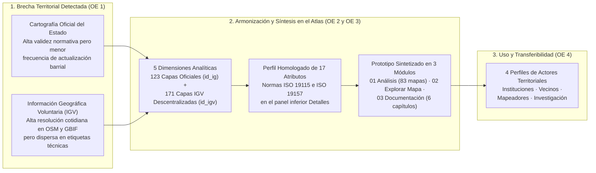

# Trazabilidad Conceptual, Metodológica y de Entregables — Atlas para la Gestión Territorial
## Análisis y Exploración | Municipio de Santiago y Barrio Brasil

* **Plataforma Web en Producción:** [https://atlasvgiuah.netlify.app](https://atlasvgiuah.netlify.app)
* **Repositorio Espejo (GitHub Pages):** [https://geojota.github.io/atlas-vgi-barrio-brasil/](https://geojota.github.io/atlas-vgi-barrio-brasil/)

---

## 1. Fundamentación conceptual: ¿Por qué articular la información del Estado (`id_ig`) con la Información Geográfica Voluntaria (`id_igv`)?

En la gestión territorial contemporánea, los gobiernos locales y las comunidades barriales enfrentan una paradoja frecuente:
* **La Información Geográfica Oficial (`id_ig`)**, producida por ministerios, servicios públicos y municipalidades (como el Censo de Población y Vivienda del INE, el Registro Social de Hogares del MDSF o los Planes Reguladores Comunales del MINVU), posee respaldo jurídico y cobertura estandarizada a nivel de manzana o zona censal, pero suele presentar **rezagos temporales** (entre 3 y 10 años entre levantamientos) y **vacíos de escala micro-urbana** respecto del equipamiento cotidiano de proximidad.
* **La Información Geográfica Voluntaria (`id_igv`)** —concepto formulado originalmente por Michael F. Goodchild (2007) y desarrollado por Muki Haklay (2010) en torno a la cartografía colaborativa y la ciencia ciudadana— es levantada y actualizada de manera continua por comunidades abiertas como **OpenStreetMap (OSM)** y la red global de biodiversidad **GBIF**, capturando con gran detalle elementos como comercios barriales, ciclovías, paradas de transporte, desfibriladores, farmacias, grifos, accesibilidad peatonal y especies de flora y fauna urbana. Sin embargo, para que estos datos colaborativos puedan utilizarse con confianza en la toma de decisiones públicas, requieren ser **descentralizados por temática, validados topológicamente y homologados bajo el mismo estándar de metadatos que las fuentes estatales**.

El **Atlas para la Gestión Territorial (Análisis y Exploración | Municipio de Santiago y Barrio Brasil)** resuelve esta brecha integrando **294 coberturas vectoriales operativas** —**123 capas oficiales del Estado (`id_ig`)** y **171 capas descentralizadas de IGV (`id_igv`)**— bajo un marco común de **5 Dimensiones Analíticas**, un **perfil homologado de 17 atributos ISO 19115 / ISO 19157** y un **prototipo sintetizado en 3 módulos** pensado para usuarios con y sin experiencia técnica en SIG.

---

## 2. Trazabilidad de las 5 Dimensiones Analíticas del Territorio

En el Prototipo 02, las antiguas clasificaciones técnicas por etiquetas aisladas fueron reemplazadas por **5 Dimensiones Analíticas comprensibles y transversales**, que estructuran tanto el diagnóstico del **Módulo 01 (`Análisis`)** como el selector de capas del **Módulo 02 (`Explorar Mapa`)** y los libros maestros en Excel (`docs/categorias_tematicas_osm.xlsx` y `docs/catalogo_fuentes_vgi.xlsx`):

| N° | Dimensión Analítica | Coberturas Oficiales del Estado (`id_ig`) que integra | Coberturas Colaborativas de IGV (`id_igv`) que integra | Brecha de información que subsana su cruce |
| :---: | :--- | :--- | :--- | :--- |
| **`01`** | **Dimensión Sociodemográfica y Habitacional** | Manzanas y unidades vecinales del Censo 2024 (INE), vulnerabilidad del Registro Social de Hogares (RSH 2026), cités municipales, catastro predial del SII, permisos de edificación y recepciones definitivas. | Tipologías residenciales colaborativas, edificios patrimoniales, viviendas colectivas, residencias estudiantiles y equipamiento comunitario barrial. | Permite cruzar la distribución real de población, adultos mayores y hogares vulnerables con la localización exacta de cités y nuevas edificaciones en altura. |
| **`02`** | **Dimensión Socioeconómica y Comercial** | Cartera georreferenciada del Banco Integrado de Proyectos (BIP / MDSF), obras del MOP, patentes y ferias libres municipales, y redes de telecomunicaciones (SUBTEL). | Comercios de proximidad, almacenes, panaderías, restaurantes, cafés, mercados, bancos, cajeros automáticos, correos y servicios cotidianos en OpenStreetMap. | Visibiliza la vitalidad comercial a escala de calle y permite evaluar si la inversión pública (BIP) llega a los sectores con menor oferta de servicios. |
| **`03`** | **Dimensión Socioambiental y Espacio Público** | Catastro nacional de áreas verdes y parques (MINVU/INE 2023), mapas acústicos de ruido ambiental (`>68 dBA`, MMA), islas de calor y las 5 zonas de recolección de residuos domiciliarios (SUBDERE RSD 2024). | Censo colaborativo de arbolado urbano, plazas, mobiliario de espacio público, bebederos, puntos limpios de reciclaje y **52 coberturas de flora y fauna ciudadana (GBIF)**. | Conecta los indicadores ambientales oficiales con la presencia efectiva de árboles, biodiversidad observada por vecinos y micro-infraestructura de reciclaje. |
| **`04`** | **Dimensión Sociosanitaria y Salud** | Red asistencial pública del MINSAL (hospitales, CESFAM, COSAM, postas y SAPU), establecimientos educacionales (MINEDUC) y recintos deportivos (IND). | Farmacias de turno y de barrio, clínicas dentales y ópticas, desfibriladores externos automáticos (DEA), grifos contra incendios y centros de cuidado comunitario. | Complementa la red hospitalaria oficial con el mapa de respuesta inmediata ante emergencias (DEA, grifos y farmacias a menos de 5–10 minutos a pie). |
| **`05`** | **Dimensión Sociourbana, Movilidad y Normativa** | Zonificación del Plan Regulador Comunal de Santiago (PRC / MINVU), Zonas e Inmuebles de Conservación Histórica (`ZCH`/`ICH`), Monumentos Nacionales (CMN), red Metro, paraderos Red/DTPM y siniestralidad vial (UOCT/CONASET). | Red de ciclovías y estacionamientos de bicicletas, pasos peatonales, semáforos sonoros, rebajes de solera para accesibilidad universal y luminarias peatonales. | Permite evaluar simultáneamente qué normas de altura y uso de suelo rigen en cada manzana y cuál es la calidad del entorno caminable y ciclista que la conecta. |

---

## 3. Trazabilidad del Perfil Homologado de 17 Atributos (ISO 19115 / ISO 19157)

Para que la integración entre capas estatales y colaborativas sea transparente y auditable por cualquier usuario desde el panel inferior **Detalles** del **Módulo 02 (`Explorar Mapa`)**, todas las entidades de las **294 capas** incorporan un esquema único de **17 atributos** documentado en [`docs/perfil_metadatos_vgi.xlsx`](perfil_metadatos_vgi.xlsx):

1. **Identificación diferenciada del origen (Atributo 01):**
   * **`id_ig`** (*Identificador de Información Geográfica*): Se asigna de forma exclusiva a los registros de las **123 capas oficiales del Estado de Chile**.
   * **`id_igv`** (*Identificador de Información Geográfica Voluntaria*): Se asigna de forma exclusiva a los registros de las **171 capas colaborativas descentralizadas** de OpenStreetMap y GBIF.
2. **Descriptores de catalogación, custodia y marco legal (Atributos 02 al 09 y 16 al 17 — Norma ISO 19115-1:2014):**
   * Registran en español el nombre del elemento y de la capa (`nombre_capa`), su adscripción a una de las 5 dimensiones (`dimension_analitica`), la naturaleza de la fuente (`tipo_fuente`), la institución pública o comunidad responsable (`institucion_custodia`), el sistema geodésico de referencia (`EPSG:4326` / `EPSG:32719`), la escala equivalente (`escala_referencia`), la fecha de actualización (`fecha_actualizacion`), la licencia abierta aplicable (`licencia_uso`: Ley N.° 20.285, `ODbL 1.0` o `CC BY 4.0`), el ámbito territorial (`cobertura_territorial`) y el archivo físico (`archivo_origen`).
3. **Descriptores de calidad espacial y linaje (Atributos 10 al 15 — Norma ISO 19157:2013):**
   * Informan en lenguaje comprensible la **exactitud posicional** (`exactitud_posicional`), la **consistencia topológica** OGC Simple Features / RFC 7946 (`consistencia_topologica`), el nivel de **completitud** de atributos (`completitud`), la **exactitud temática** de clasificación (`exactitud_tematica`), la **consistencia temporal** dentro del corte 2024–2026 (`consistencia_temporal`) y la trazabilidad del procesamiento (`linaje_fuente`).

---

## 4. Matriz maestra de trazabilidad: Objetivos Específicos, los 9 Hitos con Entregable Verificado y Verificación en Producción

En estricta correspondencia con la Carta Gantt oficial del proyecto (`Carta_Gantt_Atlas_VGI.pdf`), a continuación se presenta la trazabilidad completa entre los cuatro Objetivos Específicos (`OE 1` a `OE 4`), los **9 Hitos que cuentan con un entregable verificado asociado (`Hito 1 / E1` a `Hito 9 / E9`)** y los archivos físicos auditables en el repositorio y en la plataforma web:

| Objetivo Específico | Hito y Fecha ($\blacklozenge$) | Código y Nombre del Entregable Verificado | Archivos Verificables en el Repositorio y en la Web | Módulo de Consulta en la Plataforma |
| :--- | :---: | :--- | :--- | :---: |
| **OE 1.** Caracterizar la disponibilidad, la cobertura y los vacíos de información geográfica del área de estudio, y definir las bases taxonómicas y de diseño centrado en el usuario que permitan integrar datos colaborativos e institucionales. | **Hito 1** `03 sep 2026` | **E1 ·** Arquitectura del sistema y catálogo inicial de fuentes | [`docs/ARQUITECTURA.md`](ARQUITECTURA.md), [`docs/catalogo_fuentes_vgi.xlsx`](catalogo_fuentes_vgi.xlsx) | **Módulo 03** (`DOC · 01`, `DOC · 04` y `DOC · 06`) |
| **OE 1.** *(continuación)* | **Hito 2** `09 sep 2026` | **E2 ·** Cinco dimensiones analíticas, etiquetas IGV y configuración territorial | [`docs/categorias_tematicas_osm.xlsx`](categorias_tematicas_osm.xlsx), [`src/js/config.js`](../js/config.js) | **Módulo 01** y **Módulo 03** (`DOC · 02` y `DOC · 04`) |
| **OE 1.** *(continuación)* | **Hito 3** `16 sep 2026` | **E3 ·** Inventario consolidado de 294 fuentes y matriz de brechas | [`docs/catalogo_fuentes_vgi.xlsx`](catalogo_fuentes_vgi.xlsx), [`docs/TRAZABILIDAD.md`](TRAZABILIDAD.md) | **Módulo 03** (`DOC · 01` y `DOC · 05`) |
| **OE 2.** Consolidar una geodatabase multipropósito que armonice coberturas oficiales e información voluntaria bajo estándares internacionales de calidad y metadatos. | **Hito 4** `08 oct 2026` | **E4 ·** Geodatabase de 294 capas GeoJSON, esquema PostGIS y perfil de 17 atributos ISO (`id_ig` / `id_igv`) | `src/data/*.geojson` (294 archivos), [`docs/perfil_metadatos_vgi.xlsx`](perfil_metadatos_vgi.xlsx), `scripts/db/01_schema_postgis.sql` | **Módulo 02** (Panel *Detalles*) y **Módulo 03** (`DOC · 03` y `DOC · 05`) |
| **OE 2.** *(continuación)* | **Hito 5** `19 oct 2026` | **E5 ·** Matriz de síntesis barrial por manzana, catastro IGV e inversiones BIP | `data/matriz_sintesis_barrio_brasil_manzanas.geojson`, `data/resumen_catastro_vgi.csv`, `data/bip_inversiones_santiago.csv` | **Módulo 01** y **Módulo 02** |
| **OE 3.** Implementar un geoportal web accesible e interoperable que permita visualizar cartografía multinivel, consultar el territorio en tiempo real y descargar geodatos abiertos. *(Incluye la definición de un prototipo sintetizado para usuarios no técnicos: prototipo más sintetizado que permita a usuarios sin experiencia técnica poder interactuar de forma más simple con la plataforma).* | **Hito 6** `27 oct 2026` | **E6 ·** Plataforma sintetizada en 3 módulos (*Análisis*, *Explorar Mapa*, *Documentación*) y visor cartográfico cuadrado con 5 mapas base sin API | [`src/index.html`](../index.html), [`src/css/estilos.css`](../css/estilos.css), [`src/js/app.js`](../js/app.js), [`src/js/modulos/mapa.js`](../js/modulos/mapa.js) | **Módulos 01, 02 y 03** |
| **OE 3.** *(continuación)* | **Hito 7** `04 nov 2026` | **E7 ·** Inspector normativo PRC/OGUC, simbología dinámica Jenks, panel *Detalles*, 83 cartografías temáticas y despliegue en Netlify | [`src/js/modulos/evaluador_normativo.js`](../js/modulos/evaluador_normativo.js), [`src/js/modulos/simbologia_dinamica.js`](../js/modulos/simbologia_dinamica.js), [`src/js/modulos/indicadores_analisis.js`](../js/modulos/indicadores_analisis.js), `src/img/cartografias/`, `netlify.toml` | **Módulo 01** y **Módulo 02** |
| **OE 4.** Evaluar la usabilidad y la pertinencia de la plataforma con distintos perfiles de actores territoriales y asegurar su transferibilidad técnica, metodológica y documental. | **Hito 8** `09 nov 2026` | **E8 ·** Evaluación de usabilidad, trazabilidad, Tutorial interactivo de 18 pasos y Módulo 03 navegable | [`docs/TRAZABILIDAD.md`](TRAZABILIDAD.md), [`docs/MANUAL_USO.md`](MANUAL_USO.md), [`src/js/modulos/tutorial_interactivo.js`](../js/modulos/tutorial_interactivo.js), [`src/js/modulos/manual.js`](../js/modulos/manual.js) | **Cabecera** y **Módulo 03** (`DOC · 01` a `DOC · 06`) |
| **OE 4.** *(continuación)* | **Hito 9** `12 nov 2026` | **E9 ·** Manual de actualización técnica, paquete maestro ZIP (`542,35 MB`) y scripts de verificación de integridad | [`docs/MANUAL_ACTUALIZACION_ATLAS.md`](MANUAL_ACTUALIZACION_ATLAS.md), [`docs/geodatabase_completa_atlas_vgi.zip`](geodatabase_completa_atlas_vgi.zip), `scripts/verificar_conteo_capas.py`, `scripts/verificar_integridad_despliegue.py` | **Módulo 02** y **Módulo 03** (`DOC · 04` y `DOC · 06`) |

---

## 5. Evaluación de usabilidad y pertinencia con actores territoriales (OE 4)

Para verificar que el **Prototipo 02** responda efectivamente a las necesidades tanto de usuarios especializados como de ciudadanos sin formación técnica previa, el proyecto estructuró un instrumento metodológico dual respaldado en las normas **ISO 9241-11** (eficacia, eficiencia y satisfacción en el uso) y en la escala **SUS (*System Usability Scale*)**:

### 5.1. Los dos instrumentos de evaluación aplicada
1. **Modalidad 1 (`FO-M1`) — Prueba de Usabilidad con Tareas Guiadas sobre la Plataforma:**
   * Evalúa la experiencia práctica de navegación a través de **5 tareas representativas del Prototipo 02**:
     * **Tarea T1 (Cabecera e Inducción):** Apertura del *Tutorial Interactivo* (a la izquierda del título) para recorrer la presentación de cada módulo y consulta de términos en el *Glosario de siglas* (a la derecha del título).
     * **Tarea T2 (Módulo 01 · Análisis):** Exploración de los 4 ejes geoestadísticos (`KDE`, `LISA`, `Demografía Censo 2024` y `Metabolismo Urbano`), apertura de una de las 83 cartografías temáticas y búsqueda de una cobertura dentro de las **5 Dimensiones Analíticas** para activarla directamente en el visor.
     * **Tarea T3 (Módulo 02 · Explorar Mapa y Simbología):** Conmutación entre los **5 mapas base sin API** (`OpenStreetMap Estándar`, `HOT`, `Bing/Microsoft Satelital`, `Bing/Microsoft Híbrido` y `Esri World Imagery`), uso de `Delimitar área` en proyección `EPSG:32719` y aplicación de **Simbología Dinámica (Cortes Naturales de Jenks)**.
     * **Tarea T4 (Módulo 02 · Inspector PRC y Panel Detalles):** Activación bajo demanda del **Inspector normativo (PRC)** sobre una manzana del Barrio Brasil y lectura del perfil homologado de **17 atributos (`id_ig` / `id_igv`)** en el panel inferior **Detalles**.
     * **Tarea T5 (Módulo 03 · Documentación y Descargas):** Uso del buscador en tiempo real entre los 6 capítulos (`DOC · 01` a `DOC · 06`), filtrado del inventario de las 294 capas y descarga de los libros Excel (`.xlsx`) o de la geodatabase completa (`.zip`).
2. **Modalidad 2 (`FO-M2`) — Protocolo de Conversación Situada con Vecinas, Vecinos y Actores Locales del Barrio Brasil:**
   * Diálogo semiestructurado apoyado en cartografías del barrio para recoger percepciones sobre habitabilidad en cités, conservación patrimonial (`ZCH`/`ICH`), seguridad peatonal, ruido ambiental, arbolado y prioridades de inversión barrial.

### 5.2. Síntesis de mejoras incorporadas en el Prototipo 02 a partir de la evaluación centrada en el usuario
* **Simplificación de la navegación principal a 3 módulos claros:** Reducción de la carga visual agrupando todo el flujo en *01 Análisis*, *02 Explorar Mapa* y *03 Documentación*.
* **Separación espacial de la ayuda en cabecera:** Ubicación del *Tutorial Interactivo* a la izquierda del título y del *Glosario de siglas* a la derecha del título para impedir que sus recuadros se superpongan.
* **Tutorial interactivo pedagógico por módulos (18 pasos en 4 bloques):** Rediseño del recorrido guiado para presentar primero qué es y para qué sirve cada módulo antes de detallar sus herramientas individuales.
* **Visor cuadrado amplio y panel inferior `Detalles` de ancho completo:** Reubicación de las tablas de los 17 atributos (`id_ig` / `id_igv`) y de la ficha normativa del PRC debajo del mapa (y mostrando el PRC sólo cuando el usuario activa el inspector), evitando paneles flotantes que oculten la cartografía.
* **Mapas base 100 % abiertos y satelitales sin claves de API:** Sustitución de los antiguos mapas de Carto por **OpenStreetMap Estándar**, **OpenStreetMap HOT**, **Bing / Microsoft (Satelital e Híbrido)** y **Esri World Imagery**.
