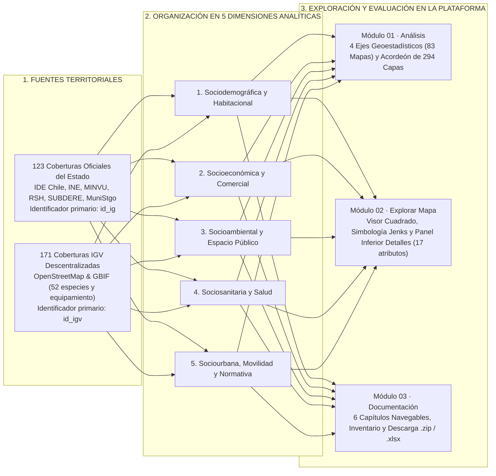

# Trazabilidad Metodológica, Marco Conceptual y Evaluación de Usabilidad
### Atlas para la Gestión Territorial — Análisis y Exploración | Municipio de Santiago y Barrio Brasil

* **Plataforma web en producción (CDN primario):** [https://atlasvgiuah.netlify.app](https://atlasvgiuah.netlify.app)
* **Repositorio espejo (GitHub Pages):** [https://geojota.github.io/atlas-vgi-barrio-brasil/](https://geojota.github.io/atlas-vgi-barrio-brasil/)

---

## 1. Objetivos y entregables verificados del proyecto

### 1.1. Objetivo general
Desarrollar un Atlas para la Gestión Territorial reproducible, interoperable y centrado en el usuario, que integre geodatos abiertos, cartografía participativa y herramientas analíticas para subsanar vacíos de información territorial y apoyar la gestión local y la investigación en la Comuna de Santiago y Barrio Brasil.

### 1.2. Objetivos específicos y entregables verificados
* **OE 1.** Caracterizar la disponibilidad, la cobertura y los vacíos de información geográfica del área de estudio, y definir las bases taxonómicas y de diseño centrado en el usuario que permitan integrar datos colaborativos e institucionales.
  * *Entregables verificados:* Revisión de plataformas abiertas (OpenStreetMap, GBIF e IDE Chile); estructuración de las **5 dimensiones analíticas** del territorio; caracterización de los 4 perfiles de actores territoriales e inventario de brechas (`docs/ARQUITECTURA.md`, `docs/TRAZABILIDAD.md`, `docs/catalogo_fuentes_vgi.xlsx`, `docs/categorias_tematicas_osm.xlsx`).
* **OE 2.** Consolidar una geodatabase multipropósito que armonice coberturas oficiales e información voluntaria bajo estándares internacionales de calidad y metadatos.
  * *Entregables verificados:* Geodatabase de **294 coberturas vectoriales** (123 oficiales del Estado de Chile y 171 coberturas descentralizadas de Información Geográfica Voluntaria, IGV) en `EPSG:4326` y `EPSG:32719`; homologación del perfil de metadatos y calidad ISO 19157 de **17 atributos** diferenciando `id_ig` (capas oficiales) e `id_igv` (capas de IGV); matrices de síntesis comunal y barrial (`src/data/*.geojson`, `docs/perfil_metadatos_vgi.xlsx`).
* **OE 3.** Implementar un geoportal web accesible e interoperable que permita visualizar cartografía multinivel, consultar el territorio en tiempo real y descargar geodatos abiertos.
  * *Entregables verificados:* **Definición de un prototipo sintetizado para usuarios no técnicos:** prototipo más sintetizado que permita a usuarios sin experiencia técnica poder interactuar de forma más simple con la plataforma, articulado en 3 módulos (*Módulo 01 Análisis*, *Módulo 02 Explorar Mapa* y *Módulo 03 Documentación*); visor cartográfico cuadrado (Leaflet 1.9.4) con 5 mapas base sin requerimiento de clave de API (OpenStreetMap, Bing/Microsoft y Esri), simbología estadística dinámica (*Natural Breaks* / Jenks) y panel inferior de **Detalles**; Inspector normativo PRC/OGUC bajo demanda y 4 ejes de diagnóstico geoestadístico con 83 cartografías (`src/index.html`, `src/css/estilos.css`, `src/js/modulos/mapa.js`, `evaluador_normativo.js`, `indicadores_analisis.js`, `netlify.toml`).
* **OE 4.** Evaluar la usabilidad y la pertinencia de la plataforma con distintos perfiles de actores territoriales y asegurar su transferibilidad técnica, metodológica y documental.
  * *Entregables verificados:* Evaluación de usabilidad (Modalidad 1) y conversaciones situadas con vecinos (Modalidad 2); tutorial interactivo navegable de 18 pasos por módulo y glosario de siglas; documentación navegable en la plataforma y en Git (`MANUAL_USO.md`, `MANUAL_ACTUALIZACION_ATLAS.md`, `ARQUITECTURA.md`); paquete comprimido de la geodatabase completa (`docs/geodatabase_completa_atlas_vgi.zip`) y scripts de verificación de integridad (`scripts/verificar_conteo_capas.py`).

---

## 2. Fundamentación conceptual: Información Geográfica Oficial (`id_ig`) e Información Geográfica Voluntaria (`id_igv`)

Tradicionalmente, la producción de datos espaciales ha recaído en organismos estatales centralizados (ministerios sectoriales, institutos nacionales de estadísticas y direcciones de obras municipales). Aunque indispensables para el ordenamiento jurídico y censal del territorio, los catastros oficiales suelen presentar ciclos de actualización multianuales y menor granularidad sobre el equipamiento cotidiano de escala barrial.

A partir de la formulación de Michael Goodchild (2007) sobre la *Información Geográfica Voluntaria* (IGV) y los desarrollos de Haklay (2010), Senaratne et al. (2017) y Herfort et al. (2023), el **Atlas para la Gestión Territorial** articula de manera paritaria **123 coberturas oficiales del Estado de Chile** (`id_ig`) con **171 coberturas descentralizadas de IGV** (`id_igv`, provenientes de OpenStreetMap y GBIF) organizadas en **5 Dimensiones Analíticas**:

---

## 3. Estándares internacionales ISO/OGC y perfil homologado de 17 atributos

1. **ISO 19115-1:2014 e ISO 19157:2013 (Metadatos y Calidad de Datos Geográficos):**
   * Todas las entidades de las 294 coberturas exponen en el panel inferior **Detalles** del Módulo 02 un perfil homologado de **17 atributos** que incluye su identificador único (`id_ig` para coberturas oficiales e `id_igv` para coberturas de IGV), nombre, dimensión analítica, fuente, institución custodia, licencia, sistema de referencia (`EPSG:4326` / `EPSG:32719`), geometría, superficie o longitud métrica, fecha de actualización y métricas de completitud tabular, consistencia lógica y exactitud posicional.
2. **ISO 19110:2016 (Catalogación de Entidades Espaciales):**
   * Las 171 coberturas de IGV se encuentran descentralizadas en archivos individuales 100 % en español, documentados en [`docs/categorias_tematicas_osm.xlsx`](docs/categorias_tematicas_osm.xlsx) y en el inventario interactivo del Módulo 03.
3. **ISO 19111:2019 (Referenciación por Coordenadas y Geodesia):**
   * El motor [`src/js/modulos/geodesia.js`](src/js/modulos/geodesia.js) reproyecta al vuelo las geometrías desde `EPSG:4326` hacia `EPSG:32719` (SIRGAS-Chile / UTM Huso 19 Sur) mediante las ecuaciones de Redfearn para calcular superficies exactas en metros cuadrados (`m²`) y hectáreas (`ha`).

---

## 4. Trazabilidad del instrumento de evaluación de usabilidad y percepción (Modalidades 1 y 2)

La evaluación con actores territoriales combina dos modalidades complementarias cuyos formularios e instrumentos LaTeX se encuentran alineados con los 3 módulos de la plataforma:

1. **Modalidad 1 (FO-M1 · Prueba de usabilidad con tareas T1 a T8):**
   * **T1 (Cabecera y Módulo 01):** Comprensión del propósito del Atlas para la Gestión Territorial e identificación del Tutorial interactivo (a la izquierda del título) y del Glosario de siglas (a la derecha).
   * **T2 (Módulo 01 · Análisis):** Exploración de uno de los 4 ejes de diagnóstico geoestadístico (83 cartografías) e interpretación de un hallazgo territorial.
   * **T3 (Módulos 01 y 02):** Navegación por las 5 dimensiones analíticas, búsqueda de la cobertura de áreas verdes en el acordeón de 294 capas y activación directa en el visor.
   * **T4 (Módulo 02 · Explorar Mapa):** Selección del área de enfoque *Barrio Brasil Completo*, cambio de mapa base (entre OpenStreetMap e imagen satelital Bing/Microsoft o Esri) y medición de superficie con *Delimitar área*.
   * **T5 (Módulo 02 · Explorar Mapa):** Consulta puntual con el *Inspector normativo (PRC)* para identificar zona y usos de suelo permitidos por el Plan Regulador Comunal.
   * **T6 (Módulo 02 · Explorar Mapa):** Inspección del panel inferior **Detalles** de una entidad, lectura de su perfil de 17 atributos (`id_ig` o `id_igv` y métricas ISO 19157) y valoración de su confiabilidad.
   * **T7 (Módulo 02 · Explorar Mapa):** Aplicación de *Simbología dinámica* (clasificación estadística Jenks) y exportación de la vista activa en GeoJSON o descarga de la base de datos `.zip`.
   * **T8 (Módulo 03 · Documentación):** Uso del buscador documental para localizar el inventario de 294 capas, los catálogos en Excel y las licencias abiertas del Atlas.
2. **Modalidad 2 (FO-M2 · Protocolo de conversación abierta y situada con vecinas y vecinos):**
   * Indaga hábitos cartográficos cotidianos, demandas de información barrial, criterios de confianza entre fuentes comunitarias y oficiales, resguardo de privacidad y gobernanza territorial en el Barrio Brasil.
