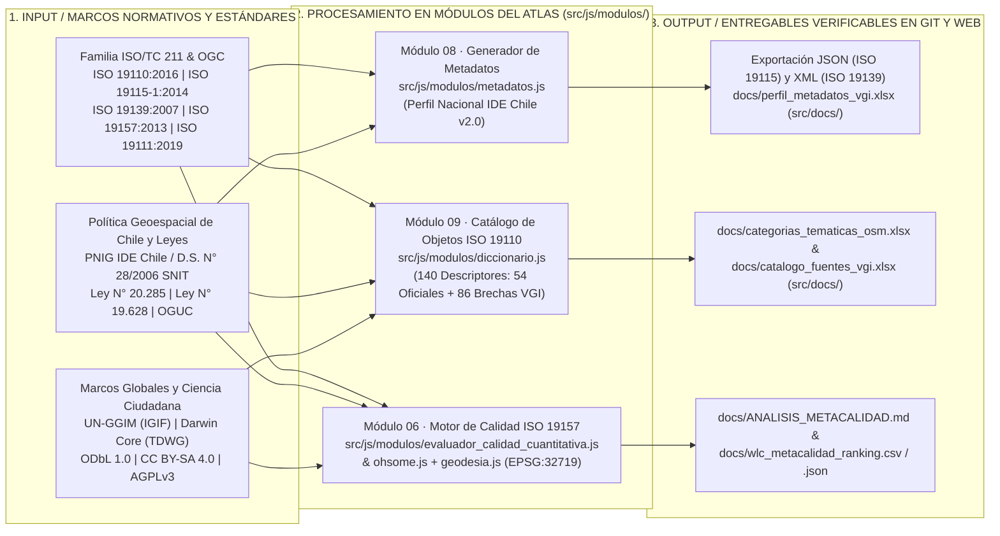
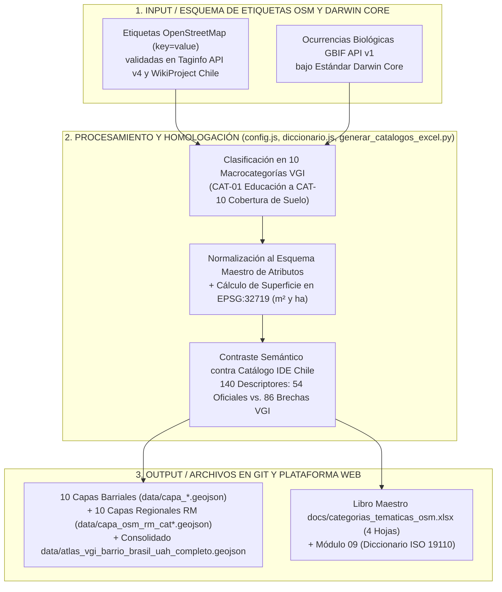
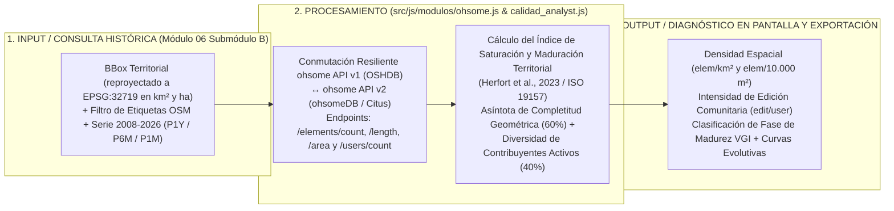

# Trazabilidad Metodológica y Marco Conceptual del Sistema
### Atlas de Información Geográfica Voluntaria para la Gestión Territorial — Nodo GeoAbierto

* **Plataforma Web en Producción (CDN Primario):** [https://atlasvgiuah.netlify.app](https://atlasvgiuah.netlify.app)
* **Repositorio Espejo (GitHub Pages):** [https://geojota.github.io/atlas-vgi-barrio-brasil/](https://geojota.github.io/atlas-vgi-barrio-brasil/)
* **Cobertura del Sistema:** **132 Capas Operativas** (`122` Oficiales del Estado + `10` Macrocategorías VGI `CAT-01` a `CAT-10`) · **140 Descriptores ISO 19110:2016** (`54` Oficiales + `86` Brechas VGI) · **5 Dimensiones Analíticas** · **4 Storyboards (75 Cartografías)** · **10 Módulos (`01` al `10`)**.

---

## 🧭 Índice de Contenidos

1. [Fundamentación Conceptual: La Información Geográfica Voluntaria en la Gestión Territorial](#1-fundamentación-conceptual-la-información-geográfica-voluntaria-en-la-gestión-territorial)
2. [Marco Normativo, Estándares ISO y Política Geoespacial Chilena y Global](#2-marco-normativo-estándares-iso-y-política-geoespacial-chilena-y-global)
3. [Evaluación de Calidad de Datos Espaciales (ISO 19157, Modelo WLC v2.0 y ohsome API v1/v2)](#3-evaluación-de-calidad-de-datos-espaciales-iso-19157-modelo-wlc-v20-y-ohsome-api-v1v2)
4. [Decisiones de Arquitectura de Software y Diseño Multi-Lenguaje](#4-decisiones-de-arquitectura-de-software-y-diseño-multi-lenguaje)
5. [Auditoría Universal de MetaCalidad de la Base de Datos (`132 Capas`)](#5-auditoría-universal-de-metacalidad-de-la-base-de-datos-132-capas)
6. [Aplicación Territorial en el Caso de Estudio: Barrio Brasil, Campus UAH y Santiago](#6-aplicación-territorial-en-el-caso-de-estudio-barrio-brasil-campus-uah-y-santiago)
7. [Preguntas Frecuentes sobre Interoperabilidad, Reproducibilidad y Calidad](#7-preguntas-frecuentes-sobre-interoperabilidad-reproducibilidad-y-calidad)
8. [Referencias Bibliográficas y Fuentes Oficiales (Norma APA 7ª Edición)](#8-referencias-bibliográficas-y-fuentes-oficiales-norma-apa-7ª-edición)

---

## 1. Fundamentación Conceptual: La Información Geográfica Voluntaria en la Gestión Territorial

Tradicionalmente, la producción de datos geográficos ha estado concentrada en agencias estatales centralizadas (institutos geográficos militares, ministerios sectoriales, institutos nacionales de estadísticas y direcciones de obras municipales). Aunque indispensables para el ordenamiento jurídico del territorio, los catastros estatales enfrentan tres limitaciones operativas:
1. **Ciclos de actualización multianuales**, que dificultan registrar transformaciones rápidas del entorno barrial.
2. **Escala macro o agregada**, que suele omitir elementos de microgeografía cotidiana (accesibilidad universal en esquinas, pavimento podotáctil, estacionamientos de bicicletas, mobiliario peatonal o arbolado de alineación).
3. **Barreras de interoperabilidad**, cuando los datos se distribuyen sin diccionarios de atributos estandarizados.

Desde la formulación de Michael Goodchild (2007) sobre la *Información Geográfica Voluntaria* (*Volunteered Geographic Information*, VGI) y las investigaciones de Muki Haklay (2010), Senaratne et al. (2017) y Herfort et al. (2023), la ciencia de la información geográfica reconoce a las comunidades locales como productores activos de datos espaciales. El **Atlas VGI (Nodo GeoAbierto)** operacionaliza este marco integrando **122 coberturas oficiales del Estado de Chile** con **10 macrocategorías colaborativas VGI (`CAT-01` a `CAT-10`)** bajo normas abiertas de calidad, catalogación y licenciamiento.

---

## 2. Marco Normativo, Estándares ISO y Política Geoespacial Chilena y Global

### 2.1. Pipeline de Implementación de Normas ISO/OGC y Política Nacional SNIT



### 2.2. Especificación de Estándares Implementados

1. **ISO 19115-1:2014 — Geographic information — Metadata — Part 1: Fundamentals:**
   * *Enlace oficial:* [https://www.iso.org/standard/53798.html](https://www.iso.org/standard/53798.html)
   * *Implementación:* El **Módulo 08** ([`src/js/modulos/metadatos.js`](src/js/modulos/metadatos.js)) estructura los elementos núcleo obligatorios (`MD_DataIdentification`, `MD_TopicCategoryCode`, `EX_GeographicBoundingBox`, `LI_Lineage`, `MD_ReferenceSystem`, `CI_RoleCode`) para las **132 capas del Atlas**.
2. **ISO/TS 19139:2007 — Geographic information — Metadata — XML schema implementation:**
   * *Enlace oficial:* [https://www.iso.org/standard/32574.html](https://www.iso.org/standard/32574.html)
   * *Implementación:* Exportación directa en XML con esquema `<gmd:MD_Metadata>` (`http://www.isotc211.org/2005/gmd`), compatible con catálogos CSW como GeoNetwork y GeoNode.
3. **ISO 19157:2013 / ISO 19157-1:2023 — Geographic information — Data quality:**
   * *Enlace oficial:* [https://www.iso.org/standard/32575.html](https://www.iso.org/standard/32575.html)
   * *Implementación:* Operacionalizado en el **Módulo 06** mediante el Evaluador Universal WLC v2.0 (`src/js/modulos/evaluador_calidad_cuantitativa.js`), el cliente histórico `src/js/modulos/ohsome.js` y el script `scripts/analisis_metacalidad.py`.
4. **ISO 19110:2016 — Geographic information — Methodology for feature cataloguing:**
   * *Enlace oficial:* [https://www.iso.org/standard/57303.html](https://www.iso.org/standard/57303.html)
   * *Implementación:* El **Módulo 09** ([`src/js/modulos/diccionario.js`](src/js/modulos/diccionario.js)) cataloga las **132 coberturas** y **140 descriptores normativos** (incluyendo el esquema normalizado de atributos VGI y las correspondencias con IDE Chile).
5. **Darwin Core Standard (TDWG / GBIF):**
   * *Enlace oficial:* [https://dwc.tdwg.org/](https://dwc.tdwg.org/)
   * *Implementación:* El **Módulo 03** ([`src/js/modulos/gbif.js`](src/js/modulos/gbif.js)) consulta ocurrencias biológicas georreferenciadas validando `scientificName`, `eventDate`, `basisOfRecord` e indicadores de calidad posicional.

### 2.3. Articulación con la Política Nacional de Información Geoespacial (PNIG) e IDE Chile
* **Política Nacional de Información Geoespacial (PNIG) y D.S. N° 28/2006 (Ministerio de Bienes Nacionales):** Promueve la estandarización y difusión de datos espaciales a través del Sistema Nacional de Información Territorial (SNIT / IDE Chile).
* **Perfil Nacional de Metadatos de Chile v2.0 (IDE Chile):** Adoptado en el Módulo 08 y en el libro [`docs/perfil_metadatos_vgi.xlsx`](docs/perfil_metadatos_vgi.xlsx).
* **Ley N° 20.285 sobre Acceso a la Información Pública y Ley N° 19.628 sobre Protección de la Vida Privada:** Respaldan la reutilización abierta de las **122 coberturas estatales** y la agregación estadística de los microdatos censales y socioeconómicos a escala de manzana y unidad vecinal.

### 2.4. Régimen Tripartito de Licencias Abiertas (`Módulo 10`)
1. **Cartografía Derivada, Documentación y Manuales:** **Creative Commons Atribución-CompartirIgual 4.0 Internacional (`CC BY-SA 4.0`)**.
2. **Bases de Datos Vectoriales Colaborativas:** **Open Database License (`ODbL 1.0`)** para datos provenientes de OpenStreetMap y **Creative Commons (`CC BY 4.0` / `CC0`)** para registros de biodiversidad de GBIF.
3. **Código Fuente del Sistema:** **GNU Affero General Public License v3.0 (`GNU AGPLv3`)**, garantizando que cualquier adaptación del visor en red mantenga su código abierto.

### 2.5. Taxonomía de las 10 Macrocategorías VGI Adaptada a Chile (`CAT-01` a `CAT-10`)



| Código | Categoría Temática Maestra | Contraparte Institucional Estatal | Norma / Estándar Técnico Vinculado | Cobertura en Barrio Brasil / UAH |
| :---: | :--- | :--- | :--- | :--- |
| **`CAT-01`** | Educación, Universidades e Investigación | MINEDUC / Subsecretaría de Educación Superior / JUNJI | Directorio Oficial de Establecimientos MINEDUC; Ley N° 21.091 | Campus Universidad Alberto Hurtado, Liceo de Aplicación, colegios, jardines infantiles y bibliotecas (`247` entidades). |
| **`CAT-02`** | Servicios Urbanos, Salud y Comercio Barrial | MINSAL / SEREMI de Salud RM / SERCOTEC / MuniSTGO | Modelo de Salud Familiar MINSAL; Ley de Rentas Municipales D.L. 3.063 | Comercio minorista, almacenes, panaderías, farmacias, CESFAM Ignacio Domeyko y gastronomía (`365` entidades). |
| **`CAT-03`** | Movilidad, Transporte Público y Paraderos | MTT / DTPM / Metro de Santiago S.A. | Manual de Paraderos Red Movilidad (DTPM); Manual REDEVU (MINVU) | Estaciones Metro Los Héroes (L1/L2), Santa Ana (L2/L5), Cumming (L5), República (L1) y paradas Red (`191` entidades). |
| **`CAT-04`** | Movilidad Activa, Ciclovías y Peatonalidad | MTT / SECTRA / SERVIU RM / MuniSTGO | Manual de Vialidad Cicloinclusiva (MINVU); Ley de Convivencia Vial N° 21.088 | Ciclovías segregadas en ejes Rosas y Compañía, ciclobanda Av. Brasil y biciestacionamientos (`11` trazados). |
| **`CAT-05`** | Áreas Verdes, Espacio Público y Recreación | MINVU / PARQUEMET / IND / MuniSTGO | Política Nacional de Parques Urbanos (MINVU); Estándares CNDU; Art. 2.2.4 OGUC | Plaza Brasil (`15.200 m²`), Plaza Manuel Rodríguez, bandejones arbolados, multicanchas y mobiliario (`144` entidades). |
| **`CAT-06`** | Patrimonio Histórico, Memoria y Cultura | SERPAT / CMN / Ministerio de las Culturas | Ley N° 17.288 de Monumentos Nacionales; D.E. N° 126/2000 Zona Típica Barrio Brasil | Cités patrimoniales, Basílica del Salvador, Inmuebles de Conservación Histórica y centros culturales (`71` entidades). |
| **`CAT-07`** | Accesibilidad Universal y Discapacidad | SENADIS / MINVU / DOM Municipalidad de Santiago | D.S. N° 50 OGUC Accesibilidad Universal; Ley N° 20.422; ISO 21542:2021 | Rebajes de cordón (`kerb=*`), cruces peatonales semaforizados, pavimento podotáctil y rampas (`185` entidades). |
| **`CAT-08`** | Biodiversidad Urbana y Arbolado (OSM / GBIF) | CONAF / MMA / Dirección de Medio Ambiente MuniSTGO / GBIF | Ley Marco de Cambio Climático N° 21.455; Guía de Arbolado Urbano CONAF; Darwin Core | Arbolado viario en Av. Brasil, ejemplares arbóreos de Plaza Brasil y ocurrencias de flora y avifauna en GBIF (`390` registros). |
| **`CAT-09`** | Edificaciones y Huella Urbana (Polígonos) | SII (Catastro de Bienes Raíces) / DOM MuniSTGO / MINVU | LGUC; Art. 2.1.24 OGUC; ISO 19157 (Completitud de Área) | Polígonos cerrados de huella edificada con superficie calculada en `EPSG:32719` (`1.673` polígonos). |
| **`CAT-10`** | Coberturas y Usos de Suelo | MINVU (DDU) / DOM MuniSTGO / Dirección de Vialidad MOP | Plan Regulador Comunal de Santiago (PRC); OGC LandInfra Standard | Polígonos de uso residencial, comercial, educativo, recreativo y materialidad de calzadas (`400` polígonos). |

---

## 3. Evaluación de Calidad de Datos Espaciales (ISO 19157, Modelo WLC v2.0 y ohsome API v1/v2)

### 3.1. Pipeline de Evaluación Histórica ohsome API v1/v2 e Índice de Saturación y Maduración Territorial



### 3.2. Soporte Dual para ohsome API v1 (OSHDB) y ohsome API v2 (ohsomeDB)
El módulo [`src/js/modulos/ohsome.js`](src/js/modulos/ohsome.js) soporta tanto la línea base pública **ohsome API v1 (`api.ohsome.org/v1`)** como la generación distribuida **ohsome API v2 (`api.heigit.org/ohsome-api/v2-rc`)**, aplicando conmutación automática hacia `v1` si el usuario no ingresa un token `Bearer`, evitando interrupciones por errores `HTTP 401`.

### 3.3. Fundamentación Geodésica y Reproyección a `EPSG:32719` (`src/js/modulos/geodesia.js`)
Para cumplir con la norma **ISO 19111:2019** y los estándares del **Instituto Geográfico Militar (IGM)** e **IDE Chile**:
* Todas las capas `.geojson` se almacenan en coordenadas geográficas **`EPSG:4326` (WGS84)** en `data/` y `src/data/`.
* Dado que a la latitud de Santiago (`latitud ≈ -33,44°`) un grado de longitud equivale a `~92,9 km` mientras que un grado de latitud equivale a `~110,9 km`, todas las mediciones de superficie (`m²`, `ha`, `km²`) y los denominadores de densidad espacial se calculan previa reproyección a **WGS 84 / UTM Huso 19 Sur (`EPSG:32719`)** en [`src/js/modulos/geodesia.js`](src/js/modulos/geodesia.js).

---

## 4. Decisiones de Arquitectura de Software y Diseño Multi-Lenguaje

| Decisión de Ingeniería | Alternativa Descartada | Justificación Técnica y Operativa |
| :--- | :--- | :--- |
| **Arquitectura Web Estática + PostGIS Híbrido** | Servidor monolítico de pago exclusivo | Permite alojar el sistema en CDN (Netlify y GitHub Pages) con disponibilidad permanente y conmutación automática entre PostGIS RPC (`Nivel 1`), archivos GeoJSON locales (`Nivel 2`) y caché RAM (`Nivel 3`). |
| **JavaScript ES6+ Modular (21 Scripts IIFE)** | Frameworks con transpilación compleja | Elimina dependencias vulnerables de `node_modules` y permite inspeccionar o adaptar cualquiera de los 21 módulos en `src/js/` directamente. |
| **Sincronización Simétrica `data/` ↔ `src/data/` y `docs/` ↔ `src/docs/`** | Rutas divergentes entre desarrollo y producción | Asegura que las llamadas `fetch('data/...')` y `fetch('docs/...')` resuelvan exactamente los mismos archivos tanto en local como en producción (`publish = "src"`). |
| **Doble Formato Cartográfico (`.geojson` + `.gpkg`)** | Uso exclusivo de Shapefiles truncados a 10 caracteres | El formato `GeoJSON` (`RFC 7946`) alimenta directamente el visor web, mientras que los archivos `OGC GeoPackage (.gpkg)` en la geodatabase preservan tablas relacionales y comentarios de columnas (`gpkg_data_columns`). |

---

## 5. Auditoría Universal de MetaCalidad de la Base de Datos (`132 Capas`)

Mediante el script [`scripts/analisis_metacalidad.py`](scripts/analisis_metacalidad.py) y el modelo [`scripts/modelo_indice_lineal_wlc.py`](scripts/modelo_indice_lineal_wlc.py), se evalúa la totalidad de las **132 coberturas operativas** (`122` capas oficiales del Estado + `10` macrocategorías VGI):

```text
IGV_i = 0.50 * S_cuantitativo(i) + 0.50 * S_cualitativo(i)

Donde:
  S_cuantitativo(i) = 0.30 * S_topo(i) + 0.25 * S_comp(i) + 0.20 * S_pos(i) + 0.15 * S_estruc(i) + 0.10 * S_gran(i)
  S_cualitativo(i)  = 0.30 * MC(i)     + 0.20 * CC(i)     + 0.25 * LL(i)    + 0.15 * RG(i)       + 0.10 * AI(i)
```

### Resultados Consolidados de la Auditoría (`docs/ANALISIS_METACALIDAD.md`):
* **Total de coberturas evaluadas:** **`132` capas** (`122` Oficiales + `10` VGI).
* **Índice Global de Calidad Geográfica (`IGV`):** **`95,38%` (`Grado A+ Excelente`)**.
  * **Pilar Cuantitativo Espacial (`50%`):** **`96,67%`** (`Topología OGC = 99,89%`, `Completitud Tabular = 97,02%`, `Integridad Posicional = 99,79%`).
  * **Pilar Cualitativo de Metadatos (`50%`):** **`94,10%`** (`Metadatos Núcleo MC = 96,33%`, `Conformidad CC = 93,96%`, `Linaje Legal LL = 98,16%`, `Accesibilidad AI = 97,31%`).
* **Distribución por Grado ISO 19157:** **`91` capas en Grado A+ (`68,9%`)** y **`41` capas en Grado A (`31,1%`)**, con **`0` capas en Grado B o C (`0,0%`)**.
* **Entregables verificables generados en `docs/` y `src/docs/`:**
  * [`docs/ANALISIS_METACALIDAD.md`](docs/ANALISIS_METACALIDAD.md)
  * [`docs/matriz_metacalidad.json`](docs/matriz_metacalidad.json)
  * [`docs/wlc_metacalidad_ranking.csv`](docs/wlc_metacalidad_ranking.csv) y [`docs/wlc_metacalidad_resultado.json`](docs/wlc_metacalidad_resultado.json)
  * [`docs/correlacion_dimensiones_calidad.csv`](docs/correlacion_dimensiones_calidad.csv) y [`docs/correlacion_dimensiones_calidad.png`](docs/correlacion_dimensiones_calidad.png)
  * [`docs/perfil_metadatos_vgi.xlsx`](docs/perfil_metadatos_vgi.xlsx)

---

## 6. Aplicación Territorial en el Caso de Estudio: Barrio Brasil, Campus UAH y Santiago

En el área de estudio del Barrio Brasil y el entorno del Campus Universidad Alberto Hurtado (`data/atlas_vgi_barrio_brasil_uah_completo.geojson` y `data/resumen_catastro_vgi.csv`), las **10 macrocategorías VGI** consolidan **3.677 entidades locales** (y **1.552.144 entidades** en los extractos metropolitanos `data/capa_osm_rm_cat01_educacion.geojson` a `cat10_cobertura_suelo.geojson`), las cuales se articulan con las **122 capas oficiales** en los **4 Storyboards Territoriales (`75` cartografías temáticas)** del **Módulo 05**:

1. **Storyboard 01 (`11` mapas):** Densidad de Kernel (`KDE`) de equipamientos educativos, salud, comercio, patrimonio y accesibilidad peatonal.
2. **Storyboard 02 (`11` mapas):** Autocorrelación espacial local (`LISA` / `I de Moran`) entre densidad VGI y coberturas oficiales a escala de manzana (`data/matriz_sintesis_barrio_brasil_manzanas.geojson`).
3. **Storyboard 03 (`29` mapas):** Demografía y habitabilidad del Censo 2024 (`data/ide_censo2024_manzanas.geojson`), vulnerabilidad del Registro Social de Hogares (`data/RSH_*_UV_2026_*.geojson`) e inversión pública BIP (`data/bip_inversiones_santiago.csv`).
4. **Storyboard 04 (`24` mapas):** Metabolismo urbano, Catastro SUBDERE RSD 2024 (`data/subdere_rsd_*.geojson`), aseo municipal, ruido ambiental MMA (`data/mma_ruido_ambiental_santiago.geojson`) y red de semáforos UOCT (`data/semaforos_rm_uoct_2026.geojson`).

---

## 7. Preguntas Frecuentes sobre Interoperabilidad, Reproducibilidad y Calidad

### P1: *¿Cómo se articula la Información Geográfica Voluntaria con los datos oficiales del Estado?*
> **Respuesta:** La VGI complementa la cartografía pública en escalas y atributos donde no existen catastros estatales continuos (como las **86 brechas temáticas VGI** documentadas en el **Módulo 09**, incluyendo rebajes de solera, pavimento podotáctil o estacionamientos de bicicletas). Al mismo tiempo, las **132 capas** son evaluadas con las mismas métricas cuantitativas y documentales (**ISO 19157 / ISO 19115**) en el **Módulo 06**, permitiendo conocer el nivel de completitud y consistencia de cada cobertura antes de utilizarla.

### P2: *¿Cómo se adapta la plataforma a otra comuna, ciudad o región?*
> **Respuesta:** Los parámetros de encuadre territorial (`bbox`), centroide, comunas e identificadores de capas se encuentran desacoplados en [`config/config.json`](config/config.json) y [`src/js/config.js`](src/js/config.js). El procedimiento completo paso a paso para cambiar el polígono de estudio, el huso UTM en `src/js/modulos/geodesia.js` y las coberturas locales se detalla en el **Capítulo 8** de [`MANUAL_ACTUALIZACION_ATLAS.md`](MANUAL_ACTUALIZACION_ATLAS.md).

### P3: *¿Qué ocurre si una API externa presenta latencia o falta de conectividad?*
> **Respuesta:** La arquitectura de triple contingencia conmuta automáticamente hacia las **132 coberturas preprocesadas** en `src/data/*.geojson` (`data/*.geojson`) y permite descargar en cualquier momento el paquete autónomo `docs/geodatabase_completa_atlas_vgi.zip` (`542,35 MB`).

### P4: *¿Cómo se garantiza la exactitud en el cálculo de áreas y densidades?*
> **Respuesta:** Ninguna superficie se calcula sobre coordenadas angulares ni sobre proyecciones Web Mercator (`EPSG:3857`). Todas las geometrías se reproyectan a **`EPSG:32719` (WGS 84 / UTM Huso 19 Sur / SIRGAS-Chile)** mediante las ecuaciones de Redfearn en [`src/js/modulos/geodesia.js`](src/js/modulos/geodesia.js), calculando áreas exactas en `m²`, `ha` y `km²` conforme al estándar **ISO 19111:2019**.

---

## 8. Referencias Bibliográficas y Fuentes Oficiales (Norma APA 7ª Edición)

Todas las fuentes citadas a lo largo de este documento, en la interfaz web del Atlas y en el catálogo Excel consolidado ([`docs/categorias_tematicas_osm.xlsx`](docs/categorias_tematicas_osm.xlsx)) se encuentran estandarizadas bajo la norma **APA 7ª edición** (125 referencias formales) organizadas por tipología documental:

### 7.1 Normas Técnicas Internacionales ISO y Estándares OGC
- Biodiversity Information Standards [TDWG]. (2023). *Darwin Core standard: Quick reference guide*. Biodiversity Information Standards. https://dwc.tdwg.org/terms/
- International Organization for Standardization. (2005). *Geographic information — Web map server interface* (ISO Standard No. 19128:2005 / OGC WMS). ISO / OGC. https://www.iso.org/standard/32520.html
- International Organization for Standardization. (2007). *Geographic information — Metadata — XML schema implementation* (ISO Technical Specification No. 19139:2007). ISO. https://www.iso.org/standard/32574.html
- International Organization for Standardization. (2013). *Geographic information — Data quality* (ISO Standard No. 19157:2013). ISO. https://www.iso.org/standard/32575.html
- International Organization for Standardization. (2014). *Geographic information — Metadata — Part 1: Fundamentals* (ISO Standard No. 19115-1:2014). ISO. https://www.iso.org/standard/53798.html
- International Organization for Standardization. (2016). *Geographic information — Methodology for feature cataloguing* (ISO Standard No. 19110:2016). ISO. https://www.iso.org/standard/57303.html
- International Organization for Standardization. (2016). *Geographic information — Services* (ISO Standard No. 19119:2016/Amd 1:2019). ISO. https://www.iso.org/standard/59221.html
- International Organization for Standardization. (2021). *Building construction — Accessibility and usability of the built environment* (ISO Standard No. 21542:2021). ISO. https://www.iso.org/standard/70494.html
- Open Geospatial Consortium. (2019). *OGC API - Features - Part 1: Core* (Standard No. OGC 17-069r3). Open Geospatial Consortium. https://ogcapi.ogc.org/features/

### 7.2 Infraestructura de Datos Espaciales de Chile (IDE Chile), SNIT, GeoNodo y Marco Legal
- Bomberos de Chile. (2022). *Catálogo Nacional de Cuarteles y Estándares de Redes de Grifos Urbanos*. Junta Nacional de Cuerpos de Bomberos de Chile. https://www.bomberos.cl/
- Consejo de Monumentos Nacionales [CMN]. (2020). *Ley N° 17.288 de Monumentos Nacionales y Normas Relacionadas*. Ministerio de las Culturas, las Artes y el Patrimonio, Gobierno de Chile. https://www.monumentos.gob.cl/
- Corporación Nacional Forestal [CONAF]. (2019). *Guía de Campo: Árboles Urbanos de Chile*. Ministerio de Agricultura, Gobierno de Chile. https://www.conaf.cl/
- Directorio de Transporte Público Metropolitano [DTPM]. (2023). *Manual de Normas Técnicas para Paraderos e Infraestructura del Sistema Red Movilidad*. Ministerio de Transportes y Telecomunicaciones, Gobierno de Chile. https://www.dtpm.cl/
- Directorio de Transporte Público Metropolitano [DTPM]. (2024). *Reporte de Cobertura, Accesibilidad y Gestión de Paradas Red Movilidad*. Ministerio de Transportes y Telecomunicaciones, Gobierno de Chile. https://www.dtpm.cl/
- Empresa de Transporte de Pasajeros Metro S.A. (2024). *Memoria Anual y Catálogo de Estaciones, Accesos y Conectividad de la Red de Metro*. Metro de Santiago. https://www.metro.cl/
- Fuenzalida, M. (2025). *Taller Datos Abiertos e Infraestructura de Datos Espaciales en Chile: Integración de VGI y Políticas Públicas*. Conferencia y Seminario IDE Chile, Ministerio de Bienes Nacionales. https://www.ide.cl
- Infraestructura de Datos Espaciales de Chile [IDE Chile]. (2006). *Decreto Supremo N° 28/2006: Crea Comisión Asesora del Sistema Nacional de Información Territorial (SNIT)*. Ministerio de Bienes Nacionales, Gobierno de Chile. https://www.bcn.cl/leychile/navegar?idNorma=251642
- Infraestructura de Datos Espaciales de Chile [IDE Chile]. (2016). *Guía Técnica para la Estandarización y Producción de Información Geoespacial*. Secretaría Ejecutiva SNIT, Ministerio de Bienes Nacionales. https://www.ide.cl/
- Infraestructura de Datos Espaciales de Chile [IDE Chile]. (2017). *Marco Técnico y Metodológico para la Evaluación de la Calidad de la Información Geográfica en Chile (Norma ISO 19157)*. Secretaría Ejecutiva SNIT, Ministerio de Bienes Nacionales. https://www.ide.cl/
- Infraestructura de Datos Espaciales de Chile [IDE Chile]. (2018). *Perfil Nacional de Metadatos de Chile v2.0 (Basado en ISO 19115:2003 / ISO 19139:2007)*. Secretaría Ejecutiva SNIT, Ministerio de Bienes Nacionales. https://www.ide.cl/
- Infraestructura de Datos Espaciales de Chile [IDE Chile]. (2020). *Catálogo de Objetos Geográficos de Chile v3.0: Estándar para la captura y clasificación de información geoespacial*. Ministerio de Bienes Nacionales. https://www.ide.cl/
- Infraestructura de Datos Espaciales de Chile [IDE Chile]. (2021). *Modelo de Interoperabilidad Geoespacial del Estado de Chile: Jerarquía, Distribución y Acuerdos Interinstitucionales de Intercambio de Datos*. Ministerio de Bienes Nacionales. https://www.ide.cl/
- Infraestructura de Datos Espaciales de Chile [IDE Chile]. (2022). *GeoNodo Chile: Plataforma Nacional de Datos Geoespaciales Abiertos e Infraestructura de Servicios Web Geográficos (WMS, WFS, CSW)*. Secretaría Ejecutiva SNIT, Ministerio de Bienes Nacionales. https://www.geonodo.cl
- Infraestructura de Datos Espaciales de Chile [IDE Chile]. (2023). *Política Nacional de Información Geoespacial*. Secretaría Ejecutiva SNIT, Ministerio de Bienes Nacionales, Gobierno de Chile. https://www.ide.cl/
- Instituto Nacional de Deportes [IND]. (2021). *Catastro Nacional de Recintos Deportivos y Multicanchas Públicas*. Ministerio del Deporte, Gobierno de Chile. https://www.ind.cl/
- Instituto Nacional de Estadísticas [INE]. (2017). *Metodología de Clasificación y Asignación de Equipamiento Comunitario y Asentamientos Humanos*. INE Chile. https://www.ine.gob.cl/
- Instituto Nacional de Estadísticas [INE]. (2021). *Directorio Nacional de Empresas y Locales de Comercio Minorista según Actividad Económica*. INE Chile. https://www.ine.gob.cl/
- Junta Nacional de Jardines Infantiles [JUNJI]. (2022). *Guía de Estándares de Infraestructura y Cobertura de Educación Parvularia*. Ministerio de Educación, Gobierno de Chile. https://www.junji.gob.cl/
- Ministerio de Educación [MINEDUC]. (2023). *Directorio Oficial de Establecimientos Educacionales (RBD) y de Educación Superior en Chile*. Centro de Estudios MINEDUC. https://datosabiertos.mineduc.cl/
- Ministerio de Educación Pública. (1970). *Ley N° 17.336 sobre Propiedad Intelectual*. Diario Oficial de la República de Chile (Texto refundido y actualizado a 2024). https://www.bcn.cl/leychile/navegar?idNorma=28933
- Ministerio de Salud [MINSAL]. (2019). *Ley N° 21.156: Establece la obligación de disponer de desfibriladores externos automáticos portátiles en recintos públicos*. Diario Oficial de la República de Chile. https://www.bcn.cl/leychile/navegar?idNorma=1131750
- Ministerio de Salud [MINSAL]. (2023). *Estructura y Clasificación de la Red Asistencial Pública de Salud en Chile: Hospitales, CESFAM, CECOSF y SAPU*. Departamento de Estadísticas e Información de Salud (DEIS). https://deis.minsal.cl/
- Ministerio de Secretaría General de la Presidencia [SEGPRES]. (2008). *Ley N° 20.285 sobre Acceso a la Información Pública y Principio de Transparencia*. Diario Oficial de la República de Chile. https://www.bcn.cl/leychile/navegar?idNorma=278858
- Ministerio de Vivienda y Urbanismo [MINVU]. (2016). *Decreto Supremo N° 50: Modifica la Ordenanza General de Urbanismo y Construcciones en materia de accesibilidad universal*. Diario Oficial de la República de Chile. https://www.bcn.cl/leychile/navegar?idNorma=1087816
- Ministerio de Vivienda y Urbanismo [MINVU]. (2020). *Manual de Vialidad Cicloinclusiva y Directrices de Diseño de Ciclovías Urbanas*. Gobierno de Chile. https://www.minvu.gob.cl/
- Ministerio de Vivienda y Urbanismo [MINVU]. (2021). *Política Nacional de Parques Urbanos y Estándares de Áreas Verdes Públicas*. MINVU, Gobierno de Chile. https://www.minvu.gob.cl/
- Ministerio del Medio Ambiente [MMA]. (2016). *Ley N° 20.920: Marco para la Gestión de Residuos, Responsabilidad Extendida del Productor y Fomento al Reciclaje (Ley REP)*. Diario Oficial de la República de Chile. https://www.bcn.cl/leychile/navegar?idNorma=1090894
- Ministerio del Medio Ambiente [MMA]. (2022). *Estrategia Nacional de Biodiversidad y Catálogo de Especies de la Zona Central de Chile*. Gobierno de Chile. https://mma.gob.cl/
- Municipalidad de Santiago. (2019). *Plan Regulador Comunal de Santiago: Catálogo de Inmuebles y Zonas de Conservación Histórica*. Dirección de Obras Municipales, Ilustre Municipalidad de Santiago. https://www.munistgo.cl/
- Servicio de Cooperación Técnica [SERCOTEC]. (2022). *Barrios Comerciales de Chile: Diagnóstico del Comercio Minorista Tradicional*. Ministerio de Economía, Fomento y Turismo, Gobierno de Chile. https://www.sercotec.cl/
- Servicio Nacional de la Discapacidad [SENADIS]. (2021). *Guía de Consulta Rápida: Accesibilidad Universal en el Espacio Público y la Edificación*. Ministerio de Desarrollo Social y Familia, Gobierno de Chile. https://www.senadis.gob.cl/
- Servicio Nacional de Prevención y Respuesta ante Desastres [SENAPRED]. (2023). *Plan Estratégico Nacional para la Gestión del Riesgo de Desastres 2020-2030*. Ministerio del Interior y Seguridad Pública, Gobierno de Chile. https://senapred.cl/
- Servicio Nacional del Patrimonio Cultural [SERPAT]. (2023). *Catálogo de Bibliotecas Públicas y Museos Estatales de Chile*. Ministerio de las Culturas, las Artes y el Patrimonio, Gobierno de Chile. https://www.patrimoniocultural.gob.cl/

### 7.3 Marcos Globales de Gobernanza Geoespacial
- Canadian Geospatial Data Infrastructure Information Product [CGDIIP]. (2012). *Volunteered Geographic Information (VGI) Primer*. Hickling Arthurs Low Science & Technology Policy Research. https://ftp.geogratis.gc.ca/
- Comité Permanente para la Infraestructura de Datos Geoespaciales de las Américas [CP-IDEA]. (2013). *De la CP-IDEA a UN-GGIM: Américas: Hacia la consolidación de la Infraestructura de Datos Espaciales de las Américas*. Naciones Unidas. https://www.un-ggim-americas.org/
- Nebert, D. D. (Ed.). (2004). *Developing Spatial Data Infrastructures: The SDI Cookbook (v2.0)*. Global Spatial Data Infrastructure Association (GSDI). https://www.gsdiassociation.org/
- Snyder, J. P. (1987). *Map projections: a working manual* (U.S. Geological Survey Professional Paper No. 1395). U.S. Government Printing Office. https://doi.org/10.3133/pp1395
- United Nations Committee of Experts on Global Geospatial Information Management [UN-GGIM]. (2020). *Integrated Geospatial Information Framework (IGIF): A strategic guide to develop and strengthen national geospatial information management*. United Nations. https://ggim.un.org/IGIF/
- United Nations Committee of Experts on Global Geospatial Information Management [UN-GGIM]. (2024). *Future trends in geospatial information management: The five to ten year vision (4th ed.)*. United Nations. https://ggim.un.org/
- United Nations Framework Convention on Climate Change [UNFCCC]. (2025). *Global Climate Action Agenda at COP 30: Outcomes Report*. United Nations. https://unfccc.int/

### 7.4 Fuentes Comunitarias, Taginfo y Licencias Abiertas
- Open Data Commons. (2010). *Open Database License (ODbL) v1.0*. Open Knowledge Foundation. https://opendatacommons.org/licenses/odbl/
- OpenStreetMap Foundation & Comunidad OSM Chile. (2024). *WikiProject Chile: Guía, directrices y convenciones comunitarias de mapeo para Chile*. OpenStreetMap Wiki. https://wiki.openstreetmap.org/wiki/WikiProject_Chile
- OpenStreetMap Foundation & Geofabrik GmbH. (2024). *Taginfo Chile: Base de datos y estadísticas regionales de etiquetas de OpenStreetMap en Chile*. Geofabrik. https://taginfo.geofabrik.de/south-america:chile
- Topf, J., & OpenStreetMap Contributors. (2024). *Taginfo: OpenStreetMap tag statistics, semantic consistency and usage system*. OpenStreetMap Foundation. https://taginfo.openstreetmap.org/

### 7.5 APIs y Plataformas de Auditoría, Calidad y Contribución Histórica
- Global Biodiversity Information Facility [GBIF]. (2024). *GBIF Occurrence API & Species API (v1 REST API Documentation)*. GBIF Secretariat. https://www.gbif.org/developer/summary
- Heidelberg Institute for Geoinformation Technology [HeiGIT]. (2023). *ohsome API: OpenStreetMap History Analytics API Documentation (v1 & v2)*. Heidelberg University. https://api.ohsome.org/
- Heidelberg Institute for Geoinformation Technology [HeiGIT]. (2024). *OpenStreetMap Quality Tool (OQT API): Automated spatial data quality assessment*. Heidelberg University. https://dashboard.ohsome.org/
- OpenStreetMap Foundation [OSMF]. (2023). *Overpass API: A high-performance read-only API serving custom spatial subsets of OpenStreetMap*. OSMF. https://wiki.openstreetmap.org/wiki/Overpass_API
- Raifer, M., Troilo, R., Kowatsch, F., Marx, S., & Zipf, A. (2019). OSHDB: a framework for spatio-temporal analysis of OpenStreetMap history data. *EPJ Data Science*, 8(1), 1–18. https://doi.org/10.1140/epjds/s13688-019-0208-0
- Wille, L., & OpenStreetMap Community. (2023). *OSMCha: OpenStreetMap Changeset Analyzer and Quality Validation Tool*. Mapbox / Development Seed. https://osmcha.org/

### 7.6 Literatura Científica Seminal y Geográfica Especializada
- Amano, T., Lamming, J. D. L., & Sutherland, W. J. (2016). Spatial gaps in global biodiversity information and the role of citizen science. *BioScience*, 66(11), 993–1000. https://doi.org/10.1093/biosci/biw127
- Antoniou, V. (2023). Volunteered Geographic Information, Citizen Science and Machine Learning in the service of Sustainable Development Goals and the Sendai Framework. *Citizen Science: Theory and Practice*, 8(1), 1–15. https://doi.org/10.5334/cstp.568
- Antoniou, V., & Skopeliti, A. (2015). Measures and indicators of VGI quality: An overview. *ISPRS Annals of Photogrammetry, Remote Sensing and Spatial Information Sciences*, II-3/W5, 345–351. https://doi.org/10.5194/isprsannals-II-3-W5-345-2015
- Attard, M., Haklay, M., & Capineri, C. (2016). The potential of Volunteered Geographic Information (VGI) in future transport systems. *Urban Planning*, 1(4), 6–19. https://doi.org/10.17645/up.v1i4.612
- Ballatore, A. (2014). Defacing the map: Cartographic vandalism in the digital commons. *The Cartographic Journal*, 51(3), 214–224. https://doi.org/10.1179/1743277414Y.0000000085
- Ballatore, A., Wilson, D. C., & Bertolotto, M. (2014). A survey of volunteered open geo-knowledge bases in the Semantic Web. *Quality Issues in the Open Knowledge Base*, 48–68. https://arxiv.org/abs/1401.2610
- Burghardt, D., Demidova, E., & Keim, D. A. (Eds.). (2024). *Volunteered Geographic Information: Interpretation, visualization and social context*. Springer Nature. https://doi.org/10.1007/978-3-031-35374-1
- Chapman, A. D. (2005a). *Principles of data quality*. Global Biodiversity Information Facility (GBIF). https://www.gbif.org/document/80509
- Chapman, A. D. (2005b). *Principles and methods of data cleaning: Primary species and species-occurrence data*. Global Biodiversity Information Facility (GBIF). https://www.gbif.org/document/80528
- Chapman, A. D. (2010). *Data quality, data cleaning and data validation techniques: Training manual for courses*. Global Biodiversity Information Facility (GBIF). https://www.gbif.org/document/80530
- Committee on Data of the International Science Council [CODATA]. (2020). *Twenty-Year Review of GBIF: An independent review of the Global Biodiversity Information Facility*. CODATA. https://doi.org/10.35035/ctzm-hz97
- Farahat, A., El-Haddad, M., & Sallam, M. (2021). Quality Assessment of OpenStreetMap Data: A Multicriteria Approach. *ISPRS International Journal of Geo-Information*, 10(8), 563. https://doi.org/10.3390/ijgi10080563
- Global Biodiversity Information Facility [GBIF]. (2022). *Introducción a GBIF: La infraestructura mundial de información sobre biodiversidad*. Secretariado de GBIF. https://www.gbif.org/
- Global Biodiversity Information Facility [GBIF]. (2023). *2023-2027 GBIF Strategic Framework: Enabling biodiversity-positive decisions*. GBIF Secretariat. https://www.gbif.org/
- Global Biodiversity Information Facility [GBIF]. (2025a). *Technical Guidance for EBRD clients on uploading biodiversity data to the Global Biodiversity Information Facility*. GBIF Secretariat. https://www.gbif.org/
- Global Biodiversity Information Facility [GBIF]. (2025b). *Science Review Nº 12: Annual review of the uses of GBIF-mediated data*. GBIF Secretariat. https://www.gbif.org/
- Global Biodiversity Information Facility [GBIF]. (2025c). *Creación de un nodo participante eficaz de GBIF: Guía de implementación (v3.1.1)*. Secretariado de GBIF. https://www.gbif.org/
- GBIF.org. (2025). *GBIF Occurrence Download (Dataset Santiago Metropolitan Region)*. Global Biodiversity Information Facility. https://doi.org/10.15468/dl.zjw4q9
- Goodchild, M. F. (2007). Citizens as sensors: the world of volunteered geography. *GeoJournal*, 69(4), 211–221. https://doi.org/10.1007/s10708-007-9111-y
- Goodchild, M. F., & Li, L. (2012). Assuring the quality of volunteered geographic information. *Spatial Statistics*, 1, 110–120. https://doi.org/10.1016/j.spasta.2012.03.002
- Haklay, M. (2010). How good is volunteered geographical information? A case study of OpenStreetMap in the UK. *Environment and Planning B: Planning and Design*, 37(4), 682–703. https://doi.org/10.1068/b35097
- Haklay, M. (2013). Citizen Science and Volunteered Geographic Information: Overview and typology of participation. In D. Sui, S. Elwood, & M. Goodchild (Eds.), *Crowdsourcing Geographic Knowledge* (pp. 105–122). Springer. https://doi.org/10.1007/978-94-007-4587-2_7
- Hidalgo, R. (2005). *La vivienda social en Chile y la construcción del espacio urbano en el Santiago del siglo XX*. Instituto de Geografía, Pontificia Universidad Católica de Chile.
- Jacobs, C., & Zipf, A. (2017). Completeness of citizen science biodiversity data from a volunteered geographic information perspective. *Geo-spatial Information Science*, 20(2), 100–111. https://doi.org/10.1080/10095020.2017.1288424
- Kounadi, O., & Leitner, M. (2014). Why does geoprivacy matter? The scientific publications of confidential data presented on maps. *Journal of Empirical Research on Human Research Ethics*, 9(4), 34–45. https://doi.org/10.1177/1556264614544103
- Magaña, A., & Valverde, F. (2016). Información Geográfica Voluntaria (IGV), estado del arte en Latinoamérica. *Revista Cartográfica*, 93, 29–53. https://doi.org/10.35424/rcarto.i93.377
- Miranda, A., et al. (2022). The Landscape Fire Scars Database: mapping historical burned area and fire severity in Chile. *Earth System Science Data*, 14, 1–20. https://doi.org/10.5194/essd-14-1-2022
- Mooney, P., & Minghini, M. (2017). A review of OpenStreetMap data. In C. Capineri, M. Haklay, H. Huang, V. Antoniou, J. Kettunen, F. Vito, & R. Lenz (Eds.), *Mapping and the Citizen Sensor* (pp. 37–59). Ubiquity Press. https://doi.org/10.5334/bbf.c
- Mooney, P., Minghini, M., & Grinberger, A. Y. (2020). OpenStreetMap data use cases during the early months of the COVID-19 pandemic. *arXiv preprint arXiv:2008.02653*. https://arxiv.org/abs/2008.02653
- Muñoz-Vargas, J., Lobry, S., & Lefèvre, S. (2019). Correcting rural building annotations in OpenStreetMap using convolutional neural networks. *arXiv preprint arXiv:1901.08190*. https://arxiv.org/abs/1901.08190
- Nature. (1999). Vast database offers vision of biodiversity. *Nature*, 399, 723. https://doi.org/10.1038/21728
- Neis, P., & Zipf, A. (2012). Analyzing the contributor activity of OpenStreetMap and its development for the community. *ISPRS International Journal of Geo-Information*, 1(2), 146–177. https://doi.org/10.3390/ijgi1020146
- O'Grady, L. (2025). Volunteer Geographic Information mapping of Ebola Virus with mobile GIS using OpenStreetMap. *Open Science Framework*. https://doi.org/10.17605/OSF.IO/ZJX38
- Organisation for Economic Co-operation and Development [OECD]. (2017). *Strengthening the effectiveness and sustainability of international research infrastructures* (Policy Paper No. 48). OECD Publishing. https://doi.org/10.1787/23074957
- Pais, C., Carrasco, J., et al. (2019). Cell2Fire: A cell based forest fire growth model. *arXiv preprint arXiv:1905.09317*. https://arxiv.org/abs/1905.09317
- Pais, C., Carrasco, J., Martell, D., et al. (2021). Cell2Fire: A Cell-Based Forest Fire Growth Model to support strategic landscape management planning. *Frontiers in Forest and Global Change*, 4, 692706. https://doi.org/10.3389/ffgc.2021.692706
- Pastor, J. (2015). La confianza de la Información Geográfica Voluntaria (VGI). *Revista Cartográfica*, 91, 33–49. https://doi.org/10.35424/rcarto.i91.352
- Sandoval, S., Acuña, I., & Jaramillo, C. (2022). *Polinización Sostenible: Adaptación al cambio climático para la producción de fruta en Chile* (Proyecto CORFO 19BP-117423). CORFO / INIA Chile. https://www.corfo.cl
- Schindel, D., Miller, S., & Trizna, M. (2016). The Global Registry of Biodiversity Repositories: A call for community curation. *Biodiversity Data Journal*, 4, e10293. https://doi.org/10.3897/BDJ.4.e10293
- Schmidt, F., Rothaar, A., & Rienow, A. (2021). Development of a Web GIS for small-scale detection and analysis of COVID-19 cases based on volunteered geographic information for the city of Cologne, Germany. *International Journal of Health Geographics*, 20(1), 1–17. https://doi.org/10.1186/s12942-021-00290-0
- Schuurman, N. (2000). Trouble in the Heartland: GIS and its critics in the 1990s. *Progress in Human Geography*, 24(4), 569–590. https://doi.org/10.1191/030913200100189111
- See, L., Mooney, P., Foody, G., et al. (2016). Crowdsourcing, citizen science or Volunteered Geographic Information? The current state of crowdsourced geographic information. *ISPRS International Journal of Geo-Information*, 5(5), 55. https://doi.org/10.3390/ijgi5050055
- See, L., et al. (2025). Recent advances in Volunteered Geographic Information (VGI) and citizen science. *International Journal of Digital Earth*, 18(1), 2480220. https://doi.org/10.1080/17538947.2025.2480220
- Seto, T., Kanasugi, H., & Nishimura, Y. (2020). Quality verification of Volunteered Geographic Information using OSM Notes data in a global context. *ISPRS International Journal of Geo-Information*, 9(6), 372. https://doi.org/10.3390/ijgi9060372
- Shahi, K. (2023). Volunteered Geographic Information (VGI) in Spatial Data Infrastructure (SDI) Continuum. *EAI Endorsed Transactions on Internet of Things*, 9(1), 1–12. https://doi.org/10.4108/eetiot.v9i1.2941
- Skopeliti, A., & Antoniou, V. (2017). Visualization and communication of VGI quality. In *Mapping and the Citizen Sensor* (pp. 193–219). Ubiquity Press. https://doi.org/10.5334/bbf.i
- Soriano, C. (2016). La Información Geográfica Voluntaria: ¿cómo establecer y evaluar su calidad? *Revista Cartográfica*, 93, 11–28. https://doi.org/10.35424/rcarto.i93.376
- Tempelmeier, N., & Demidova, E. (2022). Attention-based vandalism detection in OpenStreetMap. *arXiv preprint arXiv:2201.10406*. https://arxiv.org/abs/2201.10406
- Weigell, P. (2023). Data coverage, richness, and quality of OpenStreetMap for special interest tags: wayside crosses-a case study. *arXiv preprint arXiv:2306.04752*. https://arxiv.org/abs/2306.04752
- Wilkinson, M. D., et al. (2016). The FAIR Guiding Principles for scientific data management and stewardship. *Scientific Data*, 3, 160018. https://doi.org/10.1038/sdata.2016.18
- Willington, S. (2018). Sobre la evolución de la información geográfica: las bodas de oro de los SIG. *Revista Colombiana de Geografía*, 27(1), 1–14. https://doi.org/10.15446/rcdg.v27n1.69500

### 7.7 Manuales y Especificaciones Técnicas de Lenguajes y Formatos Estándar
- Butler, H., Daly, M., Doyle, A., Gillies, S., Hagen, S., & Schaub, T. (2016). *The GeoJSON Format* (RFC No. 7946). Internet Engineering Task Force (IETF). https://doi.org/10.17487/RFC7946
- Ecma International. (2024). *ECMAScript® 2024 Language Specification* (Standard ECMA-262, 15th ed.). Ecma International. https://www.ecma-international.org/publications-and-standards/standards/ecma-262/
- Geofabrik GmbH. (2026). *OpenStreetMap Data Extracts: South America / Chile (chile-260927.osm.pbf)*. Geofabrik GmbH. https://download.geofabrik.de/south-america/chile.html
- MacFarlane, J., Krewenki, P., Greenspun, J., et al. (2024). *CommonMark Spec: A strongly defined, highly compatible specification of Markdown* (Version 0.31.2). CommonMark. https://spec.commonmark.org/
- Olbricht, R., & OpenStreetMap Contributors. (2023). *Overpass QL: Overpass API Language Guide and Reference Manual*. OpenStreetMap Foundation. https://wiki.openstreetmap.org/wiki/Overpass_API/Overpass_QL
- Van Rossum, G., & Drake, F. L. (2024). *The Python Language Reference* (Manual v3.12). Python Software Foundation. https://docs.python.org/3/reference/
- Web Hypertext Application Technology Working Group [WHATWG]. (2024). *HTML Living Standard: The specification for web application developers*. WHATWG / World Wide Web Consortium. https://html.spec.whatwg.org/multipage/
- World Wide Web Consortium [W3C]. (2018). *Scalable Vector Graphics (SVG) 2.0 Specification* (W3C Candidate Recommendation). W3C. https://www.w3.org/TR/SVG2/
- World Wide Web Consortium [W3C]. (2023). *Cascading Style Sheets (CSS) Snapshot 2023* (W3C Working Group Note). W3C. https://www.w3.org/TR/css-2023/
